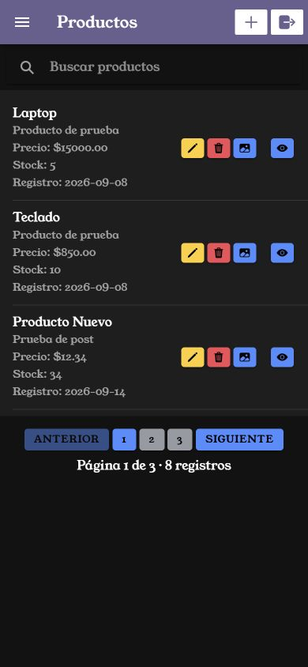
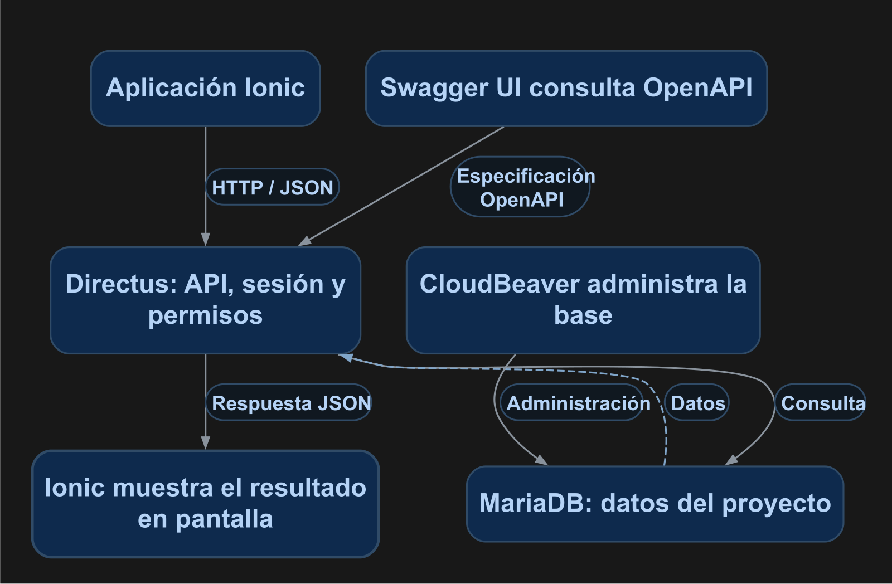

# Desarrollo de Aplicaciones Móviles con Ionic

Entorno del curso con Ionic, Angular, Directus y MariaDB dentro de Docker. Los manuales reúnen la implementación, el código completo, las comprobaciones y la explicación del flujo. El registro de validación indica qué pruebas se ejecutaron y cuáles están pendientes.

La figura 1 muestra la aplicación Ionic utilizada en las prácticas.

<p align="center">
  <br>
  <em>Figura 1. Aplicación ejecutada con los datos de práctica.</em>
</p>

## Entorno

| Componente | Función |
| --- | --- |
| Ionic 8 y Angular 20 | Interfaz y navegación |
| Capacitor 8 | Integración de la aplicación con plataformas móviles |
| Directus | API, autenticación, archivos y permisos |
| MariaDB | Persistencia de datos |
| CloudBeaver | Administración de la base |
| Swagger UI | Consulta de la especificación OpenAPI |

`mobile/package.json` contiene las versiones del proyecto. El entorno comprobado utiliza Ionic 8.8.17, Angular 20.3.30 y Capacitor 8.5.0.

La figura 2 resume la comunicación entre la aplicación, la API y la base de datos.

<p align="center">
  <br>
  <em>Figura 2. Petición de Ionic, consulta de datos y respuesta a la aplicación.</em>
</p>

## Preparar el proyecto

Instala Docker Desktop, Git y tu editor. Los comandos de la aplicación se ejecutan dentro del servicio `mobile`.

```powershell
git clone https://github.com/JonathanDeLaCruz/docker_moviles.git
cd docker_moviles
```

**Antes del primer arranque de una instalación limpia**, revisa `api.environment` en `docker-compose.yml`: el SQL inicial crea la base `moviles`, por lo que configura `DB_DATABASE: "moviles"`, `DB_USER: "moviles"` y `DB_PASSWORD: "moviles123"`. Define también un correo administrativo válido, su contraseña inicial y el secreto del proyecto. La [configuración de Directus](docs/correcciones/01_cambio_fastapi_directus.md) reúne el bloque completo.

Si ya tienes Directus configurado con una base existente, conserva esa conexión y la cuenta que utilizas. La configuración actual del servicio apunta a `especialidades`; cambiar variables de creación del administrador no cambia la contraseña de una cuenta existente.

```powershell
docker compose up -d --build
docker compose ps
```

La inicialización SQL se ejecuta cuando se crea por primera vez el volumen de MariaDB. El repositorio ya contiene el proyecto de Ionic y su marcador `mobile/.ionic-setup-complete`.

## Servicios

| Servicio | Dirección |
| --- | --- |
| Ionic | [localhost:8100](http://localhost:8100) |
| Directus | [localhost:8000/admin](http://localhost:8000/admin) |
| OpenAPI | [Especificación de la API](http://localhost:8000/server/specs/oas) |
| Swagger UI | [localhost:8081](http://localhost:8081) |
| CloudBeaver | [localhost:8978](http://localhost:8978) |

Entre contenedores, MariaDB se localiza mediante `db:3306`. En una instalación nueva, CloudBeaver utiliza la base `moviles` y las credenciales definidas en el servicio `db`. Directus utiliza los valores de conexión de su servicio `api`.

## Manuales

Cada manual conserva la implementación en el **punto 3**. El punto 2 presenta los métodos; el 4 reúne el código completo; el 5 describe las comprobaciones y el 6 explica el flujo. En creación y actualización, elige la variante mediante página o mediante modal.

| Manual | Práctica |
| --- | --- |
| 01 | [Listado de productos](docs/manuales/01_listado_elementos.md) |
| 02 | [Detalle de un producto](docs/manuales/02_detalle_elemento.md) |
| 03 | [Crear mediante página](docs/manuales/03_crear_elemento_pagina.md) |
| 03 | [Crear mediante modal](docs/manuales/03_crear_elemento_modal.md) |
| 04 | [Actualizar mediante página](docs/manuales/04_actualizar_elemento_pagina.md) |
| 04 | [Actualizar mediante modal](docs/manuales/04_actualizar_elemento_modal.md) |
| 05 | [Eliminar productos](docs/manuales/05_eliminar_elemento.md) |
| 06 | [Fuentes y estilos](docs/manuales/06_fuentes_estilos.md) |
| 07 | [Componentes reutilizables](docs/manuales/07_componentes.md) |
| 08 | [Paginación](docs/manuales/08_paginacion.md) |
| 09 | [Menú lateral](docs/manuales/09_menu.md) |
| 10 | [Búsqueda](docs/manuales/10_busqueda.md) |
| 11 | [Servicios](docs/manuales/11_servicios.md) |
| 12 | [Inicio de sesión y registro](docs/manuales/12_login_registro.md) |
| 13 | [Guardia de autenticación](docs/manuales/13_guard.md) |
| 14 | [Categorías en creación, actualización y detalle](docs/manuales/14_muchos_muchos.md) |
| 15 | [Subida de imágenes](docs/manuales/15_subir_archivos.md) |
| 16 | [Imagen en el formulario y el detalle](docs/manuales/16_imagen_formulario_detalle.md) |
| 17 | [Campos de formulario y valores agregados al guardar](docs/manuales/17_campos_formularios.md) |

Al generar una página o componente, agrega manualmente `standalone: false` en `@Component` para declararlo en su NgModule. Cada práctica especifica los módulos que utiliza.

Las capturas y los diagramas se incluyen como imágenes centradas con pie de figura en Markdown. Los flujos muestran el recorrido principal hacia abajo, con ramificaciones, decisiones y retornos. Se incluyen como PNG para que su visualización no dependa de que el visor ejecute Mermaid. En GitHub puedes abrir cada diagrama para ampliarlo. Los recursos de ejemplo se encuentran en `docs/manuales/recursos/`. El [registro de validación](docs/VALIDACION.md) detalla las comprobaciones ejecutadas y sus límites.

### Estado de las pruebas

- **09–11, 13 y 14:** pruebas realizadas con la aplicación y la API del entorno del curso.
- **12:** acceso y validaciones comprobados; registro completo pendiente de habilitar el registro y configurar el correo de verificación.
- **17:** controles de formulario, ENUM, catálogo con llave foránea, valores automáticos, guardado y consulta comprobados en Ionic y Directus.
- **15:** subida, asociación y recuperación de imágenes comprobadas con una cuenta de práctica y archivos compartidos.

Consulta el [registro de validación](docs/VALIDACION.md) para conocer el alcance de cada comprobación.

## Configuración del entorno

- [Directus y MariaDB](docs/correcciones/01_cambio_fastapi_directus.md).
- [Ionic y detección de cambios](docs/correcciones/02_correccion_ionic.md).
- [Swagger UI](docs/correcciones/03_agregar_swagger_ui.md).

## Comandos de trabajo

```powershell
docker compose up -d
docker compose logs --tail 60 mobile
docker compose exec mobile npx ng build --configuration development
docker compose stop
```

## Autor

DSC. Jonathan De La Cruz Alvarez.

## Licencia

El proyecto se distribuye con licencia MIT. La fuente Young Serif conserva su [licencia propia](docs/manuales/recursos/YoungSerif-OFL.txt).
