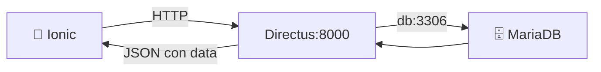

# Configurar Directus en Docker

Este documento reúne la configuración de Directus y su conexión con MariaDB para el entorno del curso.

## 1. Antes de comenzar

El servicio de base de datos debe estar disponible. En una instalación nueva, `database/init/01_database.sql` crea las tablas en `moviles`. Si ya tienes una base y una cuenta de Directus configuradas, conserva los valores de conexión que utilizas.

## 2. Conceptos que utilizarás

`DB_HOST` identifica el servicio de MariaDB dentro de Docker. `DB_DATABASE` selecciona la base; `DB_USER` y `DB_PASSWORD` deben corresponder a un usuario con acceso a ella. Las variables `ADMIN_EMAIL` y `ADMIN_PASSWORD` crean el administrador al inicializar Directus; una cuenta existente conserva sus credenciales.

## 3. Implementación

1. En `docker-compose.yml`, revisa el servicio `api` y los volúmenes de la sección 4.
2. Para una instalación limpia, utiliza `DB_DATABASE: "moviles"`, `DB_USER: "moviles"` y `DB_PASSWORD: "moviles123"`, en correspondencia con el servicio `db` y el SQL inicial.
3. Antes del primer arranque, define un correo válido para `ADMIN_EMAIL`, la contraseña inicial y el secreto del proyecto. El correo de ejemplo `admin@ejemplo.com` tiene un formato válido.
4. Aplica la configuración con `docker compose up -d api`. Si cambiaste variables de un contenedor que ya existe, utiliza `docker compose up -d --force-recreate api`.
5. Abre `http://localhost:8000/admin` e inicia sesión con la cuenta que se creó al inicializar ese entorno.

## 4. Configuración de referencia para una instalación nueva

El siguiente bloque pertenece a `services`; conserva el resto del archivo Compose:

```yaml
api:
    image: directus/directus:latest
    container_name: moviles-api
    restart: unless-stopped

    ports:
      - "8000:8055"

    environment:
      SECRET: "moviles-directus-clave-2026"

      ADMIN_EMAIL: "admin@ejemplo.com"
      ADMIN_PASSWORD: "admin123"

      DB_CLIENT: "mysql"
      DB_HOST: "db"
      DB_PORT: "3306"
      DB_DATABASE: "moviles"
      DB_USER: "moviles"
      DB_PASSWORD: "moviles123"

      CORS_ENABLED: "true"
      CORS_ORIGIN: "true"
      CORS_METHODS: "GET,POST,PATCH,DELETE,OPTIONS"
      CORS_ALLOWED_HEADERS: "Content-Type,Authorization"
      CORS_EXPOSED_HEADERS: "Content-Range"
      CORS_CREDENTIALS: "true"

    volumes:
      - directus_uploads:/directus/uploads
      - directus_extensions:/directus/extensions

    depends_on:
      db:
        condition: service_healthy

    networks:
      - moviles
```

En `volumes`, conserva los existentes y agrega:

```yaml
directus_uploads:
directus_extensions:
```

## 5. Comprobar el resultado

Ejecuta `docker compose config --quiet` y `docker compose ps`. Directus debe aparecer en ejecución. Abre su panel, comprueba la colección `productos` y sus campos. Una vez configurado el permiso de lectura de la práctica, `http://localhost:8000/items/productos` debe devolver un objeto JSON con `data`.

## 6. Flujo de la conexión



La conexión entre contenedores utiliza el nombre `db` y el puerto interno 3306. El navegador accede al puerto 8000 publicado por Directus. Sus volúmenes conservan archivos y extensiones. Las tablas del curso residen en la base seleccionada por `DB_DATABASE`.
