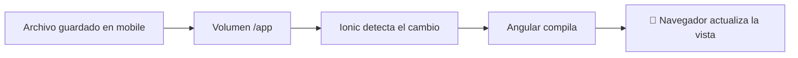

# Ejecutar Ionic y detectar cambios dentro de Docker

El servicio `mobile` ejecuta Ionic 8, Angular 20 y Capacitor 8, y detecta los cambios guardados en el proyecto.

## 1. Antes de comenzar

Utiliza el proyecto existente en `mobile/` y Docker Desktop en ejecución. El [Dockerfile adjunto](Dockerfile) coincide con el de `mobile/Dockerfile`. Conserva los archivos de tu aplicación y su marcador `.ionic-setup-complete`.

## 2. Conceptos que utilizarás

El volumen `./mobile:/app` comparte los archivos del proyecto con el contenedor. El volumen `ionic_node_modules` conserva sus dependencias. Las opciones de sondeo permiten detectar cambios en los archivos compartidos desde Windows.

## 3. Implementación

1. Verifica las variables de la sección 4 en el servicio `mobile`.
2. Si actualizaste su Dockerfile, ejecuta `docker compose build mobile`.
3. Inicia el servicio con `docker compose up -d mobile`.
4. Abre `http://localhost:8100`.
5. Al generar una página o un componente, abre su archivo TypeScript y agrega manualmente `standalone: false` dentro de `@Component`. Si ya está en falso, conserva una sola propiedad. Los servicios y guardias no llevan ese decorador.

## 4. Configuración de referencia

En el servicio `mobile`, conserva:

```yaml
ports:
  - "8100:8100"
volumes:
  - ./mobile:/app
  - ionic_node_modules:/app/node_modules
environment:
  CHOKIDAR_USEPOLLING: "true"
  WATCHPACK_POLLING: "true"
```

El Dockerfile inicia Ionic con `--poll=1000`. Un decorador de página del curso incluye:

```typescript
@Component({
  selector: 'app-productos-list',
  templateUrl: './productos-list.page.html',
  styleUrls: ['./productos-list.page.scss'],
  standalone: false
})
```

## 5. Comprobar el resultado

Cambia temporalmente el título de una página existente y guarda. Ionic debe reconstruir y mostrar el texto actualizado en el navegador; después restaura el título. Puedes consultar `docker compose logs --tail 60 mobile` y compilar con `docker compose exec mobile npx ng build --configuration development`.

## 6. Flujo de actualización



El contenedor recibe los archivos compartidos y vuelve a compilar la aplicación. El marcador de preparación evita repetir la creación inicial del proyecto. El módulo de cada página declara sus componentes y reúne los módulos que necesita su plantilla.
