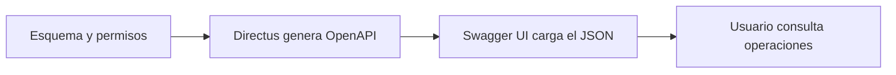

# Consultar la API de Directus con Swagger UI

Swagger UI carga la especificación OpenAPI del proyecto para mostrar sus operaciones y parámetros.

## 1. Antes de comenzar

Necesitas Directus funcionando en `http://localhost:8000`. La configuración del proyecto ya incluye el servicio `swagger`.

## 2. Conceptos que utilizarás

OpenAPI describe las operaciones disponibles. Directus genera la especificación según el esquema y los permisos de quien la consulta. `SWAGGER_JSON_URL` indica la dirección que cargará el navegador; CORS permite consultarla desde el puerto 8081.

## 3. Implementación

1. Conserva el servicio de la sección 4 en `docker-compose.yml`.
2. En `api.environment`, comprueba `CORS_ENABLED: "true"` y `CORS_ORIGIN: "true"`, junto a los métodos y encabezados que usa la práctica.
3. Inicia Swagger UI con `docker compose up -d swagger`. Si modificaste las variables de Directus, aplica ese cambio con `docker compose up -d --force-recreate api`.
4. Abre `http://localhost:8081`.

## 4. Configuración completa del servicio

Agrega este bloque dentro de `services`, conservando los demás servicios:

```yaml
swagger:
    image: swaggerapi/swagger-ui:latest
    container_name: moviles-swagger
    restart: unless-stopped

    ports:
      - "8081:8080"

    environment:
      SWAGGER_JSON_URL: "http://localhost:8000/server/specs/oas"

    depends_on:
      - api

    networks:
      - moviles


volumes:
  mariadb_data:
  ionic_node_modules:
  cloudbeaver_data:
  directus_uploads:
  directus_extensions:


networks:
  moviles:
    driver: bridg
```

## 5. Comprobar el resultado

Primero abre `http://localhost:8000/server/specs/oas`: debe entregar un JSON con `openapi` y `paths`. Después abre Swagger UI y localiza `/items/productos`. Ejecuta una consulta de lectura para ver su respuesta. Las operaciones disponibles corresponden a los permisos de la cuenta que realiza la consulta.

## 6. Flujo de documentación



El navegador obtiene la definición desde Directus y Swagger UI la presenta como documentación interactiva. Las peticiones que ejecutes desde esa interfaz se envían a la API del proyecto. Al cambiar colecciones o permisos, la especificación generada refleja ese contexto.
