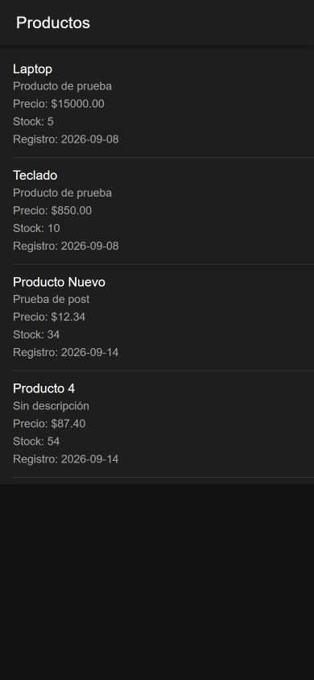
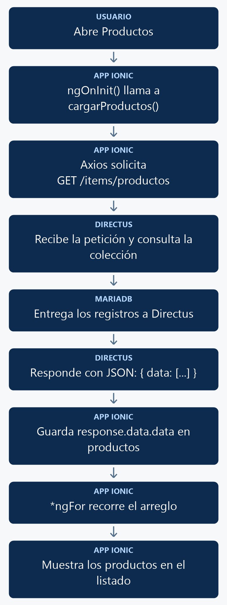

# Listado de elementos con Ionic

En esta práctica crearás una página que consulta productos en Directus y los muestra en Ionic. Trabajarás con Angular, TypeScript, Axios y NgModules.

**Resultado esperado:** al abrir `http://localhost:8100/productos-list`, verás el nombre, descripción, precio, stock y fecha de registro de cada producto, como se muestra en la figura 1.

<p align="center">
  <br>
  <em>Figura 1. Listado de productos obtenido desde Directus.</em>
</p>

Captura de la aplicación ejecutando el código de esta práctica en el navegador con tamaño de pantalla móvil. Los productos y las fechas corresponden a los registros disponibles al realizar la prueba; en tu colección pueden ser diferentes. La captura utiliza el tema oscuro del entorno de prueba.

## 1. Antes de comenzar

Necesitas el entorno Docker del proyecto en ejecución, la colección `productos` disponible en Directus y algunos registros de prueba. Esta práctica se realiza desde el navegador de la computadora donde se ejecuta Docker.

- Ejecuta los comandos desde la carpeta del repositorio que contiene `docker-compose.yml`.
- Las rutas `src/...` de este manual son relativas al proyecto Ionic: en este repositorio corresponden a `mobile/src/...`.
- El proyecto utiliza **NgModules**. Después de crear cada página o componente, debes configurar manualmente `standalone: false` en su decorador `@Component`.
- Ionic debe estar disponible en `http://localhost:8100` y Directus en `http://localhost:8000`.

Durante el curso se utilizará esta nomenclatura:

| Operación | Nombre de la página | Ejemplo | Uso |
| --- | --- | --- | --- |
| `GET` del listado | `tabla-list` | `productos-list` | Consultar varios registros. |
| `GET` con ID | `tabla-view` | `productos-view` | Consultar un registro. |
| `POST` y `PATCH` | `tabla-form` | `productos-form` | Crear y actualizar registros. |

**En esta práctica solo implementarás el listado.**

## 2. Conceptos y métodos que utilizarás

Antes de escribir el código, identifica para qué sirve cada elemento:

| Elemento | Cómo se utiliza | Para qué sirve |
| --- | --- | --- |
| `ngOnInit()` | `ngOnInit(): void { this.cargarProductos(); }` | Angular lo ejecuta al inicializar el componente; aquí iniciaremos la consulta. |
| `cargarProductos()` | `this.cargarProductos()` | Método que crearás para consultar la API y guardar los productos. |
| `axios.get()` | `await axios.get(url)` | Realiza una petición HTTP de lectura y permite obtener su respuesta. |
| `async` / `await` | `async cargarProductos()` y `await axios.get(...)` | Permiten esperar la respuesta dentro del método sin bloquear la interfaz. |
| `interface Producto` | `productos: Producto[] = []` | Describe los campos y tipos de cada producto; `Producto[]` representa un arreglo de esos objetos. |
| `environment.apiUrl` | `` `${environment.apiUrl}/items/productos` `` | Construye la dirección de la consulta a partir de una URL base. |
| `*ngFor` | `*ngFor="let producto of productos"` | Repite un elemento HTML por cada producto del arreglo. |
| Interpolación y punto | `{{ producto.nombre }}` | Accede a una propiedad del objeto y muestra su valor en el HTML. |
| Pipe `date` | `{{ producto.fecha_registro \| date:'yyyy-MM-dd' }}` | Presenta la fecha con el formato indicado. |

Por ejemplo, `await axios.get('http://localhost:8000/items/productos')` solicita los productos. En la implementación utilizarás `environment.apiUrl` para centralizar la dirección del servidor.

## 3. Implementación paso a paso

Sigue los pasos en orden. Primero prepararás el proyecto y la API; después escribirás el TypeScript y el HTML. En la sección 4 encontrarás los archivos completos para comparar el resultado.

### Paso 1. Crear la página e instalar Axios

Ejecuta en la terminal, desde la carpeta que contiene `docker-compose.yml`:

```powershell
docker compose exec mobile ionic g page productos-list
docker compose exec mobile npm install axios
```

Si la página ya existe, continúa con ella sin volver a generarla. Instala Axios solo si todavía no está agregado al proyecto.

El generador creará los archivos de la página en `mobile/src/app/productos-list/`, incluidos su módulo, rutas, TypeScript, HTML, estilos y archivo de prueba. Axios se instalará dentro del contenedor `mobile` y actualizará `mobile/package.json` y `mobile/package-lock.json`.

**Después de generar la página**, abre `mobile/src/app/productos-list/productos-list.page.ts` y agrega `standalone: false` dentro del objeto de `@Component`, como se muestra a continuación. Si aparece `standalone: true`, cámbialo a `false`; si ya está en `false`, consérvalo sin duplicarlo:

```typescript
@Component({
  selector: 'app-productos-list',
  templateUrl: './productos-list.page.html',
  styleUrls: ['./productos-list.page.scss'],
  standalone: false,
})
```

Repite esta configuración cada vez que crees una página o un componente durante el curso: se declararán dentro de módulos de Angular.

### Paso 2. Configurar la URL de la API

Abre `mobile/src/environments/environment.ts`. Dentro del objeto `environment`, agrega o actualiza `apiUrl` y conserva `production: false`:

```typescript
export const environment = {
  production: false,
  apiUrl: 'http://localhost:8000'
};
```

Después abre `mobile/src/environments/environment.prod.ts`. Agrega la misma propiedad, conservando `production: true`:

```typescript
export const environment = {
  production: true,
  apiUrl: 'https://api.midominio.com'
};
```

`https://api.midominio.com` es un dominio de ejemplo: sustitúyelo por el dominio real cuando publiques Directus. Para esta práctica en desarrollo se utiliza el primer archivo.

**Guarda únicamente la URL base en `apiUrl`, sin `/items/productos`.** Si los archivos tienen otras propiedades, consérvalas.

### Paso 3. Comprobar el acceso a Directus y habilitar CORS

Abre `http://localhost:8000/items/productos` en el navegador. La respuesta debe contener un arreglo `data`, con una estructura similar a esta:

```json
{
  "data": [
    {
      "id": 1,
      "nombre": "Laptop",
      "descripcion": "Producto de prueba",
      "precio": "15000.00",
      "stock": 5,
      "fecha_registro": "2026-08-25T21:40:56.000Z"
    }
  ]
}
```

Comprueba que la política usada en estas prácticas permita la lectura de `productos`. Si recibes `403 Forbidden`, ajusta ese permiso antes de continuar. Para ver filas en pantalla, la colección debe contener registros.

Abre `docker-compose.yml`. Dentro del servicio `api`, localiza su bloque `environment` y agrega o actualiza estas variables. **Conserva las variables de base de datos, administrador y demás configuración existente; no crees otro bloque `environment`.**

```yaml
    CORS_ENABLED: "true"
    CORS_ORIGIN: "true"
    CORS_METHODS: "GET,POST,PATCH,DELETE,OPTIONS"
    CORS_ALLOWED_HEADERS: "Content-Type,Authorization"
    CORS_EXPOSED_HEADERS: "Content-Range"
    CORS_CREDENTIALS: "true"
```

Las variables deben tener la misma indentación que las demás entradas de `environment`. Esta es su ubicación; el siguiente esquema solo muestra dónde insertarlas, no reemplaza el servicio completo:

```yaml
services:
  api:
    environment:
      # Aquí se conservan las variables existentes.
      CORS_ENABLED: "true"
      CORS_ORIGIN: "true"
      CORS_METHODS: "GET,POST,PATCH,DELETE,OPTIONS"
      CORS_ALLOWED_HEADERS: "Content-Type,Authorization"
      CORS_EXPOSED_HEADERS: "Content-Range"
      CORS_CREDENTIALS: "true"
```

Si modificaste estas variables, aplica los cambios ejecutando:

```powershell
docker compose up -d --force-recreate api
```

Este comando recrea el contenedor de Directus para cargar la configuración actualizada y conserva la base de datos. Puedes revisar su arranque con `docker compose logs -f api`; presiona `Ctrl+C` para salir de la consulta de logs.

### Paso 4. Preparar el TypeScript de la página

Abre `mobile/src/app/productos-list/productos-list.page.ts`.

**Al inicio del archivo**, deja estas importaciones para el listado básico:

```typescript
import { Component, OnInit } from '@angular/core';
import axios from 'axios';
import { environment } from '../../environments/environment';
```

**Después de las importaciones y antes de `@Component`**, agrega la interfaz:

```typescript
interface Producto {
  id: number;
  nombre: string;
  descripcion: string;
  precio: string;
  stock: number;
  fecha_registro: string;
}
```

**Dentro de la clase `ProductosListPage`**, agrega el arreglo y el método de consulta. Sustituye el `ngOnInit()` generado por el que se muestra aquí; no declares dos métodos con el mismo nombre:

```typescript
productos: Producto[] = [];

ngOnInit(): void {
  this.cargarProductos();
}

async cargarProductos(): Promise<void> {
  try {
    const response = await axios.get<{ data: Producto[] }>(
      `${environment.apiUrl}/items/productos`
    );

    this.productos = response.data.data;
  } catch (error) {
    console.error('Error al cargar los productos:', error);
  }
}
```

Conserva el decorador `@Component`, `standalone: false`, el constructor y la declaración `export class ProductosListPage implements OnInit`. El arreglo empieza vacío y se llena cuando Directus responde.

### Paso 5. Escribir la vista HTML

Abre `mobile/src/app/productos-list/productos-list.page.html` y **reemplaza todo su contenido** por:

```html
<ion-header>
  <ion-toolbar>
    <ion-title>Productos</ion-title>
  </ion-toolbar>
</ion-header>

<ion-content>
  <ion-list>
    <ion-item *ngFor="let producto of productos">
      <ion-label class="ion-text-wrap">
        <h2>{{ producto.nombre }}</h2>
        <p>{{ producto.descripcion }}</p>
        <p>Precio: ${{ producto.precio }}</p>
        <p>Stock: {{ producto.stock }}</p>
        <p>Registro: {{ producto.fecha_registro | date:'yyyy-MM-dd' }}</p>
      </ion-label>
    </ion-item>
  </ion-list>
</ion-content>
```

`*ngFor` crea una fila por producto; las expresiones `{{ }}` muestran sus propiedades. La fecha se presenta con año, mes y día.

### Paso 6. Revisar la ruta y el módulo generados

En `mobile/src/app/app-routing.module.ts`, comprueba que el arreglo `routes` incluya esta entrada. El generador normalmente la agrega; si ya existe, no la dupliques:

```typescript
{
  path: 'productos-list',
  loadChildren: () => import('./productos-list/productos-list.module')
    .then(m => m.ProductosListPageModule)
}
```

Si necesitas agregarla, insértala dentro de `routes`, separándola de las otras entradas con una coma. Conserva las rutas existentes.

En `productos-list.module.ts`, conserva los imports generados de `CommonModule`, `FormsModule`, `IonicModule` y `ProductosListPageRoutingModule`, y la declaración de `ProductosListPage`. El módulo de rutas de la página debe conservar `path: ''` y `component: ProductosListPage`.

## 4. Así debe quedar el código completo

Estos son los archivos completos de entorno, TypeScript y HTML para el **listado básico de esta práctica**. Compáralos con lo que acabas de escribir. Si tus archivos de entorno tienen otras propiedades, también debes conservarlas.

### `mobile/src/environments/environment.ts`

```typescript
export const environment = {
  production: false,
  apiUrl: 'http://localhost:8000'
};
```

### `mobile/src/environments/environment.prod.ts`

```typescript
export const environment = {
  production: true,
  apiUrl: 'https://api.midominio.com'
};
```

### `mobile/src/app/productos-list/productos-list.page.ts`

```typescript
import { Component, OnInit } from '@angular/core';
import axios from 'axios';
import { environment } from '../../environments/environment';

interface Producto {
  id: number;
  nombre: string;
  descripcion: string;
  precio: string;
  stock: number;
  fecha_registro: string;
}

@Component({
  selector: 'app-productos-list',
  templateUrl: './productos-list.page.html',
  styleUrls: ['./productos-list.page.scss'],
  standalone: false,
})
export class ProductosListPage implements OnInit {
  productos: Producto[] = [];

  constructor() {}

  ngOnInit(): void {
    this.cargarProductos();
  }

  async cargarProductos(): Promise<void> {
    try {
      const response = await axios.get<{ data: Producto[] }>(
        `${environment.apiUrl}/items/productos`
      );

      this.productos = response.data.data;
    } catch (error) {
      console.error('Error al cargar los productos:', error);
    }
  }
}
```

### `mobile/src/app/productos-list/productos-list.page.html`

```html
<ion-header>
  <ion-toolbar>
    <ion-title>Productos</ion-title>
  </ion-toolbar>
</ion-header>

<ion-content>
  <ion-list>
    <ion-item *ngFor="let producto of productos">
      <ion-label class="ion-text-wrap">
        <h2>{{ producto.nombre }}</h2>
        <p>{{ producto.descripcion }}</p>
        <p>Precio: ${{ producto.precio }}</p>
        <p>Stock: {{ producto.stock }}</p>
        <p>Registro: {{ producto.fecha_registro | date:'yyyy-MM-dd' }}</p>
      </ion-label>
    </ion-item>
  </ion-list>
</ion-content>
```

La configuración de CORS y la entrada de ruta son cambios dentro de archivos compartidos: aplica únicamente los bloques indicados en los pasos 3 y 6. Los módulos generados y el archivo SCSS no requieren cambios para este listado.

## 5. Comprobar que funciona

1. Guarda los archivos y espera a que Ionic termine de compilar.
2. Abre `http://localhost:8100/productos-list`.
3. Comprueba que aparezca el título **Productos** y una fila por cada registro devuelto por la API.
4. Compara los datos de una fila con la respuesta de `http://localhost:8000/items/productos`.
5. Verifica que cada fila muestre nombre, descripción, precio, stock y una fecha con formato `yyyy-MM-dd`.

Por ejemplo, con el registro de prueba anterior verás:

```text
Productos

Laptop
Producto de prueba
Precio: $15000.00
Stock: 5
Registro: 2026-08-25
```

Los valores dependerán de los registros de tu colección. Si la respuesta es `{"data": []}`, el listado no tendrá filas.

## 6. Explicación detallada del flujo

### De la página a la base de datos y de regreso

El siguiente diagrama muestra la consulta completa, incluida la respuesta y su presentación en pantalla:

La figura 2 muestra el recorrido de arriba hacia abajo.

<p align="center">
  <br>
  <em>Figura 2. Consultar y mostrar productos.</em>
</p>

Al inicializar el componente, Angular ejecuta `ngOnInit()`. Este llama a `cargarProductos()`, que solicita la colección mediante Axios. Directus consulta MariaDB y responde con un JSON; la página guarda el arreglo recibido y Angular actualiza la vista.

`ngOnInit()` corresponde a la inicialización del componente. En prácticas posteriores, cuando sea necesario actualizar el listado al regresar de otra página, se ajustará el ciclo de carga.

### Cómo se elige la URL del servidor

Las páginas siempre importan el mismo archivo:

```typescript
import { environment } from '../../environments/environment';
```

En desarrollo, `environment.apiUrl` vale `http://localhost:8000`. Al añadir `/items/productos`, la dirección final es `http://localhost:8000/items/productos`.

El proyecto ya configura en `mobile/angular.json` el reemplazo de entornos para la compilación de producción:

```json
"fileReplacements": [
  {
    "replace": "src/environments/environment.ts",
    "with": "src/environments/environment.prod.ts"
  }
]
```

Este fragmento describe una configuración existente; no debes pegarlo como un archivo JSON independiente. El servidor de desarrollo usa la configuración `development`; la compilación de producción aplica el reemplazo anterior. Por eso puedes cambiar la URL base sin editar las páginas ni sus importaciones.

**Al probar en un dispositivo físico**, `localhost` apunta al dispositivo. Para acceder al Docker de tu computadora desde ese dispositivo, utiliza en `environment.ts` una IP de la computadora que sea accesible desde la red, por ejemplo `http://192.168.1.50:8000`, sustituyéndola por la IP real. Cuando publiques la API, configura su dominio real en `environment.prod.ts`.

### Por qué se configura CORS

`http://localhost:8100` y `http://localhost:8000` son orígenes distintos porque usan puertos diferentes. Poder abrir la API directamente no significa que el navegador permita consultarla desde Ionic. CORS permite que Directus autorice esa comunicación.

| Variable | Función en esta configuración |
| --- | --- |
| `CORS_ENABLED` | Habilita CORS. |
| `CORS_ORIGIN` | Permite reflejar el origen de la petición durante el desarrollo. |
| `CORS_METHODS` | Establece los métodos HTTP permitidos en las peticiones entre orígenes. |
| `CORS_ALLOWED_HEADERS` | Permite encabezados como `Content-Type` y `Authorization`. |
| `CORS_EXPOSED_HEADERS` | Permite leer `Content-Range` desde el navegador. |
| `CORS_CREDENTIALS` | Autoriza el uso de credenciales en las peticiones entre orígenes cuando corresponda. |

Esta configuración se utiliza en el entorno de prácticas. Los permisos de lectura de la colección se configuran por separado en Directus. Recrear el contenedor `api` hace que Directus cargue las variables actualizadas.

### Qué aportan la interfaz y el arreglo

`interface Producto` describe la estructura que TypeScript espera recibir. `id` y `stock` son números; `nombre` y `descripcion` son texto. En la respuesta de ejemplo, `precio` llega como una cadena (`"15000.00"`), por eso se declara `string`. La fecha también llega como texto en formato ISO.

La declaración `productos: Producto[] = []` crea un arreglo inicialmente vacío y especifica el tipo de sus elementos. Mientras llega la respuesta, `*ngFor` no tiene filas que mostrar. Después de la asignación, recorre los productos recibidos.

El tipado ayuda a detectar usos incorrectos durante el desarrollo. La interfaz no transforma ni valida por sí sola el JSON recibido en ejecución.

### Cómo funciona el método asíncrono

`async` permite utilizar `await` dentro de `cargarProductos()`. `await` espera a que se resuelva la petición antes de asignar los datos al arreglo. `Promise<void>` indica que el método devuelve una promesa cuyo resultado no contiene un valor.

El genérico `axios.get<{ data: Producto[] }>(...)` indica a TypeScript que esperamos un cuerpo de respuesta con una propiedad `data` que contiene productos. [Axios](https://axios-http.com/es/) es el cliente HTTP utilizado para realizar esta consulta.

La consulta y la asignación están dentro de `try`. Si la petición falla, `catch` registra el error con `console.error()` en la consola del navegador. Este ejemplo básico no muestra una alerta de error en pantalla.

### Por qué se utiliza `response.data.data`

Hay dos propiedades llamadas `data`, cada una en un nivel distinto:

| Expresión | Contenido |
| --- | --- |
| `response` | Respuesta que entrega Axios. |
| `response.data` | Cuerpo JSON enviado por Directus: un objeto con la propiedad `data`. |
| `response.data.data` | Arreglo de productos que viene dentro de ese objeto. |

Por eso la asignación es:

```typescript
this.productos = response.data.data;
```

El primer `.data` accede al cuerpo HTTP; el segundo accede al arreglo que Directus incluyó en ese cuerpo.

### Cómo se convierte el arreglo en filas

La directiva `*ngFor="let producto of productos"` repite el `ion-item` por cada objeto del arreglo. En cada repetición, `producto` representa el registro actual: por ejemplo, primero una Laptop y después un Teclado si la API devuelve ambos.

El operador punto permite acceder a las propiedades: `producto.nombre`, `producto.precio` o `producto.stock`. La interpolación `{{ producto.nombre }}` muestra ese valor dentro del HTML. Los componentes `ion-list`, `ion-item` e `ion-label` organizan la presentación.

Por último, `{{ producto.fecha_registro | date:'yyyy-MM-dd' }}` aplica el pipe `date`: recibe la fecha ISO y la presenta con año, mes y día. El símbolo `|` aplica esa transformación para mostrar el dato sin modificar el valor almacenado en el objeto.
