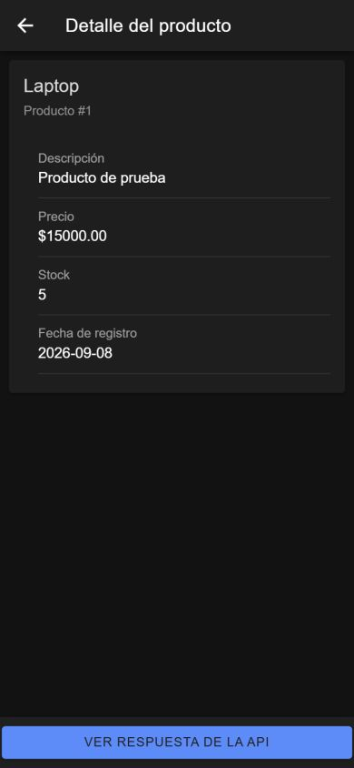
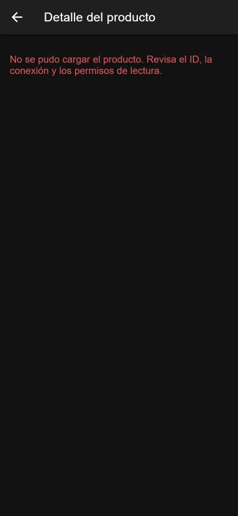
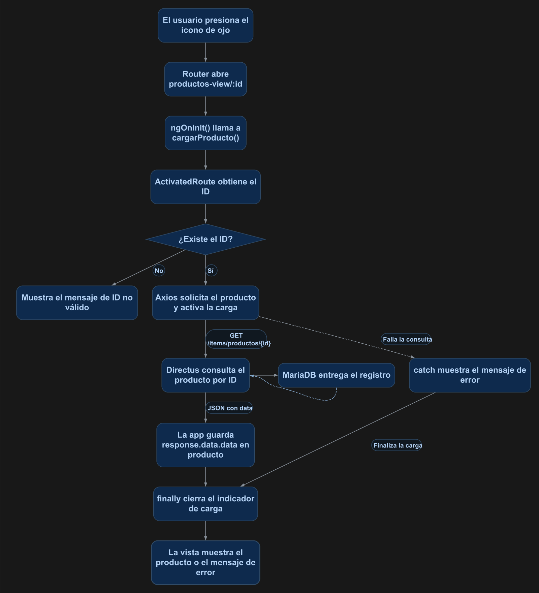

# Detalle de un elemento con Ionic

En esta práctica abrirás un producto desde el listado, consultarás su ID en Directus y mostrarás sus datos en una tarjeta. Mientras se realiza la consulta, la aplicación mostrará un indicador de carga.

**Resultado esperado:** al presionar el icono de **ojo** en un producto, navegarás a `productos-view/{id}`. Verás sus datos y podrás regresar al listado, como se muestra en la figura 1.

<p align="center">
  <br>
  <em>Figura 1. Detalle del producto y botón del ejercicio complementario para consultar su JSON.</em>
</p>

Captura de la aplicación ejecutando el código de esta práctica en el navegador con tamaño de pantalla móvil, incluido el ejercicio complementario. Los datos dependen de tu colección; el tema oscuro corresponde al entorno de prueba.

## 1. Antes de comenzar

Continúa con el [manual 01: listado de elementos](01_listado_elementos.md) terminado y funcionando. Esta práctica reutiliza la colección `productos`, Axios, los archivos `environment` y la configuración de CORS y lectura de Directus.

- Ejecuta los comandos desde la carpeta que contiene `docker-compose.yml`.
- Las rutas `src/...` pertenecen al proyecto Ionic: en este repositorio corresponden a `mobile/src/...`.
- Trabajarás con **NgModules**. Después de crear cada página o componente, configura manualmente `standalone: false` dentro de `@Component`.
- Necesitas al menos un producto existente. Usa su ID en las consultas; los ejemplos utilizan el `1`.

La nomenclatura continúa siendo `tabla-list` para el listado, `tabla-view` para el detalle y `tabla-form` para crear y actualizar. Aquí crearás `productos-view` y modificarás el listado para abrirla.

## 2. Conceptos y métodos que utilizarás

| Elemento | Cómo se utiliza | Para qué sirve |
| --- | --- | --- |
| Parámetro de ruta | `path: 'productos-view/:id'` | Define una dirección que recibe el ID del producto. |
| `[routerLink]` | `[routerLink]="['/productos-view', producto.id]"` | Construye la dirección y navega al detalle del producto seleccionado. |
| `ActivatedRoute` | `this.route.snapshot.paramMap.get('id')` | Lee el ID de la ruta actual como texto; puede devolver `null`. |
| `ngOnInit()` | `this.cargarProducto()` | Inicia la consulta cuando Angular inicializa la página. |
| `LoadingController` | `create()`, `present()` y `dismiss()` | Crea, muestra y cierra el indicador de carga. |
| `axios.get()` | `await axios.get(url)` | Solicita un producto a Directus. |
| `encodeURIComponent()` | `encodeURIComponent(id)` | Prepara el ID para incluirlo en un segmento de la URL. |
| `*ngIf` con alias | `*ngIf="producto as detalle"` | Muestra la tarjeta cuando existe el producto y permite usar el nombre local `detalle`. |
| `ion-back-button` | `defaultHref="/productos-list"` | Regresa por el historial o al listado cuando no hay una página anterior. |
| `(click)` y `window.open()` | `(click)="abrirPagina()"` | Ejecuta un método que abrirá la respuesta de la API en otra pestaña, en el ejercicio complementario. |

La diferencia principal respecto al listado es que ahora guardarás **un objeto**, no un arreglo: `producto: Producto | null = null`. Antes de recibirlo, su valor será `null`.

## 3. Implementación paso a paso

Sigue los pasos en orden. En la sección 4 encontrarás el código completo para comparar el resultado.

### Paso 1. Crear la página y configurar NgModules

Desde la carpeta que contiene `docker-compose.yml`, ejecuta:

```powershell
docker compose exec mobile ionic g page productos-view
```

Si la página ya existe, continúa con ella sin volver a generarla. Se utilizarán los archivos generados dentro de `mobile/src/app/productos-view/`: TypeScript, HTML, módulo, rutas, estilos y prueba.

Abre `mobile/src/app/productos-view/productos-view.page.ts` y agrega manualmente `standalone: false` en `@Component`. Si aparece con valor `true`, cámbialo a `false`; si ya está en `false`, consérvalo sin duplicarlo:

```typescript
@Component({
  selector: 'app-productos-view',
  templateUrl: './productos-view.page.html',
  styleUrls: ['./productos-view.page.scss'],
  standalone: false,
})
```

### Paso 2. Comprobar la consulta de un producto

Abre `http://localhost:8000/items/productos/1`. Si no existe ese ID, utiliza uno del listado. Debes recibir un objeto dentro de `data`, por ejemplo:

```json
{
  "data": {
    "id": 1,
    "nombre": "Laptop",
    "descripcion": "Producto de prueba",
    "precio": "15000.00",
    "stock": 5,
    "fecha_registro": "2026-08-25T21:40:56.000Z"
  }
}
```

Conserva `apiUrl: 'http://localhost:8000'` en `mobile/src/environments/environment.ts`, sin agregar la colección ni el ID a la URL base. La página seguirá importando `environment` desde ese archivo; producción utiliza el reemplazo explicado en el manual 01.

Axios ya debe estar instalado. Solo si todavía falta, ejecuta:

```powershell
docker compose exec mobile npm install axios
```

Esta consulta reutiliza el acceso de lectura sin token y CORS del manual 01. Confirma que el ID exista y que Directus permita leerlo antes de continuar.

### Paso 3. Agregar el ID a la ruta y el botón al listado

Abre `mobile/src/app/app-routing.module.ts`. Dentro del arreglo `routes`, **reemplaza la entrada generada para `productos-view`** por:

```typescript
{
  path: 'productos-view/:id',
  loadChildren: () => import('./productos-view/productos-view.module')
    .then(m => m.ProductosViewPageModule)
}
```

Conserva las demás rutas y separa las entradas con comas. Si existe una ruta comodín `**`, coloca la de detalle antes de ella. Si ya tienes esta entrada con `:id`, no la dupliques.

En `mobile/src/app/productos-view/productos-view-routing.module.ts`, conserva la ruta interna generada con `path: ''` y `component: ProductosViewPage`. No repitas `productos-view/:id` dentro de ese módulo.

Después abre `mobile/src/app/productos-list/productos-list.page.html`. **Dentro del `ion-item` que tiene `*ngFor`, después de `</ion-label>` y antes de `</ion-item>`**, agrega:

```html
<ion-button fill="solid" slot="end" [routerLink]="['/productos-view', producto.id]" aria-label="Ver detalle">
  <ion-icon slot="icon-only" name="eye"></ion-icon>
</ion-button>
```

El icono `eye` representa el detalle. `fill="solid"` establece el fondo sólido del botón y `aria-label="Ver detalle"` conserva un nombre accesible sin mostrar palabras dentro del botón.

Si ya existe ese botón, consérvalo sin duplicarlo. Debe permanecer dentro del recorrido para poder acceder al ID de cada `producto`.

### Paso 4. Preparar el TypeScript del detalle

Abre `mobile/src/app/productos-view/productos-view.page.ts`. Para el detalle de esta práctica, deja estas importaciones al inicio:

```typescript
import { Component, OnInit } from '@angular/core';
import { ActivatedRoute } from '@angular/router';
import { LoadingController } from '@ionic/angular';
import axios from 'axios';
import { environment } from '../../environments/environment';
```

Después de las importaciones y **antes de `@Component`**, agrega la misma interfaz del manual 01:

```typescript
interface Producto {
  id: number;
  nombre: string;
  descripcion: string;
  precio: string;
  stock: number;
  fecha_registro: string;
}
```

Dentro de `ProductosViewPage`, agrega las propiedades y reemplaza el constructor y `ngOnInit()` generados por estos. No declares dos constructores ni dos métodos con el mismo nombre:

```typescript
producto: Producto | null = null;
mensajeError: string = '';

constructor(
  private route: ActivatedRoute,
  private loading: LoadingController
) {}

ngOnInit(): void {
  this.cargarProducto();
}
```

A continuación, **dentro de la misma clase**, agrega el método de consulta:

```typescript
async cargarProducto(): Promise<void> {
  const id = this.route.snapshot.paramMap.get('id');

  this.producto = null;
  this.mensajeError = '';

  if (!id) {
    this.mensajeError = 'No se recibió el ID del producto.';
    return;
  }

  const loading = await this.loading.create({
    message: 'Cargando producto...',
    spinner: 'bubbles',
  });

  await loading.present();

  try {
    const response = await axios.get<{ data: Producto }>(
      `${environment.apiUrl}/items/productos/${encodeURIComponent(id)}`
    );

    this.producto = response.data.data;
  } catch (error) {
    console.error('Error al cargar el producto:', error);
    this.mensajeError = 'No se pudo cargar el producto. Revisa el ID, la conexión y los permisos de lectura.';
  } finally {
    await loading.dismiss();
  }
}
```

El método obtiene el ID, muestra el indicador, consulta el producto y lo guarda. Si la consulta falla, asigna un mensaje; `finally` cierra el indicador en ambos casos. Conserva `export class ProductosViewPage implements OnInit` y el decorador configurado en el paso 1.

### Paso 5. Escribir el HTML del detalle

Abre `mobile/src/app/productos-view/productos-view.page.html` y **reemplaza su contenido** por:

```html
<ion-header>
  <ion-toolbar>
    <ion-buttons slot="start">
      <ion-back-button defaultHref="/productos-list"></ion-back-button>
    </ion-buttons>
    <ion-title>Detalle del producto</ion-title>
  </ion-toolbar>
</ion-header>

<ion-content>
  <ion-text color="danger" *ngIf="mensajeError">
    <p class="ion-padding">{{ mensajeError }}</p>
  </ion-text>

  <ion-card *ngIf="producto as detalle">
    <ion-card-header>
      <ion-card-title>{{ detalle.nombre }}</ion-card-title>
      <ion-card-subtitle>Producto #{{ detalle.id }}</ion-card-subtitle>
    </ion-card-header>

    <ion-card-content>
      <ion-list>
        <ion-item>
          <ion-label class="ion-text-wrap">
            <p>Descripción</p>
            <h2>{{ detalle.descripcion }}</h2>
          </ion-label>
        </ion-item>
        <ion-item>
          <ion-label>
            <p>Precio</p>
            <h2>${{ detalle.precio }}</h2>
          </ion-label>
        </ion-item>
        <ion-item>
          <ion-label>
            <p>Stock</p>
            <h2>{{ detalle.stock }}</h2>
          </ion-label>
        </ion-item>
        <ion-item>
          <ion-label>
            <p>Fecha de registro</p>
            <h2 *ngIf="detalle.fecha_registro; else sinFecha">
              {{ detalle.fecha_registro | date:'yyyy-MM-dd' }}
            </h2>
            <ng-template #sinFecha>
              <h2>Sin fecha de registro</h2>
            </ng-template>
          </ion-label>
        </ion-item>
      </ion-list>
    </ion-card-content>
  </ion-card>
</ion-content>
```

La tarjeta se muestra solo cuando hay un producto. Si falla la consulta, se muestra `mensajeError`. El botón superior permite regresar al listado y la fecha tiene un texto alternativo cuando no hay un valor.

Conserva `CommonModule` e `IonicModule` en `productos-view.module.ts`, y la declaración de `ProductosViewPage`. El módulo de rutas del listado debe conservar su exportación de `RouterModule` para utilizar `[routerLink]`. Los archivos SCSS no requieren cambios.

### Paso 6. Ejercicio complementario: abrir la respuesta de la API

Este ejercicio ya forma parte de la práctica original. El detalle funciona con los pasos anteriores; aquí practicarás `(click)` para ejecutar un método.

En `productos-view.page.ts`, **dentro de `ProductosViewPage`, después de `cargarProducto()` y antes de la llave final de la clase**, agrega:

```typescript
abrirPagina(): void {
  if (!this.producto) {
    return;
  }

  const url = `${environment.apiUrl}/items/productos/${this.producto.id}`;
  window.open(url, '_blank', 'noopener,noreferrer');
}
```

En `productos-view.page.html`, **después de `</ion-content>`**, agrega:

```html
<ion-footer *ngIf="producto">
  <ion-toolbar>
    <ion-button fill="solid" expand="block" (click)="abrirPagina()">
      Ver respuesta de la API
    </ion-button>
  </ion-toolbar>
</ion-footer>
```

Al presionar el botón, se abrirá el JSON del producto mostrado en otra pestaña del navegador.

## 4. Así debe quedar el código completo

Los siguientes archivos corresponden al resultado de esta práctica, **incluido el ejercicio complementario del paso 6**. Si omites ese ejercicio, omite también `abrirPagina()` y el bloque `ion-footer`.

### `mobile/src/app/productos-list/productos-list.page.html`

```html
<ion-header>
  <ion-toolbar>
    <ion-title>Productos</ion-title>
  </ion-toolbar>
</ion-header>

<ion-content>
  <ion-list>
    <ion-item *ngFor="let producto of productos">
      <ion-label class="ion-text-wrap">
        <h2>{{ producto.nombre }}</h2>
        <p>{{ producto.descripcion }}</p>
        <p>Precio: ${{ producto.precio }}</p>
        <p>Stock: {{ producto.stock }}</p>
        <p>Registro: {{ producto.fecha_registro | date:'yyyy-MM-dd' }}</p>
      </ion-label>
      <ion-button fill="solid" slot="end" [routerLink]="['/productos-view', producto.id]" aria-label="Ver detalle">
        <ion-icon slot="icon-only" name="eye"></ion-icon>
      </ion-button>
    </ion-item>
  </ion-list>
</ion-content>
```

### `mobile/src/app/productos-view/productos-view.page.ts`

```typescript
import { Component, OnInit } from '@angular/core';
import { ActivatedRoute } from '@angular/router';
import { LoadingController } from '@ionic/angular';
import axios from 'axios';
import { environment } from '../../environments/environment';

interface Producto {
  id: number;
  nombre: string;
  descripcion: string;
  precio: string;
  stock: number;
  fecha_registro: string;
}

@Component({
  selector: 'app-productos-view',
  templateUrl: './productos-view.page.html',
  styleUrls: ['./productos-view.page.scss'],
  standalone: false,
})
export class ProductosViewPage implements OnInit {

  producto: Producto | null = null;
  mensajeError: string = '';

  constructor(
    private route: ActivatedRoute,
    private loading: LoadingController
  ) {}

  ngOnInit(): void {
    this.cargarProducto();
  }

  async cargarProducto(): Promise<void> {
    const id = this.route.snapshot.paramMap.get('id');

    this.producto = null;
    this.mensajeError = '';

    if (!id) {
      this.mensajeError = 'No se recibió el ID del producto.';
      return;
    }

    const loading = await this.loading.create({
      message: 'Cargando producto...',
      spinner: 'bubbles',
    });

    await loading.present();

    try {
      const response = await axios.get<{ data: Producto }>(
        `${environment.apiUrl}/items/productos/${encodeURIComponent(id)}`
      );

      this.producto = response.data.data;
    } catch (error) {
      console.error('Error al cargar el producto:', error);
      this.mensajeError = 'No se pudo cargar el producto. Revisa el ID, la conexión y los permisos de lectura.';
    } finally {
      await loading.dismiss();
    }
  }

  abrirPagina(): void {
    if (!this.producto) {
      return;
    }

    const url = `${environment.apiUrl}/items/productos/${this.producto.id}`;
    window.open(url, '_blank', 'noopener,noreferrer');
  }
}
```

### `mobile/src/app/productos-view/productos-view.page.html`

```html
<ion-header>
  <ion-toolbar>
    <ion-buttons slot="start">
      <ion-back-button defaultHref="/productos-list"></ion-back-button>
    </ion-buttons>
    <ion-title>Detalle del producto</ion-title>
  </ion-toolbar>
</ion-header>

<ion-content>
  <ion-text color="danger" *ngIf="mensajeError">
    <p class="ion-padding">{{ mensajeError }}</p>
  </ion-text>

  <ion-card *ngIf="producto as detalle">
    <ion-card-header>
      <ion-card-title>{{ detalle.nombre }}</ion-card-title>
      <ion-card-subtitle>Producto #{{ detalle.id }}</ion-card-subtitle>
    </ion-card-header>

    <ion-card-content>
      <ion-list>
        <ion-item>
          <ion-label class="ion-text-wrap">
            <p>Descripción</p>
            <h2>{{ detalle.descripcion }}</h2>
          </ion-label>
        </ion-item>
        <ion-item>
          <ion-label>
            <p>Precio</p>
            <h2>${{ detalle.precio }}</h2>
          </ion-label>
        </ion-item>
        <ion-item>
          <ion-label>
            <p>Stock</p>
            <h2>{{ detalle.stock }}</h2>
          </ion-label>
        </ion-item>
        <ion-item>
          <ion-label>
            <p>Fecha de registro</p>
            <h2 *ngIf="detalle.fecha_registro; else sinFecha">
              {{ detalle.fecha_registro | date:'yyyy-MM-dd' }}
            </h2>
            <ng-template #sinFecha>
              <h2>Sin fecha de registro</h2>
            </ng-template>
          </ion-label>
        </ion-item>
      </ion-list>
    </ion-card-content>
  </ion-card>
</ion-content>

<ion-footer *ngIf="producto">
  <ion-toolbar>
    <ion-button fill="solid" expand="block" (click)="abrirPagina()">
      Ver respuesta de la API
    </ion-button>
  </ion-toolbar>
</ion-footer>
```

La ruta `productos-view/:id` es un cambio dentro de `app-routing.module.ts`: aplica únicamente la entrada del paso 3 y conserva las demás rutas. El TypeScript del listado sigue siendo el del manual 01; sus módulos y los del detalle conservan la configuración indicada en los pasos 3 y 5.

## 5. Comprobar que funciona

1. Guarda los archivos y espera a que Ionic termine de compilar.
2. Abre `http://localhost:8100/productos-list` y presiona el icono de **ojo** en un producto.
3. Comprueba que la dirección incluya su ID, por ejemplo, `/productos-view/1`, y que la tarjeta muestre los datos de ese registro.
4. Presiona el botón de regreso; debe aparecer el listado. Abre otro producto y verifica que se muestren sus datos.
5. Abre directamente una URL de detalle con un ID existente y comprueba que el botón de regreso también permita llegar al listado.
6. Prueba un ID inexistente: debe mostrarse el mensaje de error y cerrarse el indicador de carga.
7. Si agregaste el ejercicio complementario, presiona **Ver respuesta de la API**: debe abrirse el JSON correspondiente al producto mostrado.

El indicador puede aparecer solo un instante si Directus responde rápidamente. Los datos deben coincidir con la consulta `http://localhost:8000/items/productos/{id}`.

Al consultar un ID inexistente, debe aparecer el mensaje de la figura 2, con el indicador ya cerrado y sin mostrar la tarjeta:

<p align="center">
  <br>
  <em>Figura 2. Mensaje de error al consultar un ID inexistente, después de cerrar el indicador de carga.</em>
</p>

Estas pruebas se realizan en el navegador de la computadora donde se ejecuta Docker. Para usar otro dispositivo, ajusta `apiUrl` como se explicó en el manual 01.

## 6. Explicación detallada del flujo

### Del producto seleccionado a su tarjeta de detalle

La app envía el ID del producto seleccionado a la página de detalle. Esta consulta Directus, recibe un objeto y lo muestra en una tarjeta.

La figura 3 muestra el recorrido de arriba hacia abajo.

<p align="center">
  <br>
  <em>Figura 3. Consultar el detalle de un producto.</em>
</p>

### Cómo se envía y se lee el ID

En `[routerLink]="['/productos-view', producto.id]"`, el primer elemento indica la ruta y el segundo aporta el ID del registro de esa fila. Para el producto `1`, Angular navega a `/productos-view/1`. El botón debe estar dentro de `*ngFor`, donde existe la variable `producto`.

Al definir `productos-view/:id`, los dos puntos indican un parámetro. En la dirección del navegador se coloca su valor. `this.route.snapshot.paramMap.get('id')` lee ese parámetro como una cadena: para el ejemplo, `'1'`. El nombre de `get('id')` debe coincidir con el declarado en la ruta.

Si falta el parámetro, `get()` devuelve `null`. La condición `if (!id)` asigna un mensaje y `return` termina el método antes de consultar la API.

`snapshot` lee el estado de la ruta en ese momento. Este ejemplo utiliza el flujo listado → detalle; si posteriormente se permite cambiar de ID reutilizando la misma instancia de la página, habrá que escuchar los cambios de parámetros. La ruta del detalle se declara fuera de las rutas hijas de `tabs`; organizarla en otro módulo no restringe por sí solo quién puede acceder.

### Por qué se conserva la ruta interna vacía

La ruta principal ya define `productos-view/:id` y carga `ProductosViewPageModule`. Dentro del módulo de la página, `path: ''` indica que se debe mostrar `ProductosViewPage` sin añadir otro segmento a la dirección. Repetir allí el nombre del detalle cambiaría la URL necesaria para abrirlo.

### Qué aportan el constructor y las variables

Angular proporciona `ActivatedRoute` y `LoadingController` mediante inyección de dependencias. Las propiedades privadas del constructor permiten utilizarlos como `this.route` y `this.loading` dentro de la clase.

`producto: Producto | null = null` almacena un único objeto. Al inicio todavía no existe una respuesta, por eso contiene `null`. `mensajeError` comienza como una cadena vacía y guarda el texto que se muestra si no se puede obtener el producto. Ambos valores se reinician al comenzar la consulta.

La interfaz mantiene los tipos del manual 01: `id` y `stock` son números; `nombre`, `descripcion`, `precio` y `fecha_registro` son cadenas. El precio del ejemplo llega como `"15000.00"` y la fecha como texto ISO. La interfaz ayuda durante el desarrollo; no valida ni transforma el JSON en ejecución.

### Cómo se controla el indicador de carga

`this.loading.create()` crea el indicador con el mensaje `Cargando producto...` y la animación `bubbles`. Todavía no lo muestra: `await loading.present()` realiza esa acción antes de consultar la API.

Después de la consulta, `finally` ejecuta `await loading.dismiss()`, tanto si `try` obtiene el producto como si `catch` maneja un error. Así el indicador deja de cubrir la página en ambos casos.

### Cómo se solicita y se guarda un solo producto

`async` permite utilizar `await` para esperar la petición dentro del método sin bloquear la interfaz. `Promise<void>` indica que el método devuelve una promesa cuyo resultado no contiene un valor.

La URL combina `environment.apiUrl`, `/items/productos/` y el ID. `encodeURIComponent(id)` prepara el ID para utilizarlo en ese segmento; para `'1'`, su resultado sigue siendo `1`.

| Consulta | Dirección de ejemplo | Contenido de `data` en Directus |
| --- | --- | --- |
| Listado | `/items/productos` | Arreglo de productos. |
| Detalle | `/items/productos/1` | Un objeto de producto. |

El tipo `axios.get<{ data: Producto }>()` describe el cuerpo esperado para el detalle. El listado utilizaba `Producto[]`; aquí se espera un solo `Producto`.

Axios guarda el cuerpo JSON en `response.data` y Directus coloca el producto dentro de la propiedad `data` de ese cuerpo. Por eso `this.producto = response.data.data` guarda el objeto que necesita la tarjeta.

Si la petición falla, `catch` registra el detalle técnico en la consola y asigna `mensajeError`. El HTML muestra ese mensaje con `*ngIf="mensajeError"`. La consulta corresponde a la operación de [obtener un elemento de Directus](https://directus.com/docs/api/items).

### Cómo se muestran la tarjeta y la fecha

`*ngIf="producto as detalle"` muestra la tarjeta cuando `producto` tiene un valor y crea el alias local `detalle`. Mientras vale `null`, Angular no muestra esa tarjeta ni intenta leer sus propiedades.

Las expresiones `{{ detalle.nombre }}`, `{{ detalle.descripcion }}`, `{{ detalle.precio }}` y `{{ detalle.stock }}` muestran las propiedades mediante interpolación. El punto accede a cada campo del objeto, igual que en el manual 01.

El pipe `date` presenta la fecha ISO con formato `yyyy-MM-dd`. Si no hay un valor, `else sinFecha` utiliza el bloque `<ng-template #sinFecha>` y muestra **Sin fecha de registro**. El nombre de la plantilla debe coincidir con el escrito después de `else`.

El modelo conserva `fecha_registro: string`. Si tu colección permite y devuelve `null`, declara ese campo como `string | null` también en el listado; la condición del HTML ya contempla ese valor.

### Cómo se regresa al listado

`ion-buttons` agrupa el botón y `slot="start"` lo coloca al inicio de la barra. `ion-back-button` utiliza el historial de navegación de Ionic. Si se abrió directamente la URL del detalle y no existe una página anterior, `defaultHref="/productos-list"` proporciona la dirección de regreso.

### Qué cambia al utilizar `(click)`

`[routerLink]` navega entre páginas de la app. En el ejercicio complementario, `(click)="abrirPagina()"` ejecuta un método al presionar el botón del pie de página.

Ese método comprueba que `producto` exista, construye la URL de su API y llama a `window.open()`. `'_blank'` solicita otra pestaña o ventana; `noopener,noreferrer` evita dar acceso a la ventana de origen y enviar la referencia de navegación. Este ejercicio utiliza el navegador y el acceso de lectura sin token configurado para las prácticas.
