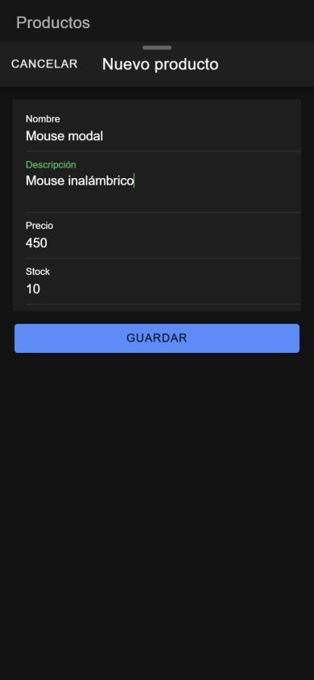
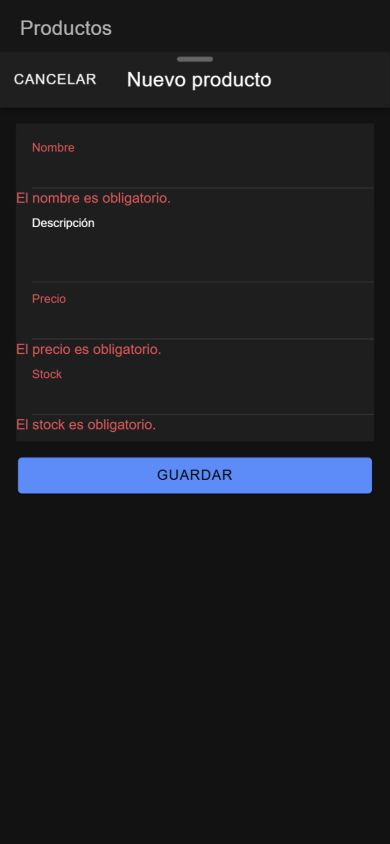
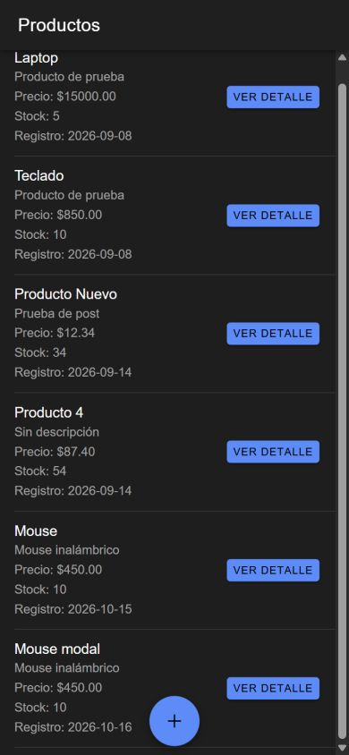
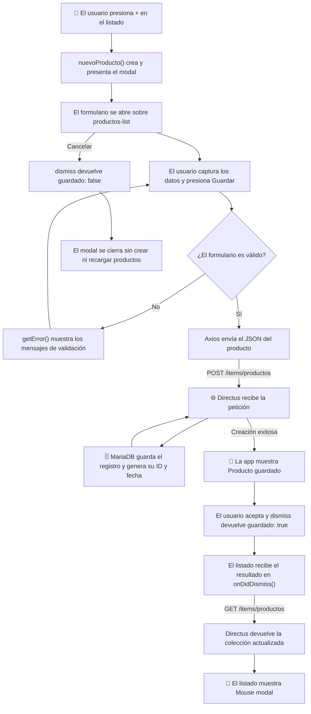

# Crear un elemento con Ionic mediante un modal

En esta práctica abrirás el formulario de creación encima del listado utilizando un modal de Ionic. Después de validar y guardar un producto en Directus, el formulario se cerrará y el listado volverá a consultar los datos.

**Resultado esperado:** el botón flotante **+** abrirá el formulario de la figura 1 sin abandonar `/productos-list`. Podrás cancelar o guardar y ver el nuevo producto sin recargar el navegador.

<p align="center">
  <br>
  <em>Figura 1. Formulario modal abierto sobre el listado, con los datos del producto de prueba.</em>
</p>

Las capturas se tomaron ejecutando el código de esta práctica en el navegador con tamaño de pantalla móvil. El tema oscuro y los productos del listado corresponden al entorno de prueba.

## 1. Antes de comenzar

Continúa con los manuales [01: listado](01_listado_elementos.md) y [02: detalle](02_detalle_elemento.md) funcionando. Reutilizarás Axios, `environment.apiUrl`, la colección `productos` y la configuración de CORS y lectura de Directus.

- Ejecuta los comandos desde la carpeta que contiene `docker-compose.yml`.
- Las rutas `src/...` pertenecen al proyecto Ionic: en este repositorio corresponden a `mobile/src/...`.
- Se utilizan **NgModules**. Después de generar una página o componente, agrega manualmente `standalone: false` dentro de su decorador `@Component`.
- La política de las prácticas debe permitir crear productos, como se indica en el primer paso.

Esta es una **alternativa** al [manual de creación mediante página](03_crear_elemento_pagina.md). Aquí se abre y cierra un modal con `ModalController`; el formulario no utiliza `Router` para regresar. Si ya probaste la otra variante, adapta sus archivos como se indica en los pasos y compara el resultado con la sección 4.

## 2. Conceptos y métodos que utilizarás

| Elemento | Cómo se utiliza | Para qué sirve |
| --- | --- | --- |
| `ModalController.create()` | `this.modalController.create({ component: ProductosFormPage, ... })` | Prepara el modal e indica qué componente mostrará. |
| `present()` | `await modal.present()` | Muestra el formulario encima del listado. |
| `breakpoints` e `initialBreakpoint` | `[0, 0.5, 0.95]` y `0.95` | Permiten ajustar la altura del modal e indican la altura inicial. |
| `dismiss()` | `this.modalController.dismiss({ guardado: true })` | Cierra el modal y entrega un resultado al listado. |
| `onDidDismiss()` | `const { data } = await modal.onDidDismiss()` | Espera al cierre y permite recibir ese resultado. |
| `ReactiveFormsModule` y `FormBuilder` | `[formGroup]` y `this.formBuilder.group({...})` | Conectan y construyen el formulario reactivo. |
| `Validators` y `getError()` | `Validators.required` y `getError('nombre')` | Validan los controles y obtienen los mensajes definidos en TypeScript. |
| `markAllAsTouched()` | `this.productoForm.markAllAsTouched()` | Permite mostrar los errores si se intenta guardar un formulario inválido. |
| `axios.post()` | `await axios.post(url, producto, opciones)` | Envía el producto a Directus. |
| `AlertController` | `create()`, `present()` y `onDidDismiss()` | Muestra la confirmación y espera a que se cierre antes de cerrar el modal. |

El resultado del modal se utilizará así: `guardado: true` indica que se creó un registro y el listado debe recargarse; `guardado: false` indica que se canceló.

## 3. Implementación paso a paso

Sigue los pasos en orden. La sección 4 contiene los seis archivos completos involucrados para comparar el resultado.

### Paso 1. Revisar el permiso de creación en Directus

Abre `http://localhost:8000`. En **Access Policies**, localiza la política utilizada en las prácticas y habilita **Create** sobre `productos` si todavía no está habilitado.

Los campos enviados serán `nombre`, `descripcion`, `precio` y `stock`. No envíes `id` ni `fecha_registro`: estos valores los genera la base de datos.

Conserva los permisos de lectura y CORS de las prácticas anteriores. No necesitas instalar nuevamente Axios ni modificar `environment`.

### Paso 2. Preparar la página y los módulos

Si todavía no existe `productos-form`, créala desde la carpeta que contiene `docker-compose.yml`:

```powershell
docker compose exec mobile ionic g page productos-form
```

Abre `mobile/src/app/productos-form/productos-form.page.ts` y agrega manualmente `standalone: false` dentro de `@Component`. Si aparece con valor `true`, cámbialo a `false`; si ya está en `false`, consérvalo sin duplicarlo:

```typescript
@Component({
  selector: 'app-productos-form',
  templateUrl: './productos-form.page.html',
  styleUrls: ['./productos-form.page.scss'],
  standalone: false,
})
```

En `mobile/src/app/productos-form/productos-form.module.ts`, **reemplaza la importación de formularios** por:

```typescript
import { FormsModule, ReactiveFormsModule } from '@angular/forms';
```

Agrega `ReactiveFormsModule` al arreglo `imports` y conserva los demás módulos y la declaración de `ProductosFormPage`.

Después abre `mobile/src/app/productos-list/productos-list.module.ts`. Agrega esta importación al inicio y `ProductosFormPageModule` al arreglo `imports`:

```typescript
import { ProductosFormPageModule } from '../productos-form/productos-form.module';
```

Conserva `CommonModule`, `FormsModule`, `IonicModule`, `ProductosListPageRoutingModule` y la declaración de `ProductosListPage`. No agregues `ProductosFormPage` a las declaraciones del listado: ya pertenece a su propio módulo. Ambos módulos completos están en la sección 4.

### Paso 3. Agregar el botón flotante al listado

Abre `mobile/src/app/productos-list/productos-list.page.html`. **Después de `</ion-content>`**, agrega:

```html
<ion-fab slot="fixed" vertical="bottom" horizontal="center">
    <ion-fab-button (click)="nuevoProducto()">
        <ion-icon name="add"></ion-icon>
    </ion-fab-button>
</ion-fab>
```

Este es el botón **+** para crear un producto. Al presionarlo se ejecutará `nuevoProducto()`. Conserva las filas y los botones **Ver detalle** del manual 02.

Si vienes de la variante mediante página, retira de la cabecera el bloque `ion-buttons` que contiene **Nuevo** y su `[routerLink]="['/productos-form']"`. El acceso al formulario en esta variante será el botón flotante que acabas de agregar.

### Paso 4. Abrir el modal y recibir el resultado

Abre `mobile/src/app/productos-list/productos-list.page.ts`. Conserva las importaciones de Angular, Axios y `environment`, y agrega:

```typescript
import { ModalController } from '@ionic/angular';
import { ProductosFormPage } from '../productos-form/productos-form.page';
```

**Reemplaza el constructor vacío** por:

```typescript
constructor(
  private modalController: ModalController
) {}
```

Dentro de `ProductosListPage`, después de `cargarProductos()` y antes de la llave final de la clase, agrega:

```typescript
async nuevoProducto(): Promise<void> {
  const modal = await this.modalController.create({
    component: ProductosFormPage,
    breakpoints: [0, 0.5, 0.95],
    initialBreakpoint: 0.95
  });

  await modal.present();

  const { data } = await modal.onDidDismiss();

  if (data?.guardado) {
    await this.cargarProductos();
  }
}
```

El listado del manual 01 conserva su carga inicial en `ngOnInit()`. Si venías de la variante mediante página, usa de nuevo:

```typescript
ngOnInit(): void {
  this.cargarProductos();
}
```

En ese caso retira el `ionViewWillEnter()` que agregaste para aquella variante, vuelve a importar `OnInit` y deja `export class ProductosListPage implements OnInit`. Así el archivo coincidirá con el código completo de esta práctica.

El refresco después de crear un producto lo realiza la condición `if (data?.guardado)` al cerrarse el modal.

### Paso 5. Preparar el formulario en TypeScript

Abre `mobile/src/app/productos-form/productos-form.page.ts`. Utiliza estas importaciones al inicio; en esta variante no se utiliza `Router`:

```typescript
import { Component, OnInit } from '@angular/core';
import { FormBuilder, FormGroup, Validators } from '@angular/forms';
import { AlertController, ModalController } from '@ionic/angular';
import axios from 'axios';
import { environment } from '../../environments/environment';
```

Después de las importaciones y **antes de `@Component`**, agrega la interfaz:

```typescript
interface ProductoCrear {
  nombre: string;
  descripcion: string;
  precio: number;
  stock: number;
}
```

Dentro de `ProductosFormPage`, agrega las propiedades y el mapa de mensajes:

```typescript
productoForm!: FormGroup;
guardando: boolean = false;

mensajesValidacion: Record<string, Record<string, string>> = {
  nombre: {
    required: 'El nombre es obligatorio.',
    maxlength: 'El nombre no debe superar 150 caracteres.'
  },
  precio: {
    required: 'El precio es obligatorio.',
    min: 'El precio debe ser igual o mayor que cero.'
  },
  stock: {
    required: 'El stock es obligatorio.',
    min: 'El stock debe ser igual o mayor que cero.',
    pattern: 'El stock debe contener únicamente números enteros.'
  }
};
```

**Reemplaza el constructor y `ngOnInit()` generados** por los siguientes, sin duplicarlos. Conserva `export class ProductosFormPage implements OnInit`:

```typescript
constructor(
  private formBuilder: FormBuilder,
  private alertController: AlertController,
  private modalController: ModalController
) {}

ngOnInit(): void {
  this.crearFormulario();
}
```

A continuación, dentro de la clase, agrega los métodos para construir el formulario y obtener sus mensajes:

```typescript
private crearFormulario(): void {
  this.productoForm = this.formBuilder.group({
    nombre: ['', [
      Validators.required,
      Validators.maxLength(150)
    ]],
    descripcion: [''],
    precio: ['', [
      Validators.required,
      Validators.min(0)
    ]],
    stock: ['', [
      Validators.required,
      Validators.min(0),
      Validators.pattern('^[0-9]+$')
    ]]
  });
}

getError(controlName: string): string {
  const control = this.productoForm.get(controlName);

  if (!control || !control.errors || !(control.touched || control.dirty)) {
    return '';
  }

  const tipoError = Object.keys(control.errors)[0];

  return this.mensajesValidacion[controlName]?.[tipoError]
    ?? 'El valor ingresado no es válido.';
}
```

Después agrega el método de cancelación:

```typescript
async cerrarModal(): Promise<void> {
  await this.modalController.dismiss({
    guardado: false
  });
}
```

Por último agrega el método de guardado. Si ya tenías `guardarProducto()` de la variante mediante página, **reemplázalo completo** por este:

```typescript
async guardarProducto(): Promise<void> {
  if (this.productoForm.invalid) {
    this.productoForm.markAllAsTouched();
    return;
  }

  this.guardando = true;

  const valores = this.productoForm.value;

  const producto: ProductoCrear = {
    nombre: valores.nombre.trim(),
    descripcion: valores.descripcion?.trim() ?? '',
    precio: Number(valores.precio),
    stock: Number(valores.stock)
  };

  try {
    await axios.post(
      `${environment.apiUrl}/items/productos`,
      producto,
      {
        headers: {
          'Content-Type': 'application/json'
        }
      }
    );

    const alerta = await this.alertController.create({
      header: 'Producto guardado',
      message: 'El producto fue registrado correctamente.',
      buttons: ['Aceptar']
    });

    await alerta.present();
    await alerta.onDidDismiss();

    await this.modalController.dismiss({
      guardado: true
    });
  } catch (error) {
    console.error('Error al guardar el producto:', error);

    const alerta = await this.alertController.create({
      header: 'Error',
      message: 'No fue posible guardar el producto. Revisa los datos, la conexión y los permisos de creación en Directus.',
      buttons: ['Aceptar']
    });

    await alerta.present();
  } finally {
    this.guardando = false;
  }
}
```

El método valida, envía el `POST` y muestra la confirmación. Después de cerrar la alerta, cierra también el modal devolviendo `guardado: true`. La cancelación devuelve `guardado: false` sin realizar el `POST`.

### Paso 6. Escribir el HTML del modal

Abre `mobile/src/app/productos-form/productos-form.page.html` y **reemplaza su contenido** por:

```html
<ion-header>
  <ion-toolbar>
    <ion-buttons slot="start">
      <ion-button (click)="cerrarModal()">
        Cancelar
      </ion-button>
    </ion-buttons>
    <ion-title>Nuevo producto</ion-title>
  </ion-toolbar>
</ion-header>

<ion-content class="ion-padding">
  <form *ngIf="productoForm" [formGroup]="productoForm" (ngSubmit)="guardarProducto()">
    <ion-list>
      <ion-item>
        <ion-input label="Nombre" labelPlacement="stacked" type="text" formControlName="nombre" maxlength="150"></ion-input>
      </ion-item>
      <ion-note color="danger" *ngIf="getError('nombre') as error">
        {{ error }}
      </ion-note>

      <ion-item>
        <ion-textarea label="Descripción" labelPlacement="stacked" formControlName="descripcion" autoGrow="true"></ion-textarea>
      </ion-item>

      <ion-item>
        <ion-input label="Precio" labelPlacement="stacked" type="number" formControlName="precio" min="0"></ion-input>
      </ion-item>
      <ion-note color="danger" *ngIf="getError('precio') as error">
        {{ error }}
      </ion-note>

      <ion-item>
        <ion-input label="Stock" labelPlacement="stacked" type="number" formControlName="stock" min="0"></ion-input>
      </ion-item>
      <ion-note color="danger" *ngIf="getError('stock') as error">
        {{ error }}
      </ion-note>
    </ion-list>

    <ion-button expand="block" type="submit" class="ion-margin-top" [disabled]="guardando">
      {{ guardando ? 'Guardando...' : 'Guardar' }}
    </ion-button>
  </form>
</ion-content>
```

El botón **Cancelar** ejecuta `cerrarModal()`. El formulario utiliza `[formGroup]`, `formControlName` y `(ngSubmit)`; los textos de validación se obtienen con `getError()` desde TypeScript.

Si probaste antes la variante mediante página, este HTML sustituye su cabecera con `ion-back-button`. Los archivos SCSS no requieren cambios.

## 4. Así debe quedar el código completo

Estos archivos corresponden a la variante mediante modal. Conservan la consulta del listado y los botones de detalle de las prácticas anteriores.

### `mobile/src/app/productos-list/productos-list.module.ts`

```typescript
import { NgModule } from '@angular/core';
import { CommonModule } from '@angular/common';
import { FormsModule } from '@angular/forms';

import { IonicModule } from '@ionic/angular';

import { ProductosListPageRoutingModule } from './productos-list-routing.module';

import { ProductosFormPageModule } from '../productos-form/productos-form.module';

import { ProductosListPage } from './productos-list.page';

@NgModule({
  imports: [
    CommonModule,
    FormsModule,
    IonicModule,
    ProductosListPageRoutingModule,
    ProductosFormPageModule
  ],
  declarations: [ProductosListPage]
})
export class ProductosListPageModule {}
```

### `mobile/src/app/productos-list/productos-list.page.ts`

```typescript
import { Component, OnInit } from '@angular/core';
import { ModalController } from '@ionic/angular';
import axios from 'axios';
import { environment } from '../../environments/environment';
import { ProductosFormPage } from '../productos-form/productos-form.page';

interface Producto {
  id: number;
  nombre: string;
  descripcion: string;
  precio: string;
  stock: number;
  fecha_registro: string;
}

@Component({
  selector: 'app-productos-list',
  templateUrl: './productos-list.page.html',
  styleUrls: ['./productos-list.page.scss'],
  standalone: false,
})
export class ProductosListPage implements OnInit {

  productos: Producto[] = [];

  constructor(
    private modalController: ModalController
  ) {}

  ngOnInit(): void {
    this.cargarProductos();
  }

  async cargarProductos(): Promise<void> {
    try {
      const response = await axios.get<{ data: Producto[] }>(
        `${environment.apiUrl}/items/productos`
      );

      this.productos = response.data.data;
    } catch (error) {
      console.error('Error al cargar los productos:', error);
    }
  }

  async nuevoProducto(): Promise<void> {
    const modal = await this.modalController.create({
      component: ProductosFormPage,
      breakpoints: [0, 0.5, 0.95],
      initialBreakpoint: 0.95
    });

    await modal.present();

    const { data } = await modal.onDidDismiss();

    if (data?.guardado) {
      await this.cargarProductos();
    }
  }
}
```

### `mobile/src/app/productos-list/productos-list.page.html`

```html
<ion-header>
  <ion-toolbar>
    <ion-title>Productos</ion-title>
  </ion-toolbar>
</ion-header>

<ion-content>
  <ion-list>
    <ion-item *ngFor="let producto of productos">
      <ion-label class="ion-text-wrap">
        <h2>{{ producto.nombre }}</h2>
        <p>{{ producto.descripcion }}</p>
        <p>Precio: ${{ producto.precio }}</p>
        <p>Stock: {{ producto.stock }}</p>
        <p>Registro: {{ producto.fecha_registro | date:'yyyy-MM-dd' }}</p>
      </ion-label>
      <ion-button slot="end" [routerLink]="['/productos-view', producto.id]">
        Ver detalle
      </ion-button>
    </ion-item>
  </ion-list>
</ion-content>

<ion-fab slot="fixed" vertical="bottom" horizontal="center">
    <ion-fab-button (click)="nuevoProducto()">
        <ion-icon name="add"></ion-icon>
    </ion-fab-button>
</ion-fab>
```

### `mobile/src/app/productos-form/productos-form.module.ts`

```typescript
import { NgModule } from '@angular/core';
import { CommonModule } from '@angular/common';
import { FormsModule, ReactiveFormsModule } from '@angular/forms';

import { IonicModule } from '@ionic/angular';

import { ProductosFormPageRoutingModule } from './productos-form-routing.module';

import { ProductosFormPage } from './productos-form.page';

@NgModule({
  imports: [
    CommonModule,
    FormsModule,
    ReactiveFormsModule,
    IonicModule,
    ProductosFormPageRoutingModule
  ],
  declarations: [ProductosFormPage]
})
export class ProductosFormPageModule {}
```

### `mobile/src/app/productos-form/productos-form.page.ts`

```typescript
import { Component, OnInit } from '@angular/core';
import { FormBuilder, FormGroup, Validators } from '@angular/forms';
import { AlertController, ModalController } from '@ionic/angular';
import axios from 'axios';
import { environment } from '../../environments/environment';

interface ProductoCrear {
  nombre: string;
  descripcion: string;
  precio: number;
  stock: number;
}

@Component({
  selector: 'app-productos-form',
  templateUrl: './productos-form.page.html',
  styleUrls: ['./productos-form.page.scss'],
  standalone: false,
})
export class ProductosFormPage implements OnInit {

  productoForm!: FormGroup;
  guardando: boolean = false;

  mensajesValidacion: Record<string, Record<string, string>> = {
    nombre: {
      required: 'El nombre es obligatorio.',
      maxlength: 'El nombre no debe superar 150 caracteres.'
    },
    precio: {
      required: 'El precio es obligatorio.',
      min: 'El precio debe ser igual o mayor que cero.'
    },
    stock: {
      required: 'El stock es obligatorio.',
      min: 'El stock debe ser igual o mayor que cero.',
      pattern: 'El stock debe contener únicamente números enteros.'
    }
  };

  constructor(
    private formBuilder: FormBuilder,
    private alertController: AlertController,
    private modalController: ModalController
  ) {}

  ngOnInit(): void {
    this.crearFormulario();
  }

  private crearFormulario(): void {
    this.productoForm = this.formBuilder.group({
      nombre: ['', [
        Validators.required,
        Validators.maxLength(150)
      ]],
      descripcion: [''],
      precio: ['', [
        Validators.required,
        Validators.min(0)
      ]],
      stock: ['', [
        Validators.required,
        Validators.min(0),
        Validators.pattern('^[0-9]+$')
      ]]
    });
  }

  getError(controlName: string): string {
    const control = this.productoForm.get(controlName);

    if (
      !control ||
      !control.errors ||
      !(control.touched || control.dirty)
    ) {
      return '';
    }

    const tipoError = Object.keys(control.errors)[0];

    return this.mensajesValidacion[controlName]?.[tipoError]
      ?? 'El valor ingresado no es válido.';
  }

  async cerrarModal(): Promise<void> {
    await this.modalController.dismiss({
      guardado: false
    });
  }

  async guardarProducto(): Promise<void> {
    if (this.productoForm.invalid) {
      this.productoForm.markAllAsTouched();
      return;
    }

    this.guardando = true;

    const valores = this.productoForm.value;

    const producto: ProductoCrear = {
      nombre: valores.nombre.trim(),
      descripcion: valores.descripcion?.trim() ?? '',
      precio: Number(valores.precio),
      stock: Number(valores.stock)
    };

    try {
      await axios.post(
        `${environment.apiUrl}/items/productos`,
        producto,
        {
          headers: {
            'Content-Type': 'application/json'
          }
        }
      );

      const alerta = await this.alertController.create({
        header: 'Producto guardado',
        message: 'El producto fue registrado correctamente.',
        buttons: ['Aceptar']
      });

      await alerta.present();
      await alerta.onDidDismiss();

      await this.modalController.dismiss({
        guardado: true
      });
    } catch (error) {
      console.error('Error al guardar el producto:', error);

      const alerta = await this.alertController.create({
        header: 'Error',
        message: 'No fue posible guardar el producto. Revisa los datos, la conexión y los permisos de creación en Directus.',
        buttons: ['Aceptar']
      });

      await alerta.present();
    } finally {
      this.guardando = false;
    }
  }
}
```

### `mobile/src/app/productos-form/productos-form.page.html`

```html
<ion-header>
  <ion-toolbar>
    <ion-buttons slot="start">
      <ion-button (click)="cerrarModal()">
        Cancelar
      </ion-button>
    </ion-buttons>
    <ion-title>Nuevo producto</ion-title>
  </ion-toolbar>
</ion-header>

<ion-content class="ion-padding">
  <form *ngIf="productoForm" [formGroup]="productoForm" (ngSubmit)="guardarProducto()">
    <ion-list>
      <ion-item>
        <ion-input label="Nombre" labelPlacement="stacked" type="text" formControlName="nombre" maxlength="150"></ion-input>
      </ion-item>
      <ion-note color="danger" *ngIf="getError('nombre') as error">
        {{ error }}
      </ion-note>

      <ion-item>
        <ion-textarea label="Descripción" labelPlacement="stacked" formControlName="descripcion" autoGrow="true"></ion-textarea>
      </ion-item>

      <ion-item>
        <ion-input label="Precio" labelPlacement="stacked" type="number" formControlName="precio" min="0"></ion-input>
      </ion-item>
      <ion-note color="danger" *ngIf="getError('precio') as error">
        {{ error }}
      </ion-note>

      <ion-item>
        <ion-input label="Stock" labelPlacement="stacked" type="number" formControlName="stock" min="0"></ion-input>
      </ion-item>
      <ion-note color="danger" *ngIf="getError('stock') as error">
        {{ error }}
      </ion-note>
    </ion-list>

    <ion-button expand="block" type="submit" class="ion-margin-top" [disabled]="guardando">
      {{ guardando ? 'Guardando...' : 'Guardar' }}
    </ion-button>
  </form>
</ion-content>
```

El formulario se abre desde el listado con `ModalController`. Para probar esta variante entra a `/productos-list` y presiona **+**; no abras `/productos-form` directamente como una página. Conserva las demás rutas del proyecto y los módulos de rutas generados.

## 5. Comprobar que funciona

1. Guarda los archivos y espera a que Ionic termine de compilar.
2. Abre `http://localhost:8100/productos-list` y presiona el botón flotante **+**. Debe aparecer el formulario como un modal, manteniendo la misma URL.
3. Presiona **Guardar** sin capturar datos. Los mensajes de los campos obligatorios deben mostrarse como en la figura 2.
4. Prueba un precio negativo y un stock decimal: deben aparecer sus errores. Corrige los valores antes de enviar.
5. Presiona **Cancelar**. Debe cerrarse el modal sin agregar un producto. Al abrirlo nuevamente, el formulario debe estar limpio.

<p align="center">
  <br>
  <em>Figura 2. Validación del formulario vacío sin abandonar el listado.</em>
</p>

Captura los datos del ejemplo de la figura 1. El nombre permite distinguir este registro del creado en la variante mediante página:

| Campo | Valor |
| --- | --- |
| Nombre | Mouse modal |
| Descripción | Mouse inalámbrico |
| Precio | 450 |
| Stock | 10 |

Presiona **Guardar** y luego **Aceptar** en la confirmación. El modal debe cerrarse y el producto nuevo debe aparecer inmediatamente en el listado, sin recargar el navegador, como en la figura 3.

<p align="center">
  <br>
  <em>Figura 3. Listado actualizado con el producto creado desde el modal.</em>
</p>

Las pruebas de guardado crean un registro real en la colección `productos`. Los demás productos y las fechas de las capturas dependen de la base de datos del entorno.

## 6. Explicación detallada del flujo

### Del modal al listado actualizado

El listado permanece debajo del modal. La app valida los datos, los envía a Directus y, al cerrar el formulario después de guardar, recibe el resultado que indica que debe recargar los productos.



### Cómo se abre y se ajusta el modal

`ModalController.create()` prepara el modal. `component: ProductosFormPage` indica qué componente contendrá. El módulo del formulario se importa en el del listado para que esa página y sus dependencias estén disponibles en esta configuración con NgModules.

`create()` no lo muestra: `await modal.present()` realiza esa acción. La URL continúa en `/productos-list`; el listado permanece debajo del formulario.

Los valores de `breakpoints: [0, 0.5, 0.95]` establecen posiciones de altura para la hoja del modal. `initialBreakpoint: 0.95` la abre inicialmente cerca de la altura completa. El valor `0` permite cerrarla al desplazarla hasta esa posición.

### Cómo funcionan el formulario y los mensajes

`ReactiveFormsModule` habilita `[formGroup]` y `formControlName`. `FormBuilder` construye el `FormGroup` y `ngOnInit()` llama a `crearFormulario()` al inicializarse el formulario.

Los controles son `nombre`, `descripcion`, `precio` y `stock`. El nombre es obligatorio y admite hasta 150 caracteres. La descripción es opcional; el precio es obligatorio y no puede ser negativo. El stock es obligatorio, no puede ser negativo y debe contener únicamente dígitos enteros.

`getError()` obtiene el control y devuelve una cadena vacía si no existe, no tiene errores o todavía no está marcado como `touched` o `dirty`. Si hay errores, toma el primero y busca el texto correspondiente en `mensajesValidacion`; `??` proporciona un texto alternativo si falta un mensaje específico.

Al enviar un formulario inválido, `markAllAsTouched()` permite mostrar los errores y `return` termina el método sin hacer el `POST`. Así el HTML solo solicita el mensaje y los textos permanecen en `page.ts`.

### Cómo se prepara y se envía el producto

`this.productoForm.value` contiene los valores capturados. El objeto `ProductoCrear` incluye solamente los campos enviados: `trim()` retira espacios al inicio y al final del nombre y la descripción; `?.trim() ?? ''` permite usar una descripción vacía. `Number()` convierte el precio y el stock a números.

El JSON enviado es similar a este:

```json
{
  "nombre": "Mouse modal",
  "descripcion": "Mouse inalámbrico",
  "precio": 450,
  "stock": 10
}
```

`axios.post()` recibe la URL, el objeto y el encabezado `Content-Type: application/json`. Directus crea el registro en MariaDB y la base de datos genera `id` y `fecha_registro`.

`guardando` mantiene deshabilitado el botón y muestra **Guardando...** durante el proceso de guardado. En esta variante permanece en ese estado mientras se acepta la confirmación y se cierra el modal; `finally` restablece su valor al terminar el intento.

Si falla la petición, `catch` registra el error y muestra una alerta. El formulario no devuelve un guardado exitoso ni se cierra por esa ruta.

### Por qué se espera al cierre de la alerta

Después del `POST`, `AlertController.create()` prepara la confirmación y `alerta.present()` la muestra. `await alerta.onDidDismiss()` espera a que esa alerta termine de cerrarse.

Después se ejecuta `this.modalController.dismiss({ guardado: true })`. De esta manera se cierra primero la confirmación y luego el formulario, comunicando al listado que se creó un producto.

### Cómo se actualiza el listado

`const { data } = await modal.onDidDismiss()` espera al cierre del formulario y obtiene el resultado. Si `data?.guardado` es verdadero, el listado ejecuta `await this.cargarProductos()` y vuelve a consultar Directus.

Esa consulta actualiza el arreglo que recorre `*ngFor`, por lo que el producto aparece sin recargar el navegador. `ngOnInit()` se utiliza para la carga inicial; el refresco posterior al guardado depende del resultado del modal.

El acceso opcional `data?.guardado` también contempla que el modal se cierre sin entregar datos. En ese caso la condición no se cumple y no se realiza una nueva consulta desde este bloque.

### Qué sucede al cancelar

`cerrarModal()` ejecuta `dismiss({ guardado: false })` sin enviar datos a Directus. El listado recibe el resultado, pero la condición de actualización no se cumple. Al volver a abrir el formulario con `create()`, se crea una nueva instancia y sus controles comienzan vacíos.

| Variante mediante página | Variante mediante modal |
| --- | --- |
| Navega a `/productos-form`. | Permanece en `/productos-list`. |
| Regresa utilizando `Router`. | Cierra con `ModalController.dismiss()`. |
| Actualiza el listado con `ionViewWillEnter()`. | Actualiza el listado después de `onDidDismiss()` si hubo un guardado. |
| El botón de regreso utiliza navegación. | Cancelar comunica `guardado: false`. |
