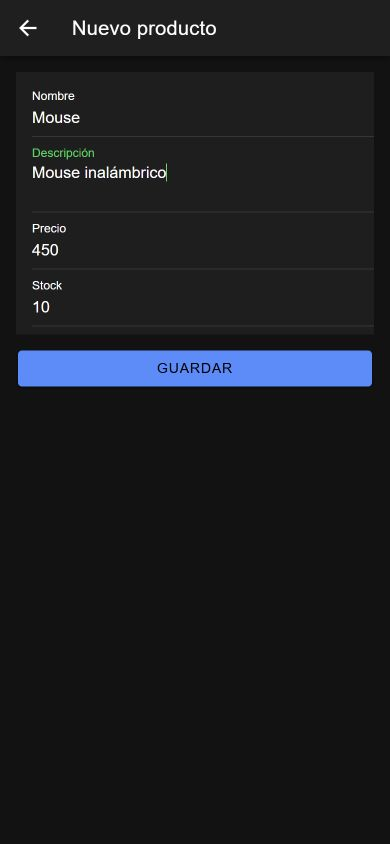
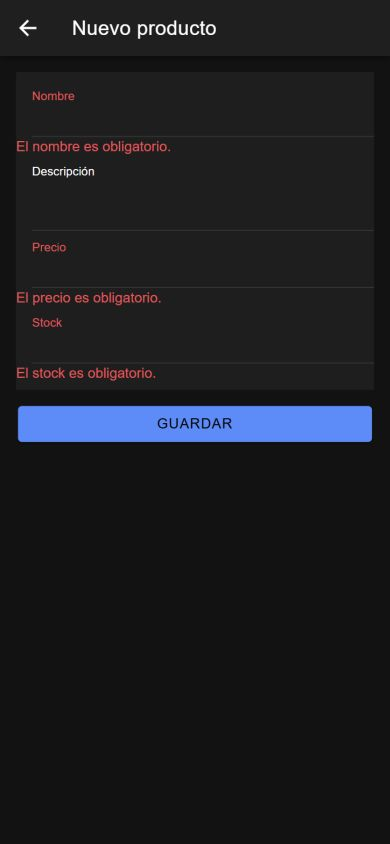
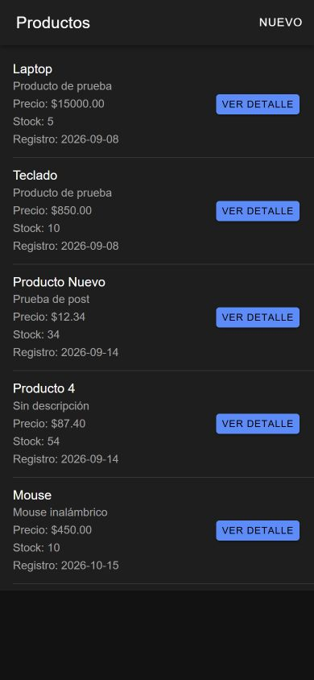
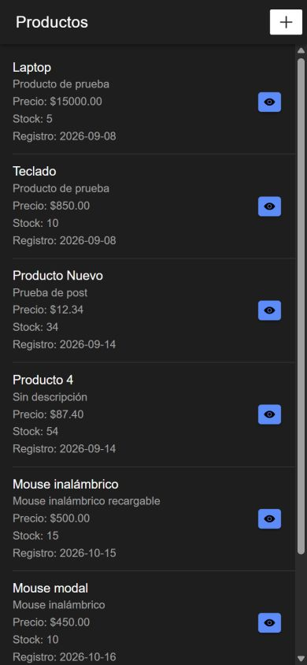
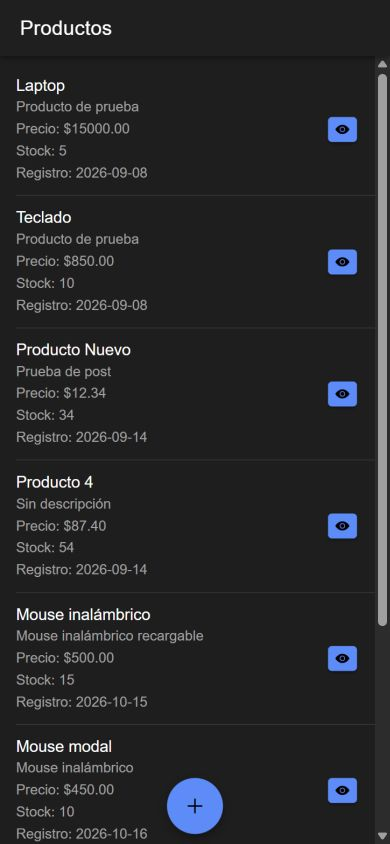
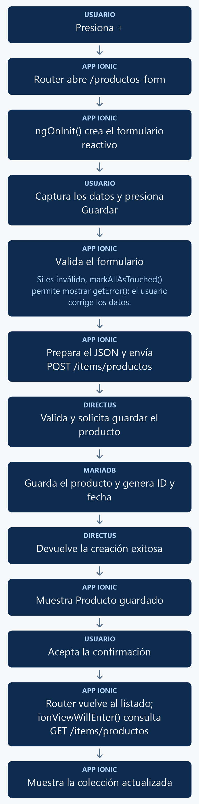

# Crear un elemento con Ionic mediante una página

En esta práctica abrirás un formulario desde el listado, validarás sus campos y enviarás un producto a Directus mediante `POST`. Después de guardar y aceptar la confirmación, regresarás al listado y verás el nuevo registro sin recargar el navegador.

**Resultado esperado:** el botón con icono **+** abrirá la página `productos-form`. La figura 1 muestra el formulario con los datos del ejemplo, antes de guardarlo.

<p align="center">
  <br>
  <em>Figura 1. Formulario de creación mediante una página, listo para enviar el producto.</em>
</p>

Las capturas se tomaron ejecutando el código de esta práctica en el navegador con tamaño de pantalla móvil. El tema oscuro y los registros del listado corresponden al entorno de prueba.

## 1. Antes de comenzar

Continúa con los manuales [01: listado](01_listado_elementos.md) y [02: detalle](02_detalle_elemento.md) funcionando. Reutilizarás Axios, `environment.apiUrl`, la colección `productos`, el acceso de lectura y la configuración de CORS.

- Ejecuta los comandos desde la carpeta que contiene `docker-compose.yml`.
- Las rutas `src/...` pertenecen al proyecto Ionic: en este repositorio corresponden a `mobile/src/...`.
- Se utilizan **NgModules**. Después de crear cada página o componente, configura manualmente `standalone: false` dentro de `@Component`.
- La API debe permitir crear productos. Lo comprobarás en el primer paso de implementación.

Esta es la variante **mediante página**: se navega a `/productos-form` y se regresa con `Router`. El [manual de creación mediante modal](03_crear_elemento_modal.md) es una alternativa; elige una variante para continuar y no mezcles sus instrucciones sobre apertura, cierre y actualización del listado.

## 2. Conceptos y métodos que utilizarás

| Elemento | Cómo se utiliza | Para qué sirve |
| --- | --- | --- |
| `ReactiveFormsModule` | Agregarlo a los `imports` del módulo del formulario. | Permite conectar el HTML con un formulario reactivo. |
| `FormBuilder` y `FormGroup` | `this.formBuilder.group({...})` | Crean y representan el conjunto de controles del formulario. |
| `Validators` | `required`, `maxLength(150)`, `min(0)` y `pattern(...)` | Definen las reglas de los campos. |
| `[formGroup]` y `formControlName` | `[formGroup]="productoForm"` y `formControlName="nombre"` | Conectan el formulario y sus campos con TypeScript. |
| `(ngSubmit)` | `(ngSubmit)="guardarProducto()"` | Ejecuta el método al enviar el formulario. |
| `getError()` | `getError('nombre')` | Obtiene el mensaje de validación definido en TypeScript para un campo. |
| `markAllAsTouched()` | `this.productoForm.markAllAsTouched()` | Marca los campos para mostrar sus errores cuando se intenta guardar un formulario inválido. |
| `axios.post()` | `await axios.post(url, producto, opciones)` | Envía el JSON del producto a Directus. |
| `AlertController` | `create()` y `present()` | Prepara y muestra la confirmación o el mensaje de error. |
| `Router` | `this.router.navigateByUrl('/productos-list')` | Regresa al listado después de aceptar la confirmación. |
| `ionViewWillEnter()` | `this.cargarProductos()` | Recarga el listado cada vez que Ionic vuelve a mostrar esa página. |

`productoForm` almacena los controles y sus valores. `guardando` controla el estado del botón mientras se realiza el envío. Los mensajes se guardan en `mensajesValidacion` para mantenerlos fuera del HTML.

## 3. Implementación paso a paso

Sigue los pasos en orden. La sección 4 reúne el código completo del listado, el módulo del formulario, su TypeScript y su HTML.

### Paso 1. Permitir la creación en Directus

Abre `http://localhost:8000`. En **Access Policies**, localiza la política utilizada en las prácticas y habilita el permiso **Create** sobre `productos`. Si ya está habilitado, consérvalo.

La aplicación enviará únicamente `nombre`, `descripcion`, `precio` y `stock`. Los campos `id` y `fecha_registro` son generados por la base de datos y no deben agregarse al formulario ni al JSON enviado.

Conserva los permisos de lectura y la configuración de CORS de las prácticas anteriores. No necesitas reinstalar Axios ni cambiar `environment`.

### Paso 2. Crear la página y configurar su ruta

Desde la carpeta que contiene `docker-compose.yml`, ejecuta:

```powershell
docker compose exec mobile ionic g page productos-form
```

Si la página ya existe, continúa con ella sin volver a generarla. Los archivos se encuentran en `mobile/src/app/productos-form/`.

Abre `productos-form.page.ts` y agrega manualmente `standalone: false` dentro de `@Component`. Si aparece con valor `true`, cámbialo a `false`; si ya está en `false`, consérvalo sin duplicarlo:

```typescript
@Component({
  selector: 'app-productos-form',
  templateUrl: './productos-form.page.html',
  styleUrls: ['./productos-form.page.scss'],
  standalone: false,
})
```

En `mobile/src/app/app-routing.module.ts`, comprueba que `routes` incluya la entrada generada para el formulario. Si ya existe, no la dupliques:

```typescript
{
  path: 'productos-form',
  loadChildren: () => import('./productos-form/productos-form.module')
    .then(m => m.ProductosFormPageModule)
}
```

Conserva las demás rutas y separa las entradas con comas. En `productos-form-routing.module.ts`, conserva la ruta interna con `path: ''` y `component: ProductosFormPage`.

### Paso 3. Habilitar los formularios reactivos

Abre `mobile/src/app/productos-form/productos-form.module.ts`. **Reemplaza la importación de formularios** por:

```typescript
import { FormsModule, ReactiveFormsModule } from '@angular/forms';
```

Después agrega `ReactiveFormsModule` al arreglo `imports`, conservando `CommonModule`, `FormsModule`, `IonicModule` y `ProductosFormPageRoutingModule`. La página debe seguir declarada en `declarations`. El módulo completo está en la sección 4.

### Paso 4. Preparar el listado para abrir el formulario y recargarse

Abre `mobile/src/app/productos-list/productos-list.page.ts` y **reemplaza**:

```typescript
ngOnInit(): void {
  this.cargarProductos();
}
```

por el ciclo de vida de Ionic:

```typescript
ionViewWillEnter(): void {
  this.cargarProductos();
}
```

Retira `implements OnInit` de la clase y `OnInit` de la importación de Angular, que debe quedar como `import { Component } from '@angular/core';`. Conserva la interfaz `Producto`, el arreglo y el método `cargarProductos()` del manual 01. Si ya utilizas `ionViewWillEnter()`, no lo dupliques.

En `mobile/src/app/productos-list/productos-list.page.html`, **dentro de `ion-toolbar`, después de `ion-title`**, agrega:

```html
<ion-buttons slot="end">
  <ion-button fill="solid" [routerLink]="['/productos-form']" aria-label="Nuevo producto">
    <ion-icon slot="icon-only" name="add"></ion-icon>
  </ion-button>
</ion-buttons>
```

**Opción A: botón en la barra.** El bloque anterior coloca el icono **+** a la derecha del título (figura 4). El atributo `aria-label` identifica su acción para lectores de pantalla sin mostrar palabras.

**Opción B: botón flotante.** Si prefieres el acceso flotante, retira el bloque `ion-buttons` de creación de la barra y agrega el siguiente bloque **dentro de `ion-content`, antes de `</ion-content>`**, después de `</ion-list>`:

```html
<ion-fab slot="fixed" vertical="bottom" horizontal="center">
  <ion-fab-button [routerLink]="['/productos-form']" aria-label="Nuevo producto">
    <ion-icon name="add"></ion-icon>
  </ion-fab-button>
</ion-fab>
```

La figura 5 muestra esta alternativa. **Elige una sola opción**: ambas abren la misma página y utilizan el mismo formulario. Conserva las filas y los botones con icono de **ojo** del manual 02. El código completo de la sección 4 utiliza la opción A. Los botones `ion-button` llevan `fill="solid"`; `ion-fab-button` ya es sólido.

### Paso 5. Crear el formulario y sus mensajes en TypeScript

Abre `mobile/src/app/productos-form/productos-form.page.ts` y deja estas importaciones al inicio:

```typescript
import { Component, OnInit } from '@angular/core';
import { FormBuilder, FormGroup, Validators } from '@angular/forms';
import { AlertController } from '@ionic/angular';
import { Router } from '@angular/router';
import axios from 'axios';
import { environment } from '../../environments/environment';
```

Después de las importaciones y **antes de `@Component`**, agrega la interfaz con los datos que enviarás:

```typescript
interface ProductoCrear {
  nombre: string;
  descripcion: string;
  precio: number;
  stock: number;
}
```

**Dentro de `ProductosFormPage`**, agrega las propiedades:

```typescript
productoForm!: FormGroup;
guardando: boolean = false;
```

Después agrega el mapa de mensajes, también dentro de la clase:

```typescript
mensajesValidacion: Record<string, Record<string, string>> = {
  nombre: {
    required: 'El nombre es obligatorio.',
    maxlength: 'El nombre no debe superar 150 caracteres.'
  },
  precio: {
    required: 'El precio es obligatorio.',
    min: 'El precio debe ser igual o mayor que cero.'
  },
  stock: {
    required: 'El stock es obligatorio.',
    min: 'El stock debe ser igual o mayor que cero.',
    pattern: 'El stock debe contener únicamente números enteros.'
  }
};
```

**Reemplaza el constructor y `ngOnInit()` generados** por los siguientes, sin duplicarlos. Conserva `export class ProductosFormPage implements OnInit`:

```typescript
constructor(
  private formBuilder: FormBuilder,
  private alertController: AlertController,
  private router: Router
) {}

ngOnInit(): void {
  this.crearFormulario();
}
```

A continuación agrega los métodos para construir los controles y consultar su primer mensaje de error:

```typescript
private crearFormulario(): void {
  this.productoForm = this.formBuilder.group({
    nombre: ['', [
      Validators.required,
      Validators.maxLength(150)
    ]],
    descripcion: [''],
    precio: ['', [
      Validators.required,
      Validators.min(0)
    ]],
    stock: ['', [
      Validators.required,
      Validators.min(0),
      Validators.pattern('^[0-9]+$')
    ]]
  });
}

getError(controlName: string): string {
  const control = this.productoForm.get(controlName);

  if (!control || !control.errors || !(control.touched || control.dirty)) {
    return '';
  }

  const tipoError = Object.keys(control.errors)[0];

  return this.mensajesValidacion[controlName]?.[tipoError]
    ?? 'El valor ingresado no es válido.';
}
```

Por último, **dentro de la misma clase**, agrega el método de guardado:

```typescript
async guardarProducto(): Promise<void> {
  if (this.productoForm.invalid) {
    this.productoForm.markAllAsTouched();
    return;
  }

  this.guardando = true;

  const valores = this.productoForm.value;

  const producto: ProductoCrear = {
    nombre: valores.nombre.trim(),
    descripcion: valores.descripcion?.trim() ?? '',
    precio: Number(valores.precio),
    stock: Number(valores.stock)
  };

  try {
    await axios.post(
      `${environment.apiUrl}/items/productos`,
      producto,
      {
        headers: {
          'Content-Type': 'application/json'
        }
      }
    );

    const alerta = await this.alertController.create({
      header: 'Producto guardado',
      message: 'El producto fue registrado correctamente.',
      buttons: [
        {
          text: 'Aceptar',
          handler: () => {
            this.router.navigateByUrl('/productos-list');
          }
        }
      ]
    });

    await alerta.present();
  } catch (error) {
    console.error('Error al guardar el producto:', error);

    const alerta = await this.alertController.create({
      header: 'Error',
      message: 'No fue posible guardar el producto. Revisa los datos, la conexión y los permisos de creación en Directus.',
      buttons: ['Aceptar']
    });

    await alerta.present();
  } finally {
    this.guardando = false;
  }
}
```

El método marca los campos inválidos sin enviar datos. Cuando el formulario es válido, prepara el JSON y realiza el `POST`; al aceptar la confirmación, navega al listado. `finally` restablece el estado del botón al finalizar el intento de guardado.

### Paso 6. Conectar el formulario con el HTML

Abre `mobile/src/app/productos-form/productos-form.page.html` y **reemplaza su contenido** por:

```html
<ion-header>
  <ion-toolbar>
    <ion-buttons slot="start">
      <ion-back-button defaultHref="/productos-list"></ion-back-button>
    </ion-buttons>

    <ion-title>Nuevo producto</ion-title>
  </ion-toolbar>
</ion-header>

<ion-content class="ion-padding">
  <form *ngIf="productoForm" [formGroup]="productoForm" (ngSubmit)="guardarProducto()">
    <ion-list>
      <ion-item>
        <ion-input label="Nombre" labelPlacement="stacked" type="text" formControlName="nombre" maxlength="150"></ion-input>
      </ion-item>
      <ion-note color="danger" *ngIf="getError('nombre') as error">
        {{ error }}
      </ion-note>

      <ion-item>
        <ion-textarea label="Descripción" labelPlacement="stacked" formControlName="descripcion" autoGrow="true"></ion-textarea>
      </ion-item>

      <ion-item>
        <ion-input label="Precio" labelPlacement="stacked" type="number" formControlName="precio" min="0"></ion-input>
      </ion-item>
      <ion-note color="danger" *ngIf="getError('precio') as error">
        {{ error }}
      </ion-note>

      <ion-item>
        <ion-input label="Stock" labelPlacement="stacked" type="number" formControlName="stock" min="0"></ion-input>
      </ion-item>
      <ion-note color="danger" *ngIf="getError('stock') as error">
        {{ error }}
      </ion-note>
    </ion-list>

    <ion-button fill="solid" expand="block" type="submit" class="ion-margin-top" [disabled]="guardando">
      {{ guardando ? 'Guardando...' : 'Guardar' }}
    </ion-button>
  </form>
</ion-content>
```

Los campos se conectan mediante `formControlName`. El HTML llama a `getError()` y muestra el mensaje devuelto desde TypeScript. El botón envía el formulario con `(ngSubmit)` y se deshabilita mientras `guardando` sea `true`.

## 4. Así debe quedar el código completo

Los siguientes archivos corresponden a la variante mediante página, conservando el listado y el acceso al detalle de las prácticas anteriores. Compáralos con lo que acabas de escribir.

### `mobile/src/app/productos-list/productos-list.page.ts`

```typescript
import { Component } from '@angular/core';
import axios from 'axios';
import { environment } from '../../environments/environment';

interface Producto {
  id: number;
  nombre: string;
  descripcion: string;
  precio: string;
  stock: number;
  fecha_registro: string;
}

@Component({
  selector: 'app-productos-list',
  templateUrl: './productos-list.page.html',
  styleUrls: ['./productos-list.page.scss'],
  standalone: false,
})
export class ProductosListPage {
  productos: Producto[] = [];

  constructor() {}

  ionViewWillEnter(): void {
    this.cargarProductos();
  }

  async cargarProductos(): Promise<void> {
    try {
      const response = await axios.get<{ data: Producto[] }>(
        `${environment.apiUrl}/items/productos`
      );

      this.productos = response.data.data;
    } catch (error) {
      console.error('Error al cargar los productos:', error);
    }
  }
}
```

### `mobile/src/app/productos-list/productos-list.page.html`

```html
<ion-header>
  <ion-toolbar>
    <ion-title>Productos</ion-title>
    <ion-buttons slot="end">
      <ion-button fill="solid" [routerLink]="['/productos-form']" aria-label="Nuevo producto">
        <ion-icon slot="icon-only" name="add"></ion-icon>
      </ion-button>
    </ion-buttons>
  </ion-toolbar>
</ion-header>

<ion-content>
  <ion-list>
    <ion-item *ngFor="let producto of productos">
      <ion-label class="ion-text-wrap">
        <h2>{{ producto.nombre }}</h2>
        <p>{{ producto.descripcion }}</p>
        <p>Precio: ${{ producto.precio }}</p>
        <p>Stock: {{ producto.stock }}</p>
        <p>Registro: {{ producto.fecha_registro | date:'yyyy-MM-dd' }}</p>
      </ion-label>
      <ion-button fill="solid" slot="end" [routerLink]="['/productos-view', producto.id]" aria-label="Ver detalle">
        <ion-icon slot="icon-only" name="eye"></ion-icon>
      </ion-button>
    </ion-item>
  </ion-list>
</ion-content>
```

### `mobile/src/app/productos-form/productos-form.module.ts`

```typescript
import { NgModule } from '@angular/core';
import { CommonModule } from '@angular/common';
import { FormsModule, ReactiveFormsModule } from '@angular/forms';

import { IonicModule } from '@ionic/angular';

import { ProductosFormPageRoutingModule } from './productos-form-routing.module';

import { ProductosFormPage } from './productos-form.page';

@NgModule({
  imports: [
    CommonModule,
    FormsModule,
    ReactiveFormsModule,
    IonicModule,
    ProductosFormPageRoutingModule
  ],
  declarations: [ProductosFormPage]
})
export class ProductosFormPageModule {}
```

### `mobile/src/app/productos-form/productos-form.page.ts`

```typescript
import { Component, OnInit } from '@angular/core';
import { FormBuilder, FormGroup, Validators } from '@angular/forms';
import { AlertController } from '@ionic/angular';
import { Router } from '@angular/router';
import axios from 'axios';
import { environment } from '../../environments/environment';

interface ProductoCrear {
  nombre: string;
  descripcion: string;
  precio: number;
  stock: number;
}

@Component({
  selector: 'app-productos-form',
  templateUrl: './productos-form.page.html',
  styleUrls: ['./productos-form.page.scss'],
  standalone: false,
})
export class ProductosFormPage implements OnInit {

  productoForm!: FormGroup;
  guardando: boolean = false;

  mensajesValidacion: Record<string, Record<string, string>> = {
    nombre: {
      required: 'El nombre es obligatorio.',
      maxlength: 'El nombre no debe superar 150 caracteres.'
    },
    precio: {
      required: 'El precio es obligatorio.',
      min: 'El precio debe ser igual o mayor que cero.'
    },
    stock: {
      required: 'El stock es obligatorio.',
      min: 'El stock debe ser igual o mayor que cero.',
      pattern: 'El stock debe contener únicamente números enteros.'
    }
  };

  constructor(
    private formBuilder: FormBuilder,
    private alertController: AlertController,
    private router: Router
  ) {}

  ngOnInit(): void {
    this.crearFormulario();
  }

  private crearFormulario(): void {
    this.productoForm = this.formBuilder.group({
      nombre: ['', [
        Validators.required,
        Validators.maxLength(150)
      ]],
      descripcion: [''],
      precio: ['', [
        Validators.required,
        Validators.min(0)
      ]],
      stock: ['', [
        Validators.required,
        Validators.min(0),
        Validators.pattern('^[0-9]+$')
      ]]
    });
  }

  getError(controlName: string): string {
    const control = this.productoForm.get(controlName);

    if (
      !control ||
      !control.errors ||
      !(control.touched || control.dirty)
    ) {
      return '';
    }

    const tipoError = Object.keys(control.errors)[0];

    return this.mensajesValidacion[controlName]?.[tipoError]
      ?? 'El valor ingresado no es válido.';
  }

  async guardarProducto(): Promise<void> {
    if (this.productoForm.invalid) {
      this.productoForm.markAllAsTouched();
      return;
    }

    this.guardando = true;

    const valores = this.productoForm.value;

    const producto: ProductoCrear = {
      nombre: valores.nombre.trim(),
      descripcion: valores.descripcion?.trim() ?? '',
      precio: Number(valores.precio),
      stock: Number(valores.stock)
    };

    try {
      await axios.post(
        `${environment.apiUrl}/items/productos`,
        producto,
        {
          headers: {
            'Content-Type': 'application/json'
          }
        }
      );

      const alerta = await this.alertController.create({
        header: 'Producto guardado',
        message: 'El producto fue registrado correctamente.',
        buttons: [
          {
            text: 'Aceptar',
            handler: () => {
              this.router.navigateByUrl('/productos-list');
            }
          }
        ]
      });

      await alerta.present();
    } catch (error) {
      console.error('Error al guardar el producto:', error);

      const alerta = await this.alertController.create({
        header: 'Error',
        message: 'No fue posible guardar el producto. Revisa los datos, la conexión y los permisos de creación en Directus.',
        buttons: ['Aceptar']
      });

      await alerta.present();
    } finally {
      this.guardando = false;
    }
  }
}
```

### `mobile/src/app/productos-form/productos-form.page.html`

```html
<ion-header>
  <ion-toolbar>
    <ion-buttons slot="start">
      <ion-back-button defaultHref="/productos-list"></ion-back-button>
    </ion-buttons>

    <ion-title>Nuevo producto</ion-title>
  </ion-toolbar>
</ion-header>

<ion-content class="ion-padding">
  <form *ngIf="productoForm" [formGroup]="productoForm" (ngSubmit)="guardarProducto()">
    <ion-list>
      <ion-item>
        <ion-input label="Nombre" labelPlacement="stacked" type="text" formControlName="nombre" maxlength="150"></ion-input>
      </ion-item>
      <ion-note color="danger" *ngIf="getError('nombre') as error">
        {{ error }}
      </ion-note>

      <ion-item>
        <ion-textarea label="Descripción" labelPlacement="stacked" formControlName="descripcion" autoGrow="true"></ion-textarea>
      </ion-item>

      <ion-item>
        <ion-input label="Precio" labelPlacement="stacked" type="number" formControlName="precio" min="0"></ion-input>
      </ion-item>
      <ion-note color="danger" *ngIf="getError('precio') as error">
        {{ error }}
      </ion-note>

      <ion-item>
        <ion-input label="Stock" labelPlacement="stacked" type="number" formControlName="stock" min="0"></ion-input>
      </ion-item>
      <ion-note color="danger" *ngIf="getError('stock') as error">
        {{ error }}
      </ion-note>
    </ion-list>

    <ion-button fill="solid" expand="block" type="submit" class="ion-margin-top" [disabled]="guardando">
      {{ guardando ? 'Guardando...' : 'Guardar' }}
    </ion-button>
  </form>
</ion-content>
```

En `app-routing.module.ts`, aplica únicamente la entrada del paso 2 y conserva las demás rutas. El módulo de rutas del formulario mantiene su configuración generada. Los archivos SCSS no requieren cambios.

## 5. Comprobar que funciona

1. Guarda los archivos y espera a que Ionic termine de compilar.
2. Abre `http://localhost:8100/productos-list` y presiona **Nuevo**. Debe abrirse `/productos-form`.
3. Presiona **Guardar** sin capturar datos. Deben aparecer los mensajes de nombre, precio y stock obligatorios, como en la figura 2.
4. Comprueba que un precio negativo y un stock decimal muestren los mensajes correspondientes. Corrige esos valores antes de guardar.

<p align="center">
  <br>
  <em>Figura 2. Validación del formulario vacío antes de enviar información a Directus.</em>
</p>

Captura los mismos datos del ejemplo de la figura 1:

| Campo | Valor |
| --- | --- |
| Nombre | Mouse |
| Descripción | Mouse inalámbrico |
| Precio | 450 |
| Stock | 10 |

Presiona **Guardar**. Debe aparecer **Producto guardado**. Al presionar **Aceptar**, la aplicación debe regresar al listado y mostrar el nuevo producto sin recargar manualmente el navegador, como en la figura 3.

<p align="center">
  <br>
  <em>Figura 3. Producto recién creado visible en el listado después de aceptar la confirmación.</em>
</p>

Los demás productos y las fechas dependen de tu base de datos. Esta prueba crea un registro real en la colección `productos` del entorno de prácticas.

### Dos ubicaciones para el botón de creación

Con la opción A, el icono **+** aparece en la barra (figura 4). Con la opción B, aparece flotando en la parte inferior (figura 5). En ambos casos, presiónalo y comprueba que abre `/productos-form` con el formulario vacío; regresa al listado con la flecha de atrás.

<p align="center">
  <br>
  <em>Figura 4. Opción A: botón sólido con icono + en la barra.</em>
</p>

<p align="center">
  <br>
  <em>Figura 5. Opción B: botón flotante + que abre la misma página.</em>
</p>

## 6. Explicación detallada del flujo

### Del formulario al listado actualizado

La app valida los datos antes de enviarlos. Directus crea el producto y la aplicación regresa al listado; al volver a mostrarse, el listado consulta otra vez la colección.

La figura 6 muestra el recorrido de arriba hacia abajo.

<p align="center">
  <br>
  <em>Figura 6. Crear un producto mediante una página.</em>
</p>

### Cómo se construye el formulario

`ReactiveFormsModule` permite utilizar `[formGroup]` y `formControlName` en el HTML. `FormBuilder` construye el `FormGroup` con cuatro controles. `ngOnInit()` llama a `crearFormulario()` al inicializar la página.

`productoForm!: FormGroup` declara la propiedad que se asignará en ese método. El símbolo `!` indica a TypeScript que la propiedad será inicializada, aunque no se asigne directamente en el constructor.

| Control | Validaciones |
| --- | --- |
| `nombre` | Obligatorio y con un máximo de 150 caracteres. |
| `descripcion` | Opcional. |
| `precio` | Obligatorio y mayor o igual que cero. |
| `stock` | Obligatorio, mayor o igual que cero y compuesto únicamente por dígitos enteros. |

`Validators.pattern('^[0-9]+$')` comprueba que todo el valor del stock esté formado por uno o más dígitos. Los atributos del HTML complementan la captura; las reglas del formulario reactivo se definen en TypeScript.

### Cómo se elige el mensaje de validación

`getError('nombre')` obtiene ese control del formulario. Si no existe, no tiene errores o todavía no está marcado como `touched` o `dirty`, devuelve una cadena vacía. Esto evita mostrar mensajes antes de que el usuario interactúe con el formulario.

Si hay errores, `Object.keys(control.errors)[0]` selecciona el primer tipo de error y busca su texto dentro de `mensajesValidacion`. Por ejemplo, `nombre` → `required` devuelve **El nombre es obligatorio**. Si no existe un mensaje específico, `??` utiliza **El valor ingresado no es válido**.

La expresión `getError('nombre') as error` del HTML muestra el `ion-note` cuando hay un mensaje y permite usar el nombre local `error` para presentarlo. Así, los textos de validación permanecen en `page.ts`.

Al intentar guardar un formulario inválido, `markAllAsTouched()` marca los controles para que se vean sus errores y `return` termina el método antes del `POST`.

### Cómo se prepara el JSON

`this.productoForm.value` contiene los valores capturados. La interfaz `ProductoCrear` describe únicamente los cuatro campos que se enviarán; no incluye `id` ni `fecha_registro`.

`trim()` retira espacios al inicio y al final del nombre. Para la descripción, `?.trim() ?? ''` permite usar una cadena vacía si no hay un valor. `Number()` convierte el precio y el stock en números para construir el JSON:

```json
{
  "nombre": "Mouse",
  "descripcion": "Mouse inalámbrico",
  "precio": 450,
  "stock": 10
}
```

El precio se envía como número. En las consultas de los manuales anteriores, Directus lo devuelve como cadena, por ejemplo `"450.00"`; por eso las interfaces de creación y lectura no usan el mismo tipo para ese campo.

### Cómo se envía y se confirma el guardado

`axios.post()` recibe la URL, el objeto del producto y la configuración de encabezados. `Content-Type: application/json` indica el formato del cuerpo enviado. La URL se construye con `environment.apiUrl` y `/items/productos`, igual que en las prácticas anteriores.

Al iniciar el envío, `guardando` pasa a `true`: el botón queda deshabilitado y muestra **Guardando...** mientras se procesa el intento de guardado. En `finally` vuelve a `false`.

Si el `POST` termina correctamente, `AlertController.create()` prepara la alerta **Producto guardado** y `present()` la muestra. El `handler` de **Aceptar** ejecuta `this.router.navigateByUrl('/productos-list')`.

Si falla la petición, `catch` registra el error en la consola y muestra una alerta indicando que no fue posible guardar. La navegación al listado pertenece a la confirmación de éxito.

### Por qué el listado utiliza `ionViewWillEnter()`

Ionic puede conservar la página del listado en memoria al navegar hacia el formulario. Por eso `ngOnInit()` no necesariamente vuelve a ejecutarse al regresar.

`ionViewWillEnter()` se ejecuta cuando Ionic va a mostrar la página. Al llamar allí a `cargarProductos()`, se realiza otro `GET /items/productos` y se actualiza el arreglo que recorre `*ngFor`. Así aparece el registro recién creado sin recargar el navegador.

Esta variante regresa mediante `Router`. En la alternativa mediante modal, el resultado se comunica al cerrar el modal y el listado se actualiza con ese resultado; ese mecanismo se desarrolla en su propio manual.
