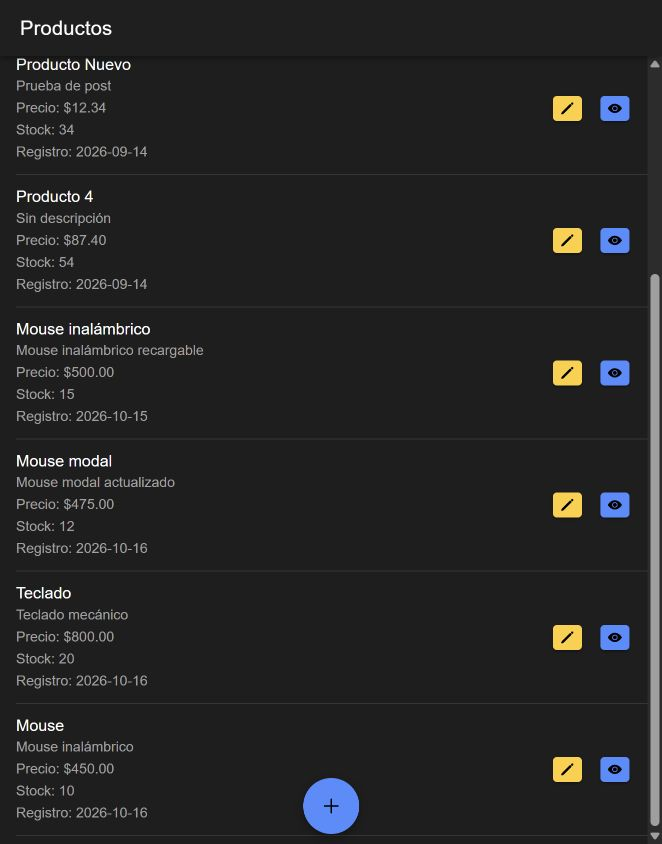
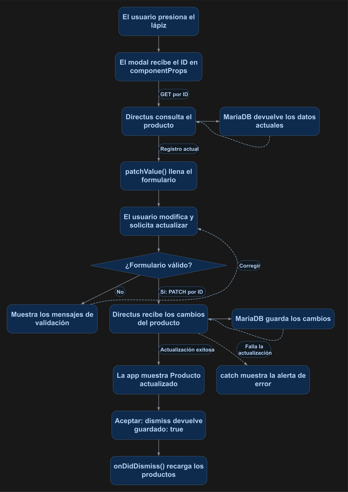

# Actualizar un elemento con Ionic mediante un modal

Abrirás el producto elegido sobre el listado, cargarás sus datos y guardarás sus cambios con `PATCH`. El modal devolverá el resultado al listado para que vuelva a consultar Directus sin recargar el navegador.

<p align="center">
  <br>
  <em>Figura 1. Resultado de la práctica ejecutado en Ionic.</em>
</p>

## 1. Antes de comenzar

Continúa con el [manual 03 mediante modal](03_crear_elemento_modal.md). Conserva la lectura, CORS y creación configurados. Si vienes de la variante mediante página, completa primero el manual 03 mediante modal: el formulario recibe el ID mediante `@Input()`, no desde la ruta.

Las rutas pertenecen al proyecto Ionic en `mobile/`. Ejecuta los comandos Docker desde la carpeta que contiene `docker-compose.yml`. Al generar páginas o componentes, configura manualmente `standalone: false` en `@Component`; este curso utiliza NgModules.

## 2. Conceptos y métodos que utilizarás

| Elemento | Uso | Resultado |
| --- | --- | --- |
| `componentProps` | `{ id: id }` | Entrega el ID al formulario. |
| `@Input() id` | Recibe un número opcional. | Distingue creación de edición. |
| `patchValue()` | Carga cuatro controles existentes. | Conserva sus validaciones. |
| `axios.patch()` | `PATCH /items/productos/{id}` | Actualiza el registro elegido. |
| `dismiss()` | `{ guardado: true }` | Comunica que debe recargarse el listado. |
| `onDidDismiss()` | Espera el cierre del modal. | Permite leer su resultado. |

## 3. Implementación paso a paso

### Paso 1. Revisar permisos y módulos

En Directus, habilita **Update** sobre `productos` para la política de las prácticas. Conserva **Read** y **Create**. El módulo del formulario necesita `ReactiveFormsModule`; el módulo del listado importa `ProductosFormPageModule`, como en el manual 03.

### Paso 2. Agregar el botón de edición

Dentro de cada `ion-item` del listado, agrega junto al botón de ojo:

```html
<ion-button fill="solid" color="warning" (click)="editarProducto(producto.id)" aria-label="Editar producto">
  <ion-icon slot="icon-only" name="pencil"></ion-icon>
</ion-button>
```

### Paso 3. Abrir el modal con su ID

En `mobile/src/app/productos-list/productos-list.page.ts`, ubica el cierre de `nuevoProducto()`. En la línea siguiente, dentro de `ProductosListPage`, agrega el método que abre el formulario con el ID seleccionado.

```typescript
async editarProducto(id: number): Promise<void> {
  const modal = await this.modalController.create({
    component: ProductosFormPage,
    componentProps: {
      id: id
    },
    breakpoints: [0, 0.5, 0.95],
    initialBreakpoint: 0.95
  });

  await modal.present();

  const { data } = await modal.onDidDismiss();

  if (data?.guardado) {
    await this.cargarProductos();
  }
}
```

### Paso 4. Adaptar el formulario

Importa `Input` desde Angular. Agrega `@Input() id?: number;`, `cargando = false` y el getter `esEdicion`, que devuelve `this.id !== undefined`. En `ngOnInit()`, construye primero el formulario y, si existe ID, espera `cargarProducto()`.

`cargarProducto()` consulta `/items/productos/{id}` y usa `patchValue()` para llenar nombre, descripción, precio y stock. Reemplaza `guardarProducto()` aplicando los cambios indicados abajo: elige `PATCH` con ID o `POST` sin él. Conserva `getError()`, las validaciones y `cerrarModal()`.

**`mobile/src/app/productos-form/productos-form.page.ts`**. Aplica estos cambios en el orden indicado.

Sustituye la línea `import { Component, OnInit } from '@angular/core';` al inicio del archivo y antes de `import { FormBuilder, FormGroup, Validators } from '@angular/forms';`.

```typescript
import { Component, Input, OnInit } from '@angular/core';
```

Sustituye la línea `interface ProductoCrear {` después de `import axios from 'axios';` / `import { environment } from '../../environments/environment';` y antes de `nombre: string;`.

```typescript
interface ProductoGuardar {
```

Inserta el fragmento después de `stock: number;` / `}` y antes de `@Component({`.

```typescript
interface ProductoDetalle {
  id: number;
  nombre: string;
  descripcion: string;
  precio: string | number;
  stock: number;
  fecha_registro: string;
}
```

Sustituye la línea `productoForm!: FormGroup;` después de `})` / `export class ProductosFormPage implements OnInit {` y antes de `guardando: boolean = false;`.

```typescript
  @Input() id?: number;

  productoForm!: FormGroup;
  cargando: boolean = false;
```

Sustituye el bloque desde `ngOnInit(): void {` hasta `}` después de `private modalController: ModalController` / `) {}` y antes de `private crearFormulario(): void {`.

```typescript
  get esEdicion(): boolean {
    return this.id !== undefined;
  }

  async ngOnInit(): Promise<void> {
    this.crearFormulario();

    if (this.esEdicion) {
      await this.cargarProducto();
    }
  }
```

Inserta el fragmento después de `?? 'El valor ingresado no es válido.';` / `}` y antes de `async cerrarModal(): Promise<void> {`.

```typescript
  private async cargarProducto(): Promise<void> {
    if (this.id === undefined) {
      return;
    }

    this.cargando = true;

    try {
      const response = await axios.get<{ data: ProductoDetalle }>(
        `${environment.apiUrl}/items/productos/${this.id}`
      );

      const producto = response.data.data;

      this.productoForm.patchValue({
        nombre: producto.nombre,
        descripcion: producto.descripcion,
        precio: producto.precio,
        stock: producto.stock
      });
    } catch (error) {
      console.error('Error al cargar el producto:', error);

      const alerta = await this.alertController.create({
        header: 'Error',
        message: 'No fue posible cargar los datos del producto. Revisa la conexión, el identificador y los permisos de lectura en Directus.',
        buttons: ['Aceptar']
      });

      await alerta.present();
    } finally {
      this.cargando = false;
    }
  }
```

Sustituye la línea `const producto: ProductoCrear = {` después de `this.guardando = true;` / `const valores = this.productoForm.value;` y antes de `nombre: valores.nombre.trim(),`.

```typescript
    const producto: ProductoGuardar = {
```

Inserta el fragmento después de `};` / `try {` y antes de `await axios.post(`.

```typescript
      if (this.esEdicion && this.id !== undefined) {
        await axios.patch(
          `${environment.apiUrl}/items/productos/${this.id}`,
          producto,
          {
            headers: {
              'Content-Type': 'application/json'
            }
          }
        );
      } else {
```

Sustituye el bloque desde `const alerta = await this.alertController.create({` hasta `message: 'El producto fue registrado correctamente.',` después de `}` / `);` y antes de `buttons: ['Aceptar']`.

```typescript
      }

      const alerta = await this.alertController.create({
        header: this.esEdicion ? 'Producto actualizado' : 'Producto guardado',
        message: this.esEdicion
          ? 'El producto fue actualizado correctamente.'
          : 'El producto fue registrado correctamente.',
```

Sustituye la línea `console.error('Error al guardar el producto:', error);` después de `});` / `} catch (error) {` y antes de `const alerta = await this.alertController.create({`.

```typescript
      console.error(
        this.esEdicion
          ? 'Error al actualizar el producto:'
          : 'Error al guardar el producto:',
        error
      );
```

Sustituye la línea `message: 'No fue posible guardar el producto. Revisa los datos, la conexión y los permisos de creación en Directus.',` después de `const alerta = await this.alertController.create({` / `header: 'Error',` y antes de `buttons: ['Aceptar']`.

```typescript
        message: this.esEdicion
          ? 'No fue posible actualizar el producto. Revisa los datos, la conexión y los permisos de actualización en Directus.'
          : 'No fue posible guardar el producto. Revisa los datos, la conexión y los permisos de creación en Directus.',
```

### Paso 5. Adaptar la vista

Aplica los cambios de la plantilla indicados abajo. El título y el botón cambian entre crear y editar; `cargando` muestra un indicador mientras llegan los datos. `guardando || cargando` deshabilita el envío durante esas operaciones.

**`mobile/src/app/productos-form/productos-form.page.html`**. Aplica estos cambios en el orden indicado.

Sustituye la línea `<ion-title>Nuevo producto</ion-title>` después de `</ion-button>` / `</ion-buttons>` y antes de `</ion-toolbar>`.

```html

    <ion-title>
      {{ esEdicion ? 'Editar producto' : 'Nuevo producto' }}
    </ion-title>
```

Sustituye la línea `<form *ngIf="productoForm" [formGroup]="productoForm" (ngSubmit)="guardarProducto()">` después de `</ion-header>` / `<ion-content class="ion-padding">` y antes de `<ion-list>`.

```html
  <div *ngIf="cargando" class="ion-text-center ion-padding">
    <ion-spinner></ion-spinner>
    <p>Cargando producto...</p>
  </div>

  <form *ngIf="productoForm && !cargando" [formGroup]="productoForm" (ngSubmit)="guardarProducto()">
```

Sustituye el bloque desde `<ion-button fill="solid" expand="block" type="submit" class="ion-margin-top" [disabled]="guardando">` hasta `{{ guardando ? 'Guardando...' : 'Guardar' }}` después de `</ion-note>` / `</ion-list>` y antes de `</ion-button>`.

```html
    <ion-button fill="solid" expand="block" type="submit" class="ion-margin-top" [disabled]="guardando || cargando">
      {{ guardando ? 'Guardando...' : (esEdicion ? 'Actualizar' : 'Guardar')}}
```

## 4. Comprobar el resultado

1. Presiona el lápiz de **Mouse modal**. La URL debe seguir siendo `/productos-list` y el modal debe contener los datos existentes.
2. Borra el nombre e intenta actualizar: debe aparecer su validación. Restaura el nombre.
3. Cambia la descripción a **Mouse modal actualizado**, el precio a **475** y el stock a **12**. Presiona **Actualizar** y acepta la confirmación.
4. Comprueba que el modal se cierre y que la fila muestre los cambios sin recargar.
5. Abre de nuevo el mismo producto y presiona **Cancelar**: no debe guardarse ninguna modificación.
6. El icono **+** debe seguir abriendo un formulario vacío para crear.

La figura 1 muestra el resultado obtenido con el código de esta práctica. Las fechas, los productos y el tema visual dependen de tu entorno.

## 5. Explicación detallada del flujo

La figura 2 muestra el recorrido de arriba hacia abajo.

<p align="center">
  <br>
  <em>Figura 2. Actualizar un producto mediante un modal.</em>
</p>

### Cómo llega el identificador

`componentProps` asigna el ID a la propiedad `@Input()` antes de inicializar el componente. `ngOnInit()` construye los controles y después solicita el registro. La creación no envía ID; por eso el mismo formulario puede iniciar vacío.

### Cómo se guardan los cambios

`patchValue()` llena los controles sin reemplazar sus reglas. `guardarProducto()` primero valida, convierte precio y stock a números y envía únicamente los cuatro campos editables. El ID se usa en la URL; la fecha queda a cargo de la base de datos.

### Cómo se actualiza el listado

Después del `PATCH`, la aplicación muestra una alerta y espera su cierre con `onDidDismiss()`. Luego `dismiss({ guardado: true })` cierra el formulario. El listado recibe ese resultado y llama a `cargarProductos()`. Cancelar devuelve `guardado: false`, de modo que no ejecuta la consulta de actualización. Si falla una petición, `catch` muestra la alerta y `finally` restablece el indicador correspondiente.
