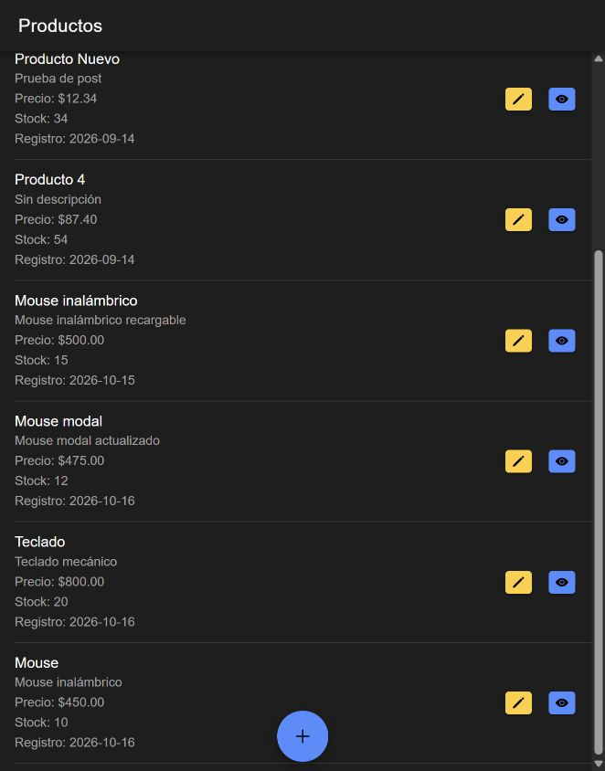
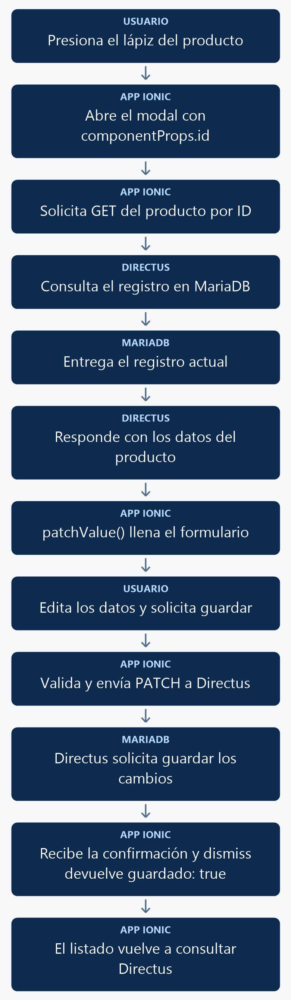

# Actualizar un elemento con Ionic mediante un modal

Abrirás el producto elegido sobre el listado, cargarás sus datos y guardarás sus cambios con `PATCH`. El modal devolverá el resultado al listado para que vuelva a consultar Directus sin recargar el navegador.

<p align="center">
  <br>
  <em>Figura 1. Resultado de la práctica ejecutado en Ionic.</em>
</p>

## 1. Antes de comenzar

Continúa con el [manual 03 mediante modal](03_crear_elemento_modal.md). Conserva la lectura, CORS y creación configurados. Si vienes de la variante mediante página, cambia los archivos por la referencia completa de esta práctica: el formulario recibe el ID mediante `@Input()`, no desde la ruta.

Las rutas pertenecen al proyecto Ionic en `mobile/`. Ejecuta los comandos Docker desde la carpeta que contiene `docker-compose.yml`. Al generar páginas o componentes, configura manualmente `standalone: false` en `@Component`; este curso utiliza NgModules.

## 2. Conceptos y métodos que utilizarás

| Elemento | Uso | Resultado |
| --- | --- | --- |
| `componentProps` | `{ id: id }` | Entrega el ID al formulario. |
| `@Input() id` | Recibe un número opcional. | Distingue creación de edición. |
| `patchValue()` | Carga cuatro controles existentes. | Conserva sus validaciones. |
| `axios.patch()` | `PATCH /items/productos/{id}` | Actualiza el registro elegido. |
| `dismiss()` | `{ guardado: true }` | Comunica que debe recargarse el listado. |
| `onDidDismiss()` | Espera el cierre del modal. | Permite leer su resultado. |

## 3. Implementación paso a paso

### Paso 1. Revisar permisos y módulos

En Directus, habilita **Update** sobre `productos` para la política de las prácticas. Conserva **Read** y **Create**. El módulo del formulario necesita `ReactiveFormsModule`; el módulo del listado importa `ProductosFormPageModule`, como en el manual 03.

### Paso 2. Agregar el botón de edición

Dentro de cada `ion-item` del listado, agrega junto al botón de ojo:

```html
<ion-button fill="solid" color="warning" (click)="editarProducto(producto.id)" aria-label="Editar producto">
  <ion-icon slot="icon-only" name="pencil"></ion-icon>
</ion-button>
```

### Paso 3. Abrir el modal con su ID

Conserva `nuevoProducto()` y agrega este método dentro de `ProductosListPage`:

```typescript
async editarProducto(id: number): Promise<void> {
  const modal = await this.modalController.create({
    component: ProductosFormPage,
    componentProps: {
      id: id
    },
    breakpoints: [0, 0.5, 0.95],
    initialBreakpoint: 0.95
  });

  await modal.present();

  const { data } = await modal.onDidDismiss();

  if (data?.guardado) {
    await this.cargarProductos();
  }
}
```

### Paso 4. Adaptar el formulario

Importa `Input` desde Angular. Agrega `@Input() id?: number;`, `cargando = false` y el getter `esEdicion`, que devuelve `this.id !== undefined`. En `ngOnInit()`, construye primero el formulario y, si existe ID, espera `cargarProducto()`.

`cargarProducto()` consulta `/items/productos/{id}` y usa `patchValue()` para llenar nombre, descripción, precio y stock. Reemplaza `guardarProducto()` por la versión completa de la sección 4: elige `PATCH` con ID o `POST` sin él. Conserva `getError()`, las validaciones y `cerrarModal()`.

### Paso 5. Adaptar la vista

Utiliza el HTML completo de la sección 4. El título y el botón cambian entre crear y editar; `cargando` muestra un indicador mientras llegan los datos. `guardando || cargando` deshabilita el envío durante esas operaciones.

## 4. Código completo de referencia

### `mobile/src/app/productos-list/productos-list.module.ts`

```typescript
import { NgModule } from '@angular/core';
import { CommonModule } from '@angular/common';
import { FormsModule } from '@angular/forms';

import { IonicModule } from '@ionic/angular';

import { ProductosListPageRoutingModule } from './productos-list-routing.module';

import { ProductosFormPageModule } from '../productos-form/productos-form.module';

import { ProductosListPage } from './productos-list.page';

@NgModule({
  imports: [
    CommonModule,
    FormsModule,
    IonicModule,
    ProductosListPageRoutingModule,
    ProductosFormPageModule
  ],
  declarations: [ProductosListPage]
})
export class ProductosListPageModule {}
```

### `mobile/src/app/productos-list/productos-list.page.ts`

```typescript
import { Component, OnInit } from '@angular/core';
import { ModalController } from '@ionic/angular';
import axios from 'axios';
import { environment } from '../../environments/environment';
import { ProductosFormPage } from '../productos-form/productos-form.page';

interface Producto {
  id: number;
  nombre: string;
  descripcion: string;
  precio: string;
  stock: number;
  fecha_registro: string;
}

@Component({
  selector: 'app-productos-list',
  templateUrl: './productos-list.page.html',
  styleUrls: ['./productos-list.page.scss'],
  standalone: false,
})
export class ProductosListPage implements OnInit {

  productos: Producto[] = [];

  constructor(
    private modalController: ModalController
  ) {}

  ngOnInit(): void {
    this.cargarProductos();
  }

  async cargarProductos(): Promise<void> {
    try {
      const response = await axios.get<{ data: Producto[] }>(
        `${environment.apiUrl}/items/productos`
      );

      this.productos = response.data.data;
    } catch (error) {
      console.error('Error al cargar los productos:', error);
    }
  }

  async nuevoProducto(): Promise<void> {
    const modal = await this.modalController.create({
      component: ProductosFormPage,
      breakpoints: [0, 0.5, 0.95],
      initialBreakpoint: 0.95
    });

    await modal.present();

    const { data } = await modal.onDidDismiss();

    if (data?.guardado) {
      await this.cargarProductos();
    }
  }

  async editarProducto(id: number): Promise<void> {
    const modal = await this.modalController.create({
      component: ProductosFormPage,
      componentProps: {
        id: id
      },
      breakpoints: [0, 0.5, 0.95],
      initialBreakpoint: 0.95
    });

    await modal.present();

    const { data } = await modal.onDidDismiss();

    if (data?.guardado) {
      await this.cargarProductos();
    }
  }
}
```

### `mobile/src/app/productos-list/productos-list.page.html`

```html
<ion-header>
  <ion-toolbar>
    <ion-title>Productos</ion-title>
  </ion-toolbar>
</ion-header>

<ion-content>
  <ion-list>
    <ion-item *ngFor="let producto of productos">
      <ion-label class="ion-text-wrap">
        <h2>{{ producto.nombre }}</h2>
        <p>{{ producto.descripcion }}</p>
        <p>Precio: ${{ producto.precio }}</p>
        <p>Stock: {{ producto.stock }}</p>
        <p>Registro: {{ producto.fecha_registro | date:'yyyy-MM-dd' }}</p>
      </ion-label>
      <ion-button fill="solid" slot="end" [routerLink]="['/productos-view', producto.id]" aria-label="Ver detalle">
        <ion-icon slot="icon-only" name="eye"></ion-icon>
      </ion-button>
      <ion-button fill="solid" color="warning" (click)="editarProducto(producto.id)" aria-label="Editar producto">
        <ion-icon slot="icon-only" name="pencil"></ion-icon>
      </ion-button>
    </ion-item>
  </ion-list>
  <ion-fab slot="fixed" vertical="bottom" horizontal="center">
      <ion-fab-button (click)="nuevoProducto()" aria-label="Nuevo producto">
          <ion-icon name="add"></ion-icon>
      </ion-fab-button>
  </ion-fab>
</ion-content>
```

### `mobile/src/app/productos-form/productos-form.module.ts`

```typescript
import { NgModule } from '@angular/core';
import { CommonModule } from '@angular/common';
import { FormsModule, ReactiveFormsModule } from '@angular/forms';

import { IonicModule } from '@ionic/angular';

import { ProductosFormPageRoutingModule } from './productos-form-routing.module';

import { ProductosFormPage } from './productos-form.page';

@NgModule({
  imports: [
    CommonModule,
    FormsModule,
    ReactiveFormsModule,
    IonicModule,
    ProductosFormPageRoutingModule
  ],
  declarations: [ProductosFormPage]
})
export class ProductosFormPageModule {}
```

### `mobile/src/app/productos-form/productos-form.page.ts`

```typescript
import { Component, Input, OnInit } from '@angular/core';
import { FormBuilder, FormGroup, Validators } from '@angular/forms';
import { AlertController, ModalController } from '@ionic/angular';
import axios from 'axios';
import { environment } from '../../environments/environment';

interface ProductoGuardar {
  nombre: string;
  descripcion: string;
  precio: number;
  stock: number;
}

interface ProductoDetalle {
  id: number;
  nombre: string;
  descripcion: string;
  precio: string | number;
  stock: number;
  fecha_registro: string;
}

@Component({
  selector: 'app-productos-form',
  templateUrl: './productos-form.page.html',
  styleUrls: ['./productos-form.page.scss'],
  standalone: false,
})
export class ProductosFormPage implements OnInit {

  @Input() id?: number;

  productoForm!: FormGroup;
  cargando: boolean = false;
  guardando: boolean = false;

  mensajesValidacion: Record<string, Record<string, string>> = {
    nombre: {
      required: 'El nombre es obligatorio.',
      maxlength: 'El nombre no debe superar 150 caracteres.'
    },
    precio: {
      required: 'El precio es obligatorio.',
      min: 'El precio debe ser igual o mayor que cero.'
    },
    stock: {
      required: 'El stock es obligatorio.',
      min: 'El stock debe ser igual o mayor que cero.',
      pattern: 'El stock debe contener únicamente números enteros.'
    }
  };

  constructor(
    private formBuilder: FormBuilder,
    private alertController: AlertController,
    private modalController: ModalController
  ) {}

  get esEdicion(): boolean {
    return this.id !== undefined;
  }

  async ngOnInit(): Promise<void> {
    this.crearFormulario();

    if (this.esEdicion) {
      await this.cargarProducto();
    }
  }

  private crearFormulario(): void {
    this.productoForm = this.formBuilder.group({
      nombre: ['', [
        Validators.required,
        Validators.maxLength(150)
      ]],
      descripcion: [''],
      precio: ['', [
        Validators.required,
        Validators.min(0)
      ]],
      stock: ['', [
        Validators.required,
        Validators.min(0),
        Validators.pattern('^[0-9]+$')
      ]]
    });
  }

  getError(controlName: string): string {
    const control = this.productoForm.get(controlName);

    if (
      !control ||
      !control.errors ||
      !(control.touched || control.dirty)
    ) {
      return '';
    }

    const tipoError = Object.keys(control.errors)[0];

    return this.mensajesValidacion[controlName]?.[tipoError]
      ?? 'El valor ingresado no es válido.';
  }

  private async cargarProducto(): Promise<void> {
    if (this.id === undefined) {
      return;
    }

    this.cargando = true;

    try {
      const response = await axios.get<{ data: ProductoDetalle }>(
        `${environment.apiUrl}/items/productos/${this.id}`
      );

      const producto = response.data.data;

      this.productoForm.patchValue({
        nombre: producto.nombre,
        descripcion: producto.descripcion,
        precio: producto.precio,
        stock: producto.stock
      });
    } catch (error) {
      console.error('Error al cargar el producto:', error);

      const alerta = await this.alertController.create({
        header: 'Error',
        message: 'No fue posible cargar los datos del producto. Revisa la conexión, el identificador y los permisos de lectura en Directus.',
        buttons: ['Aceptar']
      });

      await alerta.present();
    } finally {
      this.cargando = false;
    }
  }

  async cerrarModal(): Promise<void> {
    await this.modalController.dismiss({
      guardado: false
    });
  }

  async guardarProducto(): Promise<void> {
    if (this.productoForm.invalid) {
      this.productoForm.markAllAsTouched();
      return;
    }

    this.guardando = true;

    const valores = this.productoForm.value;

    const producto: ProductoGuardar = {
      nombre: valores.nombre.trim(),
      descripcion: valores.descripcion?.trim() ?? '',
      precio: Number(valores.precio),
      stock: Number(valores.stock)
    };

    try {
      if (this.esEdicion && this.id !== undefined) {
        await axios.patch(
          `${environment.apiUrl}/items/productos/${this.id}`,
          producto,
          {
            headers: {
              'Content-Type': 'application/json'
            }
          }
        );
      } else {
        await axios.post(
          `${environment.apiUrl}/items/productos`,
          producto,
          {
            headers: {
              'Content-Type': 'application/json'
            }
          }
        );
      }

      const alerta = await this.alertController.create({
        header: this.esEdicion ? 'Producto actualizado' : 'Producto guardado',
        message: this.esEdicion
          ? 'El producto fue actualizado correctamente.'
          : 'El producto fue registrado correctamente.',
        buttons: ['Aceptar']
      });

      await alerta.present();
      await alerta.onDidDismiss();

      await this.modalController.dismiss({
        guardado: true
      });
    } catch (error) {
      console.error(
        this.esEdicion
          ? 'Error al actualizar el producto:'
          : 'Error al guardar el producto:',
        error
      );

      const alerta = await this.alertController.create({
        header: 'Error',
        message: this.esEdicion
          ? 'No fue posible actualizar el producto. Revisa los datos, la conexión y los permisos de actualización en Directus.'
          : 'No fue posible guardar el producto. Revisa los datos, la conexión y los permisos de creación en Directus.',
        buttons: ['Aceptar']
      });

      await alerta.present();
    } finally {
      this.guardando = false;
    }
  }
}
```

### `mobile/src/app/productos-form/productos-form.page.html`

```html
<ion-header>
  <ion-toolbar>
    <ion-buttons slot="start">
      <ion-button fill="solid" (click)="cerrarModal()">
        Cancelar
      </ion-button>
    </ion-buttons>

    <ion-title>
      {{ esEdicion ? 'Editar producto' : 'Nuevo producto' }}
    </ion-title>
  </ion-toolbar>
</ion-header>

<ion-content class="ion-padding">
  <div *ngIf="cargando" class="ion-text-center ion-padding">
    <ion-spinner></ion-spinner>
    <p>Cargando producto...</p>
  </div>

  <form *ngIf="productoForm && !cargando" [formGroup]="productoForm" (ngSubmit)="guardarProducto()">
    <ion-list>
      <ion-item>
        <ion-input label="Nombre" labelPlacement="stacked" type="text" formControlName="nombre" maxlength="150"></ion-input>
      </ion-item>
      <ion-note color="danger" *ngIf="getError('nombre') as error">
        {{ error }}
      </ion-note>

      <ion-item>
        <ion-textarea label="Descripción" labelPlacement="stacked" formControlName="descripcion" autoGrow="true"></ion-textarea>
      </ion-item>

      <ion-item>
        <ion-input label="Precio" labelPlacement="stacked" type="number" formControlName="precio" min="0"></ion-input>
      </ion-item>
      <ion-note color="danger" *ngIf="getError('precio') as error">
        {{ error }}
      </ion-note>

      <ion-item>
        <ion-input label="Stock" labelPlacement="stacked" type="number" formControlName="stock" min="0"></ion-input>
      </ion-item>
      <ion-note color="danger" *ngIf="getError('stock') as error">
        {{ error }}
      </ion-note>
    </ion-list>

    <ion-button fill="solid" expand="block" type="submit" class="ion-margin-top" [disabled]="guardando || cargando">
      {{ guardando ? 'Guardando...' : (esEdicion ? 'Actualizar' : 'Guardar')}}
    </ion-button>
  </form>
</ion-content>
```

### `mobile/src/app/productos-form/productos-form-routing.module.ts`

```typescript
import { NgModule } from '@angular/core';
import { Routes, RouterModule } from '@angular/router';
import { ProductosFormPage } from './productos-form.page';
const routes: Routes = [{ path: '', component: ProductosFormPage }];
@NgModule({ imports: [RouterModule.forChild(routes)], exports: [RouterModule] })
export class ProductosFormPageRoutingModule {}
```

## 5. Comprobar el resultado

1. Presiona el lápiz de **Mouse modal**. La URL debe seguir siendo `/productos-list` y el modal debe contener los datos existentes.
2. Borra el nombre e intenta actualizar: debe aparecer su validación. Restaura el nombre.
3. Cambia la descripción a **Mouse modal actualizado**, el precio a **475** y el stock a **12**. Presiona **Actualizar** y acepta la confirmación.
4. Comprueba que el modal se cierre y que la fila muestre los cambios sin recargar.
5. Abre de nuevo el mismo producto y presiona **Cancelar**: no debe guardarse ninguna modificación.
6. El icono **+** debe seguir abriendo un formulario vacío para crear.

La figura 1 muestra el resultado obtenido con el código de esta práctica. Las fechas, los productos y el tema visual dependen de tu entorno.

## 6. Explicación detallada del flujo

La figura 2 muestra el recorrido de arriba hacia abajo.

<p align="center">
  <br>
  <em>Figura 2. Actualizar un producto mediante un modal.</em>
</p>

### Cómo llega el identificador

`componentProps` asigna el ID a la propiedad `@Input()` antes de inicializar el componente. `ngOnInit()` construye los controles y después solicita el registro. La creación no envía ID; por eso el mismo formulario puede iniciar vacío.

### Cómo se guardan los cambios

`patchValue()` llena los controles sin reemplazar sus reglas. `guardarProducto()` primero valida, convierte precio y stock a números y envía únicamente los cuatro campos editables. El ID se usa en la URL; la fecha queda a cargo de la base de datos.

### Cómo se actualiza el listado

Después del `PATCH`, la aplicación muestra una alerta y espera su cierre con `onDidDismiss()`. Luego `dismiss({ guardado: true })` cierra el formulario. El listado recibe ese resultado y llama a `cargarProductos()`. Cancelar devuelve `guardado: false`, de modo que no ejecuta la consulta de actualización. Si falla una petición, `catch` muestra la alerta y `finally` restablece el indicador correspondiente.
