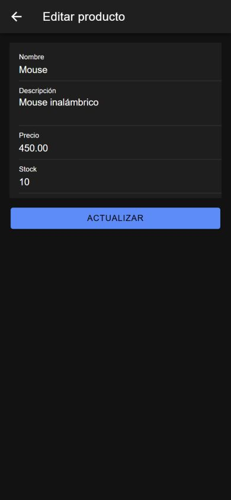
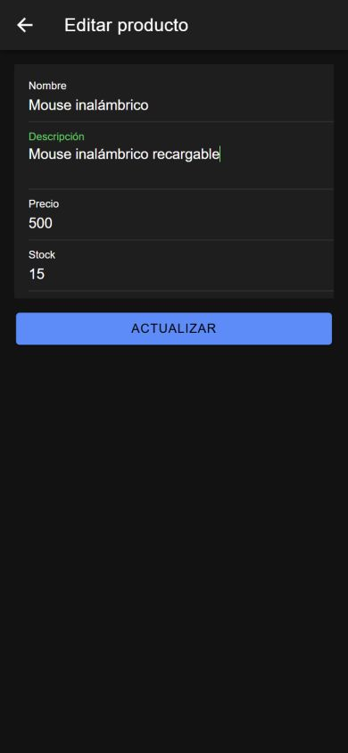
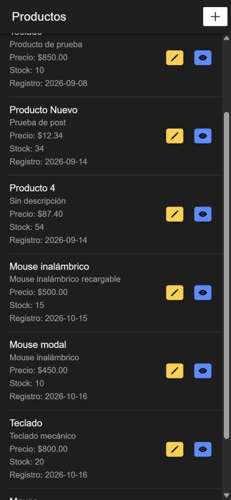
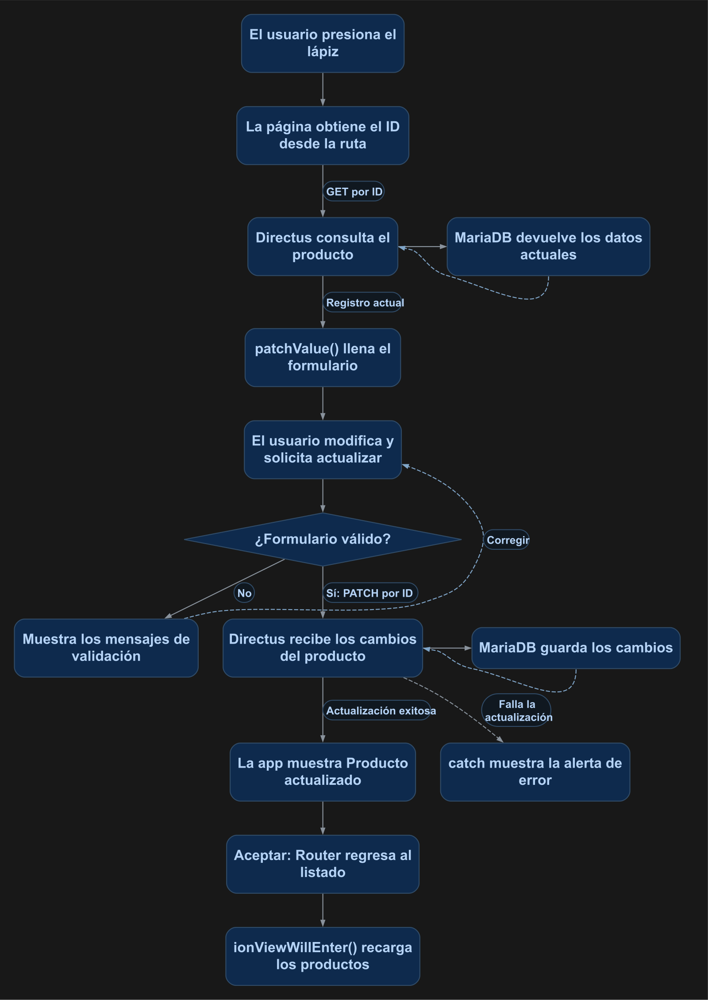

# Actualizar un elemento con Ionic mediante una página

En esta práctica reutilizarás el formulario de creación para editar un producto. Al presionar el icono de lápiz, la app consultará ese registro, mostrará sus datos y enviará los cambios a Directus mediante `PATCH`. Después de aceptar la confirmación, el listado volverá a consultar la colección.

**Resultado esperado:** abrir `/productos-form/5` muestra los datos del producto seleccionado, como en la figura 1. Utiliza el ID que exista en tu colección.

<p align="center">
  <br>
  <em>Figura 1. Formulario de edición cargado con los datos existentes del producto.</em>
</p>

Las capturas se tomaron con el código de esta práctica en la aplicación Ionic, con tamaño de pantalla móvil. El tema oscuro, los identificadores, las fechas y los demás registros corresponden al entorno de prueba.

## 1. Antes de comenzar

Continúa con el [manual 03: creación mediante página](03_crear_elemento_pagina.md) funcionando y con al menos un producto registrado. Conserva Axios, `environment.apiUrl`, los permisos de lectura y creación y la configuración de CORS.

- Ejecuta los comandos desde la carpeta que contiene `docker-compose.yml`.
- Las rutas del proyecto Ionic comienzan en `mobile/src/` en este repositorio.
- Conserva `standalone: false` en las páginas. Si generas una página o componente, configura ese valor manualmente en `@Component`.
- Esta variante utiliza `Router` y una página independiente. La [actualización mediante modal](04_actualizar_elemento_modal.md) es otra alternativa.

Los archivos finales de esta práctica están reunidos en la sección 4.

## 2. Conceptos y métodos que utilizarás

| Elemento | Cómo se utiliza | Para qué sirve |
| --- | --- | --- |
| `[routerLink]` | `['/productos-form', producto.id]` | Abre la página con el ID del producto elegido. |
| `ActivatedRoute` | `snapshot.paramMap.get('id')` | Obtiene el parámetro de la ruta. |
| `Number()` y `Number.isNaN()` | Convertir el parámetro y comprobar si es numérico. | Permiten guardar el ID recibido como número. |
| `esEdicion` | `this.idProducto !== undefined` | Distingue entre editar un registro y crear uno. |
| `axios.get()` | `GET /items/productos/{id}` | Consulta los datos de un producto. |
| `patchValue()` | `this.productoForm.patchValue({...})` | Carga los campos recibidos en el formulario existente. |
| `axios.patch()` | `await axios.patch(url, producto, opciones)` | Envía los campos que se actualizarán en el registro seleccionado. |
| `axios.post()` | `POST /items/productos` | Conserva la creación cuando no se recibe un ID. |
| `onDidDismiss()` | `await alerta.onDidDismiss()` | Espera a que se cierre la confirmación antes de regresar. |
| `ionViewWillEnter()` | `this.cargarProductos()` | Vuelve a consultar la colección al regresar al listado. |

Se conservan el formulario reactivo, `Validators`, `getError()` y `markAllAsTouched()` del manual 03. `cargando` controla la espera de la consulta inicial y `guardando` el envío del formulario.

## 3. Implementación paso a paso

### Paso 1. Permitir actualizar en Directus

Abre `http://localhost:8000`. En **Access Policies**, habilita **Update** sobre `productos` en la política utilizada en las prácticas. Conserva **Read** y **Create**. El formulario enviará únicamente `nombre`, `descripcion`, `precio` y `stock`; no agregues `id` ni `fecha_registro` a los controles o al cuerpo de la petición.

### Paso 2. Agregar la ruta de edición

En `mobile/src/app/productos-form/productos-form-routing.module.ts`, reemplaza el arreglo `routes` por:

```typescript
const routes: Routes = [
  { path: ':id', component: ProductosFormPage },
  { path: '', component: ProductosFormPage }
];
```

La ruta **`:id` es para editar**: `/productos-form/5`. La ruta **vacía es para crear**: `/productos-form`. Conserva en `app-routing.module.ts` la carga del módulo para `path: 'productos-form'` del manual anterior; no agregues allí otra entrada con `:id`.

### Paso 3. Abrir el producto desde el listado

En `mobile/src/app/productos-list/productos-list.page.html`, dentro de cada `ion-item`, después del botón con icono de ojo, agrega:

```html
<ion-button fill="solid" color="warning" [routerLink]="['/productos-form', producto.id]">
  <ion-icon slot="icon-only" name="pencil"></ion-icon>
</ion-button>
```

Conserva el botón de detalle con icono de ojo y el de creación con icono **+**. Aquí se muestra el acceso de creación en la barra; si elegiste el botón flotante del manual 03, conserva ese acceso y agrega únicamente el de edición a cada fila.

En el TypeScript del listado conserva `ionViewWillEnter()` llamando a `cargarProductos()`, como en el manual 03 mediante página. Así los cambios aparecerán al regresar sin recargar el navegador.

### Paso 4. Detectar el ID e inicializar el formulario

En `mobile/src/app/productos-form/productos-form.page.ts`, reemplaza la importación de `Router` por:

```typescript
import { ActivatedRoute, Router } from '@angular/router';
```

Reemplaza `ProductoCrear` por `ProductoGuardar` y agrega `ProductoDetalle` antes de `@Component`:

```typescript
interface ProductoGuardar {
  nombre: string;
  descripcion: string;
  precio: number;
  stock: number;
}

interface ProductoDetalle {
  id: number;
  nombre: string;
  descripcion: string;
  precio: string | number;
  stock: number;
  fecha_registro: string;
}
```

Dentro de la clase, junto a `productoForm` y `guardando`, agrega `idProducto?: number;` y `cargando: boolean = false;`. Reemplaza el constructor y `ngOnInit()`, y agrega el getter `esEdicion`:

```typescript
constructor(
  private formBuilder: FormBuilder,
  private alertController: AlertController,
  private activatedRoute: ActivatedRoute,
  private router: Router
) {}

get esEdicion(): boolean {
  return this.idProducto !== undefined;
}

async ngOnInit(): Promise<void> {
  this.crearFormulario();

  const id = this.activatedRoute.snapshot.paramMap.get('id');

  if (id !== null) {
    const idConvertido = Number(id);

    if (!Number.isNaN(idConvertido)) {
      this.idProducto = idConvertido;
      await this.cargarProducto();
    }
  }
}
```

Conserva `crearFormulario()`, `mensajesValidacion` y `getError()` del manual 03. El formulario se construye **antes** de consultar sus datos. Si la ruta no trae ID, queda vacío para crear; si trae un valor numérico, se carga el registro.

### Paso 5. Consultar y cargar los valores actuales

Dentro de la misma clase, agrega:

```typescript
private async cargarProducto(): Promise<void> {
  if (this.idProducto === undefined) {
    return;
  }

  this.cargando = true;

  try {
    const response = await axios.get<{ data: ProductoDetalle }>(
      `${environment.apiUrl}/items/productos/${this.idProducto}`
    );

    const producto = response.data.data;

    this.productoForm.patchValue({
      nombre: producto.nombre,
      descripcion: producto.descripcion,
      precio: producto.precio,
      stock: producto.stock
    });
  } catch (error) {
    console.error('Error al cargar el producto:', error);

    const alerta = await this.alertController.create({
      header: 'Error',
      message: 'No fue posible cargar los datos del producto. Revisa la conexión, el identificador y los permisos de lectura en Directus.',
      buttons: ['Aceptar']
    });

    await alerta.present();
  } finally {
    this.cargando = false;
  }
}
```

`response.data.data` contiene el producto entregado por Directus. `patchValue()` llena los cuatro campos editables; el ID se conserva por separado para construir la URL del `PATCH`.

### Paso 6. Elegir entre actualizar y crear al guardar

Reemplaza el método `guardarProducto()` por:

```typescript
async guardarProducto(): Promise<void> {
  if (this.productoForm.invalid) {
    this.productoForm.markAllAsTouched();
    return;
  }

  this.guardando = true;

  const valores = this.productoForm.value;

  const producto: ProductoGuardar = {
    nombre: valores.nombre.trim(),
    descripcion: valores.descripcion?.trim() ?? '',
    precio: Number(valores.precio),
    stock: Number(valores.stock)
  };

  try {
    if (this.esEdicion && this.idProducto !== undefined) {
      await axios.patch(
        `${environment.apiUrl}/items/productos/${this.idProducto}`,
        producto,
        {
          headers: {
            'Content-Type': 'application/json'
          }
        }
      );
    } else {
      await axios.post(
        `${environment.apiUrl}/items/productos`,
        producto,
        {
          headers: {
            'Content-Type': 'application/json'
          }
        }
      );
    }

    const alerta = await this.alertController.create({
      header: this.esEdicion ? 'Producto actualizado' : 'Producto guardado',
      message: this.esEdicion
        ? 'El producto fue actualizado correctamente.'
        : 'El producto fue registrado correctamente.',
      buttons: ['Aceptar']
    });

    await alerta.present();
    await alerta.onDidDismiss();

    await this.router.navigate(['/productos-list']);
  } catch (error) {
    console.error(
      this.esEdicion
        ? 'Error al actualizar el producto:'
        : 'Error al guardar el producto:',
      error
    );

    const alerta = await this.alertController.create({
      header: 'Error',
      message: this.esEdicion
        ? 'No fue posible actualizar el producto. Revisa los datos, la conexión y los permisos de actualización en Directus.'
        : 'No fue posible guardar el producto. Revisa los datos, la conexión y los permisos de creación en Directus.',
      buttons: ['Aceptar']
    });

    await alerta.present();
  } finally {
    this.guardando = false;
  }
}
```

El formulario inválido se detiene antes de enviar datos. Si `esEdicion` es verdadero, se ejecuta `PATCH` con el ID; en caso contrario se conserva el `POST` de creación. La navegación ocurre después de aceptar la confirmación.

### Paso 7. Adaptar el HTML al modo de edición

En `productos-form.page.html`, cambia el título por:

```html
<ion-title>{{ esEdicion ? 'Editar producto' : 'Nuevo producto' }}</ion-title>
```

Antes del formulario agrega el indicador de carga y ajusta la condición del `form`:

```html
<div *ngIf="cargando" class="ion-text-center ion-padding">
  <ion-spinner name="crescent"></ion-spinner>
  <p>Cargando producto...</p>
</div>

<form *ngIf="productoForm && !cargando" [formGroup]="productoForm" (ngSubmit)="guardarProducto()">
  <!-- Conserva aquí los cuatro campos y sus mensajes del manual 03. -->
</form>
```

Dentro del formulario, el botón de envío queda así:

```html
<ion-button fill="solid" expand="block" type="submit" [disabled]="guardando">
  {{ guardando ? 'Guardando...' : (esEdicion ? 'Actualizar' : 'Guardar') }}
</ion-button>
```

Conserva `ReactiveFormsModule` y la flecha de regreso con `defaultHref="/productos-list"`. Compara el archivo final con la sección siguiente.

## 4. Código completo de referencia

Estos archivos corresponden a la variante mediante página con el botón **+** en la barra. Conserva las demás páginas, las rutas principales y `environment` de los manuales anteriores. No necesitas agregar estilos para esta práctica.

### `mobile/src/app/productos-form/productos-form-routing.module.ts`

```typescript
import { NgModule } from '@angular/core';
import { Routes, RouterModule } from '@angular/router';

import { ProductosFormPage } from './productos-form.page';

const routes: Routes = [
  {
    path: ':id',
    component: ProductosFormPage
  },
  {
    path: '',
    component: ProductosFormPage
  }
];

@NgModule({
  imports: [RouterModule.forChild(routes)],
  exports: [RouterModule],
})
export class ProductosFormPageRoutingModule {}
```

### `mobile/src/app/productos-list/productos-list.module.ts`

```typescript
import { NgModule } from '@angular/core';
import { CommonModule } from '@angular/common';
import { FormsModule } from '@angular/forms';

import { IonicModule } from '@ionic/angular';

import { ProductosListPageRoutingModule } from './productos-list-routing.module';

import { ProductosListPage } from './productos-list.page';

@NgModule({
  imports: [
    CommonModule,
    FormsModule,
    IonicModule,
    ProductosListPageRoutingModule
  ],
  declarations: [ProductosListPage]
})
export class ProductosListPageModule {}
```

### `mobile/src/app/productos-list/productos-list.page.ts`

```typescript
import { Component } from '@angular/core';
import axios from 'axios';
import { environment } from '../../environments/environment';

interface Producto {
  id: number;
  nombre: string;
  descripcion: string;
  precio: string;
  stock: number;
  fecha_registro: string;
}

@Component({
  selector: 'app-productos-list',
  templateUrl: './productos-list.page.html',
  styleUrls: ['./productos-list.page.scss'],
  standalone: false,
})
export class ProductosListPage {

  productos: Producto[] = [];

  ionViewWillEnter(): void {
    this.cargarProductos();
  }

  async cargarProductos(): Promise<void> {
    try {
      const response = await axios.get<{ data: Producto[] }>(
        `${environment.apiUrl}/items/productos`
      );

      this.productos = response.data.data;
    } catch (error) {
      console.error('Error al cargar los productos:', error);
    }
  }
}
```

### `mobile/src/app/productos-list/productos-list.page.html`

```html
<ion-header>
  <ion-toolbar>
    <ion-title>Productos</ion-title>
    <ion-buttons slot="end">
      <ion-button fill="solid" [routerLink]="['/productos-form']" aria-label="Nuevo producto">
        <ion-icon slot="icon-only" name="add"></ion-icon>
      </ion-button>
    </ion-buttons>
  </ion-toolbar>
</ion-header>

<ion-content>
  <ion-list>
    <ion-item *ngFor="let producto of productos">
      <ion-label class="ion-text-wrap">
        <h2>{{ producto.nombre }}</h2>
        <p>{{ producto.descripcion }}</p>
        <p>Precio: ${{ producto.precio }}</p>
        <p>Stock: {{ producto.stock }}</p>
        <p>Registro: {{ producto.fecha_registro | date:'yyyy-MM-dd' }}</p>
      </ion-label>
      <ion-button fill="solid" slot="end" [routerLink]="['/productos-view', producto.id]" aria-label="Ver detalle">
        <ion-icon slot="icon-only" name="eye"></ion-icon>
      </ion-button>
      <ion-button fill="solid" color="warning" [routerLink]="['/productos-form', producto.id]">
        <ion-icon slot="icon-only" name="pencil"></ion-icon>
      </ion-button>
    </ion-item>
  </ion-list>
</ion-content>
```

### `mobile/src/app/productos-form/productos-form.module.ts`

```typescript
import { NgModule } from '@angular/core';
import { CommonModule } from '@angular/common';
import { FormsModule, ReactiveFormsModule } from '@angular/forms';

import { IonicModule } from '@ionic/angular';

import { ProductosFormPageRoutingModule } from './productos-form-routing.module';

import { ProductosFormPage } from './productos-form.page';

@NgModule({
  imports: [
    CommonModule,
    FormsModule,
    ReactiveFormsModule,
    IonicModule,
    ProductosFormPageRoutingModule
  ],
  declarations: [ProductosFormPage]
})
export class ProductosFormPageModule {}
```

### `mobile/src/app/productos-form/productos-form.page.ts`

```typescript
import { Component, OnInit } from '@angular/core';
import { FormBuilder, FormGroup, Validators } from '@angular/forms';
import { ActivatedRoute, Router } from '@angular/router';
import { AlertController } from '@ionic/angular';
import axios from 'axios';
import { environment } from '../../environments/environment';

interface ProductoGuardar {
  nombre: string;
  descripcion: string;
  precio: number;
  stock: number;
}

interface ProductoDetalle {
  id: number;
  nombre: string;
  descripcion: string;
  precio: string | number;
  stock: number;
  fecha_registro: string;
}

@Component({
  selector: 'app-productos-form',
  templateUrl: './productos-form.page.html',
  styleUrls: ['./productos-form.page.scss'],
  standalone: false,
})
export class ProductosFormPage implements OnInit {

  productoForm!: FormGroup;
  idProducto?: number;
  cargando: boolean = false;
  guardando: boolean = false;

  mensajesValidacion: Record<string, Record<string, string>> = {
    nombre: {
      required: 'El nombre es obligatorio.',
      maxlength: 'El nombre no debe superar 150 caracteres.'
    },
    precio: {
      required: 'El precio es obligatorio.',
      min: 'El precio debe ser igual o mayor que cero.'
    },
    stock: {
      required: 'El stock es obligatorio.',
      min: 'El stock debe ser igual o mayor que cero.',
      pattern: 'El stock debe contener únicamente números enteros.'
    }
  };

  constructor(
    private formBuilder: FormBuilder,
    private alertController: AlertController,
    private activatedRoute: ActivatedRoute,
    private router: Router
  ) {}

  get esEdicion(): boolean {
    return this.idProducto !== undefined;
  }

  async ngOnInit(): Promise<void> {
    this.crearFormulario();

    const id = this.activatedRoute.snapshot.paramMap.get('id');

    if (id !== null) {
      const idConvertido = Number(id);

      if (!Number.isNaN(idConvertido)) {
        this.idProducto = idConvertido;
        await this.cargarProducto();
      }
    }
  }

  private crearFormulario(): void {
    this.productoForm = this.formBuilder.group({
      nombre: ['', [
        Validators.required,
        Validators.maxLength(150)
      ]],
      descripcion: [''],
      precio: ['', [
        Validators.required,
        Validators.min(0)
      ]],
      stock: ['', [
        Validators.required,
        Validators.min(0),
        Validators.pattern('^[0-9]+$')
      ]]
    });
  }

  getError(controlName: string): string {
    const control = this.productoForm.get(controlName);

    if (
      !control ||
      !control.errors ||
      !(control.touched || control.dirty)
    ) {
      return '';
    }

    const tipoError = Object.keys(control.errors)[0];

    return this.mensajesValidacion[controlName]?.[tipoError]
      ?? 'El valor ingresado no es válido.';
  }

  private async cargarProducto(): Promise<void> {
    if (this.idProducto === undefined) {
      return;
    }

    this.cargando = true;

    try {
      const response = await axios.get<{ data: ProductoDetalle }>(
        `${environment.apiUrl}/items/productos/${this.idProducto}`
      );

      const producto = response.data.data;

      this.productoForm.patchValue({
        nombre: producto.nombre,
        descripcion: producto.descripcion,
        precio: producto.precio,
        stock: producto.stock
      });
    } catch (error) {
      console.error('Error al cargar el producto:', error);

      const alerta = await this.alertController.create({
        header: 'Error',
        message: 'No fue posible cargar los datos del producto. Revisa la conexión, el identificador y los permisos de lectura en Directus.',
        buttons: ['Aceptar']
      });

      await alerta.present();
    } finally {
      this.cargando = false;
    }
  }

  async guardarProducto(): Promise<void> {
    if (this.productoForm.invalid) {
      this.productoForm.markAllAsTouched();
      return;
    }

    this.guardando = true;

    const valores = this.productoForm.value;

    const producto: ProductoGuardar = {
      nombre: valores.nombre.trim(),
      descripcion: valores.descripcion?.trim() ?? '',
      precio: Number(valores.precio),
      stock: Number(valores.stock)
    };

    try {
      if (this.esEdicion && this.idProducto !== undefined) {
        await axios.patch(
          `${environment.apiUrl}/items/productos/${this.idProducto}`,
          producto,
          {
            headers: {
              'Content-Type': 'application/json'
            }
          }
        );
      } else {
        await axios.post(
          `${environment.apiUrl}/items/productos`,
          producto,
          {
            headers: {
              'Content-Type': 'application/json'
            }
          }
        );
      }

      const alerta = await this.alertController.create({
        header: this.esEdicion ? 'Producto actualizado' : 'Producto guardado',
        message: this.esEdicion
          ? 'El producto fue actualizado correctamente.'
          : 'El producto fue registrado correctamente.',
        buttons: ['Aceptar']
      });

      await alerta.present();
      await alerta.onDidDismiss();

      await this.router.navigate(['/productos-list']);
    } catch (error) {
      console.error(
        this.esEdicion
          ? 'Error al actualizar el producto:'
          : 'Error al guardar el producto:',
        error
      );

      const alerta = await this.alertController.create({
        header: 'Error',
        message: this.esEdicion
          ? 'No fue posible actualizar el producto. Revisa los datos, la conexión y los permisos de actualización en Directus.'
          : 'No fue posible guardar el producto. Revisa los datos, la conexión y los permisos de creación en Directus.',
        buttons: ['Aceptar']
      });

      await alerta.present();
    } finally {
      this.guardando = false;
    }
  }
}
```

### `mobile/src/app/productos-form/productos-form.page.html`

```html
<ion-header>
  <ion-toolbar>
    <ion-buttons slot="start">
      <ion-back-button defaultHref="/productos-list"></ion-back-button>
    </ion-buttons>

    <ion-title>
      {{ esEdicion ? 'Editar producto' : 'Nuevo producto' }}
    </ion-title>
  </ion-toolbar>
</ion-header>

<ion-content class="ion-padding">
  <div *ngIf="cargando" class="ion-text-center ion-padding">
    <ion-spinner></ion-spinner>
    <p>Cargando producto...</p>
  </div>

  <form *ngIf="productoForm && !cargando" [formGroup]="productoForm" (ngSubmit)="guardarProducto()">
    <ion-list>
      <ion-item>
        <ion-input label="Nombre" labelPlacement="stacked" type="text" formControlName="nombre" maxlength="150"></ion-input>
      </ion-item>
      <ion-note color="danger" *ngIf="getError('nombre') as error">
        {{ error }}
      </ion-note>

      <ion-item>
        <ion-textarea label="Descripción" labelPlacement="stacked" formControlName="descripcion" autoGrow="true"></ion-textarea>
      </ion-item>

      <ion-item>
        <ion-input label="Precio" labelPlacement="stacked" type="number" formControlName="precio" min="0"></ion-input>
      </ion-item>
      <ion-note color="danger" *ngIf="getError('precio') as error">
        {{ error }}
      </ion-note>

      <ion-item>
        <ion-input label="Stock" labelPlacement="stacked" type="number" formControlName="stock" min="0"></ion-input>
      </ion-item>
      <ion-note color="danger" *ngIf="getError('stock') as error">
        {{ error }}
      </ion-note>
    </ion-list>

    <ion-button fill="solid" expand="block" type="submit" class="ion-margin-top" [disabled]="guardando || cargando">
      {{ guardando ? 'Guardando...' : (esEdicion ? 'Actualizar' : 'Guardar') }}
    </ion-button>
  </form>
</ion-content>
```

## 5. Comprobar el resultado

Con la aplicación Ionic abierta, sigue esta secuencia:

1. En el listado, presiona el **lápiz** del producto que deseas modificar. La URL debe incluir su ID y el formulario debe mostrar los valores existentes (figura 1).
2. Vacía el nombre o escribe un precio negativo y trata de actualizar. Deben aparecer los mensajes de validación; corrige los campos antes de continuar.
3. Para reproducir el ejemplo, parte del producto **Mouse**, con precio **450** y stock **10**, y cambia sus datos por los de esta tabla. La figura 2 muestra el formulario antes del envío.

| Campo | Valor nuevo |
| --- | --- |
| Nombre | Mouse inalámbrico |
| Descripción | Mouse inalámbrico recargable |
| Precio | 500 |
| Stock | 15 |

<p align="center">
  <br>
  <em>Figura 2. Valores modificados, preparados para enviarse mediante PATCH.</em>
</p>

4. Presiona **Actualizar**. Debe aparecer **Producto actualizado**. Acepta y comprueba que el listado muestre los cambios sin recargar el navegador (figura 3).
5. Abre el icono de **ojo** del mismo producto para comprobar que el detalle también muestra sus datos actualizados.
6. Regresa y presiona **+**. Debe abrirse el formulario vacío con el título **Nuevo producto** y el botón **Guardar**. Prueba la creación para confirmar que se conserva el `POST`; en la prueba se registró **Teclado**, descripción **Teclado mecánico**, precio **800** y stock **20**.

<p align="center">
  <br>
  <em>Figura 3. Listado consultado de nuevo al regresar después de la actualización.</em>
</p>

Estas pruebas modifican un registro existente y crean otro en la colección `productos` del entorno de prácticas. Utiliza el ID real de tu producto; el ejemplo se probó editando el ID 5.

## 6. Explicación detallada del flujo

### De la fila seleccionada al formulario

`[routerLink]="['/productos-form', producto.id]"` construye la ruta del registro elegido. El módulo del formulario reconoce el segmento `:id`; `ActivatedRoute.snapshot.paramMap.get('id')` lo entrega como cadena o devuelve `null` si no existe.

`Number()` convierte el parámetro y `Number.isNaN()` evita tratar una conversión no numérica como un ID. El getter `esEdicion` depende de si se asignó `idProducto`; con él se eligen el título, el texto del botón y el tipo de petición. La consulta inicial ocurre en `ngOnInit()`, después de construir el formulario.

`axios.get()` pide un solo registro a Directus. Axios guarda el cuerpo HTTP en `response.data` y Directus coloca el producto en la propiedad `data` de ese cuerpo; por eso se utiliza `response.data.data`. El precio recibido admite cadena o número, mientras que al guardar se convierte a número.

`patchValue()` asigna los valores a los controles existentes. No recrea el formulario ni elimina sus validaciones. `cargando` muestra el indicador y oculta el formulario mientras se espera la respuesta; `finally` restablece ese estado incluso si falla la consulta.

### Del formulario a Directus y de regreso

`guardarProducto()` primero comprueba la validez. `markAllAsTouched()` permite mostrar los mensajes de `getError()`; el `return` impide continuar con un formulario inválido.

Después prepara un objeto con los cuatro campos editables. `trim()` quita espacios del nombre y la descripción; `?.trim() ?? ''` permite una descripción vacía. `Number()` convierte precio y stock. No se envían el ID ni la fecha generada por la base de datos.

En edición, `PATCH /items/productos/{id}` actualiza el registro señalado por la URL. Sin ID, `POST /items/productos` crea otro. El mismo formulario conserva ambos usos sin duplicar los controles.

`guardando` deshabilita el botón durante el envío. Si la petición tiene éxito, la app presenta la confirmación, espera su cierre con `onDidDismiss()` y regresa mediante `Router`. Si falla, `catch` registra el error y muestra la alerta correspondiente; `finally` libera el estado de guardado.

Al volver al listado, `ionViewWillEnter()` ejecuta `cargarProductos()`. Esta nueva consulta actualiza el arreglo de `*ngFor` y muestra los valores guardados sin recargar todo el navegador.

La figura 4 muestra el recorrido de arriba hacia abajo.

<p align="center">
  <br>
  <em>Figura 4. Actualizar un producto mediante una página.</em>
</p>
