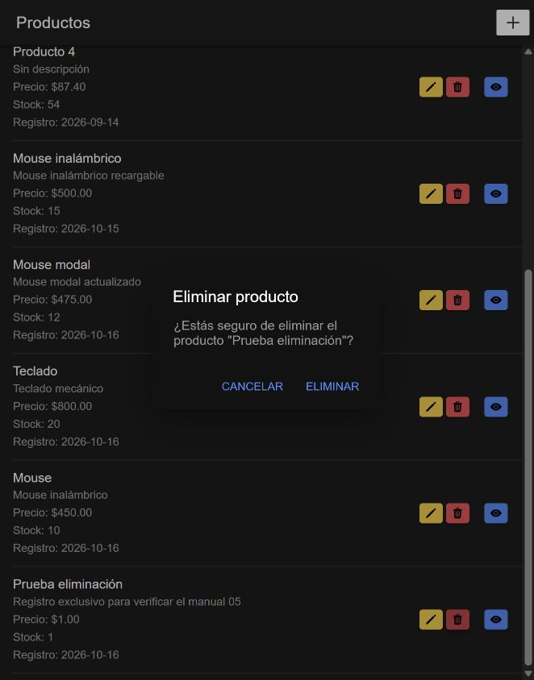
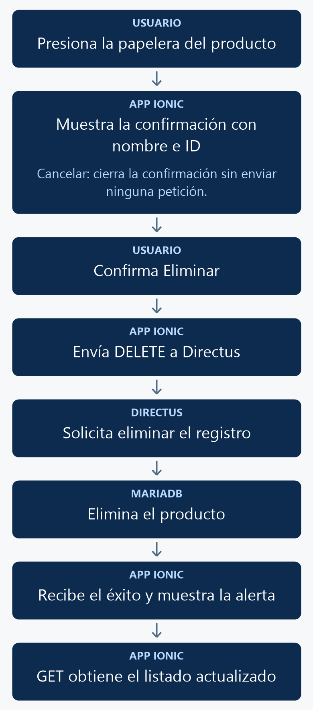

# Eliminar un elemento con Ionic

Agregarás un botón con icono de papelera para confirmar la eliminación de un producto y actualizar el listado después de la respuesta de Directus.

<p align="center">
  <br>
  <em>Figura 1. Resultado de la práctica ejecutado en Ionic.</em>
</p>

## 1. Antes de comenzar

Continúa con una variante del manual 04 funcionando. La referencia completa de este manual usa la variante mediante página. Para la variante modal conserva también `ModalController`, `nuevoProducto()` y `editarProducto()`; agrega únicamente lo indicado aquí. Trabaja con un producto creado expresamente para la prueba.

Las rutas pertenecen al proyecto Ionic en `mobile/`. Ejecuta los comandos Docker desde la carpeta que contiene `docker-compose.yml`. Al generar páginas o componentes, configura manualmente `standalone: false` en `@Component`; este curso utiliza NgModules.

## 2. Conceptos y métodos que utilizarás

| Elemento | Cómo se utiliza | Para qué sirve |
| --- | --- | --- |
| `AlertController` | `create()` y `present()` | Solicita confirmar la acción. |
| `role: cancel` | Botón Cancelar. | Cierra sin enviar una petición. |
| `handler` | Llama a `eliminarProducto(id)`. | Ejecuta la acción elegida. |
| `axios.delete()` | `DELETE /items/productos/{id}` | Elimina el registro seleccionado. |
| `onDidDismiss()` | Espera la alerta de éxito. | Recarga el listado después de aceptar. |

## 3. Implementación paso a paso

### Paso 1. Revisar el permiso

En Directus, en la política de las prácticas, habilita **Delete** sobre `productos`. Conserva el permiso de lectura. Una relación de base de datos puede impedir borrar un registro: utiliza uno de prueba sin relaciones.

### Paso 2. Agregar la papelera

Dentro del `ion-item` de cada producto, junto a los demás botones, agrega:

```html
<ion-button fill="solid" color="danger" (click)="confirmarEliminar(producto.id, producto.nombre)" aria-label="Eliminar producto">
  <ion-icon slot="icon-only" name="trash"></ion-icon>
</ion-button>
```

### Paso 3. Inyectar el controlador

Importa `AlertController` desde `@ionic/angular` y agrégalo al constructor. Si ya utilizas `ModalController`, conserva ambos.

```typescript
constructor(private alertController: AlertController) {}
```

### Paso 4. Confirmar y eliminar

Agrega estos métodos dentro de `ProductosListPage`:

```typescript
async confirmarEliminar(id: number, nombre: string): Promise<void> {
  const alerta = await this.alertController.create({
    header: 'Eliminar producto',
    message: `¿Estás seguro de eliminar el producto "${nombre}"?`,
    buttons: [
      {
        text: 'Cancelar',
        role: 'cancel'
      },
      {
        text: 'Eliminar',
        role: 'destructive',
        handler: () => {
          void this.eliminarProducto(id);
        }
      }
    ]
  });

  await alerta.present();
}
async eliminarProducto(id: number): Promise<void> {
  try {
    await axios.delete(
      `${environment.apiUrl}/items/productos/${id}`
    );

    const alerta = await this.alertController.create({
      header: 'Producto eliminado',
      message: 'El producto fue eliminado correctamente.',
      buttons: ['Aceptar']
    });

    await alerta.present();
    await alerta.onDidDismiss();

    await this.cargarProductos();
  } catch (error) {
    console.error('Error al eliminar el producto:', error);

    const alerta = await this.alertController.create({
      header: 'Error',
      message: 'No fue posible eliminar el producto. Revisa la conexión, los permisos de eliminación en Directus y las relaciones del registro.',
      buttons: ['Aceptar']
    });

    await alerta.present();
  }
}
```

Conserva el resto de la clase. En la variante modal, la recarga después de guardar sigue dependiendo de `onDidDismiss()`; en la variante página, de `ionViewWillEnter()`. La eliminación llama directamente a `cargarProductos()` desde el método anterior.

## 4. Código completo de referencia

### `mobile/src/app/productos-list/productos-list.page.ts`

```typescript
import { Component } from '@angular/core';
import { AlertController } from '@ionic/angular';
import axios from 'axios';
import { environment } from '../../environments/environment';

interface Producto {
  id: number;
  nombre: string;
  descripcion: string;
  precio: string;
  stock: number;
  fecha_registro: string;
}

@Component({
  selector: 'app-productos-list',
  templateUrl: './productos-list.page.html',
  styleUrls: ['./productos-list.page.scss'],
  standalone: false,
})
export class ProductosListPage {

  constructor(private alertController: AlertController) {}

  productos: Producto[] = [];

  ionViewWillEnter(): void {
    this.cargarProductos();
  }

  async cargarProductos(): Promise<void> {
    try {
      const response = await axios.get<{ data: Producto[] }>(
        `${environment.apiUrl}/items/productos`
      );

      this.productos = response.data.data;
    } catch (error) {
      console.error('Error al cargar los productos:', error);
    }
  }

async confirmarEliminar(id: number, nombre: string): Promise<void> {
  const alerta = await this.alertController.create({
    header: 'Eliminar producto',
    message: `¿Estás seguro de eliminar el producto "${nombre}"?`,
    buttons: [
      {
        text: 'Cancelar',
        role: 'cancel'
      },
      {
        text: 'Eliminar',
        role: 'destructive',
        handler: () => {
          void this.eliminarProducto(id);
        }
      }
    ]
  });

  await alerta.present();
}
async eliminarProducto(id: number): Promise<void> {
  try {
    await axios.delete(
      `${environment.apiUrl}/items/productos/${id}`
    );

    const alerta = await this.alertController.create({
      header: 'Producto eliminado',
      message: 'El producto fue eliminado correctamente.',
      buttons: ['Aceptar']
    });

    await alerta.present();
    await alerta.onDidDismiss();

    await this.cargarProductos();
  } catch (error) {
    console.error('Error al eliminar el producto:', error);

    const alerta = await this.alertController.create({
      header: 'Error',
      message: 'No fue posible eliminar el producto. Revisa la conexión, los permisos de eliminación en Directus y las relaciones del registro.',
      buttons: ['Aceptar']
    });

    await alerta.present();
  }
}
}
```

### `mobile/src/app/productos-list/productos-list.page.html`

```html
<ion-header>
  <ion-toolbar>
    <ion-title>Productos</ion-title>
    <ion-buttons slot="end">
      <ion-button fill="solid" [routerLink]="['/productos-form']" aria-label="Nuevo producto">
        <ion-icon slot="icon-only" name="add"></ion-icon>
      </ion-button>
    </ion-buttons>
  </ion-toolbar>
</ion-header>

<ion-content>
  <ion-list>
    <ion-item *ngFor="let producto of productos">
      <ion-label class="ion-text-wrap">
        <h2>{{ producto.nombre }}</h2>
        <p>{{ producto.descripcion }}</p>
        <p>Precio: ${{ producto.precio }}</p>
        <p>Stock: {{ producto.stock }}</p>
        <p>Registro: {{ producto.fecha_registro | date:'yyyy-MM-dd' }}</p>
      </ion-label>
      <ion-button fill="solid" slot="end" [routerLink]="['/productos-view', producto.id]" aria-label="Ver detalle">
        <ion-icon slot="icon-only" name="eye"></ion-icon>
      </ion-button>
      <ion-button fill="solid" color="warning" [routerLink]="['/productos-form', producto.id]">
        <ion-icon slot="icon-only" name="pencil"></ion-icon>
      </ion-button>
      <ion-button fill="solid" color="danger" (click)="confirmarEliminar(producto.id, producto.nombre)" aria-label="Eliminar producto">
        <ion-icon slot="icon-only" name="trash"></ion-icon>
      </ion-button>
    </ion-item>
  </ion-list>
</ion-content>
```

## 5. Comprobar el resultado

1. Crea un producto exclusivo para la prueba, por ejemplo **Prueba eliminación**.
2. Presiona su papelera: la confirmación debe nombrar ese producto, como en la figura 1.
3. Presiona **Cancelar** y comprueba que el registro siga en el listado.
4. Vuelve a abrir la confirmación y elige **Eliminar**. Debe aparecer **Producto eliminado**. Acepta y verifica que desaparezca sin recargar el navegador.
5. No uses un registro con relaciones para esta primera prueba.

La figura 1 muestra el resultado obtenido con el código de esta práctica. Las fechas, los productos y el tema visual dependen de tu entorno.

## 6. Explicación detallada del flujo

La figura 2 muestra el recorrido de arriba hacia abajo.

<p align="center">
  <br>
  <em>Figura 2. Eliminar un producto con confirmación.</em>
</p>

`confirmarEliminar()` recibe el ID y el nombre de la fila. La alerta explica qué registro se eligió; la petición utiliza el ID. Cancelar tiene el rol `cancel` y no llama al método de eliminación.

El `handler` de Eliminar inicia `eliminarProducto()`; `void` expresa que ese callback no devuelve la promesa al controlador de la alerta. El método espera `axios.delete()` antes de mostrar éxito. La respuesta puede no contener cuerpo, por lo que no se intenta leer `response.data.data`.

Después de aceptar la alerta de éxito, `cargarProductos()` reemplaza los datos mostrados. Si Directus rechaza la petición por permisos, conexión o relaciones, `catch` muestra un error. La aplicación no debe mostrar una eliminación exitosa cuando la API respondió con un fallo.
