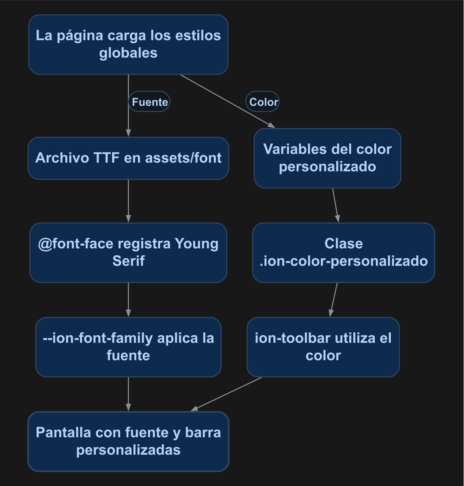

# Cambiar fuentes y estilos en Ionic

Aplicarás una fuente local, un color personalizado y estilos de página. Los componentes conservarán sus propiedades de Ionic y la fuente se servirá desde los recursos de la aplicación.

<p align="center">
  <br>
  <em>Figura 1. Resultado de la práctica ejecutado en Ionic.</em>
</p>

## 1. Antes de comenzar

Necesitas el listado de productos funcionando. La fuente de esta práctica es **Young Serif**, distribuida con licencia SIL Open Font License. El repositorio incluye el archivo y su licencia en `docs/manuales/recursos/`; puedes consultar su [distribución oficial](https://github.com/google/fonts/tree/main/ofl/youngserif).

Las rutas pertenecen al proyecto Ionic en `mobile/`. Ejecuta los comandos Docker desde la carpeta que contiene `docker-compose.yml`. Al generar páginas o componentes, configura manualmente `standalone: false` en `@Component`; este curso utiliza NgModules.

## 2. Conceptos y métodos que utilizarás

| Elemento | Uso | Resultado |
| --- | --- | --- |
| `@font-face` | Registra el archivo TTF. | Define la familia tipográfica. |
| `--ion-font-family` | Variable global de Ionic. | Aplica la fuente a sus componentes. |
| `:root` | Contiene variables globales. | Comparte fuente y colores. |
| `.ion-color-personalizado` | Vincula las variables del color. | Habilita `color="personalizado"`. |
| `--border-radius` | Propiedad CSS de un botón Ionic. | Ajusta sus esquinas. |

## 3. Implementación paso a paso

### Paso 1. Copiar la fuente

Crea `mobile/src/assets/font/` y copia allí `docs/manuales/recursos/YoungSerif-Regular.ttf`. Conserva su licencia cuando distribuyas el archivo.

### Paso 2. Cargar los estilos globales

Al final de `mobile/src/global.scss`, agrega una sola vez:

```scss
@import "./app/app.component.scss";
```

Conserva las importaciones de Ionic que ya contiene ese archivo.

### Paso 3. Registrar la fuente y el color

Coloca el contenido completo de `app.component.scss` de la sección 4 en `mobile/src/app/app.component.scss`. La URL `/assets/font/...` corresponde al despliegue en la raíz utilizado por esta aplicación. `font-display: swap` permite mostrar texto mientras se descarga la fuente.

### Paso 4. Utilizar el color

En el encabezado del listado usa:

```html
<ion-toolbar color="personalizado">
  <ion-title>Productos</ion-title>
  <!-- Conserva aquí tus botones de la barra. -->
</ion-toolbar>
```

Ionic también permite los colores `primary`, `secondary`, `tertiary`, `success`, `warning`, `danger`, `light`, `medium` y `dark`. El nuevo color se usa con la misma propiedad.

### Paso 5. Agregar un estilo de página

Coloca `.boton-producto` de la sección 4 en `productos-list.page.scss` y agrega `class="boton-producto"` a un botón del listado que quieras redondear. Sus estilos pertenecen a esa página. Para crear otra paleta puedes utilizar el [generador de colores de Ionic](https://ionicframework.com/docs/theming/color-generator).

## 4. Código completo de referencia

### `mobile/src/app/app.component.scss`

```scss
@font-face {
  font-family: 'Young Serif';
  src: url('/assets/font/YoungSerif-Regular.ttf') format('truetype');
  font-weight: 400;
  font-style: normal;
  font-display: swap;
}

:root {
  --ion-font-family: 'Young Serif', serif;
  --ion-color-personalizado: #686090;
  --ion-color-personalizado-rgb: 104, 96, 144;
  --ion-color-personalizado-contrast: #ffffff;
  --ion-color-personalizado-contrast-rgb: 255, 255, 255;
  --ion-color-personalizado-shade: #5c547f;
  --ion-color-personalizado-tint: #77709b;
}

.ion-color-personalizado {
  --ion-color-base: var(--ion-color-personalizado);
  --ion-color-base-rgb: var(--ion-color-personalizado-rgb);
  --ion-color-contrast: var(--ion-color-personalizado-contrast);
  --ion-color-contrast-rgb: var(--ion-color-personalizado-contrast-rgb);
  --ion-color-shade: var(--ion-color-personalizado-shade);
  --ion-color-tint: var(--ion-color-personalizado-tint);
}
```

### `mobile/src/app/productos-list/productos-list.page.scss`

```scss
.boton-producto {
  --border-radius: 12px;
  font-weight: bold;
}
```

### `mobile/src/global.scss`

```scss
/*
 * App Global CSS
 * ----------------------------------------------------------------------------
 * Put style rules here that you want to apply globally. These styles are for
 * the entire app and not just one component. Additionally, this file can be
 * used as an entry point to import other CSS/Sass files to be included in the
 * output CSS.
 * For more information on global stylesheets, visit the documentation:
 * https://ionicframework.com/docs/layout/global-stylesheets
 */

/* Core CSS required for Ionic components to work properly */
@import "@ionic/angular/css/core.css";

/* Basic CSS for apps built with Ionic */
@import "@ionic/angular/css/normalize.css";
@import "@ionic/angular/css/structure.css";
@import "@ionic/angular/css/typography.css";
@import "@ionic/angular/css/display.css";

/* Optional CSS utils that can be commented out */
@import "@ionic/angular/css/padding.css";
@import "@ionic/angular/css/float-elements.css";
@import "@ionic/angular/css/text-alignment.css";
@import "@ionic/angular/css/text-transformation.css";
@import "@ionic/angular/css/flex-utils.css";

/**
 * Ionic Dark Mode
 * -----------------------------------------------------
 * For more info, please see:
 * https://ionicframework.com/docs/theming/dark-mode
 */

/* @import "@ionic/angular/css/palettes/dark.always.css"; */
/* @import "@ionic/angular/css/palettes/dark.class.css"; */
@import "@ionic/angular/css/palettes/dark.system.css";

@import "./app/app.component.scss";
```

## 5. Comprobar el resultado

1. Abre el listado: el encabezado debe verse con el color personalizado y los textos con Young Serif, como en la figura 1.
2. Abre un formulario: la fuente debe continuar aplicada.
3. Comprueba que `/assets/font/YoungSerif-Regular.ttf` responda desde Ionic y que el navegador haya cargado la familia **Young Serif**.
4. Aplica `class="boton-producto"` a un botón y comprueba sus esquinas.

La figura 1 muestra el resultado obtenido con el código de esta práctica. Las fechas, los productos y el tema visual dependen de tu entorno.

## 6. Explicación detallada del flujo

La figura 2 muestra el recorrido de arriba hacia abajo.

<p align="center">
  <br>
  <em>Figura 2. Aplicar la fuente y el color.</em>
</p>

### Alcance de los estilos

`global.scss` conserva las importaciones base de Ionic y carga la configuración compartida de `app.component.scss`. Las variables de `:root` quedan disponibles para las páginas. Los estilos de un `page.scss` se aplican al componente de esa página.

### Fuente local

`@font-face` relaciona el nombre de la familia con su archivo. `--ion-font-family` indica a Ionic qué familia utilizar; `serif` proporciona una alternativa durante la carga. La fuente incluida tiene peso 400. Si necesitas otros pesos, registra archivos que los contengan.

### Variables de color

La variable principal guarda el color; `rgb` representa sus canales sin el símbolo hexadecimal. `contrast` define el texto que se dibuja encima y `contrast-rgb` sus canales. `shade` y `tint` aportan variantes para los estados de los componentes. La clase `.ion-color-personalizado` asigna esos valores a las variables que consume Ionic.

Las propiedades CSS que ofrece cada componente, como `--border-radius`, permiten ajustar su presentación. Consulta las propiedades del componente en la [documentación de Ionic](https://ionicframework.com/docs/theming/css-custom-properties).
