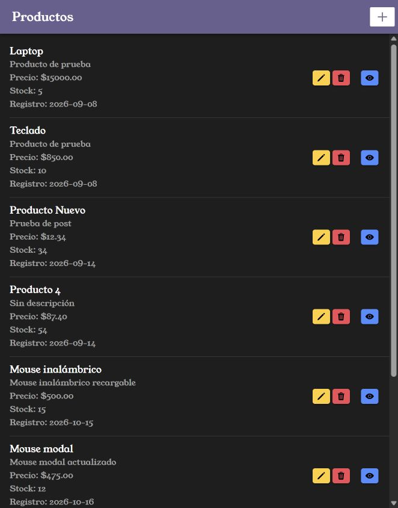
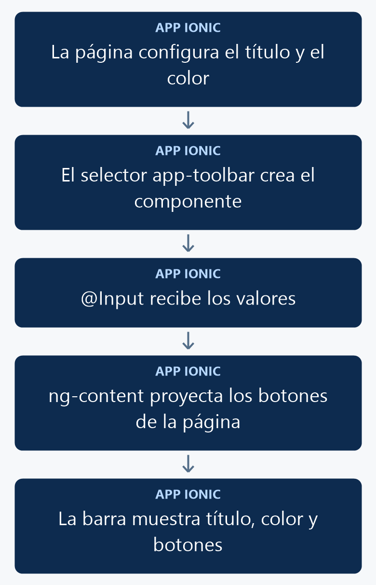

# Crear componentes reutilizables con Ionic y Angular

Crearás `ToolbarComponent` para compartir el encabezado entre páginas. El componente recibirá el título y el color mediante `@Input()`; cada página podrá conservar sus botones dentro de la barra.

<p align="center">
  <br>
  <em>Figura 1. Resultado de la práctica ejecutado en Ionic.</em>
</p>

## 1. Antes de comenzar

Continúa con el listado funcionando. El color `personalizado` procede del [manual 06](06_fuentes_estilos.md); también puedes usar un color disponible de Ionic, como `primary`.

Las rutas pertenecen al proyecto Ionic en `mobile/`. Ejecuta los comandos Docker desde la carpeta que contiene `docker-compose.yml`. Al generar páginas o componentes, configura manualmente `standalone: false` en `@Component`; este curso utiliza NgModules.

## 2. Conceptos y métodos que utilizarás

| Elemento | Uso | Resultado |
| --- | --- | --- |
| `selector` | `app-toolbar` | Define la etiqueta del componente. |
| `@Input()` | `nombre` y `color` | Recibe valores desde la página. |
| Interpolación | `{{ nombre }}` | Muestra el título recibido. |
| `[nombre]` | `[nombre]="titulo"` | Envía una propiedad de TypeScript. |
| `NgModule` | Declara y exporta el componente. | Permite importarlo en otras páginas. |
| `ng-content` | Aloja los botones que escribe la página. | Conserva las acciones de la barra. |

## 3. Implementación paso a paso

### Paso 1. Generar el componente

```powershell
docker compose exec mobile ionic g component components/toolbar
```

Abre `toolbar.component.ts` y agrega manualmente `standalone: false` al decorador. Reemplaza su contenido por el de la sección 4.

### Paso 2. Definir las entradas y la vista

Agrega `@Input() nombre` y `@Input() color`. Utiliza el HTML completo de la sección 4: el título muestra `nombre`, la barra recibe `color` y `ng-content` conserva los botones proporcionados por la página.

### Paso 3. Crear el módulo

Crea `toolbar.module.ts` en la misma carpeta. Declara `ToolbarComponent`, importa `CommonModule` e `IonicModule` y expórtalo, como en la sección 4.

### Paso 4. Importar y utilizar el componente

Importa `ToolbarModule` en `productos-list.module.ts` y agrégalo a sus `imports`, conservando los módulos que ya utiliza. En `productos-list.page.ts`, dentro de la clase, agrega `titulo: string = 'Productos';`. Reemplaza el encabezado del listado por:

```html
<app-toolbar [nombre]="titulo" color="personalizado">
  <ion-buttons slot="end">
    <ion-button fill="solid" [routerLink]="['/productos-form']" aria-label="Nuevo producto">
      <ion-icon slot="icon-only" name="add"></ion-icon>
    </ion-button>
  </ion-buttons>
</app-toolbar>
```

Conserva el contenido del listado. Para usar la barra en otra página, importa `ToolbarModule` en su módulo y escribe el selector con sus valores, por ejemplo `<app-toolbar nombre="Categorías" color="secondary"></app-toolbar>`. El archivo SCSS del componente puede quedar vacío.

## 4. Código completo de referencia

### `mobile/src/app/components/toolbar/toolbar.component.ts`

```typescript
import { Component, Input } from '@angular/core';
@Component({
  selector: 'app-toolbar',
  templateUrl: './toolbar.component.html',
  styleUrls: ['./toolbar.component.scss'],
  standalone: false
})
export class ToolbarComponent {
  @Input() nombre: string = '';
  @Input() color: string = 'primary';
}
```

### `mobile/src/app/components/toolbar/toolbar.component.html`

```html
<ion-header [translucent]="true">
  <ion-toolbar [color]="color">
    <ion-title>{{ nombre }}</ion-title>
    <ng-content></ng-content>
  </ion-toolbar>
</ion-header>
```

### `mobile/src/app/components/toolbar/toolbar.module.ts`

```typescript
import { NgModule } from '@angular/core';
import { CommonModule } from '@angular/common';
import { IonicModule } from '@ionic/angular';
import { ToolbarComponent } from './toolbar.component';
@NgModule({
  declarations: [ToolbarComponent],
  imports: [CommonModule, IonicModule],
  exports: [ToolbarComponent]
})
export class ToolbarModule {}
```

### `mobile/src/app/productos-list/productos-list.module.ts`

```typescript
import { ToolbarModule } from '../components/toolbar/toolbar.module';
import { NgModule } from '@angular/core';
import { CommonModule } from '@angular/common';
import { FormsModule } from '@angular/forms';

import { IonicModule } from '@ionic/angular';

import { ProductosListPageRoutingModule } from './productos-list-routing.module';

import { ProductosListPage } from './productos-list.page';

@NgModule({
  imports: [
    ToolbarModule,
    CommonModule,
    FormsModule,
    IonicModule,
    ProductosListPageRoutingModule
  ],
  declarations: [ProductosListPage]
})
export class ProductosListPageModule {}
```

### `mobile/src/app/productos-list/productos-list.page.html`

```html
<app-toolbar [nombre]="titulo" color="personalizado">
  <ion-buttons slot="end">
    <ion-button fill="solid" [routerLink]="['/productos-form']" aria-label="Nuevo producto">
      <ion-icon slot="icon-only" name="add"></ion-icon>
    </ion-button>
  </ion-buttons>
</app-toolbar>

<ion-content>
  <ion-list>
    <ion-item *ngFor="let producto of productos">
      <ion-label class="ion-text-wrap">
        <h2>{{ producto.nombre }}</h2>
        <p>{{ producto.descripcion }}</p>
        <p>Precio: ${{ producto.precio }}</p>
        <p>Stock: {{ producto.stock }}</p>
        <p>Registro: {{ producto.fecha_registro | date:'yyyy-MM-dd' }}</p>
      </ion-label>
      <ion-button fill="solid" slot="end" [routerLink]="['/productos-view', producto.id]" aria-label="Ver detalle">
        <ion-icon slot="icon-only" name="eye"></ion-icon>
      </ion-button>
      <ion-button fill="solid" color="warning" [routerLink]="['/productos-form', producto.id]">
        <ion-icon slot="icon-only" name="pencil"></ion-icon>
      </ion-button>
      <ion-button fill="solid" color="danger" (click)="confirmarEliminar(producto.id, producto.nombre)" aria-label="Eliminar producto">
        <ion-icon slot="icon-only" name="trash"></ion-icon>
      </ion-button>
    </ion-item>
  </ion-list>
</ion-content>
```

### `mobile/src/app/productos-list/productos-list.page.ts`

```typescript
import { Component } from '@angular/core';
import { AlertController } from '@ionic/angular';
import axios from 'axios';
import { environment } from '../../environments/environment';

interface Producto {
  id: number;
  nombre: string;
  descripcion: string;
  precio: string;
  stock: number;
  fecha_registro: string;
}

@Component({
  selector: 'app-productos-list',
  templateUrl: './productos-list.page.html',
  styleUrls: ['./productos-list.page.scss'],
  standalone: false,
})
export class ProductosListPage {
  titulo: string = 'Productos';

  constructor(private alertController: AlertController) {}

  productos: Producto[] = [];

  ionViewWillEnter(): void {
    this.cargarProductos();
  }

  async cargarProductos(): Promise<void> {
    try {
      const response = await axios.get<{ data: Producto[] }>(
        `${environment.apiUrl}/items/productos`
      );

      this.productos = response.data.data;
    } catch (error) {
      console.error('Error al cargar los productos:', error);
    }
  }

async confirmarEliminar(id: number, nombre: string): Promise<void> {
  const alerta = await this.alertController.create({
    header: 'Eliminar producto',
    message: `¿Estás seguro de eliminar el producto "${nombre}"?`,
    buttons: [
      {
        text: 'Cancelar',
        role: 'cancel'
      },
      {
        text: 'Eliminar',
        role: 'destructive',
        handler: () => {
          void this.eliminarProducto(id);
        }
      }
    ]
  });

  await alerta.present();
}
async eliminarProducto(id: number): Promise<void> {
  try {
    await axios.delete(
      `${environment.apiUrl}/items/productos/${id}`
    );

    const alerta = await this.alertController.create({
      header: 'Producto eliminado',
      message: 'El producto fue eliminado correctamente.',
      buttons: ['Aceptar']
    });

    await alerta.present();
    await alerta.onDidDismiss();

    await this.cargarProductos();
  } catch (error) {
    console.error('Error al eliminar el producto:', error);

    const alerta = await this.alertController.create({
      header: 'Error',
      message: 'No fue posible eliminar el producto. Revisa la conexión, los permisos de eliminación en Directus y las relaciones del registro.',
      buttons: ['Aceptar']
    });

    await alerta.present();
  }
}
}
```

## 5. Comprobar el resultado

1. Abre el listado: debe mostrar el encabezado de la figura 1 y conservar el icono **+**.
2. Cambia el valor de `titulo` a **Listado de productos**: la barra debe mostrar ese texto. Restaura **Productos**.
3. Cambia `color="personalizado"` por `color="primary"` y comprueba el color.
4. Presiona **+** para comprobar que el botón proporcionado por la página sigue abriendo el formulario.

La figura 1 muestra el resultado obtenido con el código de esta práctica. Las fechas, los productos y el tema visual dependen de tu entorno.

## 6. Explicación detallada del flujo

La figura 2 muestra el recorrido de arriba hacia abajo.

<p align="center">
  <br>
  <em>Figura 2. Mostrar una barra reutilizable.</em>
</p>

### Cómo se comparte el componente

`ToolbarComponent` pertenece a las declaraciones de `ToolbarModule`. El módulo importa los elementos necesarios para su plantilla y lo exporta. Las páginas que importan ese módulo pueden utilizar `app-toolbar`; la declaración del componente se mantiene en un solo módulo.

### Cómo llegan los valores

`nombre="Productos"` envía texto fijo. `[nombre]="titulo"` evalúa una propiedad de la clase de la página. Cuando cambia esa propiedad, Angular actualiza el valor recibido y la interpolación del título. La entrada `color` se conecta a la propiedad del `ion-toolbar`.

### Cómo se conservan los botones

La página escribe sus botones dentro de `app-toolbar`. `ng-content` coloca ese contenido dentro de la barra y el `slot="end"` de `ion-buttons` lo alinea al final. Así el componente comparte la estructura del encabezado y cada página define las acciones que necesita.
