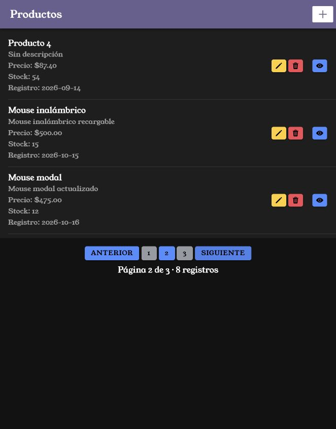
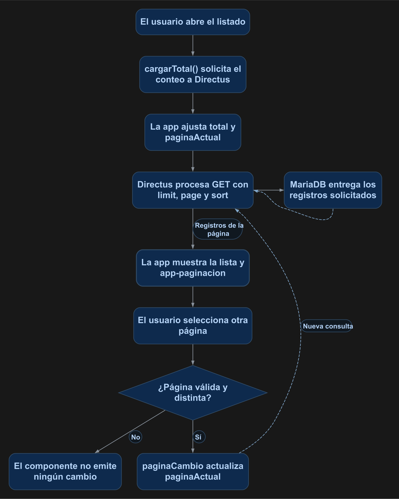

# Paginar productos con Ionic y Directus

Crearás un componente con los botones de página y pedirás a Directus únicamente los productos de la página elegida. El listado contará los registros para calcular cuántas páginas necesita.

<p align="center">
  <br>
  <em>Figura 1. Resultado de la práctica ejecutado en Ionic.</em>
</p>

## 1. Antes de comenzar

Continúa con los manuales [05](05_eliminar_elemento.md) y [07](07_componentes.md). Necesitas más productos que el tamaño de página. El ejemplo usa **3 por página** para poder probar la navegación con pocos registros; puedes cambiar ese valor a 10.

Las rutas pertenecen al proyecto Ionic en `mobile/`. Ejecuta los comandos Docker desde la carpeta que contiene `docker-compose.yml`. Al generar páginas o componentes, configura manualmente `standalone: false` en `@Component`; este curso utiliza NgModules.

## 2. Conceptos y métodos que utilizarás

| Elemento | Cómo se utiliza | Para qué sirve |
| --- | --- | --- |
| `limit` y `page` | Parámetros del GET. | Indican tamaño y número de página; `page` empieza en 1. |
| `sort: id` | Orden ascendente estable. | Mantiene el orden entre consultas. |
| `aggregate[count]` | Conteo de la colección. | Obtiene el total. |
| `Math.ceil()` | `Math.ceil(total / porPagina)` | Calcula el total de páginas. |
| `@Input()` y `OnChanges` | Reciben y recalculan el estado. | Actualizan los botones del componente. |
| `@Output()` y `EventEmitter` | Emiten `paginaCambio`. | Comunican la página elegida al listado. |

## 3. Implementación paso a paso

### Paso 1. Generar el componente

```powershell
docker compose exec mobile ionic g component components/paginacion
```

Agrega manualmente `standalone: false`. Crea `paginacion.module.ts` y completa los cuatro archivos del componente con el código de este paso. El módulo declara y exporta `PaginacionComponent`.

**`mobile/src/app/components/paginacion/paginacion.component.ts`**

1. En el archivo nuevo coloca los imports, las declaraciones y la estructura inicial que se muestran abajo. Si el generador creó una clase de ejemplo, sustituye esa plantilla una sola vez.

```typescript
import {
  Component,
  EventEmitter,
  Input,
  OnChanges,
  Output
} from '@angular/core';

@Component({
  selector: 'app-paginacion',
  templateUrl: './paginacion.component.html',
  styleUrls: ['./paginacion.component.scss'],
  standalone: false
})
export class PaginacionComponent implements OnChanges {

  @Input() total: number = 0;
  @Input() porPagina: number = 10;
  @Input() paginaActual: number = 1;
  @Input() maxPaginasVisibles: number = 5;

  @Output() paginaCambio = new EventEmitter<number>();

  totalPaginas: number = 0;
  paginasVisibles: number[] = [];
}
```

2. Dentro de `PaginacionComponent`, inserta los siguientes métodos en orden, justo antes de la última llave de la clase.

**`ngOnChanges()`**

```typescript
  ngOnChanges(): void {
    this.totalPaginas = Math.ceil(
      this.total / this.porPagina
    );

    this.calcularPaginasVisibles();
  }
```

**`calcularPaginasVisibles()`**

```typescript
  private calcularPaginasVisibles(): void {
    if (this.totalPaginas === 0) {
      this.paginasVisibles = [];
      return;
    }

    const mitad = Math.floor(
      this.maxPaginasVisibles / 2
    );

    let inicio = Math.max(
      1,
      this.paginaActual - mitad
    );

    let fin = Math.min(
      this.totalPaginas,
      inicio + this.maxPaginasVisibles - 1
    );

    inicio = Math.max(
      1,
      fin - this.maxPaginasVisibles + 1
    );

    this.paginasVisibles = [];

    for (let pagina = inicio; pagina <= fin; pagina++) {
      this.paginasVisibles.push(pagina);
    }
  }
```

**`cambiarPagina()`**

```typescript
  cambiarPagina(pagina: number): void {
    if (
      pagina < 1 ||
      pagina > this.totalPaginas ||
      pagina === this.paginaActual
    ) {
      return;
    }

    this.paginaCambio.emit(pagina);
  }
```

**`anterior()`**

```typescript
  anterior(): void {
    this.cambiarPagina(
      this.paginaActual - 1
    );
  }
```

**`siguiente()`**

```typescript
  siguiente(): void {
    this.cambiarPagina(
      this.paginaActual + 1
    );
  }
```

**`mobile/src/app/components/paginacion/paginacion.component.html`**. Coloca esta plantilla en la vista de la práctica. Si Ionic generó contenido de ejemplo, sustitúyelo.

```html
<div class="paginacion" *ngIf="totalPaginas > 1">

  <ion-button fill="solid" size="small" [disabled]="paginaActual === 1" (click)="anterior()">
    Anterior
  </ion-button>

  <ion-button *ngFor="let pagina of paginasVisibles" size="small" fill="solid" [color]="pagina === paginaActual ? 'primary' : 'medium'" (click)="cambiarPagina(pagina)">
    {{ pagina }}
  </ion-button>

  <ion-button fill="solid" size="small" [disabled]="paginaActual === totalPaginas" (click)="siguiente()">
    Siguiente
  </ion-button>

</div>

<p class="informacion" *ngIf="total > 0">
  Página {{ paginaActual }} de {{ totalPaginas }} · {{ total }} registros
</p>
```

**`mobile/src/app/components/paginacion/paginacion.component.scss`**. Agrega estas reglas al final de la hoja de estilos.

```scss
.paginacion {
  display: flex;
  flex-wrap: wrap;
  justify-content: center;
  align-items: center;
  gap: 4px;
  margin-top: 16px;
}

.paginacion ion-button {
  margin: 0;
  --padding-start: 12px;
  --padding-end: 12px;
}

.informacion {
  text-align: center;
  margin-top: 8px;
  margin-bottom: 0;
}
```

**`mobile/src/app/components/paginacion/paginacion.module.ts`**. Crea este archivo con el siguiente contenido o sustituye la plantilla inicial del generador.

```typescript
import { NgModule } from '@angular/core';
import { CommonModule } from '@angular/common';
import { IonicModule } from '@ionic/angular';

import { PaginacionComponent } from './paginacion.component';

@NgModule({
  declarations: [
    PaginacionComponent
  ],
  imports: [
    CommonModule,
    IonicModule
  ],
  exports: [
    PaginacionComponent
  ]
})
export class PaginacionModule {}
```

### Paso 2. Preparar el listado

En `productos-list.page.ts`, agrega `total = 0`, `paginaActual = 1` y `porPagina = 3`. Cambia la carga de `ionViewWillEnter()` para llamar a `cargarDatos()`.

`cargarTotal()` solicita el conteo; `ajustarPaginaActual()` verifica que la página exista y `cargarProductos()` solicita sus registros con `limit`, `page` y `sort`. Aplica los cambios al listado indicados abajo.

**`mobile/src/app/productos-list/productos-list.page.ts`**. Aplica estos cambios en el orden indicado.

Inserta el fragmento después de `})` / `export class ProductosListPage {` y antes de `titulo: string = 'Productos';`.

```typescript
  total: number = 0;
  paginaActual: number = 1;
  porPagina: number = 3;
```

Sustituye la línea `this.cargarProductos();` después de `productos: Producto[] = [];` / `ionViewWillEnter(): void {` y antes de `}`.

```typescript
    void this.cargarDatos();
```

Sustituye la línea la URL de la colección después de `try {` / `const response = await axios.get<{ data: Producto[] }>(` y antes de `);`.

```typescript
      `${environment.apiUrl}/items/productos`,
      {
        params: {
          limit: this.porPagina,
          page: this.paginaActual,
          sort: 'id'
        }
      }
```

Sustituye la línea `await this.cargarProductos();` después de `await alerta.present();` / `await alerta.onDidDismiss();` y antes de `} catch (error) {`.

```typescript
    await this.cargarDatos();
```

En `ProductosListPage`, agrega los métodos siguientes justo antes de la última llave de la clase.

```typescript
async cargarTotal(): Promise<void> {
  try {
    const response = await axios.get<{ data: { count: number | string }[] }>(
      `${environment.apiUrl}/items/productos?aggregate[count]=*`
    );

    this.total = Number(
      response.data.data[0]?.count ?? 0
    );

  } catch (error) {
    console.error(
      'Error al obtener el total de productos:',
      error
    );

    this.total = 0;
  }
}
private ajustarPaginaActual(): void {
  const totalPaginas = Math.ceil(
    this.total / this.porPagina
  );

  if (totalPaginas === 0) {
    this.paginaActual = 1;
    return;
  }

  if (this.paginaActual > totalPaginas) {
    this.paginaActual = totalPaginas;
  }
}
async cargarDatos(): Promise<void> {
  await this.cargarTotal();
  this.ajustarPaginaActual();
  await this.cargarProductos();
}
async cambiarPagina(
  pagina: number
): Promise<void> {
  this.paginaActual = pagina;
  await this.cargarProductos();
}
```

### Paso 3. Importar el módulo y mostrar los botones

Agrega `import { PaginacionModule } from '../components/paginacion/paginacion.module';` al inicio de `mobile/src/app/productos-list/productos-list.module.ts` y agrégalo a `imports`. Dentro de `ion-content`, después de la lista, coloca:

```html
<app-paginacion
  [total]="total"
  [porPagina]="porPagina"
  [paginaActual]="paginaActual"
  [maxPaginasVisibles]="5"
  (paginaCambio)="cambiarPagina($event)">
</app-paginacion>
```

### Paso 4. Actualizar el estado después de cambios

En `eliminarProducto()`, después de aceptar el éxito, llama a `cargarDatos()`. Al regresar del formulario mediante página, `ionViewWillEnter()` ejecutará la misma carga. Si utilizas formularios mediante modal, llama a `cargarDatos()` cuando `data?.guardado` sea verdadero.

## 4. Comprobar el resultado

1. Abre el listado: debe mostrar hasta tres productos y los controles de la figura 1. **Anterior** estará deshabilitado en la primera página.
2. Presiona **Siguiente**: deben cambiar los registros y el color del botón de la página activa.
3. Presiona la última página: puede contener menos productos; **Siguiente** estará deshabilitado.
4. Regresa con **Anterior** o con un número de página.
5. Crea un producto desde **+**, acepta y comprueba que se actualice el total al regresar.
6. Si eliminas el último producto de la última página, el listado debe ajustarse a una página existente.

La figura 1 muestra el resultado obtenido con el código de esta práctica. Las fechas, los productos y el tema visual dependen de tu entorno.

## 5. Explicación detallada del flujo

La figura 2 muestra el recorrido de arriba hacia abajo.

<p align="center">
  <br>
  <em>Figura 2. Consultar productos por página.</em>
</p>

### Reparto de responsabilidades

La página realiza las consultas, almacena `total`, `porPagina` y `paginaActual`, y muestra los productos. El componente recibe esos valores mediante `@Input()`, calcula sus botones y emite la selección mediante `paginaCambio`.

### Conteo y límites

El GET `?aggregate[count]=*` devuelve el total dentro de `data[0].count`. `Number()` permite aceptar un conteo numérico o expresado como cadena. Por ejemplo, 47 registros con 10 por página producen `Math.ceil(47 / 10)`, es decir, 5 páginas.

`ajustarPaginaActual()` se ejecuta después del conteo. Si el total queda en cero, conserva la página 1; si la página actual supera la última disponible, la reduce. De esta manera una eliminación no deja el listado apuntando a una página que ya no existe.

### Botones visibles

`ngOnChanges()` recalcula el total de páginas y una ventana de hasta `maxPaginasVisibles` números. El cálculo centra esa ventana alrededor de la página actual y la ajusta al inicio o al final. La página activa usa `primary` y las demás `medium`; todos los botones tienen relleno sólido. `cambiarPagina()` evita valores fuera del rango y selecciones repetidas.

Después de una creación, edición o eliminación se recalculan el total y la página antes de consultar sus productos. La configuración de `limit` evita transferir la colección completa para mostrar solo una parte.
