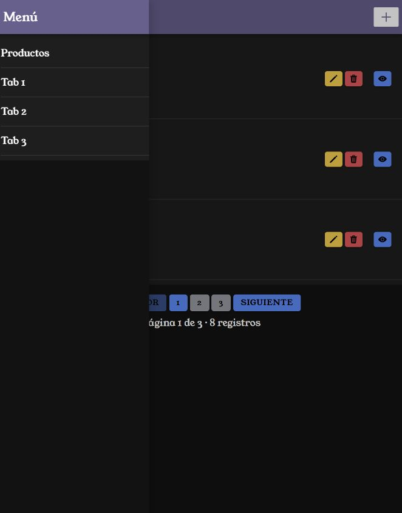
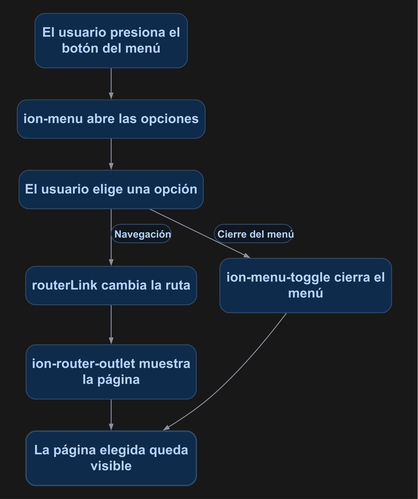

# Agregar un menú lateral en Ionic

Agregarás un menú con los enlaces de la aplicación. El encabezado abrirá ese menú y cada opción navegará a su ruta y lo cerrará.

<p align="center">
  <br>
  <em>Figura 1. Resultado de la práctica ejecutado en Ionic.</em>
</p>

## 1. Antes de comenzar

Continúa con el componente `ToolbarComponent` del [manual 07](07_componentes.md). Comprueba que existan las rutas del listado y de las pestañas que incluirás.

Las rutas pertenecen al proyecto Ionic en `mobile/`. Ejecuta los comandos Docker desde la carpeta que contiene `docker-compose.yml`. Al generar páginas o componentes, configura manualmente `standalone: false` en `@Component`; este curso utiliza NgModules.

## 2. Conceptos y métodos que utilizarás

| Elemento | Uso | Resultado |
| --- | --- | --- |
| `ion-menu` | `contentId="main"` | Asocia el menú con el contenido principal. |
| `ion-router-outlet` | `id="main"` | Muestra la página navegada. |
| `ion-menu-button` | `menu="principal"` | Abre el menú identificado. |
| `ion-menu-toggle` | Envuelve cada enlace. | Cierra el menú al navegar. |
| `routerLink` | Recibe la ruta de cada opción. | Realiza la navegación. |

## 3. Implementación paso a paso

### Paso 1. Definir las opciones

Agrega el arreglo `enlaces` de la sección 4 a `AppComponent`. Cada objeto contiene `ruta` y `texto`. Conserva `standalone: false`.

### Paso 2. Agregar el menú

Reemplaza `app.component.html` por su contenido completo de la sección 4. El `contentId` del menú y el `id` del outlet deben ser **main**.

### Paso 3. Agregar el acceso a la barra

En `toolbar.component.html`, dentro de `ion-toolbar`, antes de `ion-title`, agrega:

```html
<ion-buttons slot="start">
  <ion-menu-button menu="principal" aria-label="Abrir menú"></ion-menu-button>
</ion-buttons>
```

Conserva el título y los botones de la página.

### Paso 4. Ajustar el ancho

Al final de `app.component.scss`, conserva la fuente y los colores y agrega `ion-menu { --width: 260px; }`.

## 4. Código completo de referencia

### `mobile/src/app/app.component.ts`

```typescript
import { Component } from '@angular/core';
@Component({
  selector: 'app-root',
  templateUrl: 'app.component.html',
  styleUrls: ['app.component.scss'],
  standalone: false
})
export class AppComponent {
  enlaces: { ruta: string; texto: string }[] = [
    { ruta: '/productos-list', texto: 'Productos' },
    { ruta: '/tabs/tab1', texto: 'Tab 1' },
    { ruta: '/tabs/tab2', texto: 'Tab 2' },
    { ruta: '/tabs/tab3', texto: 'Tab 3' }
  ];
}
```

### `mobile/src/app/app.component.html`

```html
<ion-app>
  <ion-menu contentId="main" menuId="principal">
    <ion-header>
      <ion-toolbar color="personalizado"><ion-title>Menú</ion-title></ion-toolbar>
    </ion-header>
    <ion-content>
      <ion-list>
        <ion-menu-toggle *ngFor="let enlace of enlaces" autoHide="false">
          <ion-item [routerLink]="enlace.ruta" routerDirection="root" button detail="false">
            <ion-label>{{ enlace.texto }}</ion-label>
          </ion-item>
        </ion-menu-toggle>
      </ion-list>
    </ion-content>
  </ion-menu>
  <ion-router-outlet id="main"></ion-router-outlet>
</ion-app>
```

### `mobile/src/app/components/toolbar/toolbar.component.html`

```html
<ion-header [translucent]="true">
  <ion-toolbar [color]="color">
    <ion-buttons slot="start"><ion-menu-button menu="principal" aria-label="Abrir menú"></ion-menu-button></ion-buttons>
    <ion-title>{{ nombre }}</ion-title>
    <ng-content></ng-content>
  </ion-toolbar>
</ion-header>
```

### `mobile/src/app/app.component.scss`

```scss
@font-face {
  font-family: 'Young Serif';
  src: url('/assets/font/YoungSerif-Regular.ttf') format('truetype');
  font-weight: 400;
  font-style: normal;
  font-display: swap;
}

:root {
  --ion-font-family: 'Young Serif', serif;
  --ion-color-personalizado: #686090;
  --ion-color-personalizado-rgb: 104, 96, 144;
  --ion-color-personalizado-contrast: #ffffff;
  --ion-color-personalizado-contrast-rgb: 255, 255, 255;
  --ion-color-personalizado-shade: #5c547f;
  --ion-color-personalizado-tint: #77709b;
}

.ion-color-personalizado {
  --ion-color-base: var(--ion-color-personalizado);
  --ion-color-base-rgb: var(--ion-color-personalizado-rgb);
  --ion-color-contrast: var(--ion-color-personalizado-contrast);
  --ion-color-contrast-rgb: var(--ion-color-personalizado-contrast-rgb);
  --ion-color-shade: var(--ion-color-personalizado-shade);
  --ion-color-tint: var(--ion-color-personalizado-tint);
}

ion-menu { --width: 260px; }
```

## 5. Comprobar el resultado

1. Abre `/productos-list` y presiona el icono del menú. Debe abrirse la vista de la figura 1.
2. Presiona **Tab 1**: debe navegar y cerrar el menú.
3. Regresa al listado y abre el menú; elige **Productos**.
4. Verifica que el icono **+** y la paginación sigan funcionando.

La figura 1 muestra el resultado obtenido con el código de esta práctica. Las fechas, los productos y el tema visual dependen de tu entorno.

## 6. Explicación detallada del flujo

La figura 2 muestra el recorrido de arriba hacia abajo.

<p align="center">
  <br>
  <em>Figura 2. Navegar mediante el menú.</em>
</p>

`ion-menu` permanece en el componente raíz y se vincula con el outlet mediante `contentId`. El arreglo `enlaces` define las opciones sin repetir manualmente cada fila. `*ngFor` crea un acceso por objeto y `routerLink` recibe su ruta.

`ion-menu-button` identifica el menú por `menuId`. `ion-menu-toggle` envuelve cada opción para cerrarlo al navegar. `routerDirection="root"` establece la navegación de esa selección como raíz. El componente de encabezado conserva sus entradas y las acciones proporcionadas por la página.
