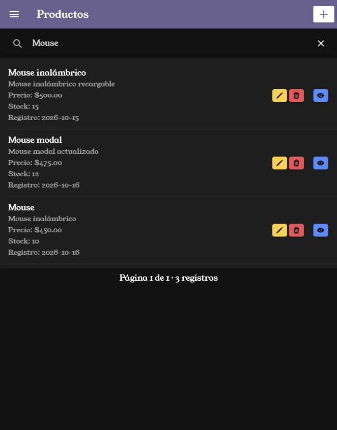
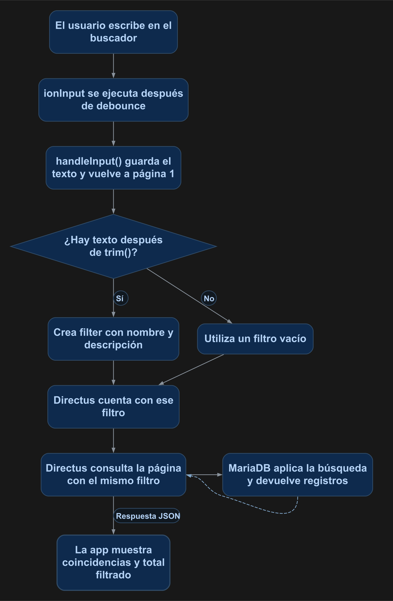

# Buscar productos con Ionic y Directus

Agregarás una barra de búsqueda por nombre o descripción. El listado y el conteo utilizarán el mismo filtro, y cada búsqueda comenzará en la primera página.

<p align="center">
  <br>
  <em>Figura 1. Resultado de la práctica ejecutado en Ionic.</em>
</p>

## 1. Antes de comenzar

Continúa con la paginación del [manual 08](08_paginacion.md) funcionando y con permiso de lectura sobre los campos `nombre` y `descripcion` de `productos`.

Las rutas pertenecen al proyecto Ionic en `mobile/`. Ejecuta los comandos Docker desde la carpeta que contiene `docker-compose.yml`. Al generar páginas o componentes, configura manualmente `standalone: false` en `@Component`; este curso utiliza NgModules.

## 2. Conceptos y métodos que utilizarás

| Elemento | Uso | Resultado |
| --- | --- | --- |
| `ion-searchbar` | Emite `ionInput`. | Captura el texto escrito. |
| `debounce` | Espera 300 ms desde el último cambio. | Agrupa la escritura antes de consultar. |
| `event.detail.value` | Obtiene el texto. | Actualiza `busqueda`. |
| `filter` y `_or` | Combinan dos condiciones. | Busca en nombre o descripción. |
| `_icontains` | Compara contenido sin distinguir mayúsculas. | Encuentra coincidencias parciales. |

## 3. Implementación paso a paso

### Paso 1. Guardar el texto

En `mobile/src/app/productos-list/productos-list.page.ts`, dentro de `ProductosListPage`, agrega `busqueda: string = '';`.

### Paso 2. Preparar el filtro y el evento

Agrega estos métodos dentro de la clase:

```typescript

  private parametrosBusqueda(): Record<string, string> {
    const texto = this.busqueda.trim();
    return texto ? {
      filter: JSON.stringify({
        _or: [
          { nombre: { _icontains: texto } },
          { descripcion: { _icontains: texto } }
        ]
      })
    } : {};
  }

  async handleInput(event: CustomEvent<{ value?: string | null }>): Promise<void> {
    this.busqueda = event.detail.value ?? '';
    this.paginaActual = 1;
    await this.cargarDatos();
  }
```

### Paso 3. Aplicar el filtro a las dos consultas

En el mismo archivo realiza dos cambios.

1. Dentro de `cargarProductos()`, localiza `sort: 'id'` en el objeto `params`. Agrega una coma al final de esa línea e inserta debajo `...this.parametrosBusqueda()`.
2. Dentro de `cargarTotal()`, localiza el `axios.get` cuya URL contiene `aggregate[count]`. Después de la URL y antes de cerrar el paréntesis, añade `, { params: this.parametrosBusqueda() }`.

 Comprueba que al buscar disminuyan tanto las filas visibles como el número de páginas.

### Paso 4. Agregar la barra

En `mobile/src/app/productos-list/productos-list.page.html`, dentro de `ion-content`, antes de `ion-list`, agrega:

```html
<ion-searchbar [value]="busqueda" [debounce]="300" (ionInput)="handleInput($event)" placeholder="Buscar productos" aria-label="Buscar productos"></ion-searchbar>
<p class="ion-padding" *ngIf="total === 0">No se encontraron productos.</p>
```

## 4. Comprobar el resultado

1. Escribe **Mouse**: deben aparecer únicamente productos cuyo nombre o descripción coincidan, como en la figura 1.
2. Escribe **teclado** y comprueba las coincidencias sin depender de mayúsculas.
3. Escribe un texto sin coincidencias: debe aparecer **No se encontraron productos**.
4. Limpia la búsqueda: debe volver el listado completo con su paginación.
5. Cambia de página y realiza otra búsqueda: debe comenzar en la página 1 y el total debe corresponder a sus resultados.

La figura 1 muestra el resultado obtenido con el código de esta práctica. Las fechas, los productos y el tema visual dependen de tu entorno.

## 5. Explicación detallada del flujo

La figura 2 muestra el recorrido de arriba hacia abajo.

<p align="center">
  <br>
  <em>Figura 2. Filtrar los productos.</em>
</p>

`ion-searchbar` entrega el texto en `event.detail.value`. `??` permite tratar el valor vacío como una cadena. `handleInput()` actualiza la búsqueda, reinicia la página y espera `cargarDatos()`.

`parametrosBusqueda()` recorta espacios y construye un filtro con dos condiciones `_icontains`, unidas por `_or`. `JSON.stringify()` convierte ese objeto en el parámetro que envía Axios. Una búsqueda vacía devuelve un objeto sin filtro.

El conteo y el listado reciben el mismo filtro: el total representa las coincidencias y los botones se calculan sobre ellas. El orden estable por ID y los parámetros de paginación siguen aplicándose. Para ampliar la consulta a otro campo, agrega su condición al arreglo `_or` y conserva ese mismo filtro en ambas peticiones. Consulta la [sintaxis de filtros de Directus](https://directus.com/docs/guides/connect/filter-rules).
