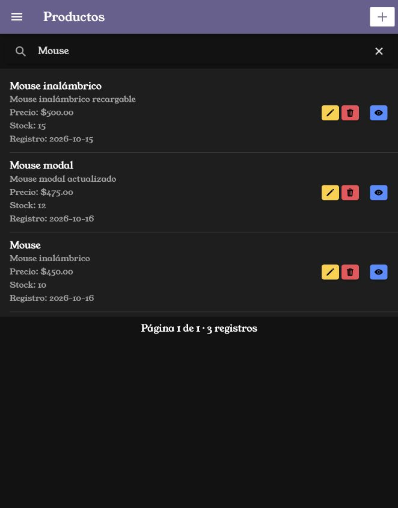
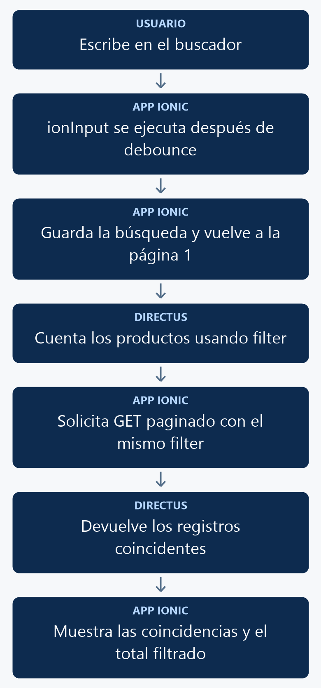

# Buscar productos con Ionic y Directus

Agregarás una barra de búsqueda por nombre o descripción. El listado y el conteo utilizarán el mismo filtro, y cada búsqueda comenzará en la primera página.

<p align="center">
  <br>
  <em>Figura 1. Resultado de la práctica ejecutado en Ionic.</em>
</p>

## 1. Antes de comenzar

Continúa con la paginación del [manual 08](08_paginacion.md) funcionando y con permiso de lectura sobre los campos `nombre` y `descripcion` de `productos`.

Las rutas pertenecen al proyecto Ionic en `mobile/`. Ejecuta los comandos Docker desde la carpeta que contiene `docker-compose.yml`. Al generar páginas o componentes, configura manualmente `standalone: false` en `@Component`; este curso utiliza NgModules.

## 2. Conceptos y métodos que utilizarás

| Elemento | Uso | Resultado |
| --- | --- | --- |
| `ion-searchbar` | Emite `ionInput`. | Captura el texto escrito. |
| `debounce` | Espera 300 ms desde el último cambio. | Agrupa la escritura antes de consultar. |
| `event.detail.value` | Obtiene el texto. | Actualiza `busqueda`. |
| `filter` y `_or` | Combinan dos condiciones. | Busca en nombre o descripción. |
| `_icontains` | Compara contenido sin distinguir mayúsculas. | Encuentra coincidencias parciales. |

## 3. Implementación paso a paso

### Paso 1. Guardar el texto

Dentro de `ProductosListPage`, agrega `busqueda: string = '';`.

### Paso 2. Preparar el filtro y el evento

Agrega estos métodos dentro de la clase:

```typescript

  private parametrosBusqueda(): Record<string, string> {
    const texto = this.busqueda.trim();
    return texto ? {
      filter: JSON.stringify({
        _or: [
          { nombre: { _icontains: texto } },
          { descripcion: { _icontains: texto } }
        ]
      })
    } : {};
  }

  async handleInput(event: CustomEvent<{ value?: string | null }>): Promise<void> {
    this.busqueda = event.detail.value ?? '';
    this.paginaActual = 1;
    await this.cargarDatos();
  }
```

### Paso 3. Aplicar el filtro a las dos consultas

En los parámetros de `cargarProductos()`, después de `sort`, agrega `...this.parametrosBusqueda()`. En el GET de `cargarTotal()`, agrega `{ params: this.parametrosBusqueda() }` como segundo argumento. La sección 4 contiene ambas consultas completas.

### Paso 4. Agregar la barra

Dentro de `ion-content`, antes de `ion-list`, agrega:

```html
<ion-searchbar [value]="busqueda" [debounce]="300" (ionInput)="handleInput($event)" placeholder="Buscar productos" aria-label="Buscar productos"></ion-searchbar>
<p class="ion-padding" *ngIf="total === 0">No se encontraron productos.</p>
```


## 4. Código completo de referencia

### `mobile/src/app/productos-list/productos-list.page.ts`

```typescript
import { Component } from '@angular/core';
import { AlertController } from '@ionic/angular';
import axios from 'axios';
import { environment } from '../../environments/environment';

interface Producto {
  id: number;
  nombre: string;
  descripcion: string;
  precio: string;
  stock: number;
  fecha_registro: string;
}

@Component({
  selector: 'app-productos-list',
  templateUrl: './productos-list.page.html',
  styleUrls: ['./productos-list.page.scss'],
  standalone: false,
})
export class ProductosListPage {
  busqueda: string = '';

  total: number = 0;
  paginaActual: number = 1;
  porPagina: number = 3;

  titulo: string = 'Productos';

  constructor(private alertController: AlertController) {}

  productos: Producto[] = [];

  ionViewWillEnter(): void {
    void this.cargarDatos();
  }

async cargarProductos(): Promise<void> {
  try {
    const response = await axios.get<{ data: Producto[] }>(
      `${environment.apiUrl}/items/productos`,
      {
        params: {
          limit: this.porPagina,
          page: this.paginaActual,
          sort: 'id',
          ...this.parametrosBusqueda()
        }
      }
    );

    this.productos = response.data.data;

  } catch (error) {
    console.error('Error al cargar los productos:', error);
  }
}


async confirmarEliminar(id: number, nombre: string): Promise<void> {
  const alerta = await this.alertController.create({
    header: 'Eliminar producto',
    message: `¿Estás seguro de eliminar el producto "${nombre}"?`,
    buttons: [
      {
        text: 'Cancelar',
        role: 'cancel'
      },
      {
        text: 'Eliminar',
        role: 'destructive',
        handler: () => {
          void this.eliminarProducto(id);
        }
      }
    ]
  });

  await alerta.present();
}
async eliminarProducto(id: number): Promise<void> {
  try {
    await axios.delete(
      `${environment.apiUrl}/items/productos/${id}`
    );

    const alerta = await this.alertController.create({
      header: 'Producto eliminado',
      message: 'El producto fue eliminado correctamente.',
      buttons: ['Aceptar']
    });

    await alerta.present();
    await alerta.onDidDismiss();

    await this.cargarDatos();
  } catch (error) {
    console.error('Error al eliminar el producto:', error);

    const alerta = await this.alertController.create({
      header: 'Error',
      message: 'No fue posible eliminar el producto. Revisa la conexión, los permisos de eliminación en Directus y las relaciones del registro.',
      buttons: ['Aceptar']
    });

    await alerta.present();
  }
}
async cargarTotal(): Promise<void> {
  try {
    const response = await axios.get<{ data: { count: number | string }[] }>(
      `${environment.apiUrl}/items/productos?aggregate[count]=*`,
      { params: this.parametrosBusqueda() }
    );

    this.total = Number(
      response.data.data[0]?.count ?? 0
    );

  } catch (error) {
    console.error(
      'Error al obtener el total de productos:',
      error
    );

    this.total = 0;
  }
}
private ajustarPaginaActual(): void {
  const totalPaginas = Math.ceil(
    this.total / this.porPagina
  );

  if (totalPaginas === 0) {
    this.paginaActual = 1;
    return;
  }

  if (this.paginaActual > totalPaginas) {
    this.paginaActual = totalPaginas;
  }
}
async cargarDatos(): Promise<void> {
  await this.cargarTotal();
  this.ajustarPaginaActual();
  await this.cargarProductos();
}
async cambiarPagina(
  pagina: number
): Promise<void> {
  this.paginaActual = pagina;
  await this.cargarProductos();
}
  private parametrosBusqueda(): Record<string, string> {
    const texto = this.busqueda.trim();
    return texto ? {
      filter: JSON.stringify({
        _or: [
          { nombre: { _icontains: texto } },
          { descripcion: { _icontains: texto } }
        ]
      })
    } : {};
  }

  async handleInput(event: CustomEvent<{ value?: string | null }>): Promise<void> {
    this.busqueda = event.detail.value ?? '';
    this.paginaActual = 1;
    await this.cargarDatos();
  }
}
```

### `mobile/src/app/productos-list/productos-list.page.html`

```html
<app-toolbar [nombre]="titulo" color="personalizado">
  <ion-buttons slot="end">
    <ion-button fill="solid" [routerLink]="['/productos-form']" aria-label="Nuevo producto">
      <ion-icon slot="icon-only" name="add"></ion-icon>
    </ion-button>
  </ion-buttons>
</app-toolbar>

<ion-content>
  <ion-searchbar [value]="busqueda" [debounce]="300" (ionInput)="handleInput($event)" placeholder="Buscar productos" aria-label="Buscar productos"></ion-searchbar>
  <p class="ion-padding" *ngIf="total === 0">No se encontraron productos.</p>
  <ion-list>
    <ion-item *ngFor="let producto of productos">
      <ion-label class="ion-text-wrap">
        <h2>{{ producto.nombre }}</h2>
        <p>{{ producto.descripcion }}</p>
        <p>Precio: ${{ producto.precio }}</p>
        <p>Stock: {{ producto.stock }}</p>
        <p>Registro: {{ producto.fecha_registro | date:'yyyy-MM-dd' }}</p>
      </ion-label>
      <ion-button fill="solid" slot="end" [routerLink]="['/productos-view', producto.id]" aria-label="Ver detalle">
        <ion-icon slot="icon-only" name="eye"></ion-icon>
      </ion-button>
      <ion-button fill="solid" color="warning" [routerLink]="['/productos-form', producto.id]">
        <ion-icon slot="icon-only" name="pencil"></ion-icon>
      </ion-button>
      <ion-button fill="solid" color="danger" (click)="confirmarEliminar(producto.id, producto.nombre)" aria-label="Eliminar producto">
        <ion-icon slot="icon-only" name="trash"></ion-icon>
      </ion-button>
    </ion-item>
  </ion-list>
  <app-paginacion [total]="total" [porPagina]="porPagina" [paginaActual]="paginaActual" [maxPaginasVisibles]="5" (paginaCambio)="cambiarPagina($event)"></app-paginacion>
</ion-content>
```

## 5. Comprobar el resultado

1. Escribe **Mouse**: deben aparecer únicamente productos cuyo nombre o descripción coincidan, como en la figura 1.
2. Escribe **teclado** y comprueba las coincidencias sin depender de mayúsculas.
3. Escribe un texto sin coincidencias: debe aparecer **No se encontraron productos**.
4. Limpia la búsqueda: debe volver el listado completo con su paginación.
5. Cambia de página y realiza otra búsqueda: debe comenzar en la página 1 y el total debe corresponder a sus resultados.

La figura 1 muestra el resultado obtenido con el código de esta práctica. Las fechas, los productos y el tema visual dependen de tu entorno.

## 6. Explicación detallada del flujo

La figura 2 muestra el recorrido de arriba hacia abajo.

<p align="center">
  <br>
  <em>Figura 2. Filtrar los productos.</em>
</p>

`ion-searchbar` entrega el texto en `event.detail.value`. `??` permite tratar el valor vacío como una cadena. `handleInput()` actualiza la búsqueda, reinicia la página y espera `cargarDatos()`.

`parametrosBusqueda()` recorta espacios y construye un filtro con dos condiciones `_icontains`, unidas por `_or`. `JSON.stringify()` convierte ese objeto en el parámetro que envía Axios. Una búsqueda vacía devuelve un objeto sin filtro.

El conteo y el listado reciben el mismo filtro: el total representa las coincidencias y los botones se calculan sobre ellas. El orden estable por ID y los parámetros de paginación siguen aplicándose. Para ampliar la consulta a otro campo, agrega su condición al arreglo `_or` y conserva ese mismo filtro en ambas peticiones. Consulta la [sintaxis de filtros de Directus](https://directus.com/docs/guides/connect/filter-rules).
