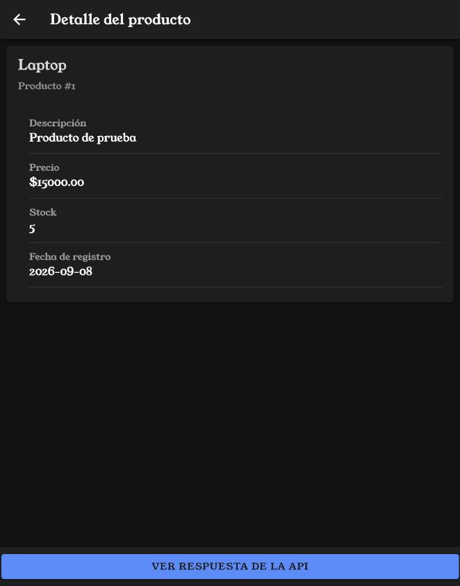
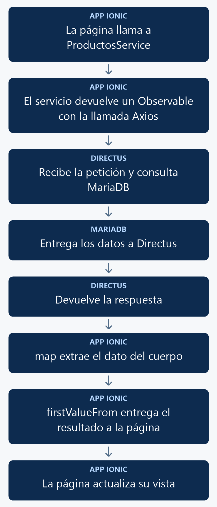

# Compartir las consultas de productos mediante un servicio

Crearás un servicio para consultar, contar, crear, actualizar y eliminar productos. Las páginas utilizarán sus métodos y conservarán sus formularios y mensajes.

<p align="center">
  <br>
  <em>Figura 1. Resultado de la práctica ejecutado en Ionic.</em>
</p>

## 1. Antes de comenzar

Continúa con la búsqueda y paginación del [manual 10](10_busqueda.md). Axios y RxJS ya forman parte del proyecto. Esta referencia utiliza el formulario mediante página.

Las rutas pertenecen al proyecto Ionic en `mobile/`. Ejecuta los comandos Docker desde la carpeta que contiene `docker-compose.yml`. Al generar páginas o componentes, configura manualmente `standalone: false` en `@Component`; este curso utiliza NgModules.

## 2. Conceptos y métodos que utilizarás

| Elemento | Uso | Resultado |
| --- | --- | --- |
| `@Injectable` | `providedIn: root` | Permite inyectar el servicio. |
| `Observable<T>` | Tipo de retorno de cada operación. | Representa su resultado o error. |
| `defer()` | Prepara la llamada Axios. | La ejecuta al suscribirse. |
| `map()` | Extrae `response.data.data`. | Entrega el dato que utiliza la página. |
| `firstValueFrom()` | Espera el resultado del observable. | Permite usarlo con `await` y `try/catch`. |

## 3. Implementación paso a paso

### Paso 1. Generar el servicio

```powershell
docker compose exec mobile ionic g service services/productos
```

El generador utilizado en este proyecto crea `src/app/services/productos.ts`. Coloca allí la clase `ProductosService` de la sección 4.

### Paso 2. Definir las operaciones

El servicio incluye `listado`, `detalle`, `crear`, `actualizar`, `eliminar` y `total`. Su filtro se utiliza tanto en el listado como en el conteo. Las interfaces describen los datos recibidos y los enviados.

### Paso 3. Inyectarlo en las páginas

Importa `ProductosService` desde `../services/productos` y `firstValueFrom` desde `rxjs`. Agrega el servicio al constructor de listado, formulario y detalle.

### Paso 4. Utilizar los métodos

El listado espera el resultado con:

```typescript
this.productos = await firstValueFrom(
  this.productosService.listado(this.paginaActual, this.porPagina, this.busqueda)
);
```

En el formulario, `detalle(id)` carga sus valores, `crear(producto)` envía el registro nuevo y `actualizar(id, producto)` guarda la edición. La eliminación espera `eliminar(id)` y después actualiza el listado. La sección 4 reúne los archivos completos modificados. Sus plantillas HTML se conservan.

## 4. Código completo de referencia

### `mobile/src/app/services/productos.ts`

```typescript
import { Injectable } from '@angular/core';
import { defer, map, Observable } from 'rxjs';
import axios from 'axios';
import { environment } from '../../environments/environment';

export interface Producto {
  id: number;
  nombre: string;
  descripcion: string;
  precio: string;
  stock: number;
  fecha_registro: string;
}
export interface ProductoGuardar {
  nombre: string;
  descripcion: string;
  precio: number;
  stock: number;
}

@Injectable({ providedIn: 'root' })
export class ProductosService {
  private url = environment.apiUrl + '/items/productos';

  private filtro(busqueda: string): Record<string, string> {
    const texto = busqueda.trim();
    return texto ? { filter: JSON.stringify({ _or: [
      { nombre: { _icontains: texto } },
      { descripcion: { _icontains: texto } }
    ] }) } : {};
  }

  listado(pagina = 1, porPagina = 3, busqueda = ''): Observable<Producto[]> {
    return defer(() => axios.get<{ data: Producto[] }>(this.url, {
      params: { page: pagina, limit: porPagina, sort: 'id', ...this.filtro(busqueda) }
    })).pipe(map(response => response.data.data));
  }

  detalle(id: number): Observable<Producto> {
    return defer(() => axios.get<{ data: Producto }>(this.url + '/' + id))
      .pipe(map(response => response.data.data));
  }

  crear(producto: ProductoGuardar): Observable<Producto> {
    return defer(() => axios.post<{ data: Producto }>(this.url, producto))
      .pipe(map(response => response.data.data));
  }

  actualizar(id: number, producto: ProductoGuardar): Observable<Producto> {
    return defer(() => axios.patch<{ data: Producto }>(this.url + '/' + id, producto))
      .pipe(map(response => response.data.data));
  }

  eliminar(id: number): Observable<void> {
    return defer(() => axios.delete(this.url + '/' + id)).pipe(map(() => undefined));
  }

  total(busqueda = ''): Observable<number> {
    return defer(() => axios.get<{ data: { count: string | number }[] }>(this.url, {
      params: { 'aggregate[count]': '*', ...this.filtro(busqueda) }
    })).pipe(map(response => Number(response.data.data[0]?.count ?? 0)));
  }
}
```

### `mobile/src/app/productos-list/productos-list.page.ts`

```typescript
import { Component } from '@angular/core';
import { AlertController } from '@ionic/angular';
import { firstValueFrom } from 'rxjs';
import { ProductosService } from '../services/productos';

interface Producto {
  id: number;
  nombre: string;
  descripcion: string;
  precio: string;
  stock: number;
  fecha_registro: string;
}

@Component({
  selector: 'app-productos-list',
  templateUrl: './productos-list.page.html',
  styleUrls: ['./productos-list.page.scss'],
  standalone: false,
})
export class ProductosListPage {
  busqueda: string = '';

  total: number = 0;
  paginaActual: number = 1;
  porPagina: number = 3;

  titulo: string = 'Productos';

  constructor(private alertController: AlertController, private productosService: ProductosService) {}

  productos: Producto[] = [];

  ionViewWillEnter(): void {
    void this.cargarDatos();
  }

async cargarProductos(): Promise<void> {
  try {
    this.productos = await firstValueFrom(this.productosService.listado(this.paginaActual, this.porPagina, this.busqueda));
  } catch (error) { console.error('Error al cargar productos:', error); }
}


async confirmarEliminar(id: number, nombre: string): Promise<void> {
  const alerta = await this.alertController.create({
    header: 'Eliminar producto',
    message: `¿Estás seguro de eliminar el producto "${nombre}"?`,
    buttons: [
      {
        text: 'Cancelar',
        role: 'cancel'
      },
      {
        text: 'Eliminar',
        role: 'destructive',
        handler: () => {
          void this.eliminarProducto(id);
        }
      }
    ]
  });

  await alerta.present();
}
async eliminarProducto(id: number): Promise<void> {
  try {
    await firstValueFrom(this.productosService.eliminar(id));

    const alerta = await this.alertController.create({
      header: 'Producto eliminado',
      message: 'El producto fue eliminado correctamente.',
      buttons: ['Aceptar']
    });

    await alerta.present();
    await alerta.onDidDismiss();

    await this.cargarDatos();
  } catch (error) {
    console.error('Error al eliminar el producto:', error);

    const alerta = await this.alertController.create({
      header: 'Error',
      message: 'No fue posible eliminar el producto. Revisa la conexión, los permisos de eliminación en Directus y las relaciones del registro.',
      buttons: ['Aceptar']
    });

    await alerta.present();
  }
}
async cargarTotal(): Promise<void> {
  try { this.total = await firstValueFrom(this.productosService.total(this.busqueda)); }
  catch (error) { this.total = 0; console.error('Error al contar productos:', error); }
}
private ajustarPaginaActual(): void {
  const totalPaginas = Math.ceil(
    this.total / this.porPagina
  );

  if (totalPaginas === 0) {
    this.paginaActual = 1;
    return;
  }

  if (this.paginaActual > totalPaginas) {
    this.paginaActual = totalPaginas;
  }
}
async cargarDatos(): Promise<void> {
  await this.cargarTotal();
  this.ajustarPaginaActual();
  await this.cargarProductos();
}
async cambiarPagina(
  pagina: number
): Promise<void> {
  this.paginaActual = pagina;
  await this.cargarProductos();
}

  async handleInput(event: CustomEvent<{ value?: string | null }>): Promise<void> {
    this.busqueda = event.detail.value ?? '';
    this.paginaActual = 1;
    await this.cargarDatos();
  }
}
```

### `mobile/src/app/productos-form/productos-form.page.ts`

```typescript
import { Component, OnInit } from '@angular/core';
import { FormBuilder, FormGroup, Validators } from '@angular/forms';
import { ActivatedRoute, Router } from '@angular/router';
import { AlertController } from '@ionic/angular';
import { firstValueFrom } from 'rxjs';
import { ProductosService } from '../services/productos';

interface ProductoGuardar {
  nombre: string;
  descripcion: string;
  precio: number;
  stock: number;
}

interface ProductoDetalle {
  id: number;
  nombre: string;
  descripcion: string;
  precio: string | number;
  stock: number;
  fecha_registro: string;
}

@Component({
  selector: 'app-productos-form',
  templateUrl: './productos-form.page.html',
  styleUrls: ['./productos-form.page.scss'],
  standalone: false,
})
export class ProductosFormPage implements OnInit {

  productoForm!: FormGroup;
  idProducto?: number;
  cargando: boolean = false;
  guardando: boolean = false;

  mensajesValidacion: Record<string, Record<string, string>> = {
    nombre: {
      required: 'El nombre es obligatorio.',
      maxlength: 'El nombre no debe superar 150 caracteres.'
    },
    precio: {
      required: 'El precio es obligatorio.',
      min: 'El precio debe ser igual o mayor que cero.'
    },
    stock: {
      required: 'El stock es obligatorio.',
      min: 'El stock debe ser igual o mayor que cero.',
      pattern: 'El stock debe contener únicamente números enteros.'
    }
  };

  constructor(
    private formBuilder: FormBuilder,
    private alertController: AlertController,
    private activatedRoute: ActivatedRoute,
    private productosService: ProductosService,
    private router: Router
  ) {}

  get esEdicion(): boolean {
    return this.idProducto !== undefined;
  }

  async ngOnInit(): Promise<void> {
    this.crearFormulario();

    const id = this.activatedRoute.snapshot.paramMap.get('id');

    if (id !== null) {
      const idConvertido = Number(id);

      if (!Number.isNaN(idConvertido)) {
        this.idProducto = idConvertido;
        await this.cargarProducto();
      }
    }
  }

  private crearFormulario(): void {
    this.productoForm = this.formBuilder.group({
      nombre: ['', [
        Validators.required,
        Validators.maxLength(150)
      ]],
      descripcion: [''],
      precio: ['', [
        Validators.required,
        Validators.min(0)
      ]],
      stock: ['', [
        Validators.required,
        Validators.min(0),
        Validators.pattern('^[0-9]+$')
      ]]
    });
  }

  getError(controlName: string): string {
    const control = this.productoForm.get(controlName);

    if (
      !control ||
      !control.errors ||
      !(control.touched || control.dirty)
    ) {
      return '';
    }

    const tipoError = Object.keys(control.errors)[0];

    return this.mensajesValidacion[controlName]?.[tipoError]
      ?? 'El valor ingresado no es válido.';
  }

  private async cargarProducto(): Promise<void> {
    if (this.idProducto === undefined) {
      return;
    }

    this.cargando = true;

    try {
      const producto = await firstValueFrom(this.productosService.detalle(this.idProducto));

      this.productoForm.patchValue({
        nombre: producto.nombre,
        descripcion: producto.descripcion,
        precio: producto.precio,
        stock: producto.stock
      });
    } catch (error) {
      console.error('Error al cargar el producto:', error);

      const alerta = await this.alertController.create({
        header: 'Error',
        message: 'No fue posible cargar los datos del producto. Revisa la conexión, el identificador y los permisos de lectura en Directus.',
        buttons: ['Aceptar']
      });

      await alerta.present();
    } finally {
      this.cargando = false;
    }
  }

  async guardarProducto(): Promise<void> {
    if (this.productoForm.invalid) {
      this.productoForm.markAllAsTouched();
      return;
    }

    this.guardando = true;

    const valores = this.productoForm.value;

    const producto: ProductoGuardar = {
      nombre: valores.nombre.trim(),
      descripcion: valores.descripcion?.trim() ?? '',
      precio: Number(valores.precio),
      stock: Number(valores.stock)
    };

    try {
      if (this.esEdicion && this.idProducto !== undefined) {
        await firstValueFrom(this.productosService.actualizar(this.idProducto, producto));
      } else {
        await firstValueFrom(this.productosService.crear(producto));
      }

      const alerta = await this.alertController.create({
        header: this.esEdicion ? 'Producto actualizado' : 'Producto guardado',
        message: this.esEdicion
          ? 'El producto fue actualizado correctamente.'
          : 'El producto fue registrado correctamente.',
        buttons: ['Aceptar']
      });

      await alerta.present();
      await alerta.onDidDismiss();

      await this.router.navigate(['/productos-list']);
    } catch (error) {
      console.error(
        this.esEdicion
          ? 'Error al actualizar el producto:'
          : 'Error al guardar el producto:',
        error
      );

      const alerta = await this.alertController.create({
        header: 'Error',
        message: this.esEdicion
          ? 'No fue posible actualizar el producto. Revisa los datos, la conexión y los permisos de actualización en Directus.'
          : 'No fue posible guardar el producto. Revisa los datos, la conexión y los permisos de creación en Directus.',
        buttons: ['Aceptar']
      });

      await alerta.present();
    } finally {
      this.guardando = false;
    }
  }
}
```

### `mobile/src/app/productos-view/productos-view.page.ts`

```typescript
import { Component, OnInit } from '@angular/core';
import { ActivatedRoute } from '@angular/router';
import { LoadingController } from '@ionic/angular';
import { firstValueFrom } from 'rxjs';
import { ProductosService } from '../services/productos';
import { environment } from '../../environments/environment';

interface Producto {
  id: number;
  nombre: string;
  descripcion: string;
  precio: string;
  stock: number;
  fecha_registro: string;
}

@Component({
  selector: 'app-productos-view',
  templateUrl: './productos-view.page.html',
  styleUrls: ['./productos-view.page.scss'],
  standalone: false
})
export class ProductosViewPage implements OnInit {

  producto: Producto | null = null;
  mensajeError: string = '';

  constructor(
    private route: ActivatedRoute,
    private productosService: ProductosService,
    private loading: LoadingController
  ) { }

  ngOnInit() {
    this.cargarProducto();
  }

  async cargarProducto(): Promise<void> {
    const id = this.route.snapshot.paramMap.get('id');

    this.producto = null;
    this.mensajeError = '';

    if (!id) {
      this.mensajeError = 'No se recibió el ID del producto.';
      return;
    }

    const loading = await this.loading.create({
      message: 'Cargando producto...',
      spinner: 'bubbles',
    });

    await loading.present();

    try {
      this.producto = await firstValueFrom(this.productosService.detalle(Number(id)));
    } catch (error) {
      console.error('Error al cargar el producto:', error);
      this.mensajeError = 'No se pudo cargar el producto. Revisa el ID, la conexión y los permisos de lectura.';
    } finally {
      await loading.dismiss();
    }
  }

  abrirPagina(): void {
    if (!this.producto) {
      return;
    }

    const url = `${environment.apiUrl}/items/productos/${this.producto.id}`;
    window.open(url, '_blank', 'noopener,noreferrer');
  }

}
```

## 5. Comprobar el resultado

1. Abre el listado y busca **Mouse**: deben conservarse los resultados y el conteo.
2. Abre el ojo de un producto: debe mostrarse su detalle, como en la figura 1.
3. Abre **+**, crea un producto de prueba y comprueba que aparezca al regresar.
4. Edítalo y verifica sus nuevos datos.
5. Elimina únicamente ese registro de prueba y comprueba que se actualice el total.

La figura 1 muestra el resultado obtenido con el código de esta práctica. Las fechas, los productos y el tema visual dependen de tu entorno.

## 6. Explicación detallada del flujo

La figura 2 muestra el recorrido de arriba hacia abajo.

<p align="center">
  <br>
  <em>Figura 2. Consultar datos mediante un servicio.</em>
</p>

### Inyección y operaciones

`providedIn: root` permite que Angular comparta el servicio. Cada página lo recibe en su constructor. El servicio concentra la URL y las operaciones HTTP; la página conserva el estado visible, la validación y los mensajes de la interacción.

### Inicio y resultado de la consulta

`defer()` prepara la ejecución de Axios dentro del observable. `firstValueFrom()` se suscribe y entrega el primer resultado como promesa. `map()` devuelve los datos de Directus o convierte el conteo a número. Si la petición falla, la promesa se rechaza y el `catch` de la página puede presentar su error.

La creación utiliza `POST`, la edición `PATCH` y la eliminación `DELETE`. El servicio de eliminación devuelve `void` porque el resultado no necesita un cuerpo de datos. La paginación y la búsqueda se mantienen como parámetros del servicio.
