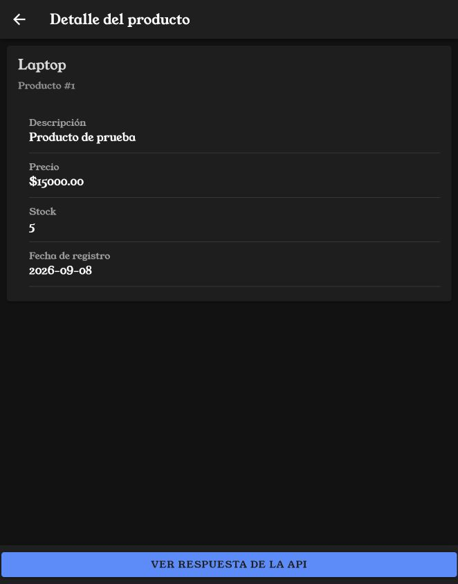
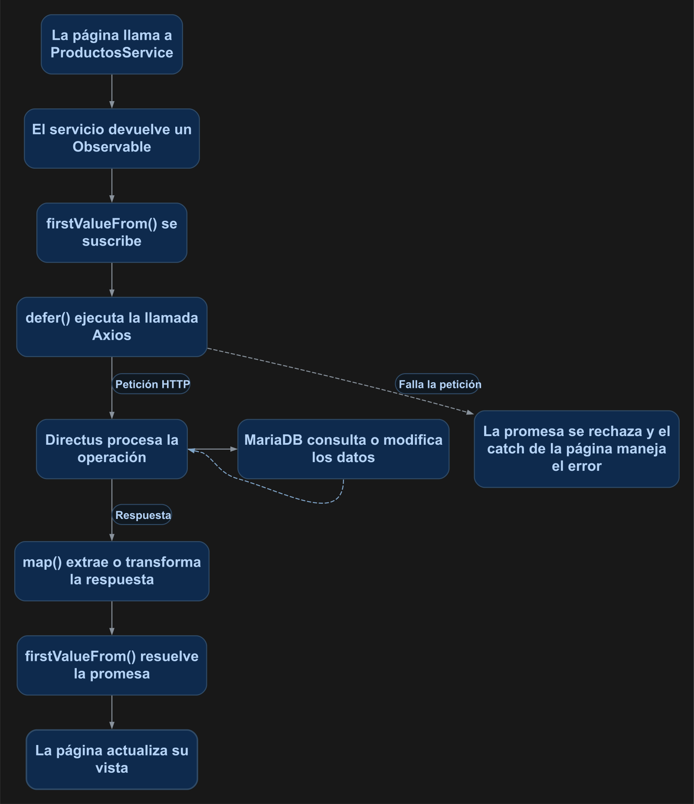

# Compartir las consultas de productos mediante un servicio

Crearás un servicio para consultar, contar, crear, actualizar y eliminar productos. Las páginas utilizarán sus métodos y conservarán sus formularios y mensajes.

<p align="center">
  <br>
  <em>Figura 1. Resultado de la práctica ejecutado en Ionic.</em>
</p>

## 1. Antes de comenzar

Continúa con la búsqueda y paginación del [manual 10](10_busqueda.md). Axios y RxJS ya forman parte del proyecto. Esta referencia utiliza el formulario mediante página.

Las rutas pertenecen al proyecto Ionic en `mobile/`. Ejecuta los comandos Docker desde la carpeta que contiene `docker-compose.yml`. Al generar páginas o componentes, configura manualmente `standalone: false` en `@Component`; este curso utiliza NgModules.

## 2. Conceptos y métodos que utilizarás

| Elemento | Uso | Resultado |
| --- | --- | --- |
| `@Injectable` | `providedIn: root` | Permite inyectar el servicio. |
| `Observable<T>` | Tipo de retorno de cada operación. | Representa su resultado o error. |
| `defer()` | Prepara la llamada Axios. | La ejecuta al suscribirse. |
| `map()` | Extrae `response.data.data`. | Entrega el dato que utiliza la página. |
| `firstValueFrom()` | Espera el resultado del observable. | Permite usarlo con `await` y `try/catch`. |

## 3. Implementación paso a paso

### Paso 1. Generar el servicio

```powershell
docker compose exec mobile ionic g service services/productos
```

El generador utilizado en este proyecto crea `src/app/services/productos.ts`. En el paso 2 encontrarás la implementación del servicio.

### Paso 2. Definir las operaciones

El servicio incluye `listado`, `detalle`, `crear`, `actualizar`, `eliminar` y `total`. Su filtro se utiliza tanto en el listado como en el conteo. Las interfaces describen los datos recibidos y los enviados.

**`mobile/src/app/services/productos.ts`**

1. En el archivo nuevo coloca los imports, las declaraciones y la estructura inicial que se muestran abajo. Si el generador creó una clase de ejemplo, sustituye esa plantilla una sola vez.

```typescript
import { Injectable } from '@angular/core';
import { defer, map, Observable } from 'rxjs';
import axios from 'axios';
import { environment } from '../../environments/environment';

export interface Producto {
  id: number;
  nombre: string;
  descripcion: string;
  precio: string;
  stock: number;
  fecha_registro: string;
}
export interface ProductoGuardar {
  nombre: string;
  descripcion: string;
  precio: number;
  stock: number;
}

@Injectable({ providedIn: 'root' })
export class ProductosService {
  private url = environment.apiUrl + '/items/productos';
}
```

2. Dentro de `ProductosService`, inserta los siguientes métodos en orden, justo antes de la última llave de la clase.

**`filtro()`**

```typescript
  private filtro(busqueda: string): Record<string, string> {
    const texto = busqueda.trim();
    return texto ? { filter: JSON.stringify({ _or: [
      { nombre: { _icontains: texto } },
      { descripcion: { _icontains: texto } }
    ] }) } : {};
  }
```

**`listado()`**

```typescript
  listado(pagina = 1, porPagina = 3, busqueda = ''): Observable<Producto[]> {
    return defer(() => axios.get<{ data: Producto[] }>(this.url, {
      params: { page: pagina, limit: porPagina, sort: 'id', ...this.filtro(busqueda) }
    })).pipe(map(response => response.data.data));
  }
```

**`detalle()`**

```typescript
  detalle(id: number): Observable<Producto> {
    return defer(() => axios.get<{ data: Producto }>(this.url + '/' + id))
      .pipe(map(response => response.data.data));
  }
```

**`crear()`**

```typescript
  crear(producto: ProductoGuardar): Observable<Producto> {
    return defer(() => axios.post<{ data: Producto }>(this.url, producto))
      .pipe(map(response => response.data.data));
  }
```

**`actualizar()`**

```typescript
  actualizar(id: number, producto: ProductoGuardar): Observable<Producto> {
    return defer(() => axios.patch<{ data: Producto }>(this.url + '/' + id, producto))
      .pipe(map(response => response.data.data));
  }
```

**`eliminar()`**

```typescript
  eliminar(id: number): Observable<void> {
    return defer(() => axios.delete(this.url + '/' + id)).pipe(map(() => undefined));
  }
```

**`total()`**

```typescript
  total(busqueda = ''): Observable<number> {
    return defer(() => axios.get<{ data: { count: string | number }[] }>(this.url, {
      params: { 'aggregate[count]': '*', ...this.filtro(busqueda) }
    })).pipe(map(response => Number(response.data.data[0]?.count ?? 0)));
  }
```

### Paso 3. Inyectarlo en las páginas

Abre los tres archivos de página en `mobile/src/app`: `productos-list/productos-list.page.ts`, `productos-form/productos-form.page.ts` y `productos-view/productos-view.page.ts`. En cada uno localiza los imports de Axios y el constructor de la clase. El paso 4 indica qué cambiar en cada archivo para inyectar `ProductosService` y esperar los resultados con `firstValueFrom`.

### Paso 4. Utilizar los métodos

En el formulario, `detalle(id)` carga sus valores, `crear(producto)` envía el registro nuevo y `actualizar(id, producto)` guarda la edición. La eliminación espera `eliminar(id)` y después actualiza el listado. Sus plantillas HTML se conservan.

**`mobile/src/app/productos-list/productos-list.page.ts`**. Aplica estos cambios en el orden indicado.

Sustituye el bloque desde `import axios from 'axios';` hasta `import { environment } from '../../environments/environment';` después de `import { Component } from '@angular/core';` / `import { AlertController } from '@ionic/angular';` y antes de `interface Producto {`.

```typescript
import { firstValueFrom } from 'rxjs';
import { ProductosService } from '../services/productos';
```

Sustituye la línea `constructor(private alertController: AlertController) {}` después de `porPagina: number = 3;` / `titulo: string = 'Productos';` y antes de `productos: Producto[] = [];`.

```typescript
  constructor(private alertController: AlertController, private productosService: ProductosService) {}
```

Sustituye el bloque desde `const response = await axios.get<{ data: Producto[] }>(` hasta `}` después de `async cargarProductos(): Promise<void> {` / `try {` y antes de `}`.

```typescript
    this.productos = await firstValueFrom(this.productosService.listado(this.paginaActual, this.porPagina, this.busqueda));
  } catch (error) { console.error('Error al cargar productos:', error); }
```

Sustituye el bloque desde `await axios.delete(` hasta `);` después de `async eliminarProducto(id: number): Promise<void> {` / `try {` y antes de `const alerta = await this.alertController.create({`.

```typescript
    await firstValueFrom(this.productosService.eliminar(id));
```

Sustituye el bloque desde `try {` hasta `}` después de `}` / `async cargarTotal(): Promise<void> {` y antes de `}`.

```typescript
  try { this.total = await firstValueFrom(this.productosService.total(this.busqueda)); }
  catch (error) { this.total = 0; console.error('Error al contar productos:', error); }
```

Retira el bloque desde `private parametrosBusqueda(): Record<string, string> {` hasta `}` después de `await this.cargarProductos();` / `}` y antes de `async handleInput(event: CustomEvent<{ value?: string | null }>): Promise<void> {`.

**`mobile/src/app/productos-form/productos-form.page.ts`**. Aplica estos cambios en el orden indicado.

Sustituye el bloque desde `import axios from 'axios';` hasta `import { environment } from '../../environments/environment';` después de `import { ActivatedRoute, Router } from '@angular/router';` / `import { AlertController } from '@ionic/angular';` y antes de `interface ProductoGuardar {`.

```typescript
import { firstValueFrom } from 'rxjs';
import { ProductosService } from '../services/productos';
```

Inserta el fragmento después de `private alertController: AlertController,` / `private activatedRoute: ActivatedRoute,` y antes de `private router: Router`.

```typescript
    private productosService: ProductosService,
```

Sustituye el bloque desde `const response = await axios.get<{ data: ProductoDetalle }>(` hasta `const producto = response.data.data;` después de `this.cargando = true;` / `try {` y antes de `this.productoForm.patchValue({`.

```typescript
      const producto = await firstValueFrom(this.productosService.detalle(this.idProducto));
```

Sustituye el bloque desde `await axios.patch(` hasta `);` después de `try {` / `if (this.esEdicion && this.idProducto !== undefined) {` y antes de `}`.

```typescript
        await firstValueFrom(this.productosService.actualizar(this.idProducto, producto));
      } else {
        await firstValueFrom(this.productosService.crear(producto));
```

**`mobile/src/app/productos-view/productos-view.page.ts`**. Aplica estos cambios en el orden indicado.

Sustituye la línea `import axios from 'axios';` después de `import { ActivatedRoute } from '@angular/router';` / `import { LoadingController } from '@ionic/angular';` y antes de `import { environment } from '../../environments/environment';`.

```typescript
import { firstValueFrom } from 'rxjs';
import { ProductosService } from '../services/productos';
```

En los parámetros del constructor de `ProductosViewPage`, justo antes de `private loading: LoadingController`, agrega esta dependencia.

```typescript
    private productosService: ProductosService,
```

Sustituye el bloque desde `const response = await axios.get<{ data: Producto }>(` hasta `this.producto = response.data.data;` después de `await loading.present();` / `try {` y antes de `} catch (error) {`.

```typescript
      this.producto = await firstValueFrom(this.productosService.detalle(Number(id)));
```

## 4. Comprobar el resultado

1. Abre el listado y busca **Mouse**: deben conservarse los resultados y el conteo.
2. Abre el ojo de un producto: debe mostrarse su detalle, como en la figura 1.
3. Abre **+**, crea un producto de prueba y comprueba que aparezca al regresar.
4. Edítalo y verifica sus nuevos datos.
5. Elimina únicamente ese registro de prueba y comprueba que se actualice el total.

La figura 1 muestra el resultado obtenido con el código de esta práctica. Las fechas, los productos y el tema visual dependen de tu entorno.

## 5. Explicación detallada del flujo

La figura 2 muestra el recorrido de arriba hacia abajo.

<p align="center">
  <br>
  <em>Figura 2. Consultar datos mediante un servicio.</em>
</p>

### Inyección y operaciones

`providedIn: root` permite que Angular comparta el servicio. Cada página lo recibe en su constructor. El servicio concentra la URL y las operaciones HTTP; la página conserva el estado visible, la validación y los mensajes de la interacción.

### Inicio y resultado de la consulta

`defer()` prepara la ejecución de Axios dentro del observable. `firstValueFrom()` se suscribe y entrega el primer resultado como promesa. `map()` devuelve los datos de Directus o convierte el conteo a número. Si la petición falla, la promesa se rechaza y el `catch` de la página puede presentar su error.

La creación utiliza `POST`, la edición `PATCH` y la eliminación `DELETE`. El servicio de eliminación devuelve `void` porque el resultado no necesita un cuerpo de datos. La paginación y la búsqueda se mantienen como parámetros del servicio.
