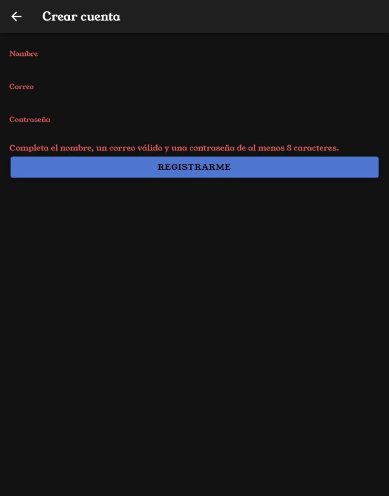
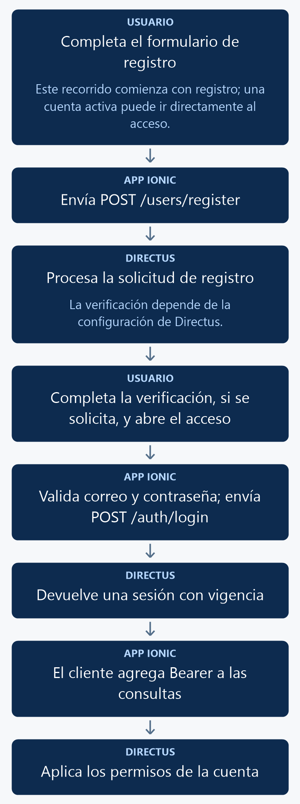

# Iniciar sesión y registrar usuarios con Ionic y Directus

Crearás páginas de acceso y registro, validarás sus formularios y utilizarás la autenticación de Directus. El servicio mantendrá la sesión en memoria y enviará el token con las consultas autenticadas.

<p align="center">
  <br>
  <em>Figura 1. Resultado de la práctica ejecutado en Ionic.</em>
</p>

## 1. Antes de comenzar

Continúa con el servicio de productos del [manual 11](11_servicios.md). Necesitas una cuenta activa de Directus para probar el acceso. Para el registro público configura en Directus **Settings → User Registration**: habilita el registro, selecciona un rol de aplicación y configura el envío de correo si se utiliza verificación. El rol debe permitir las operaciones de productos utilizadas y la lectura de su propio campo `id` en `directus_users`, con filtro `id = $CURRENT_USER`.

Las rutas pertenecen al proyecto Ionic en `mobile/`. Ejecuta los comandos Docker desde la carpeta que contiene `docker-compose.yml`. Al generar páginas o componentes, configura manualmente `standalone: false` en `@Component`; este curso utiliza NgModules.

## 2. Conceptos y métodos que utilizarás

| Elemento | Uso | Resultado |
| --- | --- | --- |
| `POST /auth/login` | Envía correo, contraseña y `mode: json`. | Obtiene la sesión. |
| `access_token` | Encabezado `Authorization: Bearer ...`. | Autentica peticiones. |
| `expires` | Milisegundos hasta el vencimiento. | Permite conocer la vigencia. |
| `POST /auth/refresh` | Envía el refresh token. | Renueva la sesión. |
| `POST /auth/logout` | Invalida el refresh token. | Cierra la sesión. |
| `POST /users/register` | Envía nombre, correo y contraseña. | Solicita registrar una cuenta. |

## 3. Implementación paso a paso

### Paso 1. Generar las páginas y el servicio

```powershell
docker compose exec mobile ionic g page login
docker compose exec mobile ionic g page registro
docker compose exec mobile ionic g service services/auth
```

Agrega manualmente `standalone: false` a ambas páginas. Utiliza `services/auth.ts` para `AuthService`.


Para la verificación por correo, configura en `api.environment` los datos de tu proveedor SMTP. Las variables pueden obtenerse del archivo local `.env`:

```yaml
EMAIL_TRANSPORT: smtp
EMAIL_FROM: ${SMTP_FROM}
EMAIL_SMTP_HOST: ${SMTP_HOST}
EMAIL_SMTP_PORT: ${SMTP_PORT}
EMAIL_SMTP_USER: ${SMTP_USER}
EMAIL_SMTP_PASSWORD: ${SMTP_PASSWORD}
EMAIL_SMTP_SECURE: ${SMTP_SECURE}
PUBLIC_URL: http://localhost:8000
```

Completa esos valores según tu proveedor. `SMTP_SECURE` corresponde a su modo TLS. Aplica las variables con `docker compose up -d --force-recreate api` y comprueba la entrega del correo con una cuenta de práctica. Consulta la [configuración de correo de Directus](https://docs.directus.io/self-hosted/config-options#email).

### Paso 2. Configurar formularios y rutas

Agrega `ReactiveFormsModule` a los dos módulos. Conserva las rutas `/login` y `/registro` que genera Ionic. La referencia completa de la sección 4 incluye sus archivos y las rutas principales.

### Paso 3. Implementar la sesión

Completa `AuthService` con el código de la sección 4. `ingresar()` obtiene los tokens, `renovar()` actualiza su vigencia y `cerrarSesion()` termina la sesión. El cliente Axios del servicio agrega el encabezado al enviar cada petición.

### Paso 4. Conectar las páginas y el servicio de productos

Coloca las clases y plantillas completas de la sección 4. Inyecta `AuthService` en `ProductosService` y utiliza `this.auth.cliente` en sus operaciones. El formulario de acceso navega al listado después de autenticar; el de registro informa el resultado y solicita revisar el correo cuando corresponda.

## 4. Código completo de referencia

### `mobile/src/app/services/auth.ts`

```typescript
import { Injectable } from '@angular/core';
import axios from 'axios';
import { environment } from '../../environments/environment';
interface SesionDirectus {
  access_token: string;
  refresh_token: string;
  expires: number;
}
@Injectable({ providedIn: 'root' })
export class AuthService {
  private token = '';
  private refreshToken = '';
  private expira = 0;
  readonly cliente = axios.create({ baseURL: environment.apiUrl });

  constructor() {
    this.cliente.interceptors.request.use(config => {
      if (this.token) config.headers.set('Authorization', 'Bearer ' + this.token);
      return config;
    });
  }

  private guardar(datos: SesionDirectus): void {
    this.token = datos.access_token;
    this.refreshToken = datos.refresh_token;
    this.expira = Date.now() + Number(datos.expires);
  }

  async ingresar(email: string, password: string): Promise<void> {
    const response = await axios.post<{ data: SesionDirectus }>(environment.apiUrl + '/auth/login', {
      email: email.trim(), password, mode: 'json'
    });
    this.guardar(response.data.data);
  }

  async registrar(email: string, password: string, nombre: string): Promise<void> {
    await axios.post(environment.apiUrl + '/users/register', {
      email: email.trim(), password, first_name: nombre.trim()
    });
  }

  activa(): boolean {
    return !!this.token && Date.now() < this.expira;
  }

  async renovar(): Promise<void> {
    const response = await axios.post<{ data: SesionDirectus }>(environment.apiUrl + '/auth/refresh', {
      refresh_token: this.refreshToken, mode: 'json'
    });
    this.guardar(response.data.data);
  }

  async validarSesion(): Promise<boolean> {
    try {
      if (!this.activa()) {
        if (!this.refreshToken) return false;
        await this.renovar();
      }
      await this.cliente.get('/users/me', { params: { fields: 'id' } });
      return true;
    } catch {
      this.limpiar();
      return false;
    }
  }

  private limpiar(): void {
    this.token = '';
    this.refreshToken = '';
    this.expira = 0;
  }

  async cerrarSesion(): Promise<void> {
    try {
      if (this.refreshToken) await axios.post(environment.apiUrl + '/auth/logout', {
        refresh_token: this.refreshToken, mode: 'json'
      });
    } finally { this.limpiar(); }
  }
}
```

### `mobile/src/app/login/login.page.ts`

```typescript
import { Component } from '@angular/core';
import { FormBuilder, FormGroup, Validators } from '@angular/forms';
import { Router } from '@angular/router';
import { AuthService } from '../services/auth';
@Component({ selector: 'app-login', templateUrl: './login.page.html', styleUrls: ['./login.page.scss'], standalone: false })
export class LoginPage {
  form: FormGroup;
  enviando = false;
  mensaje = '';
  constructor(fb: FormBuilder, private auth: AuthService, private router: Router) {
    this.form = fb.group({ email: ['', [Validators.required, Validators.email]], password: ['', Validators.required] });
  }
  async ingresar(): Promise<void> {
    if (this.form.invalid) { this.form.markAllAsTouched(); return; }
    this.enviando = true;
    this.mensaje = '';
    try {
      await this.auth.ingresar(this.form.value.email, this.form.value.password);
      const destino = new URLSearchParams(location.search).get('returnUrl');
      await this.router.navigateByUrl(destino?.startsWith('/') && !destino.startsWith('//') ? destino : '/productos-list', { replaceUrl: true });
      this.form.reset();
    } catch { this.mensaje = 'No fue posible iniciar sesión. Revisa tus datos y el acceso al servidor.'; }
    finally { this.enviando = false; }
  }
}
```

### `mobile/src/app/login/login.page.html`

```html
<ion-header><ion-toolbar><ion-title>Iniciar sesión</ion-title></ion-toolbar></ion-header>
<ion-content class="ion-padding">
  <form [formGroup]="form" (ngSubmit)="ingresar()">
    <ion-input label="Correo" labelPlacement="stacked" type="email" autocomplete="username" formControlName="email"></ion-input>
    <ion-input label="Contraseña" labelPlacement="stacked" type="password" autocomplete="current-password" formControlName="password"></ion-input>
    <ion-note color="danger" *ngIf="form.touched && form.invalid">Escribe un correo válido y tu contraseña.</ion-note>
    <p *ngIf="mensaje" role="status">{{ mensaje }}</p>
    <ion-button fill="solid" expand="block" type="submit" [disabled]="enviando">{{ enviando ? 'Ingresando...' : 'Ingresar' }}</ion-button>
  </form>
  <p><a routerLink="/registro">Crear cuenta</a></p>
</ion-content>
```

### `mobile/src/app/login/login.module.ts`

```typescript
import { NgModule } from '@angular/core';
import { CommonModule } from '@angular/common';
import { FormsModule, ReactiveFormsModule } from '@angular/forms';

import { IonicModule } from '@ionic/angular';

import { LoginPageRoutingModule } from './login-routing.module';

import { LoginPage } from './login.page';

@NgModule({
  imports: [
    CommonModule,
    FormsModule,
    ReactiveFormsModule,
    IonicModule,
    LoginPageRoutingModule
  ],
  declarations: [LoginPage]
})
export class LoginPageModule {}
```

### `mobile/src/app/login/login-routing.module.ts`

```typescript
import { NgModule } from '@angular/core';
import { Routes, RouterModule } from '@angular/router';

import { LoginPage } from './login.page';

const routes: Routes = [
  {
    path: '',
    component: LoginPage
  }
];

@NgModule({
  imports: [RouterModule.forChild(routes)],
  exports: [RouterModule],
})
export class LoginPageRoutingModule {}
```

### `mobile/src/app/registro/registro.page.ts`

```typescript
import { Component } from '@angular/core';
import { FormBuilder, FormGroup, Validators } from '@angular/forms';
import { AuthService } from '../services/auth';
@Component({ selector: 'app-registro', templateUrl: './registro.page.html', styleUrls: ['./registro.page.scss'], standalone: false })
export class RegistroPage {
  form: FormGroup;
  enviando = false;
  mensaje = '';
  constructor(fb: FormBuilder, private auth: AuthService) {
    this.form = fb.group({ nombre: ['', Validators.required], email: ['', [Validators.required, Validators.email]], password: ['', [Validators.required, Validators.minLength(8)]] });
  }
  async registrar(): Promise<void> {
    if (this.form.invalid) { this.form.markAllAsTouched(); return; }
    this.enviando = true;
    this.mensaje = '';
    try {
      await this.auth.registrar(this.form.value.email, this.form.value.password, this.form.value.nombre);
      this.mensaje = 'Solicitud recibida. Revisa tu correo para completar el registro si se solicita verificación.';
      this.form.reset();
    } catch { this.mensaje = 'No fue posible completar el registro. Revisa los datos y la configuración de registro de Directus.'; }
    finally { this.enviando = false; }
  }
}
```

### `mobile/src/app/registro/registro.page.html`

```html
<ion-header><ion-toolbar><ion-buttons slot="start"><ion-back-button defaultHref="/login"></ion-back-button></ion-buttons><ion-title>Crear cuenta</ion-title></ion-toolbar></ion-header>
<ion-content class="ion-padding">
  <form [formGroup]="form" (ngSubmit)="registrar()">
    <ion-input label="Nombre" labelPlacement="stacked" formControlName="nombre" autocomplete="given-name"></ion-input>
    <ion-input label="Correo" labelPlacement="stacked" type="email" formControlName="email" autocomplete="email"></ion-input>
    <ion-input label="Contraseña" labelPlacement="stacked" type="password" formControlName="password" autocomplete="new-password"></ion-input>
    <ion-note color="danger" *ngIf="form.touched && form.invalid">Completa el nombre, un correo válido y una contraseña de al menos 8 caracteres.</ion-note>
    <p *ngIf="mensaje" role="status">{{ mensaje }}</p>
    <ion-button fill="solid" expand="block" type="submit" [disabled]="enviando">{{ enviando ? 'Enviando...' : 'Registrarme' }}</ion-button>
  </form>
</ion-content>
```

### `mobile/src/app/registro/registro.module.ts`

```typescript
import { NgModule } from '@angular/core';
import { CommonModule } from '@angular/common';
import { FormsModule, ReactiveFormsModule } from '@angular/forms';

import { IonicModule } from '@ionic/angular';

import { RegistroPageRoutingModule } from './registro-routing.module';

import { RegistroPage } from './registro.page';

@NgModule({
  imports: [
    CommonModule,
    FormsModule,
    ReactiveFormsModule,
    IonicModule,
    RegistroPageRoutingModule
  ],
  declarations: [RegistroPage]
})
export class RegistroPageModule {}
```

### `mobile/src/app/registro/registro-routing.module.ts`

```typescript
import { NgModule } from '@angular/core';
import { Routes, RouterModule } from '@angular/router';

import { RegistroPage } from './registro.page';

const routes: Routes = [
  {
    path: '',
    component: RegistroPage
  }
];

@NgModule({
  imports: [RouterModule.forChild(routes)],
  exports: [RouterModule],
})
export class RegistroPageRoutingModule {}
```

### `mobile/src/app/services/productos.ts`

```typescript
import { Injectable } from '@angular/core';
import { defer, map, Observable } from 'rxjs';
import { AuthService } from './auth';
import { environment } from '../../environments/environment';

export interface Producto {
  id: number;
  nombre: string;
  descripcion: string;
  precio: string;
  stock: number;
  fecha_registro: string;
}
export interface ProductoGuardar {
  nombre: string;
  descripcion: string;
  precio: number;
  stock: number;
}

@Injectable({ providedIn: 'root' })
export class ProductosService {
  constructor(private auth: AuthService) {}
  private url = environment.apiUrl + '/items/productos';

  private filtro(busqueda: string): Record<string, string> {
    const texto = busqueda.trim();
    return texto ? { filter: JSON.stringify({ _or: [
      { nombre: { _icontains: texto } },
      { descripcion: { _icontains: texto } }
    ] }) } : {};
  }

  listado(pagina = 1, porPagina = 3, busqueda = ''): Observable<Producto[]> {
    return defer(() => this.auth.cliente.get<{ data: Producto[] }>(this.url, {
      params: { page: pagina, limit: porPagina, sort: 'id', ...this.filtro(busqueda) }
    })).pipe(map(response => response.data.data));
  }

  detalle(id: number): Observable<Producto> {
    return defer(() => this.auth.cliente.get<{ data: Producto }>(this.url + '/' + id))
      .pipe(map(response => response.data.data));
  }

  crear(producto: ProductoGuardar): Observable<Producto> {
    return defer(() => this.auth.cliente.post<{ data: Producto }>(this.url, producto))
      .pipe(map(response => response.data.data));
  }

  actualizar(id: number, producto: ProductoGuardar): Observable<Producto> {
    return defer(() => this.auth.cliente.patch<{ data: Producto }>(this.url + '/' + id, producto))
      .pipe(map(response => response.data.data));
  }

  eliminar(id: number): Observable<void> {
    return defer(() => this.auth.cliente.delete(this.url + '/' + id)).pipe(map(() => undefined));
  }

  total(busqueda = ''): Observable<number> {
    return defer(() => this.auth.cliente.get<{ data: { count: string | number }[] }>(this.url, {
      params: { 'aggregate[count]': '*', ...this.filtro(busqueda) }
    })).pipe(map(response => Number(response.data.data[0]?.count ?? 0)));
  }
}
```

### `mobile/src/app/app-routing.module.ts`

```typescript
import { NgModule } from '@angular/core';
import { PreloadAllModules, RouterModule, Routes } from '@angular/router';

const routes: Routes = [
  {
    path: '',
    loadChildren: () => import('./tabs/tabs.module').then(m => m.TabsPageModule)
  },
  {
    path: 'productos-list',
    loadChildren: () => import('./productos-list/productos-list.module').then( m => m.ProductosListPageModule)
  },
  {
    path: 'productos-view/:id',
    loadChildren: () => import('./productos-view/productos-view.module').then( m => m.ProductosViewPageModule)
  },
  {
    path: 'productos-form',
    loadChildren: () => import('./productos-form/productos-form.module').then( m => m.ProductosFormPageModule)
  },
  {
    path: 'login',
    loadChildren: () => import('./login/login.module').then( m => m.LoginPageModule)
  },
  {
    path: 'registro',
    loadChildren: () => import('./registro/registro.module').then( m => m.RegistroPageModule)
  }
];
@NgModule({
  imports: [
    RouterModule.forRoot(routes, { preloadingStrategy: PreloadAllModules })
  ],
  exports: [RouterModule]
})
export class AppRoutingModule {}
```

## 5. Comprobar el resultado

1. Abre `/login`: debe verse el formulario de la figura 1. Envíalo vacío para comprobar la validación.
2. Escribe credenciales incorrectas: debe mostrarse el mensaje de acceso sin navegar.
3. Usa una cuenta activa: debe abrir el listado y permitir sus consultas.
4. Abre `/registro` y prueba nombre vacío, correo inválido y contraseña de menos de ocho caracteres.
5. Con el registro y correo configurados en Directus, solicita una cuenta de prueba y completa la verificación recibida. Inicia sesión con esa cuenta.
6. La sesión de este ejemplo vive en memoria: recargar la aplicación inicia una sesión de cliente nueva.

La figura 1 muestra el resultado obtenido con el código de esta práctica. Las fechas, los productos y el tema visual dependen de tu entorno.

La figura 2 muestra las validaciones del formulario de registro antes de enviar información.

<p align="center">
  <br>
  <em>Figura 2. Validación de los campos requeridos para registrar una cuenta.</em>
</p>

## 6. Explicación detallada del flujo

La figura 3 muestra el recorrido de arriba hacia abajo.

<p align="center">
  <br>
  <em>Figura 3. Registrar una cuenta e iniciar sesión.</em>
</p>

### Cómo se mantiene la sesión

Directus entrega el token de acceso, el de renovación y la duración de la sesión. `guardar()` calcula su vencimiento y conserva esos valores en el servicio. El interceptor de peticiones consulta el token vigente al preparar cada llamada.

`validarSesion()` comprueba la vigencia, renueva cuando dispone de un refresh token y consulta el ID del usuario actual. Si el servidor rechaza la sesión, limpia el estado. `cerrarSesion()` solicita invalidar el refresh token y limpia el estado en `finally`.

### Formularios y registro

Los formularios reactivos validan antes de enviar. El indicador `enviando` evita repetir el envío mientras espera la respuesta. Una autenticación correcta abre el listado; un error presenta el mensaje y conserva la página de acceso.

El registro utiliza la configuración de Directus para el rol asignado y la verificación de correo. La contraseña se envía al servicio de autenticación y no se guarda en los registros de productos. Los métodos y sus campos se describen en la [API de autenticación](https://directus.com/docs/api/authentication) y la [API de usuarios](https://directus.com/docs/api/users).
