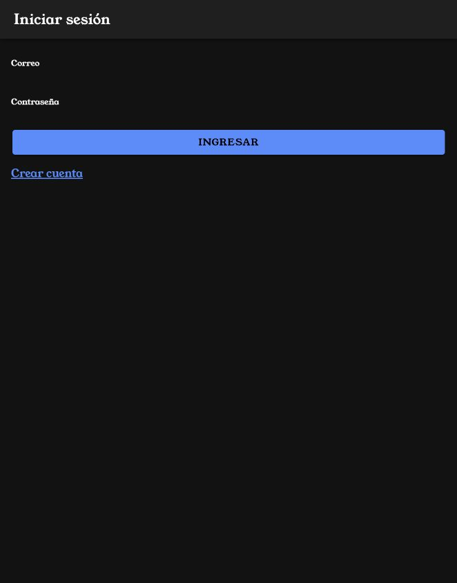
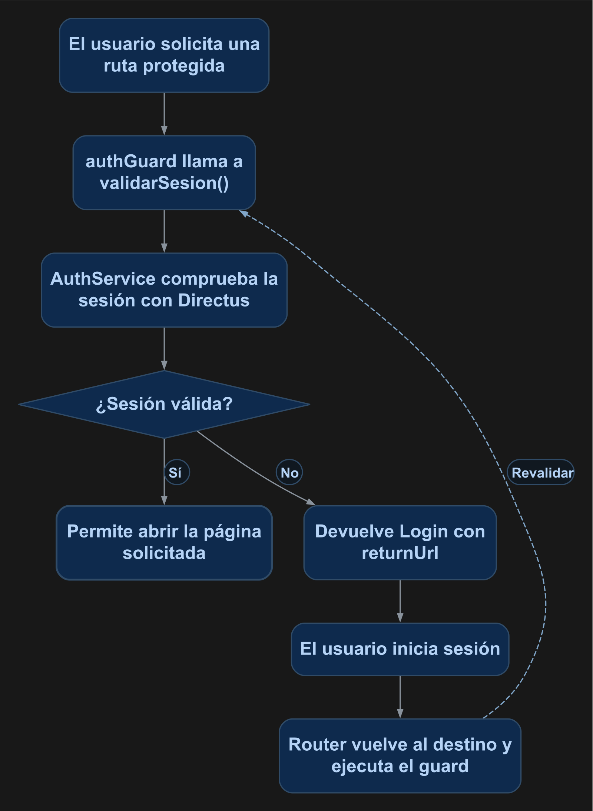

# Proteger la navegación con una guardia de autenticación

Protegerás las rutas de productos y devolverás al usuario a la página de acceso cuando no tenga una sesión válida. Después de autenticar se abrirá la ruta que había solicitado.

<p align="center">
  <br>
  <em>Figura 1. Resultado de la práctica ejecutado en Ionic.</em>
</p>

## 1. Antes de comenzar

Continúa con el [manual 12](12_login_registro.md). La cuenta debe tener permiso para consultar su propio `id` mediante `/users/me`. Los permisos de las operaciones de datos se configuran en las políticas de Directus.

Las rutas pertenecen al proyecto Ionic en `mobile/`. Ejecuta los comandos Docker desde la carpeta que contiene `docker-compose.yml`. Al generar páginas o componentes, configura manualmente `standalone: false` en `@Component`; este curso utiliza NgModules.

## 2. Conceptos y métodos que utilizarás

| Elemento | Uso | Resultado |
| --- | --- | --- |
| `CanActivateFn` | Función asociada a una ruta. | Decide si puede abrirse. |
| `inject()` | Obtiene `AuthService` y `Router`. | Accede a los servicios de Angular. |
| `validarSesion()` | Comprueba la sesión en Directus. | Devuelve un booleano. |
| `createUrlTree()` | Construye `/login` con `returnUrl`. | Indica a Angular la redirección. |
| `canActivate` | `[authGuard]` | Asocia la guardia a la ruta. |

## 3. Implementación paso a paso

### Paso 1. Crear la guardia

Crea `mobile/src/app/guard/auth.guard.ts` con el código de la sección 4. La guardia utiliza el servicio de autenticación del manual 12.

### Paso 2. Proteger las rutas

Importa `authGuard` en `app-routing.module.ts` y agrega `canActivate: [authGuard]` a las rutas de listado, detalle y formulario. Conserva `/login` y `/registro` accesibles. La sección 4 muestra el arreglo completo.

### Paso 3. Regresar a la ruta solicitada

El formulario de acceso del manual 12 lee `returnUrl` y navega a esa ruta después de autenticar. Conserva esa lógica.

### Paso 4. Agregar el cierre de sesión

Inyecta `AuthService` y `Router` en el listado. Agrega el método `cerrarSesion()` de la sección 4 y el botón sólido con icono `log-out` dentro de los botones de la barra. Al cerrar, el servicio invalida la sesión y la página navega a `/login`.

## 4. Código completo de referencia

### `mobile/src/app/guard/auth.guard.ts`

```typescript
import { inject } from '@angular/core';
import { CanActivateFn, Router } from '@angular/router';
import { AuthService } from '../services/auth';
export const authGuard: CanActivateFn = async (_route, state) => {
  const auth = inject(AuthService);
  const router = inject(Router);
  return await auth.validarSesion()
    ? true
    : router.createUrlTree(['/login'], { queryParams: { returnUrl: state.url } });
};
```

### `mobile/src/app/app-routing.module.ts`

```typescript
import { authGuard } from './guard/auth.guard';
import { NgModule } from '@angular/core';
import { PreloadAllModules, RouterModule, Routes } from '@angular/router';

const routes: Routes = [
  {
    path: '',
    loadChildren: () => import('./tabs/tabs.module').then(m => m.TabsPageModule)
  },
  {
    path: 'productos-list',
    canActivate: [authGuard],
    loadChildren: () => import('./productos-list/productos-list.module').then( m => m.ProductosListPageModule)
  },
  {
    path: 'productos-view/:id',
    canActivate: [authGuard],
    loadChildren: () => import('./productos-view/productos-view.module').then( m => m.ProductosViewPageModule)
  },
  {
    path: 'productos-form',
    canActivate: [authGuard],
    loadChildren: () => import('./productos-form/productos-form.module').then( m => m.ProductosFormPageModule)
  },
  {
    path: 'login',
    loadChildren: () => import('./login/login.module').then( m => m.LoginPageModule)
  },
  {
    path: 'registro',
    loadChildren: () => import('./registro/registro.module').then( m => m.RegistroPageModule)
  }
];
@NgModule({
  imports: [
    RouterModule.forRoot(routes, { preloadingStrategy: PreloadAllModules })
  ],
  exports: [RouterModule]
})
export class AppRoutingModule {}
```

### `mobile/src/app/productos-list/productos-list.page.ts`

```typescript
import { Router } from '@angular/router';
import { AuthService } from '../services/auth';
import { Component } from '@angular/core';
import { AlertController } from '@ionic/angular';
import { firstValueFrom } from 'rxjs';
import { ProductosService } from '../services/productos';

interface Producto {
  id: number;
  nombre: string;
  descripcion: string;
  precio: string;
  stock: number;
  fecha_registro: string;
}

@Component({
  selector: 'app-productos-list',
  templateUrl: './productos-list.page.html',
  styleUrls: ['./productos-list.page.scss'],
  standalone: false,
})
export class ProductosListPage {
  busqueda: string = '';

  total: number = 0;
  paginaActual: number = 1;
  porPagina: number = 3;

  titulo: string = 'Productos';

  constructor(private alertController: AlertController, private productosService: ProductosService, private auth: AuthService, private router: Router) {}

  productos: Producto[] = [];

  ionViewWillEnter(): void {
    void this.cargarDatos();
  }

async cargarProductos(): Promise<void> {
  try {
    this.productos = await firstValueFrom(this.productosService.listado(this.paginaActual, this.porPagina, this.busqueda));
  } catch (error) { console.error('Error al cargar productos:', error); }
}


async confirmarEliminar(id: number, nombre: string): Promise<void> {
  const alerta = await this.alertController.create({
    header: 'Eliminar producto',
    message: `¿Estás seguro de eliminar el producto "${nombre}"?`,
    buttons: [
      {
        text: 'Cancelar',
        role: 'cancel'
      },
      {
        text: 'Eliminar',
        role: 'destructive',
        handler: () => {
          void this.eliminarProducto(id);
        }
      }
    ]
  });

  await alerta.present();
}
async eliminarProducto(id: number): Promise<void> {
  try {
    await firstValueFrom(this.productosService.eliminar(id));

    const alerta = await this.alertController.create({
      header: 'Producto eliminado',
      message: 'El producto fue eliminado correctamente.',
      buttons: ['Aceptar']
    });

    await alerta.present();
    await alerta.onDidDismiss();

    await this.cargarDatos();
  } catch (error) {
    console.error('Error al eliminar el producto:', error);

    const alerta = await this.alertController.create({
      header: 'Error',
      message: 'No fue posible eliminar el producto. Revisa la conexión, los permisos de eliminación en Directus y las relaciones del registro.',
      buttons: ['Aceptar']
    });

    await alerta.present();
  }
}
async cargarTotal(): Promise<void> {
  try { this.total = await firstValueFrom(this.productosService.total(this.busqueda)); }
  catch (error) { this.total = 0; console.error('Error al contar productos:', error); }
}
private ajustarPaginaActual(): void {
  const totalPaginas = Math.ceil(
    this.total / this.porPagina
  );

  if (totalPaginas === 0) {
    this.paginaActual = 1;
    return;
  }

  if (this.paginaActual > totalPaginas) {
    this.paginaActual = totalPaginas;
  }
}
async cargarDatos(): Promise<void> {
  await this.cargarTotal();
  this.ajustarPaginaActual();
  await this.cargarProductos();
}
async cambiarPagina(
  pagina: number
): Promise<void> {
  this.paginaActual = pagina;
  await this.cargarProductos();
}

  async handleInput(event: CustomEvent<{ value?: string | null }>): Promise<void> {
    this.busqueda = event.detail.value ?? '';
    this.paginaActual = 1;
    await this.cargarDatos();
  }
  async cerrarSesion(): Promise<void> {
    try { await this.auth.cerrarSesion(); }
    finally { await this.router.navigateByUrl('/login', { replaceUrl: true }); }
  }
}
```

### `mobile/src/app/productos-list/productos-list.page.html`

```html
<app-toolbar [nombre]="titulo" color="personalizado">
  <ion-buttons slot="end">
    <ion-button fill="solid" [routerLink]="['/productos-form']" aria-label="Nuevo producto">
      <ion-icon slot="icon-only" name="add"></ion-icon>
    </ion-button>
    <ion-button fill="solid" (click)="cerrarSesion()" aria-label="Cerrar sesión"><ion-icon slot="icon-only" name="log-out"></ion-icon></ion-button>
  </ion-buttons>
</app-toolbar>

<ion-content>
  <ion-searchbar [value]="busqueda" [debounce]="300" (ionInput)="handleInput($event)" placeholder="Buscar productos" aria-label="Buscar productos"></ion-searchbar>
  <p class="ion-padding" *ngIf="total === 0">No se encontraron productos.</p>
  <ion-list>
    <ion-item *ngFor="let producto of productos">
      <ion-label class="ion-text-wrap">
        <h2>{{ producto.nombre }}</h2>
        <p>{{ producto.descripcion }}</p>
        <p>Precio: ${{ producto.precio }}</p>
        <p>Stock: {{ producto.stock }}</p>
        <p>Registro: {{ producto.fecha_registro | date:'yyyy-MM-dd' }}</p>
      </ion-label>
      <ion-button fill="solid" slot="end" [routerLink]="['/productos-view', producto.id]" aria-label="Ver detalle">
        <ion-icon slot="icon-only" name="eye"></ion-icon>
      </ion-button>
      <ion-button fill="solid" color="warning" [routerLink]="['/productos-form', producto.id]">
        <ion-icon slot="icon-only" name="pencil"></ion-icon>
      </ion-button>
      <ion-button fill="solid" color="danger" (click)="confirmarEliminar(producto.id, producto.nombre)" aria-label="Eliminar producto">
        <ion-icon slot="icon-only" name="trash"></ion-icon>
      </ion-button>
    </ion-item>
  </ion-list>
  <app-paginacion [total]="total" [porPagina]="porPagina" [paginaActual]="paginaActual" [maxPaginasVisibles]="5" (paginaCambio)="cambiarPagina($event)"></app-paginacion>
</ion-content>
```

## 5. Comprobar el resultado

1. Recarga la aplicación y abre directamente `/productos-view/1`: debe redirigir a `/login` con `returnUrl`, como en la figura 1.
2. Inicia sesión con una cuenta activa: debe abrir el detalle solicitado.
3. Abre el listado y presiona el icono de **cerrar sesión**. Debe aparecer el formulario de acceso.
4. Intenta abrir el listado otra vez: la guardia debe redirigir al acceso.
5. Comprueba con una cuenta de la práctica que las operaciones de datos respondan de acuerdo con sus permisos.

La figura 1 muestra el resultado obtenido con el código de esta práctica. Las fechas, los productos y el tema visual dependen de tu entorno.

## 6. Explicación detallada del flujo

La figura 2 muestra el recorrido de arriba hacia abajo.

<p align="center">
  <br>
  <em>Figura 2. Proteger una ruta con la sesión.</em>
</p>

La guardia se ejecuta antes de activar la ruta. `inject()` obtiene los servicios dentro de su contexto de inyección. `validarSesion()` revisa el vencimiento, renueva la sesión cuando corresponde y consulta el usuario actual.

Si la sesión es válida, devuelve `true`. En caso contrario devuelve un `UrlTree` con el destino de acceso y la ruta solicitada. Angular realiza la redirección y el formulario puede continuar hacia esa ruta después del acceso.

El cierre de sesión invalida el refresh token y limpia los valores conservados en memoria. La siguiente ruta protegida volverá a pasar por la guardia. Las políticas de Directus determinan los datos y operaciones que puede consultar esa sesión. Consulta la [documentación de guardias de Angular](https://angular.dev/guide/routing/route-guards).
