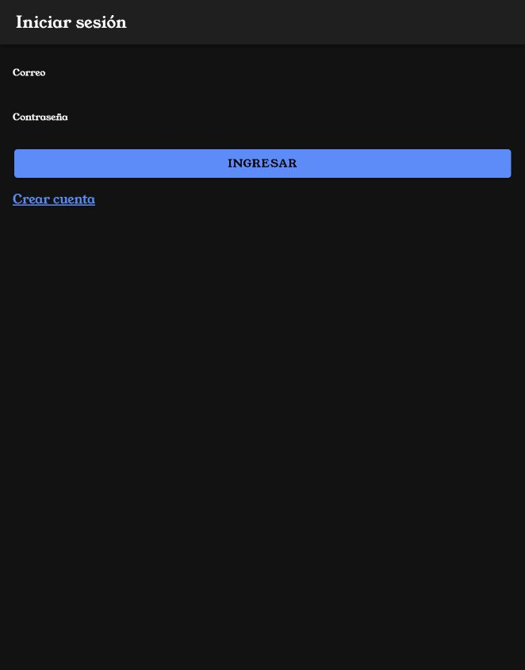
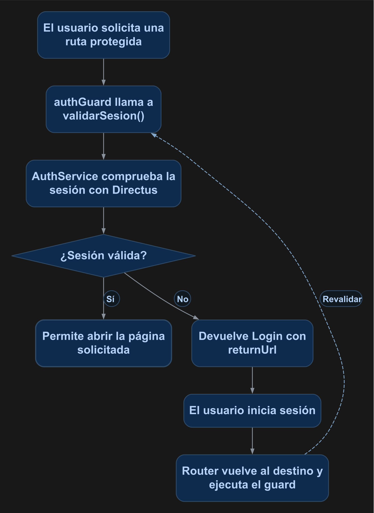

# Proteger la navegación con una guardia de autenticación

Protegerás las rutas de productos y devolverás al usuario a la página de acceso cuando no tenga una sesión válida. Después de autenticar se abrirá la ruta que había solicitado.

<p align="center">
  <br>
  <em>Figura 1. Resultado de la práctica ejecutado en Ionic.</em>
</p>

## 1. Antes de comenzar

Continúa con el [manual 12](12_login_registro.md). La cuenta debe tener permiso para consultar su propio `id` mediante `/users/me`. Los permisos de las operaciones de datos se configuran en las políticas de Directus.

Las rutas pertenecen al proyecto Ionic en `mobile/`. Ejecuta los comandos Docker desde la carpeta que contiene `docker-compose.yml`. Al generar páginas o componentes, configura manualmente `standalone: false` en `@Component`; este curso utiliza NgModules.

## 2. Conceptos y métodos que utilizarás

| Elemento | Uso | Resultado |
| --- | --- | --- |
| `CanActivateFn` | Función asociada a una ruta. | Decide si puede abrirse. |
| `inject()` | Obtiene `AuthService` y `Router`. | Accede a los servicios de Angular. |
| `validarSesion()` | Comprueba la sesión en Directus. | Devuelve un booleano. |
| `createUrlTree()` | Construye `/login` con `returnUrl`. | Indica a Angular la redirección. |
| `canActivate` | `[authGuard]` | Asocia la guardia a la ruta. |

## 3. Implementación paso a paso

### Paso 1. Crear la guardia

Crea `mobile/src/app/guard/auth.guard.ts` con el código de este paso. La guardia utiliza el servicio de autenticación del manual 12.

**`mobile/src/app/guard/auth.guard.ts`**. Crea este archivo con el siguiente contenido o sustituye la plantilla inicial del generador.

```typescript
import { inject } from '@angular/core';
import { CanActivateFn, Router } from '@angular/router';
import { AuthService } from '../services/auth';
export const authGuard: CanActivateFn = async (_route, state) => {
  const auth = inject(AuthService);
  const router = inject(Router);
  return await auth.validarSesion()
    ? true
    : router.createUrlTree(['/login'], { queryParams: { returnUrl: state.url } });
};
```

### Paso 2. Proteger las rutas

Al inicio de `mobile/src/app/app-routing.module.ts`, agrega `import { authGuard } from './guard/auth.guard';` y agrega `canActivate: [authGuard]` a las rutas de listado, detalle y formulario. Conserva `/login` y `/registro` accesibles. Dentro de cada objeto de ruta protegida, coloca `canActivate: [authGuard],` entre `path` y `loadChildren`.

### Paso 3. Regresar a la ruta solicitada

El formulario de acceso del manual 12 lee `returnUrl` y navega a esa ruta después de autenticar. En `mobile/src/app/login/login.page.ts`, localiza la lectura de `returnUrl` y la navegación tras `ingresar()`. Para comprobarla, cierra sesión, abre directamente el detalle de un producto e inicia sesión. Debe abrirse ese mismo detalle.

### Paso 4. Agregar el cierre de sesión

Inyecta `AuthService` y `Router` en el listado. Agrega el método `cerrarSesion()` de este paso y el botón sólido con icono `log-out` dentro de los botones de la barra. Al cerrar, el servicio invalida la sesión y la página navega a `/login`.

**`mobile/src/app/productos-list/productos-list.page.ts`**. Aplica estos cambios en el orden indicado.

Inserta el fragmento al inicio del archivo y antes de `import { Component } from '@angular/core';`.

```typescript
import { Router } from '@angular/router';
import { AuthService } from '../services/auth';
```

Sustituye la línea `constructor(private alertController: AlertController, private productosService: ProductosService) {}` después de `porPagina: number = 3;` / `titulo: string = 'Productos';` y antes de `productos: Producto[] = [];`.

```typescript
  constructor(private alertController: AlertController, private productosService: ProductosService, private auth: AuthService, private router: Router) {}
```

Sustituye la línea `}` después de `await this.cargarDatos();` / `}`.

```typescript
  async cerrarSesion(): Promise<void> {
    try { await this.auth.cerrarSesion(); }
    finally { await this.router.navigateByUrl('/login', { replaceUrl: true }); }
  }
}
```

**`mobile/src/app/productos-list/productos-list.page.html`**. Aplica estos cambios en el orden indicado.

Inserta el fragmento después de `<ion-icon slot="icon-only" name="add"></ion-icon>` / `</ion-button>` y antes de `</ion-buttons>`.

```html
    <ion-button fill="solid" (click)="cerrarSesion()" aria-label="Cerrar sesión"><ion-icon slot="icon-only" name="log-out"></ion-icon></ion-button>
```

## 4. Comprobar el resultado

1. Recarga la aplicación y abre directamente `/productos-view/1`: debe redirigir a `/login` con `returnUrl`, como en la figura 1.
2. Inicia sesión con una cuenta activa: debe abrir el detalle solicitado.
3. Abre el listado y presiona el icono de **cerrar sesión**. Debe aparecer el formulario de acceso.
4. Intenta abrir el listado otra vez: la guardia debe redirigir al acceso.
5. Comprueba con una cuenta de la práctica que las operaciones de datos respondan de acuerdo con sus permisos.

La figura 1 muestra el resultado obtenido con el código de esta práctica. Las fechas, los productos y el tema visual dependen de tu entorno.

## 5. Explicación detallada del flujo

La figura 2 muestra el recorrido de arriba hacia abajo.

<p align="center">
  <br>
  <em>Figura 2. Proteger una ruta con la sesión.</em>
</p>

La guardia se ejecuta antes de activar la ruta. `inject()` obtiene los servicios dentro de su contexto de inyección. `validarSesion()` revisa el vencimiento, renueva la sesión cuando corresponde y consulta el usuario actual.

Si la sesión es válida, devuelve `true`. En caso contrario devuelve un `UrlTree` con el destino de acceso y la ruta solicitada. Angular realiza la redirección y el formulario puede continuar hacia esa ruta después del acceso.

El cierre de sesión invalida el refresh token y limpia los valores conservados en memoria. La siguiente ruta protegida volverá a pasar por la guardia. Las políticas de Directus determinan los datos y operaciones que puede consultar esa sesión. Consulta la [documentación de guardias de Angular](https://angular.dev/guide/routing/route-guards).
