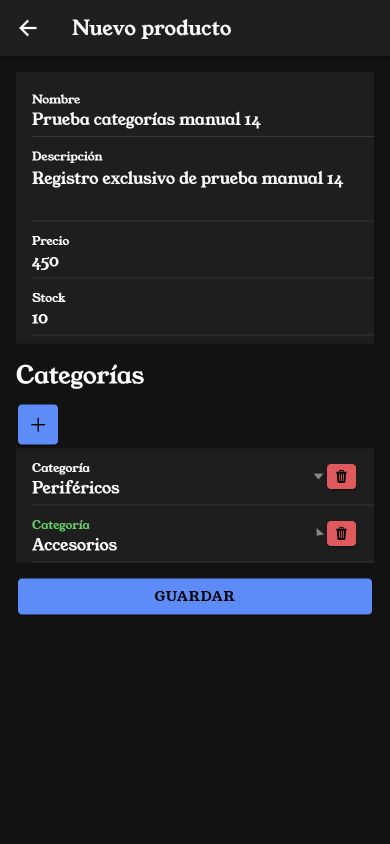
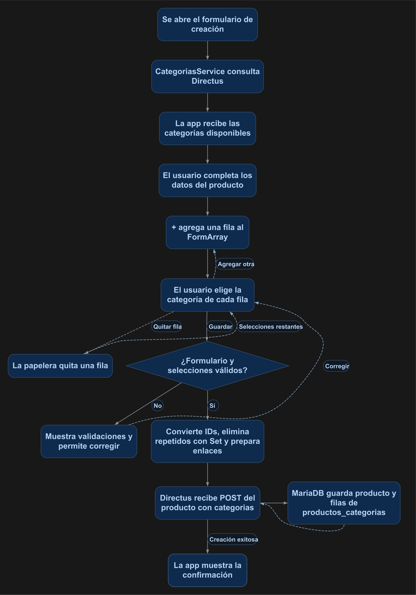

# Crear productos con varias categorías

Utilizarás un `FormArray` para seleccionar varias categorías al crear un producto. Directus guardará el producto y sus enlaces en la colección de unión de la relación.

## 1. Antes de comenzar

Continúa con los servicios y formularios de los manuales 11–13. Necesitas las colecciones y permisos descritos en el primer paso. Esta práctica agrega categorías durante la creación del producto.

Las rutas pertenecen al proyecto Ionic en `mobile/`. Ejecuta los comandos Docker desde la carpeta que contiene `docker-compose.yml`. Al generar páginas o componentes, configura manualmente `standalone: false` en `@Component`; este curso utiliza NgModules.

## 2. Conceptos y métodos que utilizarás

| Elemento | Uso | Resultado |
| --- | --- | --- |
| Muchos a muchos | Productos y categorías unidos por una colección. | Un producto puede tener varias categorías y una categoría varios productos. |
| `FormArray` | Agrupa controles de selección. | Permite agregar o quitar filas. |
| `FormControl` | Guarda el ID elegido. | Representa una selección. |
| `formArrayName` | Conecta el arreglo en la plantilla. | Vincula sus filas con Angular. |
| `Set` | Reúne los IDs sin repetir. | Evita duplicar enlaces en el envío. |

## 3. Implementación paso a paso

### Paso 1. Configurar la relación en Directus

Crea `categorias` con `id` entero autoincremental y `nombre` de texto. Registra **Periféricos** y **Accesorios**. En el modelo de datos de `productos`, crea el campo **categorias** como relación **Many to Many** hacia `categorias`, con colección de unión `productos_categorias`. Comprueba que sus campos de relación sean `productos_id` y `categorias_id`.

La colección de unión debe tener su propio ID y las dos relaciones. En la política utilizada por la cuenta de la práctica configura lectura de `categorias` y lectura/creación de `productos_categorias`; conserva los permisos de productos.

### Paso 2. Crear el servicio de categorías

Crea `services/categorias.ts` con el contenido de la sección 4. Inyecta `CategoriasService` en el formulario y carga sus opciones al inicializarlo.

### Paso 3. Agregar el arreglo de controles

Importa `FormArray` y `FormControl`. Después de construir el formulario, agrega el control `categorias` con `this.formBuilder.array([])`. El getter y los métodos de la sección 4 permiten consultar, agregar y quitar sus controles. Cada selección utiliza `Validators.required`.

### Paso 4. Preparar el envío

Agrega `categorias?: { categorias_id: number }[]` a `ProductoGuardar` en el formulario y en el servicio de productos. Antes del envío de creación, convierte las selecciones en IDs y forma los enlaces. Por ejemplo:

```json
{
  "nombre": "Mouse con categorías",
  "descripcion": "Producto de práctica",
  "precio": 450,
  "stock": 10,
  "categorias": [{ "categorias_id": 1 }, { "categorias_id": 2 }]
}
```

Utiliza los IDs reales de tus categorías. El `POST` de `ProductosService.crear()` envía ese objeto.

### Paso 5. Mostrar las selecciones

Agrega el bloque `formArrayName="categorias"` del HTML completo dentro del formulario. Los botones **+** y papelera agregan o quitan controles. La sección de categorías se muestra durante la creación.

## 4. Código completo de referencia

### `mobile/src/app/services/categorias.ts`

```typescript
import { Injectable } from '@angular/core';
import { defer, map } from 'rxjs';
import { AuthService } from './auth';
export interface Categoria { id: number; nombre: string; }
@Injectable({ providedIn: 'root' })
export class CategoriasService {
  constructor(private auth: AuthService) {}
  listado() {
    return defer(() => this.auth.cliente.get<{ data: Categoria[] }>('/items/categorias', {
      params: { limit: 100, sort: 'id' }
    })).pipe(map(response => response.data.data));
  }
}
```

### `mobile/src/app/services/productos.ts`

```typescript
import { Injectable } from '@angular/core';
import { defer, map, Observable } from 'rxjs';
import { AuthService } from './auth';
import { environment } from '../../environments/environment';

export interface Producto {
  id: number;
  nombre: string;
  descripcion: string;
  precio: string;
  stock: number;
  fecha_registro: string;
}
export interface ProductoGuardar {
  categorias?: { categorias_id: number }[];
  nombre: string;
  descripcion: string;
  precio: number;
  stock: number;
}

@Injectable({ providedIn: 'root' })
export class ProductosService {
  constructor(private auth: AuthService) {}
  private url = environment.apiUrl + '/items/productos';

  private filtro(busqueda: string): Record<string, string> {
    const texto = busqueda.trim();
    return texto ? { filter: JSON.stringify({ _or: [
      { nombre: { _icontains: texto } },
      { descripcion: { _icontains: texto } }
    ] }) } : {};
  }

  listado(pagina = 1, porPagina = 3, busqueda = ''): Observable<Producto[]> {
    return defer(() => this.auth.cliente.get<{ data: Producto[] }>(this.url, {
      params: { page: pagina, limit: porPagina, sort: 'id', ...this.filtro(busqueda) }
    })).pipe(map(response => response.data.data));
  }

  detalle(id: number): Observable<Producto> {
    return defer(() => this.auth.cliente.get<{ data: Producto }>(this.url + '/' + id))
      .pipe(map(response => response.data.data));
  }

  crear(producto: ProductoGuardar): Observable<Producto> {
    return defer(() => this.auth.cliente.post<{ data: Producto }>(this.url, producto))
      .pipe(map(response => response.data.data));
  }

  actualizar(id: number, producto: ProductoGuardar): Observable<Producto> {
    return defer(() => this.auth.cliente.patch<{ data: Producto }>(this.url + '/' + id, producto))
      .pipe(map(response => response.data.data));
  }

  eliminar(id: number): Observable<void> {
    return defer(() => this.auth.cliente.delete(this.url + '/' + id)).pipe(map(() => undefined));
  }

  total(busqueda = ''): Observable<number> {
    return defer(() => this.auth.cliente.get<{ data: { count: string | number }[] }>(this.url, {
      params: { 'aggregate[count]': '*', ...this.filtro(busqueda) }
    })).pipe(map(response => Number(response.data.data[0]?.count ?? 0)));
  }
}
```

### `mobile/src/app/productos-form/productos-form.page.ts`

```typescript
import { Categoria, CategoriasService } from '../services/categorias';
import { Component, OnInit } from '@angular/core';
import { FormArray, FormBuilder, FormControl, FormGroup, Validators } from '@angular/forms';
import { ActivatedRoute, Router } from '@angular/router';
import { AlertController } from '@ionic/angular';
import { firstValueFrom } from 'rxjs';
import { ProductosService } from '../services/productos';

interface ProductoGuardar {
  categorias?: { categorias_id: number }[];
  nombre: string;
  descripcion: string;
  precio: number;
  stock: number;
}

interface ProductoDetalle {
  id: number;
  nombre: string;
  descripcion: string;
  precio: string | number;
  stock: number;
  fecha_registro: string;
}

@Component({
  selector: 'app-productos-form',
  templateUrl: './productos-form.page.html',
  styleUrls: ['./productos-form.page.scss'],
  standalone: false,
})
export class ProductosFormPage implements OnInit {

  categorias: Categoria[] = [];
  mensajeCategorias = '';
  productoForm!: FormGroup;
  idProducto?: number;
  cargando: boolean = false;
  guardando: boolean = false;

  mensajesValidacion: Record<string, Record<string, string>> = {
    nombre: {
      required: 'El nombre es obligatorio.',
      maxlength: 'El nombre no debe superar 150 caracteres.'
    },
    precio: {
      required: 'El precio es obligatorio.',
      min: 'El precio debe ser igual o mayor que cero.'
    },
    stock: {
      required: 'El stock es obligatorio.',
      min: 'El stock debe ser igual o mayor que cero.',
      pattern: 'El stock debe contener únicamente números enteros.'
    }
  };

  constructor(
    private formBuilder: FormBuilder,
    private alertController: AlertController,
    private activatedRoute: ActivatedRoute,
    private productosService: ProductosService,
    private categoriasService: CategoriasService,
    private router: Router
  ) {}

  get esEdicion(): boolean {
    return this.idProducto !== undefined;
  }

  async ngOnInit(): Promise<void> {
    this.crearFormulario();
    await this.cargarCategorias();

    const id = this.activatedRoute.snapshot.paramMap.get('id');

    if (id !== null) {
      const idConvertido = Number(id);

      if (!Number.isNaN(idConvertido)) {
        this.idProducto = idConvertido;
        await this.cargarProducto();
      }
    }
  }

  private crearFormulario(): void {
    this.productoForm = this.formBuilder.group({
      nombre: ['', [
        Validators.required,
        Validators.maxLength(150)
      ]],
      descripcion: [''],
      precio: ['', [
        Validators.required,
        Validators.min(0)
      ]],
      stock: ['', [
        Validators.required,
        Validators.min(0),
        Validators.pattern('^[0-9]+$')
      ]]
    });
    this.productoForm.addControl('categorias', this.formBuilder.array([]));
  }

  getError(controlName: string): string {
    const control = this.productoForm.get(controlName);

    if (
      !control ||
      !control.errors ||
      !(control.touched || control.dirty)
    ) {
      return '';
    }

    const tipoError = Object.keys(control.errors)[0];

    return this.mensajesValidacion[controlName]?.[tipoError]
      ?? 'El valor ingresado no es válido.';
  }

  private async cargarProducto(): Promise<void> {
    if (this.idProducto === undefined) {
      return;
    }

    this.cargando = true;

    try {
      const producto = await firstValueFrom(this.productosService.detalle(this.idProducto));

      this.productoForm.patchValue({
        nombre: producto.nombre,
        descripcion: producto.descripcion,
        precio: producto.precio,
        stock: producto.stock
      });
    } catch (error) {
      console.error('Error al cargar el producto:', error);

      const alerta = await this.alertController.create({
        header: 'Error',
        message: 'No fue posible cargar los datos del producto. Revisa la conexión, el identificador y los permisos de lectura en Directus.',
        buttons: ['Aceptar']
      });

      await alerta.present();
    } finally {
      this.cargando = false;
    }
  }

  async guardarProducto(): Promise<void> {
    if (this.productoForm.invalid) {
      this.productoForm.markAllAsTouched();
      return;
    }

    this.guardando = true;

    const valores = this.productoForm.value;

    const producto: ProductoGuardar = {
      nombre: valores.nombre.trim(),
      descripcion: valores.descripcion?.trim() ?? '',
      precio: Number(valores.precio),
      stock: Number(valores.stock)
    };

    if (!this.esEdicion) {
      const ids = [...new Set(this.categoriasFA.value.map(Number))] as number[];
      producto.categorias = ids.map(id => ({ categorias_id: id }));
    }

    try {
      if (this.esEdicion && this.idProducto !== undefined) {
        await firstValueFrom(this.productosService.actualizar(this.idProducto, producto));
      } else {
        await firstValueFrom(this.productosService.crear(producto));
      }

      const alerta = await this.alertController.create({
        header: this.esEdicion ? 'Producto actualizado' : 'Producto guardado',
        message: this.esEdicion
          ? 'El producto fue actualizado correctamente.'
          : 'El producto fue registrado correctamente.',
        buttons: ['Aceptar']
      });

      await alerta.present();
      await alerta.onDidDismiss();

      await this.router.navigate(['/productos-list']);
    } catch (error) {
      console.error(
        this.esEdicion
          ? 'Error al actualizar el producto:'
          : 'Error al guardar el producto:',
        error
      );

      const alerta = await this.alertController.create({
        header: 'Error',
        message: this.esEdicion
          ? 'No fue posible actualizar el producto. Revisa los datos, la conexión y los permisos de actualización en Directus.'
          : 'No fue posible guardar el producto. Revisa los datos, la conexión y los permisos de creación en Directus.',
        buttons: ['Aceptar']
      });

      await alerta.present();
    } finally {
      this.guardando = false;
    }
  }
  get categoriasFA(): FormArray { return this.productoForm.get('categorias') as FormArray; }
  agregarCategoria(): void { this.categoriasFA.push(new FormControl(null, Validators.required)); }
  eliminarCategoria(indice: number): void { this.categoriasFA.removeAt(indice); }
  private async cargarCategorias(): Promise<void> {
    try { this.categorias = await firstValueFrom(this.categoriasService.listado()); }
    catch { this.mensajeCategorias = 'No fue posible consultar las categorías. Revisa su configuración y permisos.'; }
  }
}
```

### `mobile/src/app/productos-form/productos-form.page.html`

```html
<ion-header>
  <ion-toolbar>
    <ion-buttons slot="start">
      <ion-back-button defaultHref="/productos-list"></ion-back-button>
    </ion-buttons>

    <ion-title>
      {{ esEdicion ? 'Editar producto' : 'Nuevo producto' }}
    </ion-title>
  </ion-toolbar>
</ion-header>

<ion-content class="ion-padding">
  <div *ngIf="cargando" class="ion-text-center ion-padding">
    <ion-spinner></ion-spinner>
    <p>Cargando producto...</p>
  </div>

  <form *ngIf="productoForm && !cargando" [formGroup]="productoForm" (ngSubmit)="guardarProducto()">
    <ion-list>
      <ion-item>
        <ion-input label="Nombre" labelPlacement="stacked" type="text" formControlName="nombre" maxlength="150"></ion-input>
      </ion-item>
      <ion-note color="danger" *ngIf="getError('nombre') as error">
        {{ error }}
      </ion-note>

      <ion-item>
        <ion-textarea label="Descripción" labelPlacement="stacked" formControlName="descripcion" autoGrow="true"></ion-textarea>
      </ion-item>

      <ion-item>
        <ion-input label="Precio" labelPlacement="stacked" type="number" formControlName="precio" min="0"></ion-input>
      </ion-item>
      <ion-note color="danger" *ngIf="getError('precio') as error">
        {{ error }}
      </ion-note>

      <ion-item>
        <ion-input label="Stock" labelPlacement="stacked" type="number" formControlName="stock" min="0"></ion-input>
      </ion-item>
      <ion-note color="danger" *ngIf="getError('stock') as error">
        {{ error }}
      </ion-note>
    </ion-list>

    <section *ngIf="!esEdicion">
      <h2>Categorías</h2>
      <p *ngIf="mensajeCategorias" role="status">{{ mensajeCategorias }}</p>
      <ion-button fill="solid" type="button" (click)="agregarCategoria()" aria-label="Agregar categoría"><ion-icon slot="icon-only" name="add"></ion-icon></ion-button>
      <div formArrayName="categorias">
        <ion-item *ngFor="let control of categoriasFA.controls; let i = index">
          <ion-select label="Categoría" labelPlacement="stacked" [formControlName]="i" interface="popover">
            <ion-select-option *ngFor="let categoria of categorias" [value]="categoria.id">{{ categoria.nombre }}</ion-select-option>
          </ion-select>
          <ion-button fill="solid" type="button" color="danger" (click)="eliminarCategoria(i)" aria-label="Quitar categoría"><ion-icon slot="icon-only" name="trash"></ion-icon></ion-button>
        </ion-item>
      </div>
    </section>

    <ion-button fill="solid" expand="block" type="submit" class="ion-margin-top" [disabled]="guardando || cargando">
      {{ guardando ? 'Guardando...' : (esEdicion ? 'Actualizar' : 'Guardar') }}
    </ion-button>
  </form>
</ion-content>
```

## 5. Comprobar el resultado

La figura 1 muestra el formulario real de Ionic con dos categorías seleccionadas. En la prueba se guardó el producto y se verificaron ambos enlaces en Directus.

<p align="center">
  <br>
  <em>Figura 1. Producto de prueba con dos categorías antes de guardarlo.</em>
</p>

1. Abre **+** para crear un producto. Agrega dos filas de categorías.
2. Elige **Periféricos** y **Accesorios**, y completa los cuatro campos del producto.
3. Guarda y acepta la confirmación.
4. En Directus, abre el producto y comprueba sus dos categorías y los enlaces de `productos_categorias`.
5. Repite con una fila vacía para comprobar la validación; quítala con la papelera si no la necesitas.

## 6. Explicación detallada del flujo

La figura 2 muestra el recorrido de arriba hacia abajo.

<p align="center">
  <br>
  <em>Figura 2. Guardar un producto con categorías.</em>
</p>

El `FormArray` conserva un control por selección. `agregarCategoria()` crea otro control requerido y `eliminarCategoria()` quita la fila de captura. Las opciones provienen de la colección `categorias`.

Antes de guardar un producto nuevo, la aplicación transforma las selecciones en números, elimina repeticiones mediante `Set` y construye los objetos de la relación. `categorias_id` referencia un registro existente de categorías; el campo `categorias` del producto identifica la relación configurada en Directus.

Directus procesa la creación anidada y genera las filas de la colección de unión con el nuevo producto. Los nombres del modelo y de los campos deben coincidir con el JSON. En edición se conservan los campos del producto que ya utilizaba el formulario. Consulta las [relaciones de Directus](https://directus.com/docs/guides/connect/relations).
