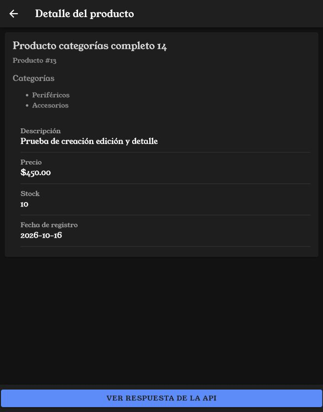
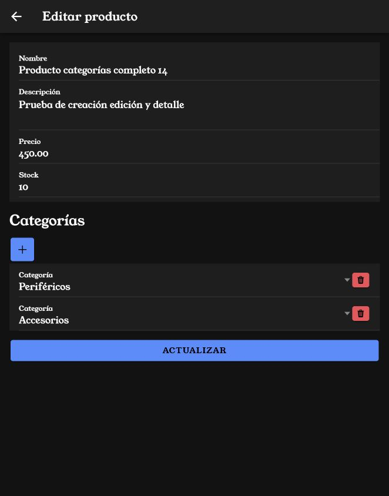
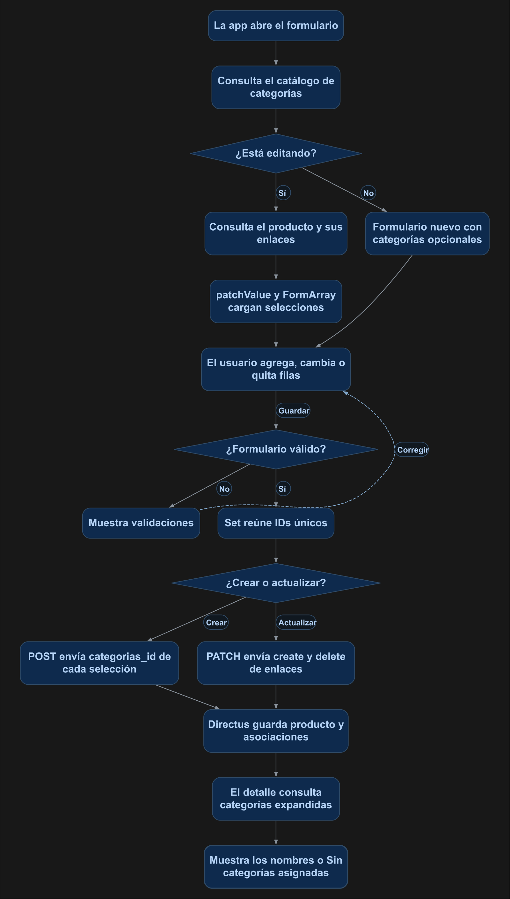

# Crear, actualizar y consultar productos con categorías

Utilizarás un FormArray para seleccionar categorías al crear y editar productos. El detalle mostrará sus nombres y Directus conservará los enlaces en productos_categorias.

## 1. Antes de comenzar

Continúa con los servicios, la sesión y los formularios mediante página de los manuales 11–13. Conserva el listado y sus accesos de creación, edición y detalle. Las rutas src/... corresponden a mobile/src/... en este repositorio. Al generar páginas o componentes, agrega manualmente `standalone: false` en @Component.

## 2. Conceptos y métodos que utilizarás

| Elemento | Uso | Para qué sirve |
| --- | --- | --- |
| FormArray y FormControl | Una selección requerida por fila. | Agregar y quitar categorías en ambos modos. |
| patchValue() y clear() | Cargar datos y reconstruir las filas. | Mostrar las selecciones existentes al editar. |
| fields | Solicitar categorias.id y categorias.categorias_id con sus datos. | Obtener el ID del enlace y el nombre de la categoría. |
| Set | Comparar IDs únicos. | Evitar enlaces repetidos. |
| create y delete | Enviar los cambios de la relación en PATCH. | Agregar enlaces nuevos y quitar solo los retirados. |

## 3. Implementación paso a paso

### Paso 1. Configurar la relación y los permisos

Crea categorias con id entero autoincremental y nombre de texto. Registra Periféricos y Accesorios. En productos crea categorias como relación Many to Many hacia categorias, con colección de unión productos_categorias. La unión debe tener id propio, productos_id y categorias_id. En la configuración de la relación productos.categorias, establece la acción al deseleccionar (Deselect Action) en Delete: al quitar una selección se elimina su fila de unión. Conserva los registros del catálogo categorias.

En la política de la cuenta autenticada, configura estas acciones con All Access dentro de cada acción, sin filtros, validaciones ni presets:

| Colección | Acciones |
| --- | --- |
| productos | Create, Read y Update |
| categorias | Read |
| productos_categorias | Create, Read y Delete |

Delete elimina el enlace del producto con una categoría; no elimina la categoría del catálogo. Conserva Admin Access desactivado.

### Paso 2. Consultar opciones y relaciones

Crea services/categorias.ts con el código del punto 4. En ProductosService.detalle() agrega fields para consultar el producto, el ID de cada enlace y el ID y nombre de cada categoría. Actualiza las interfaces del servicio con la estructura de respuesta y las dos formas de envío de categorias.

### Paso 3. Mostrar categorías en creación y edición

El bloque de categorías del formulario debe estar visible en ambos modos. Al cargar el producto para editar, guarda sus enlaces en enlacesCategorias, vacía categoriasFA con clear() y agrega un FormControl por cada categoría existente. Los botones + y papelera modifican las filas; cada fila agregada debe tener una selección para poder guardar.

### Paso 4. Guardar altas y cambios

Al crear, envía categorias como un arreglo de objetos categorias_id. Al actualizar, compara los IDs seleccionados con los enlaces originales y envía un objeto con create y delete. Por ejemplo, si conservas la categoría 1, agregas la 3 y retiras el enlace 9:

```json
{ "categorias": { "create": [{ "categorias_id": 3 }], "delete": [9] } }
```

9 es el ID del enlace en productos_categorias, no el ID de una categoría. El código completo calcula estos valores: utiliza los IDs reales de tu base. Guardar sin cambios envía ambos arreglos vacíos y conserva los enlaces existentes. Quitar todas las filas elimina los enlaces del producto.

### Paso 5. Mostrar las categorías en el detalle

Usa la misma respuesta expandida del servicio. Recorre detalle.categorias y muestra enlace.categorias_id.nombre. Si el arreglo está vacío, muestra Sin categorías asignadas. ionViewWillEnter() vuelve a consultar cada vez que entras al detalle para mostrar los cambios guardados.

## 4. Código completo de referencia

Conserva los NgModules, las rutas y AuthService de las prácticas anteriores. Sustituye estos seis archivos por su contenido completo:

### `mobile/src/app/services/categorias.ts`

```typescript
import { Injectable } from '@angular/core';
import { defer, map } from 'rxjs';
import { AuthService } from './auth';
export interface Categoria { id: number; nombre: string; }
@Injectable({ providedIn: 'root' })
export class CategoriasService {
  constructor(private auth: AuthService) {}
  listado() {
    return defer(() => this.auth.cliente.get<{ data: Categoria[] }>('/items/categorias', {
      params: { limit: 100, sort: 'id' }
    })).pipe(map(response => response.data.data));
  }
}
```

### `mobile/src/app/services/productos.ts`

```typescript
import { Injectable } from '@angular/core';
import { defer, map, Observable } from 'rxjs';
import { AuthService } from './auth';
import { environment } from '../../environments/environment';

export interface Producto {
  categorias?: { id: number; categorias_id: { id: number; nombre: string } }[];
  id: number;
  nombre: string;
  descripcion: string;
  precio: string;
  stock: number;
  fecha_registro: string;
}
export interface ProductoGuardar {
  categorias?: { categorias_id: number }[] | { create: { categorias_id: number }[]; delete: number[] };
  nombre: string;
  descripcion: string;
  precio: number;
  stock: number;
}

@Injectable({ providedIn: 'root' })
export class ProductosService {
  constructor(private auth: AuthService) {}
  private url = environment.apiUrl + '/items/productos';

  private filtro(busqueda: string): Record<string, string> {
    const texto = busqueda.trim();
    return texto ? { filter: JSON.stringify({ _or: [
      { nombre: { _icontains: texto } },
      { descripcion: { _icontains: texto } }
    ] }) } : {};
  }

  listado(pagina = 1, porPagina = 3, busqueda = ''): Observable<Producto[]> {
    return defer(() => this.auth.cliente.get<{ data: Producto[] }>(this.url, {
      params: { page: pagina, limit: porPagina, sort: 'id', ...this.filtro(busqueda) }
    })).pipe(map(response => response.data.data));
  }

  detalle(id: number): Observable<Producto> {
    return defer(() => this.auth.cliente.get<{ data: Producto }>(this.url + '/' + id, { params: { fields: '*,categorias.id,categorias.categorias_id.id,categorias.categorias_id.nombre' } }))
      .pipe(map(response => response.data.data));
  }

  crear(producto: ProductoGuardar): Observable<Producto> {
    return defer(() => this.auth.cliente.post<{ data: Producto }>(this.url, producto))
      .pipe(map(response => response.data.data));
  }

  actualizar(id: number, producto: ProductoGuardar): Observable<Producto> {
    return defer(() => this.auth.cliente.patch<{ data: Producto }>(this.url + '/' + id, producto))
      .pipe(map(response => response.data.data));
  }

  eliminar(id: number): Observable<void> {
    return defer(() => this.auth.cliente.delete(this.url + '/' + id)).pipe(map(() => undefined));
  }

  total(busqueda = ''): Observable<number> {
    return defer(() => this.auth.cliente.get<{ data: { count: string | number }[] }>(this.url, {
      params: { 'aggregate[count]': '*', ...this.filtro(busqueda) }
    })).pipe(map(response => Number(response.data.data[0]?.count ?? 0)));
  }
}
```

### `mobile/src/app/productos-form/productos-form.page.ts`

```typescript
import { Categoria, CategoriasService } from '../services/categorias';
import { Component, OnInit } from '@angular/core';
import { FormArray, FormBuilder, FormControl, FormGroup, Validators } from '@angular/forms';
import { ActivatedRoute, Router } from '@angular/router';
import { AlertController } from '@ionic/angular';
import { firstValueFrom } from 'rxjs';
import { ProductoGuardar, ProductosService } from '../services/productos';


@Component({
  selector: 'app-productos-form',
  templateUrl: './productos-form.page.html',
  styleUrls: ['./productos-form.page.scss'],
  standalone: false,
})
export class ProductosFormPage implements OnInit {
  categorias: Categoria[] = [];
  enlacesCategorias: { id: number; categoriaId: number }[] = [];
  mensajeCategorias = '';
  productoForm!: FormGroup;
  idProducto?: number;
  cargando: boolean = false;
  guardando: boolean = false;

  mensajesValidacion: Record<string, Record<string, string>> = {
    nombre: {
      required: 'El nombre es obligatorio.',
      maxlength: 'El nombre no debe superar 150 caracteres.'
    },
    precio: {
      required: 'El precio es obligatorio.',
      min: 'El precio debe ser igual o mayor que cero.'
    },
    stock: {
      required: 'El stock es obligatorio.',
      min: 'El stock debe ser igual o mayor que cero.',
      pattern: 'El stock debe contener únicamente números enteros.'
    }
  };

  constructor(
    private formBuilder: FormBuilder,
    private alertController: AlertController,
    private activatedRoute: ActivatedRoute,
    private productosService: ProductosService,
    private categoriasService: CategoriasService,
    private router: Router
  ) {}

  get esEdicion(): boolean {
    return this.idProducto !== undefined;
  }

  async ngOnInit(): Promise<void> {
    this.crearFormulario();
    await this.cargarCategorias();

    const id = this.activatedRoute.snapshot.paramMap.get('id');

    if (id !== null) {
      const idConvertido = Number(id);

      if (!Number.isNaN(idConvertido)) {
        this.idProducto = idConvertido;
        await this.cargarProducto();
      }
    }
  }

  private crearFormulario(): void {
    this.productoForm = this.formBuilder.group({
      nombre: ['', [
        Validators.required,
        Validators.maxLength(150)
      ]],
      descripcion: [''],
      precio: ['', [
        Validators.required,
        Validators.min(0)
      ]],
      stock: ['', [
        Validators.required,
        Validators.min(0),
        Validators.pattern('^[0-9]+$')
      ]]
    });
    this.productoForm.addControl('categorias', this.formBuilder.array([]));
  }

  getError(controlName: string): string {
    const control = this.productoForm.get(controlName);

    if (
      !control ||
      !control.errors ||
      !(control.touched || control.dirty)
    ) {
      return '';
    }

    const tipoError = Object.keys(control.errors)[0];

    return this.mensajesValidacion[controlName]?.[tipoError]
      ?? 'El valor ingresado no es válido.';
  }

  private async cargarProducto(): Promise<void> {
    if (this.idProducto === undefined) {
      return;
    }

    this.cargando = true;

    try {
      const producto = await firstValueFrom(this.productosService.detalle(this.idProducto));

      this.enlacesCategorias = (producto.categorias ?? []).map(enlace => ({ id: enlace.id, categoriaId: enlace.categorias_id.id }));
      this.categoriasFA.clear();
      for (const enlace of this.enlacesCategorias) {
        this.categoriasFA.push(new FormControl(enlace.categoriaId, Validators.required));
      }
      this.productoForm.patchValue({
        nombre: producto.nombre,
        descripcion: producto.descripcion,
        precio: producto.precio,
        stock: producto.stock
      });
    } catch (error) {
      console.error('Error al cargar el producto:', error);

      const alerta = await this.alertController.create({
        header: 'Error',
        message: 'No fue posible cargar los datos del producto. Revisa la conexión, el identificador y los permisos de lectura en Directus.',
        buttons: ['Aceptar']
      });

      await alerta.present();
    } finally {
      this.cargando = false;
    }
  }

  async guardarProducto(): Promise<void> {
    if (this.guardando) return;
    if (this.productoForm.invalid) {
      this.productoForm.markAllAsTouched();
      return;
    }

    this.guardando = true;

    const valores = this.productoForm.value;

    const producto: ProductoGuardar = {
      nombre: valores.nombre.trim(),
      descripcion: valores.descripcion?.trim() ?? '',
      precio: Number(valores.precio),
      stock: Number(valores.stock)
    };

    const ids = [...new Set(this.categoriasFA.value.map(Number))] as number[];
    if (this.esEdicion) {
      const anteriores = new Set(this.enlacesCategorias.map(enlace => enlace.categoriaId));
      producto.categorias = {
        create: ids.filter(id => !anteriores.has(id)).map(id => ({ categorias_id: id })),
        delete: this.enlacesCategorias.filter(enlace => !ids.includes(enlace.categoriaId)).map(enlace => enlace.id)
      };
    } else {
      producto.categorias = ids.map(id => ({ categorias_id: id }));
    }

    try {
      if (this.esEdicion && this.idProducto !== undefined) {
        await firstValueFrom(this.productosService.actualizar(this.idProducto, producto));
      } else {
        await firstValueFrom(this.productosService.crear(producto));
      }

      const alerta = await this.alertController.create({
        header: this.esEdicion ? 'Producto actualizado' : 'Producto guardado',
        message: this.esEdicion
          ? 'El producto fue actualizado correctamente.'
          : 'El producto fue registrado correctamente.',
        buttons: ['Aceptar']
      });

      await alerta.present();
      await alerta.onDidDismiss();

      await this.router.navigate(['/productos-list']);
    } catch (error) {
      console.error(
        this.esEdicion
          ? 'Error al actualizar el producto:'
          : 'Error al guardar el producto:',
        error
      );

      const alerta = await this.alertController.create({
        header: 'Error',
        message: this.esEdicion
          ? 'No fue posible actualizar el producto. Revisa los datos, la conexión y los permisos de actualización en Directus.'
          : 'No fue posible guardar el producto. Revisa los datos, la conexión y los permisos de creación en Directus.',
        buttons: ['Aceptar']
      });

      await alerta.present();
    } finally {
      this.guardando = false;
    }
  }
  get categoriasFA(): FormArray { return this.productoForm.get('categorias') as FormArray; }
  agregarCategoria(): void { this.categoriasFA.push(new FormControl(null, Validators.required)); }
  eliminarCategoria(indice: number): void { this.categoriasFA.removeAt(indice); }
  private async cargarCategorias(): Promise<void> {
    try { this.categorias = await firstValueFrom(this.categoriasService.listado()); }
    catch { this.mensajeCategorias = 'No fue posible consultar las categorías. Revisa su configuración y permisos.'; }
  }
}
```

### `mobile/src/app/productos-form/productos-form.page.html`

```html
<ion-header>
  <ion-toolbar>
    <ion-buttons slot="start">
      <ion-back-button defaultHref="/productos-list"></ion-back-button>
    </ion-buttons>

    <ion-title>
      {{ esEdicion ? 'Editar producto' : 'Nuevo producto' }}
    </ion-title>
  </ion-toolbar>
</ion-header>

<ion-content class="ion-padding">
  <div *ngIf="cargando" class="ion-text-center ion-padding">
    <ion-spinner></ion-spinner>
    <p>Cargando producto...</p>
  </div>

  <form *ngIf="productoForm && !cargando" [formGroup]="productoForm" (ngSubmit)="guardarProducto()">
    <ion-list>
      <ion-item>
        <ion-input label="Nombre" labelPlacement="stacked" type="text" formControlName="nombre" maxlength="150"></ion-input>
      </ion-item>
      <ion-note color="danger" *ngIf="getError('nombre') as error">
        {{ error }}
      </ion-note>

      <ion-item>
        <ion-textarea label="Descripción" labelPlacement="stacked" formControlName="descripcion" autoGrow="true"></ion-textarea>
      </ion-item>

      <ion-item>
        <ion-input label="Precio" labelPlacement="stacked" type="number" formControlName="precio" min="0"></ion-input>
      </ion-item>
      <ion-note color="danger" *ngIf="getError('precio') as error">
        {{ error }}
      </ion-note>

      <ion-item>
        <ion-input label="Stock" labelPlacement="stacked" type="number" formControlName="stock" min="0"></ion-input>
      </ion-item>
      <ion-note color="danger" *ngIf="getError('stock') as error">
        {{ error }}
      </ion-note>
    </ion-list>

    <section>
      <h2>Categorías</h2>
      <p *ngIf="mensajeCategorias" role="status">{{ mensajeCategorias }}</p>
      <ion-button fill="solid" type="button" (click)="agregarCategoria()" aria-label="Agregar categoría"><ion-icon slot="icon-only" name="add"></ion-icon></ion-button>
      <div formArrayName="categorias">
        <ion-item *ngFor="let control of categoriasFA.controls; let i = index">
          <ion-select label="Categoría" labelPlacement="stacked" [formControlName]="i" interface="popover">
            <ion-select-option *ngFor="let categoria of categorias" [value]="categoria.id">{{ categoria.nombre }}</ion-select-option>
          </ion-select>
          <ion-button fill="solid" type="button" color="danger" (click)="eliminarCategoria(i)" aria-label="Quitar categoría"><ion-icon slot="icon-only" name="trash"></ion-icon></ion-button>
        </ion-item>
      </div>
    </section>

    <ion-button fill="solid" expand="block" type="submit" class="ion-margin-top" [disabled]="guardando || cargando">
      {{ guardando ? 'Guardando...' : (esEdicion ? 'Actualizar' : 'Guardar') }}
    </ion-button>
  </form>
</ion-content>
```

### `mobile/src/app/productos-view/productos-view.page.ts`

```typescript
import { Component } from '@angular/core';
import { ActivatedRoute } from '@angular/router';
import { LoadingController } from '@ionic/angular';
import { firstValueFrom } from 'rxjs';
import { Producto, ProductosService } from '../services/productos';
import { environment } from '../../environments/environment';

@Component({
  selector: 'app-productos-view',
  templateUrl: './productos-view.page.html',
  styleUrls: ['./productos-view.page.scss'],
  standalone: false
})
export class ProductosViewPage {

  producto: Producto | null = null;
  mensajeError: string = '';

  constructor(
    private route: ActivatedRoute,
    private productosService: ProductosService,
    private loading: LoadingController
  ) { }

  ionViewWillEnter() {
    this.cargarProducto();
  }

  async cargarProducto(): Promise<void> {
    const id = this.route.snapshot.paramMap.get('id');

    this.producto = null;
    this.mensajeError = '';

    if (!id) {
      this.mensajeError = 'No se recibió el ID del producto.';
      return;
    }

    const loading = await this.loading.create({
      message: 'Cargando producto...',
      spinner: 'bubbles',
    });

    await loading.present();

    try {
      this.producto = await firstValueFrom(this.productosService.detalle(Number(id)));

    } catch (error) {
      console.error('Error al cargar el producto:', error);
      this.mensajeError = 'No se pudo cargar el producto. Revisa el ID, la conexión y los permisos de lectura.';
    } finally {
      await loading.dismiss();
    }
  }

  abrirPagina(): void {
    if (!this.producto) {
      return;
    }

    const url = `${environment.apiUrl}/items/productos/${this.producto.id}`;
    window.open(url, '_blank', 'noopener,noreferrer');
  }

}
```

### `mobile/src/app/productos-view/productos-view.page.html`

```html
<ion-header>
  <ion-toolbar>
    <ion-buttons slot="start">
      <ion-back-button defaultHref="/productos-list"></ion-back-button>
    </ion-buttons>
    <ion-title>Detalle del producto</ion-title>
  </ion-toolbar>
</ion-header>

<ion-content>
  <ion-text color="danger" *ngIf="mensajeError">
    <p class="ion-padding">{{ mensajeError }}</p>
  </ion-text>

  <ion-card *ngIf="producto as detalle">
    <ion-card-header>
      <ion-card-title>{{ detalle.nombre }}</ion-card-title>
      <ion-card-subtitle>Producto #{{ detalle.id }}</ion-card-subtitle>
    </ion-card-header>

    <ion-card-content>
      <h2>Categorías</h2>
      <ul *ngIf="detalle.categorias?.length; else sinCategorias">
        <li *ngFor="let enlace of detalle.categorias">{{ enlace.categorias_id.nombre }}</li>
      </ul>
      <ng-template #sinCategorias><p>Sin categorías asignadas.</p></ng-template>
      <ion-list>
        <ion-item>
          <ion-label class="ion-text-wrap">
            <p>Descripción</p>
            <h2>{{ detalle.descripcion }}</h2>
          </ion-label>
        </ion-item>
        <ion-item>
          <ion-label>
            <p>Precio</p>
            <h2>${{ detalle.precio }}</h2>
          </ion-label>
        </ion-item>
        <ion-item>
          <ion-label>
            <p>Stock</p>
            <h2>{{ detalle.stock }}</h2>
          </ion-label>
        </ion-item>
        <ion-item>
          <ion-label>
            <p>Fecha de registro</p>
            <h2 *ngIf="detalle.fecha_registro; else sinFecha">
              {{ detalle.fecha_registro | date:'yyyy-MM-dd' }}
            </h2>
            <ng-template #sinFecha>
              <h2>Sin fecha de registro</h2>
            </ng-template>
          </ion-label>
        </ion-item>
      </ion-list>
    </ion-card-content>
  </ion-card>
</ion-content>

<ion-footer *ngIf="producto">
  <ion-toolbar>
    <ion-button fill="solid" expand="block" (click)="abrirPagina()">
      Ver respuesta de la API
    </ion-button>
  </ion-toolbar>
</ion-footer>
```

## 5. Comprobar el resultado

1. Entra a Ionic con la cuenta de práctica. Crea un producto, agrega dos filas y elige Periféricos y Accesorios. Guarda y acepta la confirmación.
2. Abre el detalle: debe mostrar ambos nombres, como en la figura 1.

<p align="center">
  <br>
  <em>Figura 1. Categorías del producto mostradas en el detalle.</em>
</p>

3. Abre la edición del mismo producto. Las categorías guardadas deben aparecer seleccionadas, como en la figura 2.

<p align="center">
  <br>
  <em>Figura 2. Selecciones recuperadas en el formulario de actualización.</em>
</p>

4. Quita Accesorios y actualiza. Comprueba en el detalle que solo quede Periféricos. Agrega Accesorios de nuevo desde la edición y verifica ambos nombres.
5. Guarda otra vez sin cambiar las filas: no deben aparecer enlaces duplicados. Finalmente, quita todas las filas, actualiza y verifica Sin categorías asignadas. Reasigna las categorías si deseas conservar el ejemplo.
6. Prueba una fila vacía: el formulario debe impedir el envío hasta seleccionar una categoría o quitar esa fila.

## 6. Explicación detallada del flujo

La figura 3 muestra los caminos de creación, edición y consulta de categorías.

<p align="center">
  <br>
  <em>Figura 3. Categorías en creación, actualización y detalle.</em>
</p>

El catálogo categorias contiene las opciones. productos_categorias guarda cada asociación: su id identifica el enlace, productos_id identifica el producto y categorias_id identifica la categoría. El FormArray contiene los IDs de las categorías seleccionadas; enlacesCategorias conserva además los IDs de unión recibidos al cargar la edición.

Al crear, los objetos categorias_id producen los enlaces. Al editar, Set reúne selecciones únicas: create contiene categorías que aún no estaban y delete contiene los IDs de los enlaces retirados. Los enlaces conservados no se recrean. Las operaciones se envían dentro del guardado del producto; quitar una fila de la pantalla no cambia la base hasta presionar Actualizar.

La consulta expandida permite reconstruir las filas de edición y mostrar los nombres en el detalle. El catálogo permanece intacto al quitar asociaciones.
