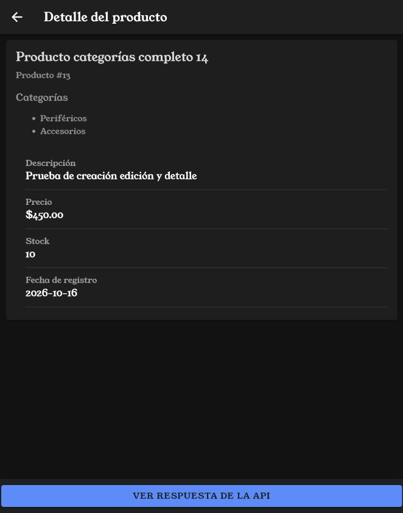
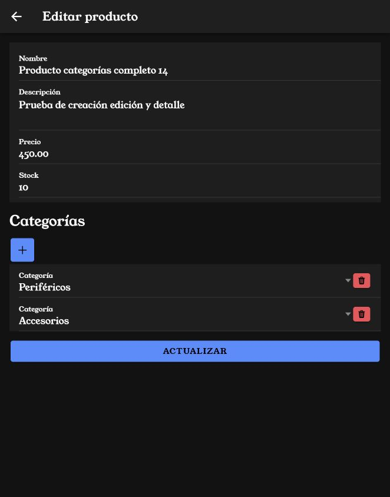
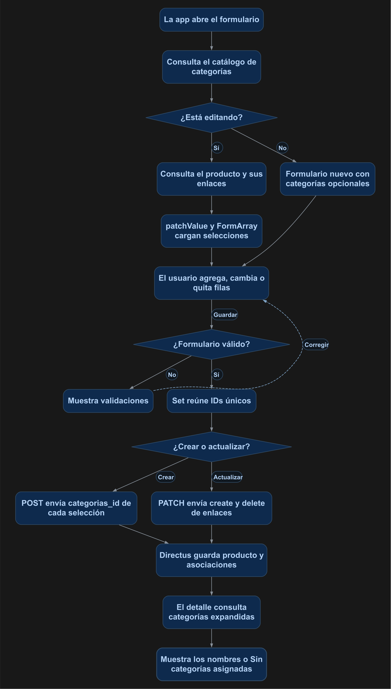

# Crear, actualizar y consultar productos con categorías

Utilizarás un FormArray para seleccionar categorías al crear y editar productos. El detalle mostrará sus nombres y Directus conservará los enlaces en productos_categorias.

Un producto puede pertenecer a varias categorías y una categoría puede aparecer en varios productos. Es el mismo caso que inscribir a un alumno en varias materias o asignar varias etiquetas a un artículo. El usuario elige opciones del catálogo desde el formulario principal. Al guardar, Directus registra una fila por asociación en la tabla intermedia.

Por ejemplo, si seleccionas las etiquetas 2 y 3 y Directus asigna al artículo nuevo el ID 25, la tabla intermedia queda así. Los identificadores son ilustrativos.

| fkarticulo | fketiqueta |
| --- | --- |
| 25 | 2 |
| 25 | 3 |

## 1. Antes de comenzar

Continúa con los servicios, la sesión y los formularios mediante página de los manuales 11–13. Conserva el listado y sus accesos de creación, edición y detalle. Las rutas src/... corresponden a mobile/src/... en este repositorio. Al generar páginas o componentes, agrega manualmente `standalone: false` en @Component.

## 2. Conceptos y métodos que utilizarás

| Elemento | Uso | Para qué sirve |
| --- | --- | --- |
| FormArray y FormControl | Una selección requerida por fila. | Agregar y quitar categorías en ambos modos. |
| patchValue() y clear() | Cargar datos y reconstruir las filas. | Mostrar las selecciones existentes al editar. |
| fields | Solicitar categorias.id y categorias.categorias_id con sus datos. | Obtener el ID del enlace y el nombre de la categoría. |
| Set | Comparar IDs únicos. | Evitar enlaces repetidos. |
| create y delete | Enviar los cambios de la relación en PATCH. | Agregar enlaces nuevos y quitar solo los retirados. |

## 3. Implementación paso a paso

### Paso 1. Configurar la relación y los permisos

Crea categorias con id entero autoincremental y nombre de texto. Registra Periféricos y Accesorios. En productos crea categorias como relación Many to Many hacia categorias, con colección de unión productos_categorias. La unión debe tener id propio, productos_id y categorias_id. En la configuración de la relación productos.categorias, establece la acción al deseleccionar (Deselect Action) en Delete: al quitar una selección se elimina su fila de unión. Conserva los registros del catálogo categorias.

En la política de la cuenta autenticada, configura estas acciones con All Access dentro de cada acción, sin filtros, validaciones ni presets:

| Colección | Acciones |
| --- | --- |
| productos | Create, Read y Update |
| categorias | Read |
| productos_categorias | Create, Read y Delete |

Delete elimina el enlace del producto con una categoría; no elimina la categoría del catálogo. Conserva Admin Access desactivado.

### Paso 2. Preparar los servicios

Crea `mobile/src/app/services/categorias.ts`. Este archivo nuevo consulta las opciones que aparecerán en el selector.

```typescript
import { Injectable } from '@angular/core';
import { defer, map } from 'rxjs';
import { AuthService } from './auth';
export interface Categoria { id: number; nombre: string; }
@Injectable({ providedIn: 'root' })
export class CategoriasService {
  constructor(private auth: AuthService) {}
  listado() {
    return defer(() => this.auth.cliente.get<{ data: Categoria[] }>('/items/categorias', {
      params: { limit: 100, sort: 'id' }
    })).pipe(map(response => response.data.data));
  }
}
```

En `mobile/src/app/services/productos.ts`, dentro de `export interface Producto`, agrega el campo que recibirás al consultar el detalle.

```typescript
  categorias?: { id: number; categorias_id: { id: number; nombre: string } }[];
```

Dentro de `export interface ProductoGuardar`, agrega el campo que enviarás al guardar.

```typescript
  categorias?: { categorias_id: number }[] | { create: { categorias_id: number }[]; delete: number[] };
```

En `ProductosService`, sustituye únicamente el método `detalle()` por este. La consulta pide el ID de la fila intermedia y los datos de la categoría.

```typescript
  detalle(id: number): Observable<Producto> {
    return defer(() => this.auth.cliente.get<{ data: Producto }>(this.url + '/' + id, { params: { fields: '*,categorias.id,categorias.categorias_id.id,categorias.categorias_id.nombre' } }))
      .pipe(map(response => response.data.data));
  }
```

### Paso 3. Agregar el selector al formulario de alta y edición

Los apartados 3.1 a 3.7 se hacen en `mobile/src/app/productos-form/productos-form.page.ts`. Abre el formulario **de página** que ya usas para crear y editar productos.

#### 3.1. Completa las importaciones

Arriba del archivo, agrega `FormArray` y `FormControl` entre las llaves del import existente de `@angular/forms`. En el import de `../services/productos` agrega `ProductoGuardar` junto a `ProductosService`. Si conservas la declaración local `interface ProductoGuardar` de la práctica 11, elimina esa declaración para usar el tipo actualizado del paso 2. Debajo de los imports agrega esta línea.

```typescript
import { Categoria, CategoriasService } from '../services/categorias';
```

#### 3.2. Declara qué datos conservará la página

Dentro de `ProductosFormPage`, justo antes de `productoForm!: FormGroup;`, agrega estas propiedades. `categorias` contiene las opciones del catálogo. `enlacesCategorias` recuerda qué asociaciones tenía este producto al abrir la edición.

```typescript
  categorias: Categoria[] = [];
  enlacesCategorias: { id: number; categoriaId: number }[] = [];
  mensajeCategorias = '';
```

#### 3.3. Conecta el servicio del catálogo

Dentro de los paréntesis del `constructor`, justo antes de `private router: Router`, agrega este parámetro con su coma final.

```typescript
    private categoriasService: CategoriasService,
```

#### 3.4. Crea el espacio para las selecciones

En `crearFormulario()`, ubica el `});` que cierra `this.formBuilder.group(...)`. En la línea siguiente, todavía dentro del método, agrega esta instrucción. El arreglo comienza vacío para que el usuario pueda decidir cuántas categorías asignar.

```typescript
    this.productoForm.addControl('categorias', this.formBuilder.array([]));
```

#### 3.5. Agrega las operaciones del selector

Justo antes de `getError(...)`, coloca estos miembros dentro de la clase. Cada pulsación de **+** crea una fila y cada papelera quita la fila elegida del formulario.

```typescript
  get categoriasFA(): FormArray {
    return this.productoForm.get('categorias') as FormArray;
  }

  agregarCategoria(): void {
    this.categoriasFA.push(new FormControl(null, Validators.required));
  }

  eliminarCategoria(indice: number): void {
    this.categoriasFA.removeAt(indice);
  }

  private async cargarCategorias(): Promise<void> {
    try {
      this.categorias = await firstValueFrom(this.categoriasService.listado());
    } catch {
      this.mensajeCategorias = 'No fue posible cargar el catálogo de categorías.';
    }
  }
```

#### 3.6. Carga las opciones al abrir el formulario

Dentro del `async ngOnInit()` existente, inmediatamente después de `this.crearFormulario();` y antes de leer el ID de la ruta, agrega esta línea. Así el catálogo queda disponible tanto al crear como al editar.

```typescript
    await this.cargarCategorias();
```

#### 3.7. Recupera las selecciones al editar

Dentro del `try` de `cargarProducto()`, ubica la línea que obtiene `const producto = await ...`. Después de esa línea y antes de `this.productoForm.patchValue(...)`, agrega este bloque. Por cada asociación guardada aparecerá una fila con la categoría correspondiente seleccionada.

```typescript
      this.enlacesCategorias = (producto.categorias ?? []).map(enlace => ({ id: enlace.id, categoriaId: enlace.categorias_id.id }));
      this.categoriasFA.clear();
      for (const enlace of this.enlacesCategorias) {
        this.categoriasFA.push(new FormControl(enlace.categoriaId, Validators.required));
      }
```

#### 3.8. Coloca el selector en la pantalla

Abre `mobile/src/app/productos-form/productos-form.page.html`. Dentro del `<form>`, busca el `</ion-list>` que cierra los campos del producto. Pega este bloque justo después y antes del botón de guardar con `type="submit"`.

```html
    <section>
      <h2>Categorías</h2>
      <p *ngIf="mensajeCategorias" role="status">{{ mensajeCategorias }}</p>
      <ion-button fill="solid" type="button" (click)="agregarCategoria()" aria-label="Agregar categoría"><ion-icon slot="icon-only" name="add"></ion-icon></ion-button>
      <div formArrayName="categorias">
        <ion-item *ngFor="let control of categoriasFA.controls; let i = index">
          <ion-select label="Categoría" labelPlacement="stacked" [formControlName]="i" interface="popover">
            <ion-select-option *ngFor="let categoria of categorias" [value]="categoria.id">{{ categoria.nombre }}</ion-select-option>
          </ion-select>
          <ion-button fill="solid" type="button" color="danger" (click)="eliminarCategoria(i)" aria-label="Quitar categoría"><ion-icon slot="icon-only" name="trash"></ion-icon></ion-button>
        </ion-item>
      </div>
    </section>
```

**Comprueba el paso 3.** Abre Nuevo producto, pulsa **+** dos veces y selecciona una categoría en cada fila. Al pulsar la papelera debe desaparecer solo esa fila. El paso 4 conecta estas selecciones con el botón Guardar.

### Paso 4. Guardar las asociaciones

Regresa a `productos-form.page.ts`. Dentro de `guardarProducto()`, ubica la construcción de `const producto: ProductoGuardar = { ... };`. Inmediatamente después de su `};` y antes del `try` que llama al servicio, agrega este bloque.

```typescript
    const ids = [...new Set(this.categoriasFA.value.map(Number))] as number[];
    if (this.esEdicion) {
      const anteriores = new Set(this.enlacesCategorias.map(enlace => enlace.categoriaId));
      producto.categorias = {
        create: ids.filter(id => !anteriores.has(id)).map(id => ({ categorias_id: id })),
        delete: this.enlacesCategorias.filter(enlace => !ids.includes(enlace.categoriaId)).map(enlace => enlace.id)
      };
    } else {
      producto.categorias = ids.map(id => ({ categorias_id: id }));
    }
```

En el alta, Directus recibe un `categorias_id` por selección y completa `productos_id` con el ID del producto nuevo. En edición, `create` contiene las categorías agregadas y `delete` contiene los IDs de las filas intermedias retiradas. Los cambios se aplican al pulsar **Actualizar**.

### Paso 5. Mostrar las categorías en el detalle

En `mobile/src/app/productos-view/productos-view.page.ts`, importa `Producto` junto a `ProductosService` desde `../services/productos`. Si el archivo declara su propia `interface Producto`, elimina esa declaración. Cambia el nombre del método `ngOnInit()` a `ionViewWillEnter()` conservando su llamada a `this.cargarProducto()`. Si la clase declara `implements OnInit`, quita esa cláusula y retira `OnInit` del import de Angular. Así la página vuelve a consultar las selecciones al regresar de la edición.

En `mobile/src/app/productos-view/productos-view.page.html`, dentro de la tarjeta con `*ngIf="producto as detalle"`, pega este bloque inmediatamente después de `<ion-card-content>`.

```html
      <h2>Categorías</h2>
      <ul *ngIf="detalle.categorias?.length; else sinCategorias">
        <li *ngFor="let enlace of detalle.categorias">{{ enlace.categorias_id.nombre }}</li>
      </ul>
      <ng-template #sinCategorias><p>Sin categorías asignadas.</p></ng-template>
```

## 4. Comprobar el resultado

1. Entra a Ionic con la cuenta de práctica. Crea un producto, agrega dos filas y elige Periféricos y Accesorios. Guarda y acepta la confirmación.
2. En Directus, abre `productos_categorias` y filtra por el `productos_id` que acabas de crear. Deben aparecer dos filas con el mismo `productos_id` y dos `categorias_id` distintos. Regresa a Ionic y abre el detalle: debe mostrar ambos nombres, como en la figura 1.

<p align="center">
  <br>
  <em>Figura 1. Categorías del producto mostradas en el detalle.</em>
</p>

3. Abre la edición del mismo producto. Las categorías guardadas deben aparecer seleccionadas, como en la figura 2.

<p align="center">
  <br>
  <em>Figura 2. Selecciones recuperadas en el formulario de actualización.</em>
</p>

4. Quita Accesorios y actualiza. Comprueba en el detalle que solo quede Periféricos. Agrega Accesorios de nuevo desde la edición y verifica ambos nombres.
5. Guarda otra vez sin cambiar las filas: no deben aparecer enlaces duplicados. Finalmente, quita todas las filas, actualiza y verifica Sin categorías asignadas. Reasigna las categorías si deseas conservar el ejemplo.
6. Prueba una fila vacía: el formulario debe impedir el envío hasta seleccionar una categoría o quitar esa fila.

## 5. Explicación detallada del flujo

La figura 3 muestra los caminos de creación, edición y consulta de categorías.

<p align="center">
  <br>
  <em>Figura 3. Categorías en creación, actualización y detalle.</em>
</p>

El catálogo categorias contiene las opciones. productos_categorias guarda cada asociación: su id identifica el enlace, productos_id identifica el producto y categorias_id identifica la categoría. El FormArray contiene los IDs de las categorías seleccionadas; enlacesCategorias conserva además los IDs de unión recibidos al cargar la edición.

Al crear, los objetos categorias_id producen los enlaces. Al editar, Set reúne selecciones únicas: create contiene categorías que aún no estaban y delete contiene los IDs de los enlaces retirados. Los enlaces conservados no se recrean. Las operaciones se envían dentro del guardado del producto; quitar una fila de la pantalla no cambia la base hasta presionar Actualizar.

La consulta expandida permite reconstruir las filas de edición y mostrar los nombres en el detalle. El catálogo permanece intacto al quitar asociaciones.
