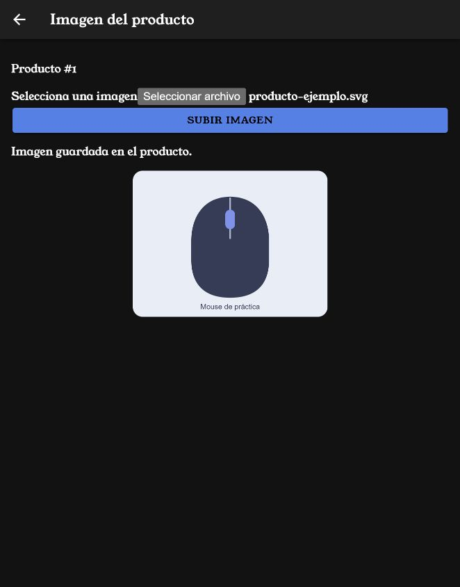
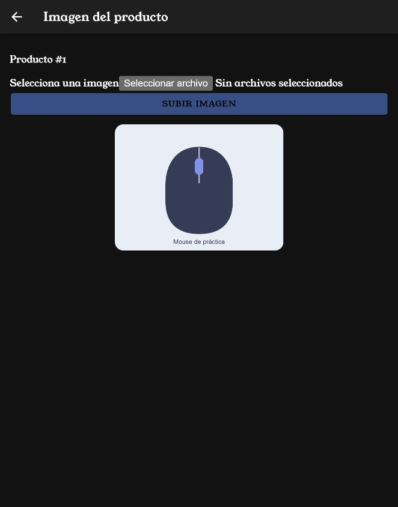
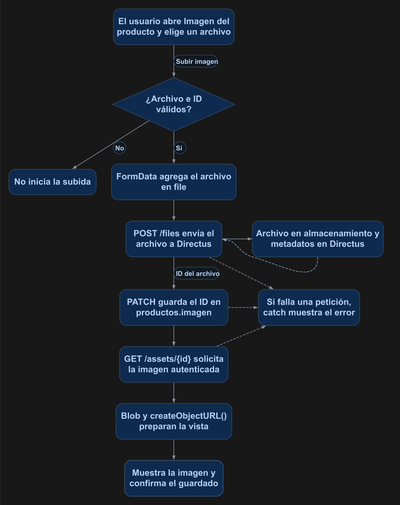

# Subir una imagen y asociarla a un producto

Seleccionarás una imagen, la enviarás a Directus y guardarás su identificador en el producto. La página mostrará la imagen después de completar ambas operaciones.

## 1. Antes de comenzar

Continúa con la sesión del [manual 12](12_login_registro.md) y un producto de prueba existente. La colección `productos` debe tener un campo de archivo llamado `imagen`, relacionado con `directus_files` y permitido como nulo. La cuenta debe poder actualizar el producto y crear/leer archivos en Directus. Los archivos se comparten entre las cuentas que tengan estos permisos.

Las rutas pertenecen al proyecto Ionic en `mobile/`. Ejecuta los comandos Docker desde la carpeta que contiene `docker-compose.yml`. Al generar páginas o componentes, configura manualmente `standalone: false` en `@Component`; este curso utiliza NgModules.

## 2. Conceptos y métodos que utilizarás

| Elemento | Uso | Resultado |
| --- | --- | --- |
| `input type=file` | Obtiene un archivo seleccionado. | Entrega un objeto `File`. |
| `FormData` | Agrega el archivo en `file`. | Construye el envío multipart. |
| `POST /files` | Recibe el formulario. | Devuelve el ID del archivo. |
| `PATCH` del producto | `{ imagen: id }` | Asocia el archivo. |
| `GET /assets/{id}` | Solicita la imagen autenticada. | Obtiene su contenido. |
| `URL.createObjectURL()` | Prepara la vista de un `Blob`. | Permite mostrarlo en `img`. |

## 3. Implementación paso a paso

### Paso 1. Configurar el campo y los permisos

En el modelo de `productos`, crea el campo **imagen** con interfaz **File**, relación hacia `directus_files` y valor nulo permitido. Revisa el permiso de actualización de ese campo.

En **Settings > Access Policies**, abre la política asignada a la cuenta de práctica. Agrega `directus_files` desde **Add Collection** y configura los permisos de esta tabla. La opción **All Access** se elige dentro de cada acción indicada; no pulses el botón **All** de la colección.

| Colección | Acción | Opción |
| --- | --- | --- |
| `directus_files` | **Create** | **All Access** |
| `directus_files` | **Read** | **All Access** |
| `productos` | **Read** | **All Access** |
| `productos` | **Update** | **All Access** |

Deja vacíos los filtros, las validaciones y los presets de estos permisos. Conserva desactivado **Admin Access** y guarda la política. Estos permisos se asignan a la cuenta autenticada que usas en Ionic, no a la política **Public**. Cada cuenta con lectura de archivos podrá consultar los archivos compartidos, independientemente de quién los haya subido.

Los archivos se guardan en el volumen `directus_uploads` del servicio; sus metadatos se registran en `directus_files`.

### Paso 2. Generar la página

```powershell
docker compose exec mobile ionic g page producto-imagen
```

Agrega manualmente `standalone: false`. En la ruta principal generada cambia el path a `producto-imagen/:id` y agrega `canActivate: [authGuard]`. Conserva la ruta interna vacía.

### Paso 3. Preparar la selección y el envío

Coloca el TypeScript, el HTML y el SCSS de la sección 4. `onFileSelected()` conserva el `File`; `subir()` crea `FormData`, envía `/files`, guarda el ID en el producto y solicita el contenido para mostrarlo. Axios prepara el encabezado multipart correspondiente al formulario.

### Paso 4. Abrir desde el listado

Agrega el botón de imagen de la sección 4 dentro de la fila de cada producto. Su ruta incluye el ID del registro elegido. Para probar, el repositorio contiene `docs/manuales/recursos/producto-ejemplo.svg`.

## 4. Código completo de referencia

### `mobile/src/app/producto-imagen/producto-imagen.page.ts`

```typescript
import { Component, OnDestroy, OnInit } from '@angular/core';
import { ActivatedRoute } from '@angular/router';
import { AuthService } from '../services/auth';
@Component({ selector: 'app-producto-imagen', templateUrl: './producto-imagen.page.html', styleUrls: ['./producto-imagen.page.scss'], standalone: false })
export class ProductoImagenPage implements OnInit, OnDestroy {
  idProducto = 0;
  archivo: File | null = null;
  imagenUrl = '';
  mensaje = '';
  enviando = false;
  constructor(private route: ActivatedRoute, private auth: AuthService) {}
  async ngOnInit(): Promise<void> {
    this.idProducto = Number(this.route.snapshot.paramMap.get('id'));
    if (!Number.isInteger(this.idProducto) || this.idProducto < 1) {
      this.mensaje = 'Selecciona un producto válido.'; return;
    }
    try {
      const response = await this.auth.cliente.get<{ data: { imagen: string | null } }>('/items/productos/' + this.idProducto, { params: { fields: 'imagen' } });
      if (response.data.data.imagen) await this.mostrar(response.data.data.imagen);
    } catch { this.mensaje = 'No fue posible cargar la imagen del producto.'; }
  }
  onFileSelected(event: Event): void {
    this.archivo = (event.target as HTMLInputElement).files?.[0] ?? null;
    this.mensaje = '';
  }
  private async mostrar(id: string): Promise<void> {
    const response = await this.auth.cliente.get<Blob>('/assets/' + id, { responseType: 'blob' });
    if (this.imagenUrl) URL.revokeObjectURL(this.imagenUrl);
    this.imagenUrl = URL.createObjectURL(response.data);
  }
  async subir(): Promise<void> {
    if (!this.archivo || this.idProducto < 1) return;
    this.enviando = true;
    this.mensaje = '';
    try {
      const datos = new FormData();
      datos.append('file', this.archivo);
      const response = await this.auth.cliente.post<{ data: { id: string } }>('/files', datos);
      const id = response.data.data.id;
      await this.auth.cliente.patch('/items/productos/' + this.idProducto, { imagen: id });
      await this.mostrar(id);
      this.mensaje = 'Imagen guardada en el producto.';
    } catch { this.mensaje = 'No fue posible guardar la imagen. Revisa el archivo y los permisos configurados.'; }
    finally { this.enviando = false; }
  }
  ngOnDestroy(): void { if (this.imagenUrl) URL.revokeObjectURL(this.imagenUrl); }
}
```

### `mobile/src/app/producto-imagen/producto-imagen.page.html`

```html
<ion-header><ion-toolbar><ion-buttons slot="start"><ion-back-button defaultHref="/productos-list"></ion-back-button></ion-buttons><ion-title>Imagen del producto</ion-title></ion-toolbar></ion-header>
<ion-content class="ion-padding">
  <p>Producto #{{ idProducto }}</p>
  <label for="archivo">Selecciona una imagen</label>
  <input id="archivo" type="file" accept="image/*" (change)="onFileSelected($event)">
  <ion-button fill="solid" expand="block" (click)="subir()" [disabled]="!archivo || enviando">{{ enviando ? 'Subiendo...' : 'Subir imagen' }}</ion-button>
  <p *ngIf="mensaje" role="status">{{ mensaje }}</p>
  
</ion-content>
```

### `mobile/src/app/producto-imagen/producto-imagen.page.scss`

```scss
.preview { display: block; width: 280px; max-width: 100%; margin: 1rem auto; }
```

### `mobile/src/app/producto-imagen/producto-imagen.module.ts`

```typescript
import { NgModule } from '@angular/core';
import { CommonModule } from '@angular/common';
import { FormsModule } from '@angular/forms';

import { IonicModule } from '@ionic/angular';

import { ProductoImagenPageRoutingModule } from './producto-imagen-routing.module';

import { ProductoImagenPage } from './producto-imagen.page';

@NgModule({
  imports: [
    CommonModule,
    FormsModule,
    IonicModule,
    ProductoImagenPageRoutingModule
  ],
  declarations: [ProductoImagenPage]
})
export class ProductoImagenPageModule {}
```

### `mobile/src/app/producto-imagen/producto-imagen-routing.module.ts`

```typescript
import { NgModule } from '@angular/core';
import { Routes, RouterModule } from '@angular/router';

import { ProductoImagenPage } from './producto-imagen.page';

const routes: Routes = [
  {
    path: '',
    component: ProductoImagenPage
  }
];

@NgModule({
  imports: [RouterModule.forChild(routes)],
  exports: [RouterModule],
})
export class ProductoImagenPageRoutingModule {}
```

### `mobile/src/app/app-routing.module.ts`

```typescript
import { authGuard } from './guard/auth.guard';
import { NgModule } from '@angular/core';
import { PreloadAllModules, RouterModule, Routes } from '@angular/router';

const routes: Routes = [
  {
    path: '',
    loadChildren: () => import('./tabs/tabs.module').then(m => m.TabsPageModule)
  },
  {
    path: 'productos-list',
    canActivate: [authGuard],
    loadChildren: () => import('./productos-list/productos-list.module').then( m => m.ProductosListPageModule)
  },
  {
    path: 'productos-view/:id',
    canActivate: [authGuard],
    loadChildren: () => import('./productos-view/productos-view.module').then( m => m.ProductosViewPageModule)
  },
  {
    path: 'productos-form',
    canActivate: [authGuard],
    loadChildren: () => import('./productos-form/productos-form.module').then( m => m.ProductosFormPageModule)
  },
  {
    path: 'login',
    loadChildren: () => import('./login/login.module').then( m => m.LoginPageModule)
  },
  {
    path: 'registro',
    loadChildren: () => import('./registro/registro.module').then( m => m.RegistroPageModule)
  },
  {
    path: 'producto-imagen/:id',
    canActivate: [authGuard],
    loadChildren: () => import('./producto-imagen/producto-imagen.module').then( m => m.ProductoImagenPageModule)
  }
];
@NgModule({
  imports: [
    RouterModule.forRoot(routes, { preloadingStrategy: PreloadAllModules })
  ],
  exports: [RouterModule]
})
export class AppRoutingModule {}
```

### `mobile/src/app/productos-list/productos-list.page.html`

```html
<app-toolbar [nombre]="titulo" color="personalizado">
  <ion-buttons slot="end">
    <ion-button fill="solid" [routerLink]="['/productos-form']" aria-label="Nuevo producto">
      <ion-icon slot="icon-only" name="add"></ion-icon>
    </ion-button>
    <ion-button fill="solid" (click)="cerrarSesion()" aria-label="Cerrar sesión"><ion-icon slot="icon-only" name="log-out"></ion-icon></ion-button>
  </ion-buttons>
</app-toolbar>

<ion-content>
  <ion-searchbar [value]="busqueda" [debounce]="300" (ionInput)="handleInput($event)" placeholder="Buscar productos" aria-label="Buscar productos"></ion-searchbar>
  <p class="ion-padding" *ngIf="total === 0">No se encontraron productos.</p>
  <ion-list>
    <ion-item *ngFor="let producto of productos">
      <ion-label class="ion-text-wrap">
        <h2>{{ producto.nombre }}</h2>
        <p>{{ producto.descripcion }}</p>
        <p>Precio: ${{ producto.precio }}</p>
        <p>Stock: {{ producto.stock }}</p>
        <p>Registro: {{ producto.fecha_registro | date:'yyyy-MM-dd' }}</p>
      </ion-label>
      <ion-button fill="solid" slot="end" [routerLink]="['/productos-view', producto.id]" aria-label="Ver detalle">
        <ion-icon slot="icon-only" name="eye"></ion-icon>
      </ion-button>
      <ion-button fill="solid" color="warning" [routerLink]="['/productos-form', producto.id]">
        <ion-icon slot="icon-only" name="pencil"></ion-icon>
      </ion-button>
      <ion-button fill="solid" color="danger" (click)="confirmarEliminar(producto.id, producto.nombre)" aria-label="Eliminar producto">
        <ion-icon slot="icon-only" name="trash"></ion-icon>
      </ion-button>
      <ion-button fill="solid" [routerLink]="['/producto-imagen', producto.id]" aria-label="Imagen del producto"><ion-icon slot="icon-only" name="image"></ion-icon></ion-button>
    </ion-item>
  </ion-list>
  <app-paginacion [total]="total" [porPagina]="porPagina" [paginaActual]="paginaActual" [maxPaginasVisibles]="5" (paginaCambio)="cambiarPagina($event)"></app-paginacion>
</ion-content>
```

## 5. Comprobar el resultado

La figura 1 muestra la carga y asociación completadas en Ionic con una cuenta de práctica sin acceso administrativo.

<p align="center">
  <br>
  <em>Figura 1. Imagen enviada a Directus y asociada al producto.</em>
</p>

1. Inicia sesión y abre el botón de imagen de un producto de prueba.
2. Selecciona `producto-ejemplo.svg` y presiona **Subir imagen**.
3. Debe aparecer **Imagen guardada en el producto** y su vista previa.
4. En Directus comprueba que exista el archivo y que `productos.imagen` guarde su ID.
5. Regresa al listado y vuelve a abrir la página: debe cargar la imagen asociada.

La figura 2 muestra la imagen recuperada al volver a abrir la página. El selector está vacío porque se consulta el archivo guardado, sin seleccionarlo ni subirlo de nuevo.

<p align="center">
  <br>
  <em>Figura 2. Recuperación autenticada de la imagen asociada.</em>
</p>

## 6. Explicación detallada del flujo

La figura 3 muestra el recorrido de arriba hacia abajo.

<p align="center">
  <br>
  <em>Figura 3. Flujo de subida, asociación y recuperación de una imagen.</em>
</p>

El selector entrega un `File` mediante `event.target.files`. `FormData` conserva su contenido y nombre durante el envío multipart. La respuesta de `/files` incluye el identificador que se guarda en el campo `imagen` del producto.

La asociación y la subida son dos peticiones: primero se obtiene el ID del archivo y después se actualiza el producto. La página informa éxito cuando ambas operaciones y la carga de la vista previa terminan correctamente.

El cliente de autenticación agrega el encabezado de acceso al solicitar `/assets/{id}`. `responseType: blob` obtiene el contenido y `URL.createObjectURL()` lo presenta en la imagen de la página. Antes de reemplazar la vista y al destruir el componente se libera la URL creada. Los archivos se almacenan según la configuración de Directus y sus metadatos pertenecen a `directus_files`. Consulta la [API de archivos](https://directus.com/docs/api/files).

Continúa con el [manual 17: imagen en el formulario y el detalle](17_imagen_formulario_detalle.md) para seleccionar la imagen durante la creación y actualización del producto y mostrarla en su detalle.
