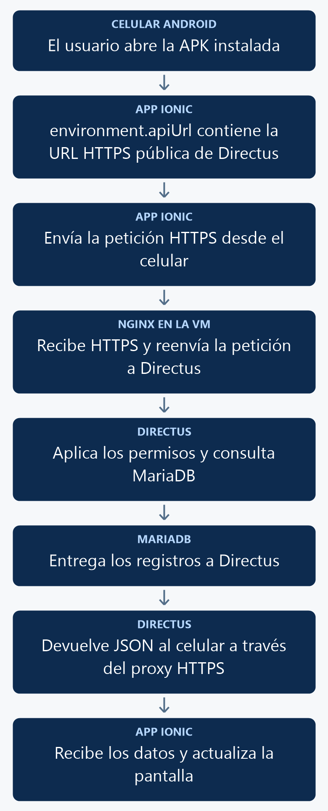

# Publicar Directus en Azure y generar la APK de Ionic

Publicarás Directus y MariaDB en una máquina virtual de Rocky Linux. La aplicación Ionic se empaqueta como APK, se instala en Android y consulta la URL pública de Directus desde el celular.

## 1. Antes de comenzar

Para el servidor necesitas una VM de Rocky Linux, acceso SSH, dominio apuntando a su IP pública y un certificado HTTPS válido. La creación de la VM y la emisión del certificado corresponden a tu infraestructura.

Para crear la APK en tu computadora necesitas el proyecto Ionic de los manuales anteriores, Node.js 22 o superior, JDK 21 y Android SDK Platform 36. Instala Android Studio 2025.2.1 o posterior y, en su SDK Manager, Android SDK Platform 36, Build-Tools 35.0.0 y Platform-Tools. Acepta las licencias del SDK durante su instalación. Configura JAVA_HOME con la ruta del JDK 21 y ANDROID_HOME con la ruta del SDK. Comprueba que java -version muestre la versión 21 antes de compilar. Consulta los [requisitos de Capacitor 8](https://capacitorjs.com/docs/getting-started/environment-setup).

Los pasos del servidor se ejecutan en la VM. Los pasos de la APK se ejecutan en tu computadora. El directorio android se genera con Capacitor; no debes escribir sus archivos manualmente.

## 2. Conceptos y métodos que utilizarás

| Elemento | Uso | Resultado |
| --- | --- | --- |
| Docker Compose | Ejecuta db y api. | MariaDB y Directus en el servidor. |
| Nginx en Rocky Linux | Termina HTTPS y reenvía las peticiones a Directus. | Una URL HTTPS para la API y su panel. |
| environment.prod.ts | Guarda la URL pública de Directus. | La APK consulta el servidor correcto. |
| ng build | Compila Ionic en www. | Prepara los archivos que llevará la aplicación. |
| cap add android | Genera el proyecto nativo una vez. | Crea mobile/android. |
| cap sync android | Copia www y sincroniza plugins. | Actualiza el contenido del proyecto Android. |
| assembleDebug | Compila y firma una APK de depuración. | Genera app-debug.apk para las prácticas. |

## 3. Implementación paso a paso

### Paso 1. Preparar Rocky Linux

Conéctate por SSH a la VM y ejecuta:

```bash
sudo dnf -y install dnf-plugins-core git firewalld nginx
sudo dnf config-manager --add-repo https://download.docker.com/linux/rhel/docker-ce.repo
sudo dnf -y install docker-ce docker-ce-cli containerd.io docker-buildx-plugin docker-compose-plugin
sudo systemctl enable --now docker
sudo systemctl enable --now firewalld
```

La instalación de Docker sigue la [guía de Rocky Linux](https://docs.rockylinux.org/gemstones/containers/docker/). En el grupo de seguridad de Azure permite SSH desde tu equipo y tráfico en 80 y 443; configura el registro DNS del dominio con la IP pública de la VM. Consulta las [conexiones a una VM Linux de Azure](https://learn.microsoft.com/en-us/azure/virtual-machines/linux-vm-connect).

```bash
sudo firewall-cmd --permanent --add-service=http
sudo firewall-cmd --permanent --add-service=https
sudo firewall-cmd --reload
```

### Paso 2. Configurar MariaDB y Directus

En la VM descarga el proyecto y prepara el archivo de variables:

```bash
git clone https://github.com/JonathanDeLaCruz/docker_moviles.git
cd docker_moviles
cp docs/manuales/recursos/despliegue/.env.example docs/manuales/recursos/despliegue/.env
```

Edita .env: sustituye api.example.com por tu dominio y define tus credenciales y secreto. El Compose completo está en la sección 4. Sus únicos servicios son db y api. MariaDB se comunica con Directus por la red de Docker. El puerto 8055 de la API queda accesible desde la propia VM para que Nginx le reenvíe las peticiones.

```bash
sudo docker compose --env-file docs/manuales/recursos/despliegue/.env -f docs/manuales/recursos/despliegue/compose.yaml config --quiet
sudo docker compose --env-file docs/manuales/recursos/despliegue/.env -f docs/manuales/recursos/despliegue/compose.yaml up -d
sudo docker compose --env-file docs/manuales/recursos/despliegue/.env -f docs/manuales/recursos/despliegue/compose.yaml ps
```

El SQL inicial prepara productos en la base moviles. Los volúmenes datos, archivos y extensiones conservan los datos de MariaDB y los recursos de Directus.

### Paso 3. Configurar HTTPS para Directus

Nginx se instala en Rocky Linux como proxy HTTPS de Directus. No aloja los archivos de Ionic: esos archivos viajarán dentro de la APK. Copia la configuración de la sección 4:

```bash
sudo cp docs/manuales/recursos/despliegue/nginx.conf /etc/nginx/conf.d/directus.conf
sudo mkdir -p /etc/pki/tls/private
```

Edita /etc/nginx/conf.d/directus.conf y cambia api.example.com por el mismo dominio de .env. Coloca el certificado del dominio y su clave en las rutas indicadas por ssl_certificate y ssl_certificate_key. Protege la clave y valida la configuración antes de iniciar Nginx:

```bash
sudo chown root:root /etc/pki/tls/private/moviles-privkey.pem
sudo chmod 600 /etc/pki/tls/private/moviles-privkey.pem
sudo setsebool -P httpd_can_network_connect 1
sudo nginx -t
sudo systemctl enable --now nginx
sudo systemctl reload nginx
```

Abre https://TU_DOMINIO/admin e ingresa con la cuenta administrativa de ese entorno. Configura las colecciones, políticas y datos que necesitan las prácticas. La API quedará en https://TU_DOMINIO; por ejemplo, el listado consultará https://TU_DOMINIO/items/productos.

### Paso 4. Configurar la dirección de la API en Ionic

En tu computadora abre mobile/src/environments/environment.prod.ts y coloca la URL HTTPS real de Directus, como muestra la sección 4. api.example.com es únicamente un marcador: debes sustituirlo antes de instalar una APK que vaya a consultar tu servidor.

En el celular, localhost identifica al propio celular. La aplicación empaquetada utiliza una dirección absoluta para la API. El Compose permite el origen https://localhost que utiliza la WebView de Capacitor Android; conserva la configuración Capacitor de la sección 4.

### Paso 5. Compilar y preparar Android

En una terminal de tu computadora, desde la carpeta mobile del repositorio, ejecuta:

```powershell
npm ci
npx ng build --configuration production
```

La compilación debe terminar correctamente y generar www. Si todavía no existe la carpeta android, créala una sola vez:

```powershell
npx cap add android
```

Después sincroniza los archivos y plugins:

```powershell
npx cap sync android
```

Cada vez que cambies el código Ionic o la URL de la API, vuelve a ejecutar ng build y cap sync antes de generar otra APK.

### Paso 6. Crear la APK

Con el SDK de Android y JDK 21 configurados, desde mobile ejecuta en PowerShell:

```powershell
cd android
.\gradlew.bat assembleDebug
Get-Item .\app\build\outputs\apk\debug\app-debug.apk
cd ..
```

En Linux o macOS, la tarea equivalente desde mobile/android es ./gradlew assembleDebug. Espera el mensaje BUILD SUCCESSFUL y comprueba que exista mobile/android/app/build/outputs/apk/debug/app-debug.apk. La APK debug ya está firmada para instalarla como prueba del curso; no corresponde a una publicación en Google Play. Consulta la [compilación por línea de comandos de Android](https://developer.android.com/build/building-cmdline).

### Paso 7. Instalar y consultar desde el celular

Transfiere app-debug.apk a tu Android y abre el archivo para instalarlo, autorizando la instalación desde esa aplicación si Android lo solicita. También puedes conectar por USB, habilitar la depuración USB y ejecutar desde mobile, con adb disponible:

```powershell
adb devices
adb install -r android/app/build/outputs/apk/debug/app-debug.apk
```

Abre la app instalada, inicia sesión si la práctica lo requiere y consulta Productos. Para comprobar el acceso al servidor público, prueba desde datos móviles. En la VM puedes observar las peticiones con:

```bash
sudo docker compose --env-file docs/manuales/recursos/despliegue/.env -f docs/manuales/recursos/despliegue/compose.yaml logs --tail 100 -f api
```

## 4. Código completo de referencia

### docs/manuales/recursos/despliegue/compose.yaml

```yaml
services:
  db:
    image: mariadb:11.8
    restart: unless-stopped
    environment:
      MARIADB_ROOT_PASSWORD: ${DB_ROOT_PASSWORD:?Define DB_ROOT_PASSWORD}
      MARIADB_DATABASE: moviles
      MARIADB_USER: moviles
      MARIADB_PASSWORD: ${DB_PASSWORD:?Define DB_PASSWORD}
    volumes:
      - datos:/var/lib/mysql
      - ../../../../database/init:/docker-entrypoint-initdb.d:ro
    healthcheck:
      test: ["CMD", "healthcheck.sh", "--connect", "--innodb_initialized"]
      interval: 5s
      retries: 20
  api:
    image: directus/directus:12.3.1
    restart: unless-stopped
    ports:
      - "127.0.0.1:8055:8055"
    environment:
      SECRET: ${DIRECTUS_SECRET:?Define DIRECTUS_SECRET}
      ADMIN_EMAIL: ${ADMIN_EMAIL:?Define ADMIN_EMAIL}
      ADMIN_PASSWORD: ${ADMIN_PASSWORD:?Define ADMIN_PASSWORD}
      DB_CLIENT: mysql
      DB_HOST: db
      DB_PORT: 3306
      DB_DATABASE: moviles
      DB_USER: moviles
      DB_PASSWORD: ${DB_PASSWORD}
      PUBLIC_URL: https://${DOMAIN:?Define DOMAIN}
      CORS_ENABLED: "true"
      CORS_ORIGIN: "https://localhost"
      CORS_METHODS: "GET,POST,PATCH,DELETE,OPTIONS"
      CORS_ALLOWED_HEADERS: "Content-Type,Authorization"
    volumes:
      - archivos:/directus/uploads
      - extensiones:/directus/extensions
    depends_on:
      db:
        condition: service_healthy
volumes:
  datos:
  archivos:
  extensiones:
```

### docs/manuales/recursos/despliegue/nginx.conf

```nginx
server {
  listen 80;
  server_name api.example.com;
  return 301 https://$host$request_uri;
}
server {
  listen 443 ssl;
  server_name api.example.com;
  ssl_certificate /etc/pki/tls/certs/moviles-fullchain.pem;
  ssl_certificate_key /etc/pki/tls/private/moviles-privkey.pem;
  client_max_body_size 25m;
  location / {
    proxy_pass http://127.0.0.1:8055;
    proxy_http_version 1.1;
    proxy_set_header Host $host;
    proxy_set_header X-Forwarded-Proto $scheme;
    proxy_set_header X-Forwarded-For $proxy_add_x_forwarded_for;
  }
}
```

### docs/manuales/recursos/despliegue/.env.example

```dotenv
DOMAIN=api.example.com
ADMIN_EMAIL=admin@example.com
ADMIN_PASSWORD=DEFINIR_UNA_CONTRASENA_PROPIA
DB_ROOT_PASSWORD=DEFINIR_CLAVE_ROOT
DB_PASSWORD=DEFINIR_CLAVE_DE_APLICACION
DIRECTUS_SECRET=DEFINIR_UN_SECRETO_ALEATORIO_DE_AL_MENOS_32_CARACTERES
```

### mobile/src/environments/environment.prod.ts

```typescript
export const environment = {
  production: true,
  // Sustituye este dominio por la URL HTTPS pública de tu Directus.
  apiUrl: 'https://api.example.com'
};
```

### mobile/capacitor.config.ts

```typescript
import type { CapacitorConfig } from '@capacitor/cli';

const config: CapacitorConfig = {
  appId: 'mx.edu.moviles',
  appName: 'Moviles',
  webDir: 'www'
};

export default config;
```

## 5. Comprobar el resultado

1. En la VM, Compose debe mostrar db y api en ejecución. Abre https://TU_DOMINIO/admin y verifica la cuenta y las políticas de práctica.
2. En tu computadora, la compilación Android debe terminar con BUILD SUCCESSFUL y crear app-debug.apk en la ruta indicada.
3. Instala la APK en el celular y comprueba que abra la interfaz de Ionic.
4. Con la URL pública real configurada, consulta el listado y un detalle. Confirma las peticiones en los registros de Directus.
5. Repite la consulta con datos móviles para comprobar el acceso al servidor desde otra red.

### Resultado comprobado de la compilación

Se creó una APK real ejecutando la tarea assembleDebug en Linux con JDK 21, Gradle 8.14.3 y SDK 36. El resultado fue:

```text
BUILD SUCCESSFUL in 2m 33s
213 actionable tasks: 213 executed
```

| Comprobación | Resultado |
| --- | --- |
| Archivo | mobile/android/app/build/outputs/apk/debug/app-debug.apk |
| Tamaño | 5 392 871 bytes |
| Paquete | mx.edu.moviles, versión 1.0 |
| SDK mínimo / destino | 24 / 36 |
| Firma | Verificada con apksigner, esquema v2 |
| Contenido | AndroidManifest.xml, classes.dex y archivos de Ionic presentes |
| Red | Permiso INTERNET presente y URL de ejemplo incluida |

La huella y los datos de esta APK están en el [registro de compilación](recursos/android/validacion-apk.json). Esta comprobación utilizó el wrapper de Linux; el comando de PowerShell del paso 6 ejecuta la misma tarea mediante gradlew.bat.

**Alcance de esta revisión:** el servidor aún no está publicado. La compilación de comprobación utiliza https://api.example.com; esa dirección no acredita una conexión real. La prueba de despliegue remoto, instalación y peticiones desde el teléfono queda pendiente.

## 6. Explicación detallada del flujo

La figura 1 muestra cómo los datos viajan desde la aplicación instalada hasta la base de datos y regresan a la pantalla.

<p align="center">
  <br>
  <em>Figura 1. Solicitud de la APK, consulta en Directus y respuesta al celular.</em>
</p>

ng build genera los archivos de Ionic en www. cap sync android los copia al proyecto Android y sincroniza los plugins. Gradle compila el proyecto y los incorpora en una APK instalable.

Al abrir la aplicación, Capacitor muestra esos archivos dentro de su WebView. El código utiliza environment.apiUrl para enviar las peticiones HTTPS al dominio público de Directus. Nginx atiende HTTPS en la VM y reenvía las peticiones a Directus, que aplica sus permisos y consulta MariaDB por la red interna de Docker.

Directus responde con JSON; Nginx devuelve la respuesta al celular y Angular actualiza la pantalla. Las credenciales de MariaDB y el secreto de Directus permanecen en el servidor. La APK contiene la URL de la API y utiliza las cuentas y permisos configurados en Directus.
