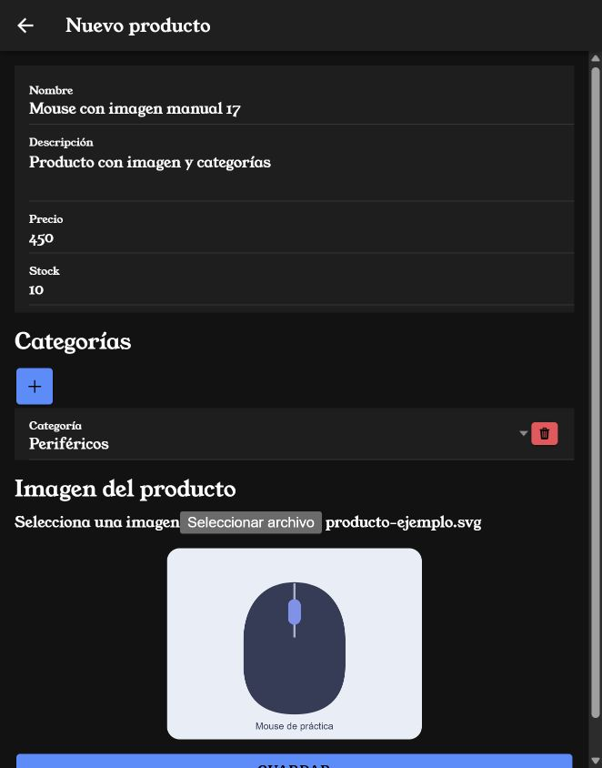
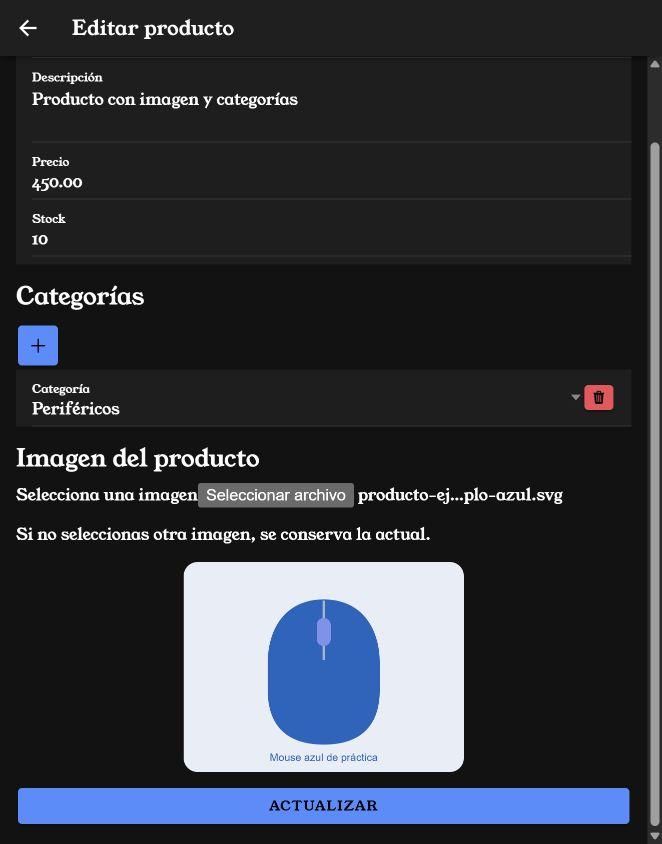
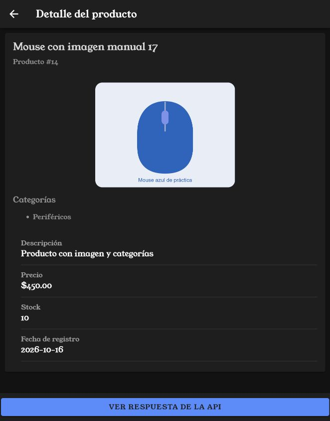
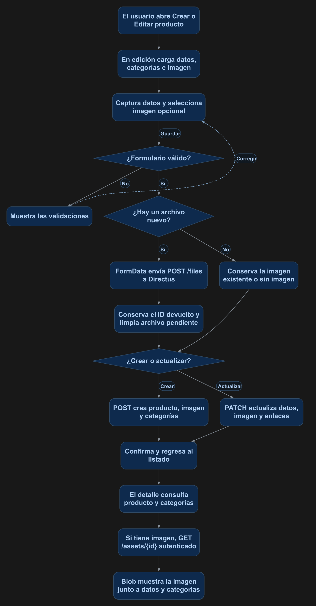

# Imagen en el formulario de creación, actualización y detalle

Seleccionarás una imagen en el mismo formulario donde capturas los datos del producto. Guardar y Actualizar enviarán el archivo y asociarán su ID. El detalle mostrará la imagen y las categorías guardadas.

## 1. Antes de comenzar

Completa el [manual 14](14_muchos_muchos.md) de categorías y el [manual 15](15_subir_archivos.md) de carga básica. Esta práctica utiliza el formulario mediante página de creación y edición. Conserva sus rutas, NgModules y la sesión de AuthService. Las rutas src/... corresponden a mobile/src/...; al generar componentes configura manualmente `standalone: false`.

En la política de la cuenta, conserva Create/Read sobre directus_files y Create/Read/Update sobre productos, además de los permisos de categorías del manual 14. El campo productos.imagen debe relacionarse con directus_files y permitir nulo. Los archivos son compartidos entre cuentas con permiso de lectura.

## 2. Conceptos y métodos que utilizarás

| Elemento | Uso | Resultado |
| --- | --- | --- |
| File y FormData | Seleccionar y enviar un archivo. | POST /files devuelve su ID. |
| ImagenesService | subir() y obtener(). | Reutiliza la sesión para cargar y consultar archivos. |
| imagenId | Conservar el ID existente o recién subido. | Se envía junto con los datos del producto. |
| Blob y createObjectURL() | Preparar una vista previa autenticada. | Mostrar la imagen en el formulario y el detalle. |
| revokeObjectURL() | Liberar la URL anterior. | Limpiar recursos al reemplazar o destruir la vista. |
| ionViewWillEnter() | Consultar al entrar al detalle. | Recuperar los datos y la imagen guardados. |

## 3. Implementación paso a paso

### Paso 1. Crear el servicio de imágenes

Crea mobile/src/app/services/imagenes.ts con el código de este paso. subir() agrega el File a FormData y envía POST /files. obtener() consulta GET /assets/{id} con responseType blob. Ambos utilizan auth.cliente, que agrega el encabezado de la sesión.

**`mobile/src/app/services/imagenes.ts`**. Crea este archivo con el siguiente contenido o sustituye la plantilla inicial del generador.

```typescript
import { Injectable } from '@angular/core';
import { AuthService } from './auth';

@Injectable({ providedIn: 'root' })
export class ImagenesService {
  constructor(private auth: AuthService) {}

  async subir(archivo: File): Promise<string> {
    const datos = new FormData();
    datos.append('file', archivo);
    const response = await this.auth.cliente.post<{ data: { id: string } }>('/files', datos);
    return response.data.data.id;
  }

  async obtener(id: string): Promise<Blob> {
    const response = await this.auth.cliente.get<Blob>('/assets/' + id, { responseType: 'blob' });
    return response.data;
  }
}
```

### Paso 2. Extender los tipos del producto

En las interfaces Producto y ProductoGuardar de services/productos.ts, agrega imagen opcional de tipo string o null. Conserva la consulta expandida y el envío de categorías del manual 14. Las respuestas y los cuerpos de creación y actualización incluyen el ID del archivo.

**`mobile/src/app/services/productos.ts`**. Aplica estos cambios en el orden indicado.

Inserta el fragmento después de `export interface Producto {` / `categorias?: { id: number; categorias_id: { id: number; nombre: string } }[];` y antes de `id: number;`.

```typescript
  imagen?: string | null;
```

Inserta el fragmento después de `}` / `export interface ProductoGuardar {` y antes de `categorias?: { categorias_id: number }[] | { create: { categorias_id: number }[]; delete: number[] };`.

```typescript
  imagen?: string | null;
```

### Paso 3. Seleccionar la imagen desde el formulario

Inyecta ImagenesService. Agrega el selector, la vista previa y los estilos de este paso al mismo formulario. onImagenSeleccionada() conserva el archivo y prepara su vista previa. La selección es opcional. En edición, cargarProducto() consulta la imagen existente y guarda su ID; sin elegir un archivo nuevo se conserva esa imagen.

**`mobile/src/app/productos-form/productos-form.page.ts`**. Aplica estos cambios en el orden indicado.

En el import existente de `@angular/core` añade `OnDestroy`. Junto a los imports de servicios agrega esta línea.

```typescript
import { ImagenesService } from '../services/imagenes';
```

Sustituye la línea `export class ProductosFormPage implements OnInit {` después de `standalone: false,` / `})` y antes de `categorias: Categoria[] = [];`.

```typescript
export class ProductosFormPage implements OnInit, OnDestroy {
  archivoImagen: File | null = null;
  imagenId: string | null = null;
  imagenUrl = '';
  mensajeImagen = '';
```

Inserta el fragmento después de `private productosService: ProductosService,` / `private categoriasService: CategoriasService,` y antes de `private router: Router`.

```typescript
    private imagenesService: ImagenesService,
```

Inserta el fragmento después de `this.categoriasFA.push(new FormControl(enlace.categoriaId, Validators.required));` / `}` y antes de `this.productoForm.patchValue({`.

```typescript
      this.imagenId = producto.imagen ?? null;
      if (this.imagenId) {
        try { this.mostrarImagen(await this.imagenesService.obtener(this.imagenId)); }
        catch { this.mensajeImagen = 'No fue posible cargar la imagen actual.'; }
      }
```

Dentro de `ProductosFormPage`, antes del getter `get categoriasFA()`, agrega los métodos siguientes.

```typescript
  onImagenSeleccionada(event: Event): void {
    this.archivoImagen = (event.target as HTMLInputElement).files?.[0] ?? null;
    if (this.archivoImagen) {
      this.mensajeImagen = '';
      this.mostrarImagen(this.archivoImagen);
    }
  }
  private mostrarImagen(archivo: Blob): void {
    if (this.imagenUrl) URL.revokeObjectURL(this.imagenUrl);
    this.imagenUrl = URL.createObjectURL(archivo);
  }
  ngOnDestroy(): void {
    if (this.imagenUrl) URL.revokeObjectURL(this.imagenUrl);
  }
```

**`mobile/src/app/productos-form/productos-form.page.html`**. Aplica estos cambios en el orden indicado.

Inserta el fragmento después de `</div>` / `</section>` y antes de `<ion-button fill="solid" expand="block" type="submit" class="ion-margin-top" [disabled]="guardando || cargando">`.

```html
    <section class="ion-margin-top">
      <h2>Imagen del producto</h2>
      <label for="imagen-producto">Selecciona una imagen</label>
      <input id="imagen-producto" type="file" accept="image/*" (change)="onImagenSeleccionada($event)" [disabled]="guardando">
      <p *ngIf="esEdicion">Si no seleccionas otra imagen, se conserva la actual.</p>
      <p *ngIf="mensajeImagen" role="status">{{ mensajeImagen }}</p>
      
    </section>
```

**`mobile/src/app/productos-form/productos-form.page.scss`**. Agrega estas reglas al final de la hoja de estilos.

```scss
.imagen-producto { display: block; max-width: 100%; width: 280px; max-height: 240px; object-fit: contain; margin: 16px auto; }
input[type="file"] { max-width: 100%; }
```

### Paso 4. Enviar archivo y producto al guardar

Valida el formulario antes de subir. Si hay un archivo nuevo, espera subir(), conserva su ID y limpia archivoImagen para reutilizar ese ID si el guardado del producto falla y se reintenta. Incluye imagen en el objeto del producto y ejecuta crear() o actualizar(). El botón queda deshabilitado durante el guardado.

**`mobile/src/app/productos-form/productos-form.page.ts`**. Dentro de `guardarProducto()`, al inicio del `try` que llama a `crear()` o `actualizar()`, agrega la carga del archivo antes de elegir la operación.


```typescript
      if (this.archivoImagen) {
        this.imagenId = await this.imagenesService.subir(this.archivoImagen);
        this.archivoImagen = null;
      }
      if (this.imagenId) producto.imagen = this.imagenId;
```

### Paso 5. Mostrar la imagen en el detalle

Inyecta ImagenesService en ProductosViewPage. Después de consultar el producto, si existe imagen solicita su Blob y crea la URL para img. Un error de imagen muestra su mensaje sin ocultar los demás datos del producto. Conserva la lista de categorías y la consulta en ionViewWillEnter().

**`mobile/src/app/productos-view/productos-view.page.ts`**. Aplica estos cambios en el orden indicado.

Sustituye la línea `import { Component } from '@angular/core';` al inicio del archivo y antes de `import { ActivatedRoute } from '@angular/router';`.

```typescript
import { Component, OnDestroy } from '@angular/core';
```

Inserta el fragmento después de `import { firstValueFrom } from 'rxjs';` / `import { Producto, ProductosService } from '../services/productos';` y antes de `import { environment } from '../../environments/environment';`.

```typescript
import { ImagenesService } from '../services/imagenes';
```

Sustituye la línea `export class ProductosViewPage {` después de `standalone: false` / `})` y antes de `producto: Producto | null = null;`.

```typescript
export class ProductosViewPage implements OnDestroy {
  imagenUrl = '';
  mensajeImagen = '';
```

Inserta el fragmento después de `private route: ActivatedRoute,` / `private productosService: ProductosService,` y antes de `private loading: LoadingController`.

```typescript
    private imagenesService: ImagenesService,
```

Inserta el fragmento después de `async cargarProducto(): Promise<void> {` / `const id = this.route.snapshot.paramMap.get('id');` y antes de `this.producto = null;`.

```typescript
    if (this.imagenUrl) URL.revokeObjectURL(this.imagenUrl);
    this.imagenUrl = '';
    this.mensajeImagen = '';
```

Inserta el fragmento después de `try {` / `this.producto = await firstValueFrom(this.productosService.detalle(Number(id)));` y antes de `} catch (error) {`.

```typescript
      if (this.producto.imagen) {
        try { this.imagenUrl = URL.createObjectURL(await this.imagenesService.obtener(this.producto.imagen)); }
        catch { this.mensajeImagen = 'No fue posible cargar la imagen del producto.'; }
      }
```

Inserta el fragmento después de `}` / `}` y antes de `abrirPagina(): void {`.

```typescript
  ngOnDestroy(): void {
    if (this.imagenUrl) URL.revokeObjectURL(this.imagenUrl);
  }
```

**`mobile/src/app/productos-view/productos-view.page.html`**. Aplica estos cambios en el orden indicado.

Inserta el fragmento después de `</ion-card-header>` / `<ion-card-content>` y antes de `<h2>Categorías</h2>`.

```html
      
      <p *ngIf="mensajeImagen" role="status">{{ mensajeImagen }}</p>
```

**`mobile/src/app/productos-view/productos-view.page.scss`**. Agrega estas reglas al final de la hoja de estilos.

```scss
.imagen-producto { display: block; max-width: 100%; width: 280px; max-height: 240px; object-fit: contain; margin: 16px auto; }
```

## 4. Comprobar el resultado

1. En el formulario de creación captura un nombre para el producto, precio 450 y stock 10. Selecciona [producto-ejemplo.svg](recursos/producto-ejemplo.svg). La figura 1 muestra la vista previa antes de guardar.

<p align="center">
  <br>
  <em>Figura 1. Datos e imagen preparados en el mismo formulario.</em>
</p>

2. Guarda y acepta la confirmación. Abre el detalle: deben aparecer los datos y la imagen. Si elegiste categorías, deben verse sus nombres.
3. Abre la edición del producto, cambia únicamente el stock y actualiza sin elegir archivo. Comprueba que se conserve la imagen.
4. Vuelve a editar y selecciona [producto-ejemplo-azul.svg](recursos/producto-ejemplo-azul.svg). La figura 2 muestra la nueva vista previa. Actualiza y vuelve al detalle.

<p align="center">
  <br>
  <em>Figura 2. Reemplazo de imagen desde el formulario de actualización.</em>
</p>

5. El detalle debe mostrar la imagen azul como en la figura 3. Sal y vuelve a entrar: debe recuperarse la misma imagen. Revisa también que las categorías permanezcan correctas.

<p align="center">
  <br>
  <em>Figura 3. Imagen guardada y categorías en la vista de detalle.</em>
</p>

6. Crea un producto sin imagen: debe guardarse sin mostrar una imagen vacía. Un formulario inválido debe impedir la subida y mostrar las validaciones existentes.

## 5. Explicación detallada del flujo

La figura 4 muestra cómo el formulario decide entre conservar la imagen existente o subir una nueva, y entre crear o actualizar el producto.

<p align="center">
  <br>
  <em>Figura 4. Selección, guardado y recuperación de la imagen del producto.</em>
</p>

La vista previa local no implica que el archivo esté guardado. Primero se valida el formulario; después POST /files guarda el archivo y devuelve el ID. Ese ID viaja en imagen junto con los datos y las asociaciones de categorías del producto. En edición, no elegir otro archivo conserva el ID cargado.

La carga de archivo y el guardado del producto son peticiones separadas. Si la primera funciona y la segunda falla, el archivo ya existe: el formulario conserva su ID para reintentar mientras sigas en esa vista. No borra archivos anteriores al reemplazar una imagen, porque pueden seguir utilizándose en otros productos.

El detalle consulta el producto al entrar, recupera el archivo con la sesión y muestra el Blob mediante una URL local. Las URLs se liberan al reemplazarlas y al destruir el componente.
