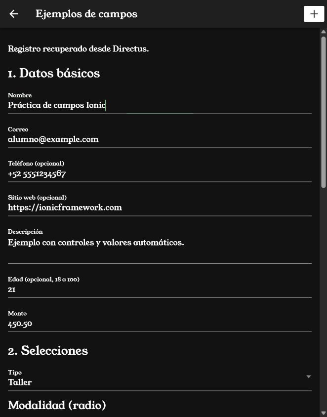
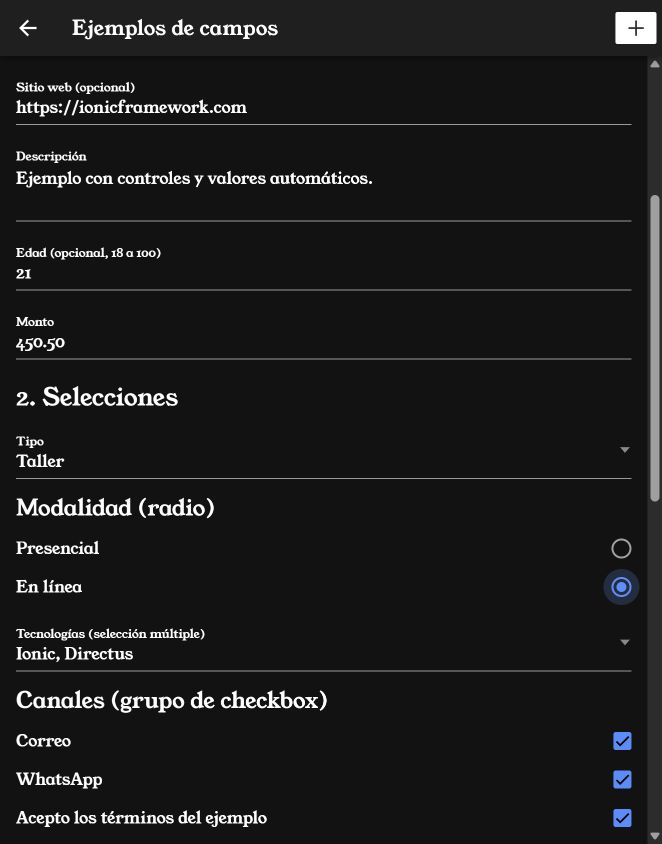
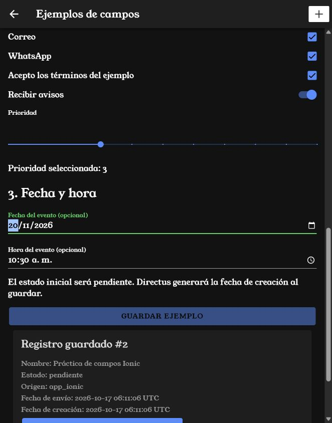
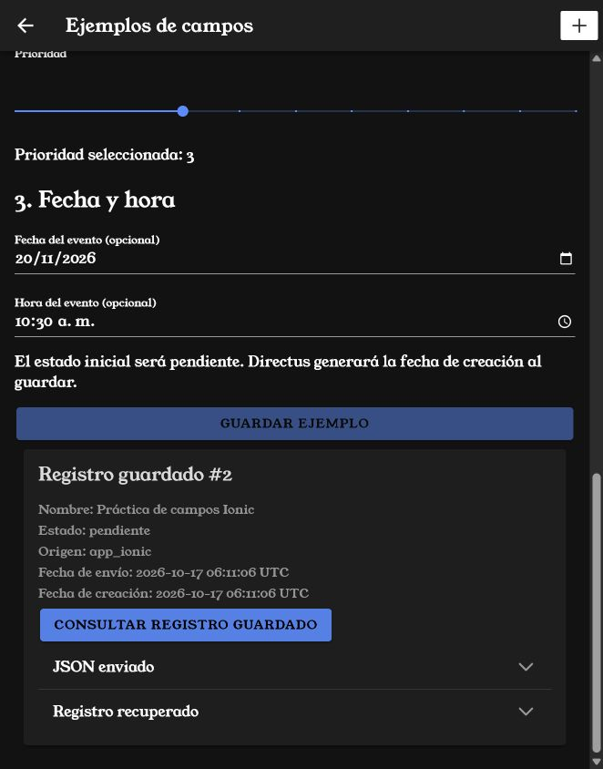
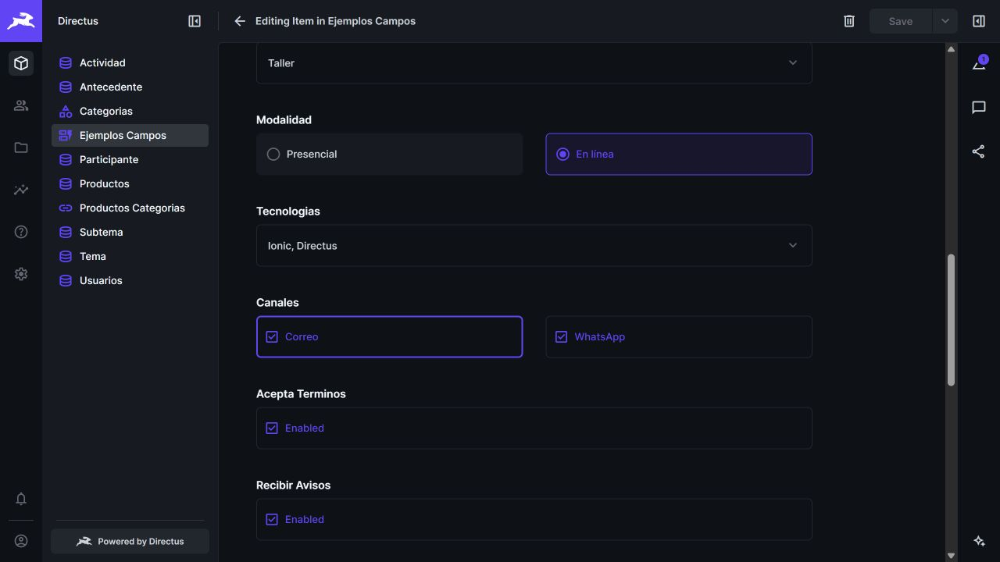
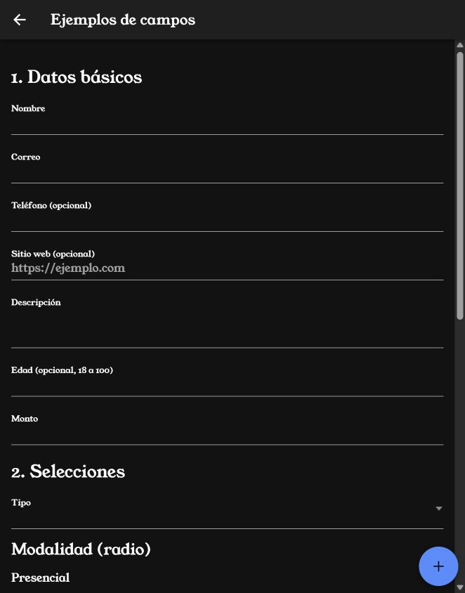
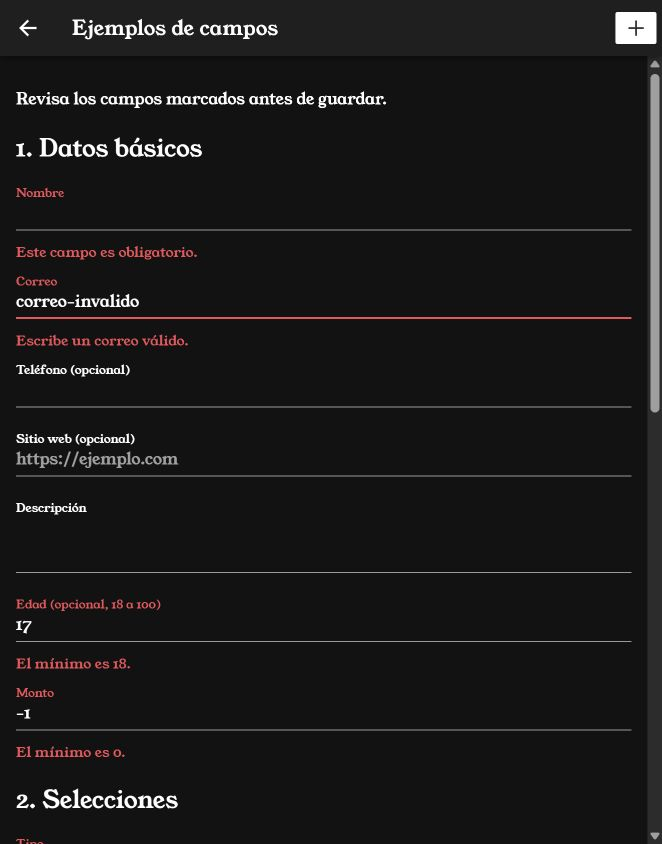
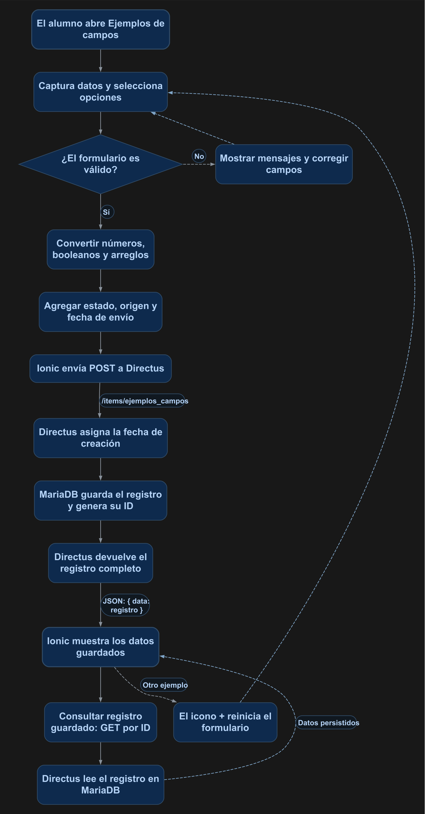

# Campos de formulario y valores agregados al guardar

Crearás un formulario con entradas de texto, números, selección simple y múltiple, radio, checkbox, interruptor, rango, fecha y hora. Guardarás el resultado en la colección `ejemplos_campos` de Directus y consultarás el registro para comprobar qué se almacenó. El ejemplo también agrega un estado y una fecha sin pedirlos al usuario.

## 1. Antes de comenzar

Utiliza el entorno Docker del curso y la sesión autenticada de los [manuales 12](12_login_registro.md) y [13](13_guard.md). Conserva `AuthService`, su cliente Axios y la guardia `authGuard`. Las rutas de código de esta práctica parten de la carpeta `mobile`. Las páginas se declaran en NgModules y llevan `standalone: false` explícitamente.

Necesitas una cuenta administrativa para preparar la colección y una cuenta de práctica con permisos **Create y Read** sobre ella. La aplicación usa la cuenta de práctica; la administración de la colección se hace en Directus.

## 2. Conceptos y métodos que utilizarás

### Qué control elegir y qué dato guardar

| Necesidad | Control Ionic | Valor que se envía | Campo en Directus |
| --- | --- | --- | --- |
| Nombre | ion-input | Texto | nombre, String(100) |
| Correo | ion-input type="email" | Texto validado | correo, String(254) |
| Teléfono | ion-input type="tel" | Texto; conserva + y espacios | telefono, String(20) |
| Dirección web | ion-input type="url" | Texto que empieza con http:// o https:// | sitio_web, String(255) |
| Descripción larga | ion-textarea | Texto | descripcion, Text |
| Edad | ion-input type="number" | Entero o null | edad, Integer |
| Importe | ion-input type="number" step="0.01" | Número con hasta dos decimales | monto, Decimal(10,2) |
| Una opción de una lista | ion-select | "curso" o "taller" | tipo, String(30) |
| Una opción visible entre varias | ion-radio-group con ion-radio | "presencial" o "en_linea" | modalidad, String(30) |
| Varias opciones de una lista | ion-select con [multiple]="true" | Arreglo de textos | tecnologias, JSON |
| Varias casillas independientes | Grupo de ion-checkbox | Arreglo con los canales marcados | canales, JSON |
| Aceptación obligatoria | ion-checkbox | Booleano true/false | acepta_terminos, Boolean |
| Activar o desactivar avisos | ion-toggle | Booleano true/false | recibir_avisos, Boolean |
| Prioridad de 0 a 10 | ion-range | Entero | prioridad, Integer |
| Día de un evento | ion-input type="date" | "2026-11-20" o null | fecha_evento, Date |
| Hora de un evento | ion-input type="time" | "10:30:00" o null | hora_evento, Time |

En las opciones, el texto **Taller** es la etiqueta que ve el usuario; `value="taller"` es el valor que se guarda. La selección múltiple produce un arreglo, por ejemplo `["ionic", "directus"]`. Las casillas de canales son booleanos dentro del formulario; al guardar se convierten en `["correo", "whatsapp"]`. Una sola casilla, como aceptar términos, se envía como booleano.

### De dónde vienen los valores que el usuario no escribe

| Valor | Quién lo establece | Momento |
| --- | --- | --- |
| modalidad = presencial y prioridad = 3 | FormBuilder | Al abrir o reiniciar; el usuario puede cambiarlos. |
| estado = pendiente | guardar() | Al construir el objeto que se enviará. |
| origen = app_ionic | guardar() | Al construir el objeto que se enviará. |
| fecha_envio | new Date().toISOString() | Al enviar, usando el reloj del dispositivo y formato UTC. |
| fecha_creacion | Directus, campo especial date-created | Al crear el registro en el servidor. |
| id | MariaDB, entero autoincremental | Al insertar el registro. |

No hace falta agregar un control oculto para enviar `estado`. Se incluye directamente en el objeto del POST. Para una **fecha de creación del registro**, utiliza el campo automático de Directus; `fecha_envio` se conserva aquí como otro ejemplo calculado por la aplicación.

| Método o propiedad | Uso en esta práctica |
| --- | --- |
| FormBuilder.group() y formControlName | Construir el formulario y conectar cada control. |
| Validators y markAllAsTouched() | Impedir el envío inválido y mostrar mensajes. |
| getRawValue() | Leer los valores antes de construir el objeto. |
| Number(), trim(), filter(Boolean) | Convertir números, limpiar texto y reunir opciones marcadas. |
| guardar() | Validar, preparar datos y crear el registro. |
| crear() / obtener() del servicio | POST a la colección y GET del registro por ID. |
| consultarGuardado() | Volver a leer desde Directus lo que se guardó. |
| nuevo() | Reiniciar campos y valores iniciales mediante el icono +. |

## 3. Implementación paso a paso

### Paso 1. Preparar la colección de Directus

En **Configuración → Modelo de datos**, crea `ejemplos_campos` con clave primaria `id` de tipo entero autoincremental. Agrega los siguientes campos con sus nombres exactos. **Obligatorio** significa que la columna no admite nulo; los arreglos vacíos, cero y false siguen siendo valores.

| Campo | Tipo | Configuración |
| --- | --- | --- |
| nombre | String(100) | Obligatorio; entrada de texto. |
| correo | String(254) | Obligatorio; entrada de correo. |
| telefono | String(20) | Admite nulo; entrada de texto. |
| sitio_web | String(255) | Admite nulo; entrada de texto. |
| descripcion | Text | Admite nulo; entrada multilínea. |
| edad | Integer | Admite nulo; entrada numérica. |
| monto | Decimal(10,2) | Obligatorio; precisión 10 y escala 2. |
| tipo | String(30) | Obligatorio; desplegable Curso=curso y Taller=taller. |
| modalidad | String(30) | Obligatorio; radio Presencial=presencial y En línea=en_linea. |
| tecnologias | JSON | Obligatorio; desplegable múltiple Ionic=ionic, Angular=angular y Directus=directus. |
| canales | JSON | Obligatorio; casillas Correo=correo y WhatsApp=whatsapp. |
| acepta_terminos | Boolean | Obligatorio; predeterminado false. |
| recibir_avisos | Boolean | Obligatorio; predeterminado false. |
| prioridad | Integer | Obligatorio; predeterminado 3; deslizador de 0 a 10. |
| fecha_evento | Date | Admite nulo. |
| hora_evento | Time | Admite nulo. |
| estado | String(30) | Obligatorio; predeterminado pendiente; solo lectura en Directus. |
| origen | String(30) | Obligatorio; predeterminado app_ionic; solo lectura en Directus. |
| fecha_envio | Timestamp | Obligatorio; fecha y hora. |
| fecha_creacion | Timestamp | Campo especial Fecha de creación, date-created; solo lectura. |

Para `fecha_creacion` utiliza el campo automático **Fecha de creación**: una entrada de fecha normal no genera la fecha por sí sola. Los campos JSON llevan la conversión `cast-json` y los booleanos `cast-boolean`; la definición adjunta conserva estas opciones. La colección completa, con sus 21 campos contando id, está en [coleccion.json](recursos/17_campos/coleccion.json). Es la definición para la API de colecciones, no un archivo de datos para importar desde la lista de registros.

En la política de la cuenta de práctica habilita **Create** y **Read** para `ejemplos_campos`. Esta práctica usa permisos normales para todos sus campos, sin reglas personalizadas. La opción solo lectura controla la edición en la interfaz de Directus; no vuelve inmodificable un valor enviado por otro cliente.

### Paso 2. Crear servicio, página y ruta

Crea `src/app/services/ejemplos-campos.ts` y la carpeta `src/app/ejemplos-campos`. Copia los cuatro archivos de página y el servicio del punto 4. El módulo importa `ReactiveFormsModule` para conectar el formulario; la página lleva `standalone: false`.

Agrega la ruta indicada al arreglo de rutas de `app-routing.module.ts`, antes de cualquier ruta comodín. Después de iniciar sesión, entra a [Ejemplos de campos en Ionic](http://localhost:8100/ejemplos-campos). Si utilizas el menú del manual 09, puedes añadir un enlace a esa misma ruta.

### Paso 3. Conectar y validar los controles

Cada `formControlName` coincide con una clave del formulario. El grupo `canales` contiene dos casillas; `tecnologias` empieza como arreglo vacío. La casilla de términos usa `Validators.requiredTrue`: debe estar marcada para guardar. Nombre, correo, monto y tipo son obligatorios; edad, teléfono y sitio web se validan cuando contienen datos.

La figura 1 muestra los datos básicos capturados en Ionic.

<p align="center">
  <br>
  <em>Figura 1. Entradas de texto, correo, teléfono, dirección web y números en Ionic.</em>
</p>


La figura 2 muestra las opciones seleccionadas. Selecciona Taller, En línea, Ionic y Directus, y marca los canales que quieras conservar.

<p align="center">
  <br>
  <em>Figura 2. Selección simple, radio, selección múltiple y casillas marcadas.</em>
</p>


### Paso 4. Construir los datos y guardar

`guardar()` comprueba la validación antes de llamar a la API. Después construye el objeto: convierte números, transforma las casillas en arreglo, envía null en los campos opcionales vacíos y agrega `estado`, `origen` y `fecha_envio`. No envía `id` ni `fecha_creacion`.

La figura 3 muestra el interruptor, el rango y los controles de fecha y hora. Pulsa **Guardar ejemplo** para ejecutar POST /items/ejemplos_campos. Mientras se procesa, el botón se desactiva; al guardar queda desactivado hasta pulsar + para otro ejemplo.

<p align="center">
  <br>
  <em>Figura 3. Interruptor, prioridad, fecha y hora antes de consultar el registro guardado.</em>
</p>


### Paso 5. Consultar y comprobar

Pulsa **Consultar registro guardado**: se ejecuta un GET por ID. Abre los paneles **JSON enviado** y **Registro recuperado** para comprobar los datos. La figura 4 muestra el resultado real de esa consulta, incluido el estado y las dos fechas.

<p align="center">
  <br>
  <em>Figura 4. Registro 2 recuperado desde Directus después de guardarlo en Ionic.</em>
</p>


En Directus abre Contenido → Ejemplos Campos y selecciona ese registro. La figura 5 muestra las selecciones y los booleanos persistidos, vistos desde Directus.

<p align="center">
  <br>
  <em>Figura 5. Selecciones guardadas en la colección de Directus.</em>
</p>


### Paso 6. Elegir la ubicación del icono +

Elige **una opción** mediante `usarBotonFlotante`. Con false aparece en la barra, como en las figuras anteriores; con true aparece abajo a la derecha, como en la figura 6. El mismo método `nuevo()` reinicia el ejemplo. El HTML completo contiene ambas alternativas con condiciones que impiden mostrarlas juntas.

<p align="center">
  <br>
  <em>Figura 6. Variante con icono + flotante para preparar otro ejemplo.</em>
</p>


## 4. Código completo de referencia

Crea estos archivos y conserva el servicio de autenticación del manual 12. Los nombres y rutas de los imports corresponden al proyecto del curso.

### `mobile/src/app/services/ejemplos-campos.ts`

```typescript
import { Injectable } from '@angular/core';
import { AuthService } from './auth';

export interface EjemploCrear {
  nombre: string;
  correo: string;
  telefono: string | null;
  sitio_web: string | null;
  descripcion: string | null;
  edad: number | null;
  monto: number;
  tipo: string;
  modalidad: string;
  tecnologias: string[];
  canales: string[];
  acepta_terminos: boolean;
  recibir_avisos: boolean;
  prioridad: number;
  fecha_evento: string | null;
  hora_evento: string | null;
  estado: string;
  origen: string;
  fecha_envio: string;
}
export interface EjemploGuardado extends Omit<EjemploCrear, 'monto'> {
  id: number;
  monto: string | number;
  fecha_creacion: string;
}
@Injectable({ providedIn: 'root' })
export class EjemplosCamposService {
  constructor(private auth: AuthService) {}
  async crear(datos: EjemploCrear): Promise<EjemploGuardado> {
    const response = await this.auth.cliente.post<{ data: EjemploGuardado }>('/items/ejemplos_campos', datos);
    return response.data.data;
  }
  async obtener(id: number): Promise<EjemploGuardado> {
    const response = await this.auth.cliente.get<{ data: EjemploGuardado }>('/items/ejemplos_campos/' + id);
    return response.data.data;
  }
}
```

### `mobile/src/app/ejemplos-campos/ejemplos-campos.page.ts`

```typescript
import { Component } from '@angular/core';
import { FormBuilder, Validators } from '@angular/forms';
import { EjemploCrear, EjemploGuardado, EjemplosCamposService } from '../services/ejemplos-campos';

@Component({
  selector: 'app-ejemplos-campos',
  templateUrl: './ejemplos-campos.page.html',
  styleUrls: ['./ejemplos-campos.page.scss'],
  standalone: false
})
export class EjemplosCamposPage {
  readonly usarBotonFlotante = false;
  readonly form = this.fb.group({
    nombre: ['', [Validators.required, Validators.maxLength(100), Validators.pattern(/\S/)]],
    correo: ['', [Validators.required, Validators.email, Validators.maxLength(254)]],
    telefono: ['', Validators.pattern(/^[0-9+ ()-]{7,20}$/)],
    sitio_web: ['', [Validators.maxLength(255), Validators.pattern(/^https?:\/\/[^\s]+$/)]],
    descripcion: [''],
    edad: ['', [Validators.min(18), Validators.max(100), Validators.pattern(/^\d+$/)]],
    monto: ['', [Validators.required, Validators.min(0), Validators.max(99999999.99), Validators.pattern(/^\d+(\.\d{1,2})?$/)]],
    tipo: ['', Validators.required],
    modalidad: ['presencial', Validators.required],
    tecnologias: this.fb.control<string[]>([]),
    canales: this.fb.group({ correo: [false], whatsapp: [false] }),
    acepta_terminos: [false, Validators.requiredTrue],
    recibir_avisos: [false],
    prioridad: [3, [Validators.min(0), Validators.max(10)]],
    fecha_evento: [''],
    hora_evento: ['']
  });
  enviando = false;
  mensaje = '';
  envio: EjemploCrear | null = null;
  guardado: EjemploGuardado | null = null;
  constructor(private fb: FormBuilder, private servicio: EjemplosCamposService) {}

  error(nombre: string): string {
    const control = this.form.get(nombre);
    if (!control?.touched || !control.errors) return '';
    if (control.hasError('required')) return 'Este campo es obligatorio.';
    if (control.hasError('email')) return 'Escribe un correo válido.';
    if (control.hasError('min')) return 'El mínimo es ' + control.errors['min'].min + '.';
    if (control.hasError('max')) return 'El máximo es ' + control.errors['max'].max + '.';
    if (control.hasError('maxlength')) return 'El texto supera la longitud permitida.';
    return 'Revisa el formato de este campo.';
  }
  async guardar(): Promise<void> {
    if (this.enviando || this.guardado) return;
    this.mensaje = '';
    if (this.form.invalid) {
      this.form.markAllAsTouched();
      this.mensaje = 'Revisa los campos marcados antes de guardar.';
      return;
    }
    const v = this.form.getRawValue();
    this.envio = {
      nombre: v.nombre!.trim(), correo: v.correo!.trim(),
      telefono: v.telefono?.trim() || null, sitio_web: v.sitio_web?.trim() || null,
      descripcion: v.descripcion?.trim() || null,
      edad: v.edad === '' || v.edad === null ? null : Number(v.edad), monto: Number(v.monto),
      tipo: v.tipo!, modalidad: v.modalidad!, tecnologias: v.tecnologias ?? [],
      canales: [v.canales.correo ? 'correo' : '', v.canales.whatsapp ? 'whatsapp' : ''].filter(Boolean),
      acepta_terminos: !!v.acepta_terminos, recibir_avisos: !!v.recibir_avisos,
      prioridad: Number(v.prioridad), fecha_evento: v.fecha_evento || null,
      hora_evento: v.hora_evento ? v.hora_evento.slice(0, 5) + ':00' : null,
      estado: 'pendiente', origen: 'app_ionic', fecha_envio: new Date().toISOString()
    };
    this.enviando = true;
    try {
      this.guardado = await this.servicio.crear(this.envio);
      this.mensaje = 'Ejemplo guardado correctamente.';
    } catch {
      this.mensaje = 'No fue posible guardar. Revisa la conexión y los permisos de la colección.';
    } finally { this.enviando = false; }
  }
  async consultarGuardado(): Promise<void> {
    if (!this.guardado || this.enviando) return;
    this.enviando = true;
    try {
      this.guardado = await this.servicio.obtener(this.guardado.id);
      this.mensaje = 'Registro recuperado desde Directus.';
    } catch { this.mensaje = 'No fue posible recuperar el registro guardado.'; }
    finally { this.enviando = false; }
  }
  nuevo(): void {
    if (this.enviando) return;
    this.form.reset({ nombre: '', correo: '', telefono: '', sitio_web: '', descripcion: '', edad: '', monto: '',
      tipo: '', modalidad: 'presencial', tecnologias: [], canales: { correo: false, whatsapp: false },
      acepta_terminos: false, recibir_avisos: false, prioridad: 3, fecha_evento: '', hora_evento: '' });
    this.guardado = null; this.envio = null; this.mensaje = '';
  }
}
```

### `mobile/src/app/ejemplos-campos/ejemplos-campos.page.html`

```html
<ion-header>
  <ion-toolbar>
    <ion-buttons slot="start"><ion-back-button defaultHref="/productos-list"></ion-back-button></ion-buttons>
    <ion-title>Ejemplos de campos</ion-title>
    <ion-buttons slot="end" *ngIf="!usarBotonFlotante">
      <ion-button fill="solid" (click)="nuevo()" [disabled]="enviando" aria-label="Nuevo ejemplo"><ion-icon slot="icon-only" name="add"></ion-icon></ion-button>
    </ion-buttons>
  </ion-toolbar>
</ion-header>
<ion-content class="ion-padding">
  <p *ngIf="mensaje" role="status">{{ mensaje }}</p>
  <form [formGroup]="form" (ngSubmit)="guardar()">
    <h2>1. Datos básicos</h2>
    <ion-input label="Nombre" labelPlacement="stacked" formControlName="nombre" maxlength="100"></ion-input>
    <ion-note color="danger" *ngIf="error('nombre') as texto">{{ texto }}</ion-note>
    <ion-input label="Correo" labelPlacement="stacked" type="email" formControlName="correo"></ion-input>
    <ion-note color="danger" *ngIf="error('correo') as texto">{{ texto }}</ion-note>
    <ion-input label="Teléfono (opcional)" labelPlacement="stacked" type="tel" formControlName="telefono"></ion-input>
    <ion-note color="danger" *ngIf="error('telefono') as texto">{{ texto }}</ion-note>
    <ion-input label="Sitio web (opcional)" labelPlacement="stacked" type="url" placeholder="https://ejemplo.com" formControlName="sitio_web"></ion-input>
    <ion-note color="danger" *ngIf="error('sitio_web') as texto">{{ texto }}</ion-note>
    <ion-textarea label="Descripción" labelPlacement="stacked" formControlName="descripcion" [autoGrow]="true"></ion-textarea>
    <ion-input label="Edad (opcional, 18 a 100)" labelPlacement="stacked" type="number" min="18" max="100" formControlName="edad"></ion-input>
    <ion-note color="danger" *ngIf="error('edad') as texto">{{ texto }}</ion-note>
    <ion-input label="Monto" labelPlacement="stacked" type="number" min="0" step="0.01" formControlName="monto"></ion-input>
    <ion-note color="danger" *ngIf="error('monto') as texto">{{ texto }}</ion-note>

    <h2>2. Selecciones</h2>
    <ion-select label="Tipo" labelPlacement="stacked" interface="popover" formControlName="tipo">
      <ion-select-option value="curso">Curso</ion-select-option><ion-select-option value="taller">Taller</ion-select-option>
    </ion-select>
    <ion-note color="danger" *ngIf="error('tipo') as texto">{{ texto }}</ion-note>
    <h3>Modalidad (radio)</h3>
    <ion-radio-group formControlName="modalidad">
      <ion-radio value="presencial">Presencial</ion-radio>
      <ion-radio value="en_linea">En línea</ion-radio>
    </ion-radio-group>
    <ion-select label="Tecnologías (selección múltiple)" labelPlacement="stacked" [multiple]="true" formControlName="tecnologias" cancelText="Cancelar" okText="Aceptar">
      <ion-select-option value="ionic">Ionic</ion-select-option><ion-select-option value="angular">Angular</ion-select-option><ion-select-option value="directus">Directus</ion-select-option>
    </ion-select>
    <h3>Canales (grupo de checkbox)</h3>
    <div formGroupName="canales">
      <ion-checkbox formControlName="correo">Correo</ion-checkbox>
      <ion-checkbox formControlName="whatsapp">WhatsApp</ion-checkbox>
    </div>
    <ion-checkbox formControlName="acepta_terminos">Acepto los términos del ejemplo</ion-checkbox>
    <ion-note color="danger" *ngIf="error('acepta_terminos') as texto">Debes aceptar los términos del ejemplo.</ion-note>
    <ion-toggle formControlName="recibir_avisos">Recibir avisos</ion-toggle>
    <ion-range label="Prioridad" labelPlacement="stacked" [min]="0" [max]="10" [step]="1" [snaps]="true" [pin]="true" formControlName="prioridad"></ion-range>
    <p>Prioridad seleccionada: {{ form.controls.prioridad.value }}</p>

    <h2>3. Fecha y hora</h2>
    <ion-input label="Fecha del evento (opcional)" labelPlacement="stacked" type="date" formControlName="fecha_evento"></ion-input>
    <ion-input label="Hora del evento (opcional)" labelPlacement="stacked" type="time" formControlName="hora_evento"></ion-input>
    <p>El estado inicial será pendiente. Directus generará la fecha de creación al guardar.</p>
    <ion-button fill="solid" expand="block" type="submit" [disabled]="enviando || !!guardado">{{ enviando ? 'Procesando...' : 'Guardar ejemplo' }}</ion-button>
  </form>
  <ion-card *ngIf="guardado as registro">
    <ion-card-header><ion-card-title>Registro guardado #{{ registro.id }}</ion-card-title></ion-card-header>
    <ion-card-content>
      <p>Nombre: {{ registro.nombre }}</p><p>Estado: {{ registro.estado }}</p><p>Origen: {{ registro.origen }}</p>
      <p>Fecha de envío: {{ registro.fecha_envio | date:'yyyy-MM-dd HH:mm:ss':'UTC' }} UTC</p>
      <p>Fecha de creación: {{ registro.fecha_creacion | date:'yyyy-MM-dd HH:mm:ss':'UTC' }} UTC</p>
      <ion-button fill="solid" (click)="consultarGuardado()" [disabled]="enviando">Consultar registro guardado</ion-button>
      <ion-accordion-group>
        <ion-accordion value="envio"><ion-item slot="header"><ion-label>JSON enviado</ion-label></ion-item><pre slot="content">{{ envio | json }}</pre></ion-accordion>
        <ion-accordion value="respuesta"><ion-item slot="header"><ion-label>Registro recuperado</ion-label></ion-item><pre slot="content">{{ guardado | json }}</pre></ion-accordion>
      </ion-accordion-group>
    </ion-card-content>
  </ion-card>
  <ion-fab *ngIf="usarBotonFlotante" vertical="bottom" horizontal="end" slot="fixed">
    <ion-fab-button (click)="nuevo()" [disabled]="enviando" aria-label="Nuevo ejemplo"><ion-icon name="add"></ion-icon></ion-fab-button>
  </ion-fab>
</ion-content>
```

### `mobile/src/app/ejemplos-campos/ejemplos-campos.page.scss`

```scss
ion-input, ion-textarea, ion-select { margin-bottom: 12px; border-bottom: 1px solid var(--ion-color-medium); }
ion-checkbox, ion-radio, ion-toggle { display: block; margin: 16px 0; }
h2 { margin-top: 24px; }
pre { white-space: pre-wrap; overflow-wrap: anywhere; font-family: monospace; font-size: 13px; padding: 12px; }
ion-note { display: block; }
```

### `mobile/src/app/ejemplos-campos/ejemplos-campos.module.ts`

```typescript
import { NgModule } from '@angular/core';
import { CommonModule } from '@angular/common';
import { ReactiveFormsModule } from '@angular/forms';
import { IonicModule } from '@ionic/angular';
import { RouterModule } from '@angular/router';
import { EjemplosCamposPage } from './ejemplos-campos.page';
@NgModule({
  imports: [CommonModule, ReactiveFormsModule, IonicModule, RouterModule.forChild([{ path: '', component: EjemplosCamposPage }])],
  declarations: [EjemplosCamposPage]
})
export class EjemplosCamposPageModule {}
```

### Ruta en `mobile/src/app/app-routing.module.ts`

Conserva las rutas existentes y el import de `authGuard` del manual 13. Agrega este objeto al arreglo `routes`:

```typescript
{
  path: 'ejemplos-campos',
  canActivate: [authGuard],
  loadChildren: () => import('./ejemplos-campos/ejemplos-campos.module')
    .then(m => m.EjemplosCamposPageModule)
},
```

### Las dos opciones del botón +

Elige la configuración en la página:

```typescript
readonly usarBotonFlotante = false; // false: barra; true: flotante
```

En la barra se usa `ion-button fill="solid"` con un icono `add` en slot icon-only. En la alternativa flotante se usa `ion-fab-button`, que ya es sólido. Ambos tienen una etiqueta accesible y carecen de texto visible.

## 5. Comprobar el resultado

### Prueba del formulario

1. Inicia sesión y abre /ejemplos-campos. Intenta guardar vacío: deben aparecer mensajes y no debe crearse un registro.
2. Escribe un correo sin formato válido, edad 17 y monto -1. Deben aparecer los mensajes de correo y mínimos, como en la figura 7. Corrige los valores antes de continuar.
3. Completa los datos como en las figuras 1–3. Selecciona dos tecnologías y ambos canales; marca términos y activa avisos. Guarda una vez.
4. Comprueba nombre, estado, origen y fechas en la tarjeta. Pulsa Consultar registro guardado y revisa que los arreglos y booleanos sigan iguales.
5. Revisa el registro en Directus. `fecha_creacion` debe tener un valor aunque el JSON enviado no la incluya.
6. Pulsa +: debe limpiar el ejemplo y recuperar modalidad presencial, prioridad 3, arreglos vacíos y casillas desmarcadas. Prueba las ubicaciones de barra y flotante por separado.

<p align="center">
  <br>
  <em>Figura 7. Validación de correo, edad y monto antes de enviar datos.</em>
</p>


### Evidencia de esta práctica

Pruebas ejecutadas el 17 de octubre de 2026 con Ionic 8.8.17, Angular 20.3.30, Directus 12.3.1 y MariaDB. Las capturas proceden de la aplicación y de Directus, no de pantallas simuladas.

| Comprobación | Resultado observado |
| --- | --- |
| Guardado vacío y con formatos inválidos | Ionic mostró mensajes y no creó registros adicionales. |
| Creación desde Ionic | Registro 2, con monto 450.50, modalidad en_linea y las opciones elegidas. |
| Selección múltiple y canales | Arreglos [ionic, directus] y [correo, whatsapp] recuperados desde Directus. |
| Casilla e interruptor | Booleanos true conservados. |
| Fecha y hora | 2026-11-20 y 10:30:00 conservados. |
| Valores agregados por código | estado pendiente, origen app_ionic y fecha_envio presentes en el envío. |
| Fecha automática del servidor | fecha_creacion presente solo en el registro recuperado. |
| Cero, falso y vacíos desde Ionic | Registro 4 con monto 0, avisos false, arreglos vacíos, opcionales null y prioridad modificada a 4. |
| Valores predeterminados mediante API | Un registro separado conservó monto 0, recibir_avisos false, arreglos vacíos y campos opcionales nulos; al omitir estado y origen se aplicaron sus predeterminados. |

Consulta el [JSON realmente enviado](recursos/17_campos/envio-ejemplo.json) y el [registro recuperado](recursos/17_campos/registro-guardado.json). El [segundo ejemplo desde Ionic](recursos/17_campos/registro-minimo.json) conserva cero, false y campos vacíos. Directus devolvió el decimal como texto `"450.50"` y las marcas de tiempo con precisión de segundos; el tipo del servicio admite ese decimal como string o number.

Las validaciones de correo, edad y monto del ejemplo se ejecutan en Angular. Los límites y permisos del servidor se configuran por separado; no se documentan estas validaciones de interfaz como reglas de la API.

## 6. Explicación detallada del flujo

La figura 8 muestra la captura, la decisión de validación, el guardado y la lectura posterior. Las ramas de corrección y de nuevo ejemplo regresan al formulario; la consulta posterior vuelve a mostrar los datos persistidos.

<p align="center">
  <br>
  <em>Figura 8. Flujo del formulario con validación, valores agregados y consulta posterior.</em>
</p>


### Del control al formulario

Angular mantiene los valores del FormGroup al cambiar los controles. El radio contiene una sola cadena; el select múltiple contiene un arreglo; cada checkbox contiene un booleano. Los valores iniciales de modalidad y prioridad existen desde el inicio y se pueden modificar. `markAllAsTouched()` permite mostrar los mensajes incluso si el alumno intentó guardar sin visitar cada campo.

### Del formulario al objeto de envío

`getRawValue()` entrega la estructura del formulario, incluido el grupo de casillas. `guardar()` la transforma en el formato esperado por Directus: convierte monto y edad con Number, conserva teléfono como texto y arma el arreglo de canales. Para edad se comprueba explícitamente si está vacía antes de convertirla; así una ausencia no se vuelve cero. El cero del monto y false de los booleanos son datos válidos y se conservan.

`tecnologias` y `canales` se envían como arreglos JSON, sin convertirlos en texto separado por comas. El servicio Axios serializa el objeto completo al enviar la petición.

### Valores fijos, valores predeterminados y fechas

El objeto del POST agrega estado pendiente y origen app_ionic aunque no existan controles para ellos. También calcula fecha_envio en UTC con el reloj del dispositivo. Estos son valores que decide el código del cliente; no constituyen una regla de seguridad del servidor.

La colección tiene además predeterminados para estado y origen. Se usan cuando un cliente **omite** esos campos. Un valor explícito reemplaza al predeterminado; null no significa “usar el predeterminado” y estas dos columnas no admiten nulo. En esta implementación ambos se envían explícitamente para mostrar cómo agregar datos fuera del formulario.

Directus añade `fecha_creacion` mediante el especial date-created y MariaDB genera id al insertar. La aplicación no solicita ninguno al usuario. La fecha de creación depende del servidor; la de envío depende del dispositivo y pueden diferir. La tarjeta muestra ambas en UTC. Por su parte, fecha_evento es solo un día y hora_evento es solo una hora: se conservan sin convertirlas a UTC.

### De la respuesta a la comprobación

Directus responde con `{ data: registro }`. Axios envuelve esa respuesta en su propia propiedad data; por eso el servicio retorna `response.data.data`. La página muestra el registro y bloquea otro guardado del mismo ejemplo. Consultar registro guardado hace una petición GET independiente por id; así se verifica la persistencia. El icono + limpia el resultado y prepara el siguiente registro.

Fuentes editables: [JSON de los flujos](recursos/flujos/flujos.json), [DOT](recursos/flujos/17-campos.dot) y [Mermaid](recursos/flujos/17-campos.mmd). El manual muestra el PNG para que también sea visible en lectores que no ejecutan Mermaid.

Referencias: [campos de Directus](https://directus.com/docs/guides/data-model/fields) y [checkbox de Ionic 8](https://ionicframework.com/docs/v8/api/checkbox).
