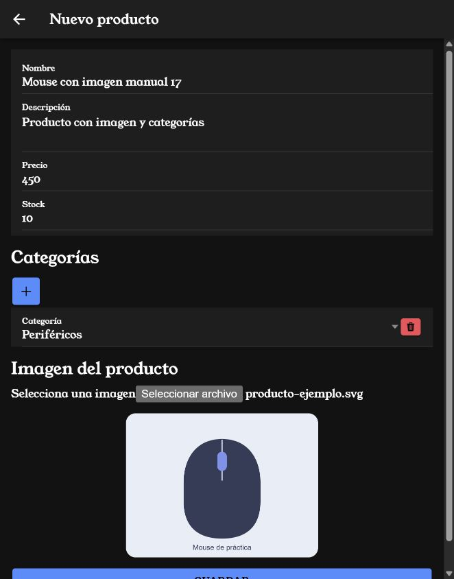
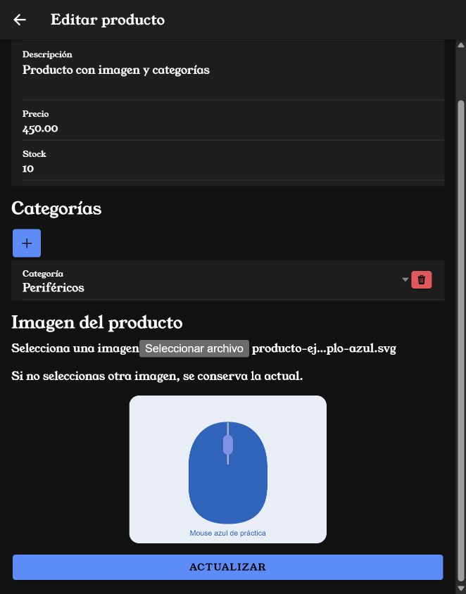
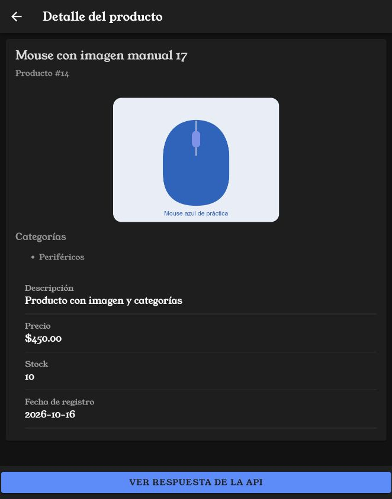
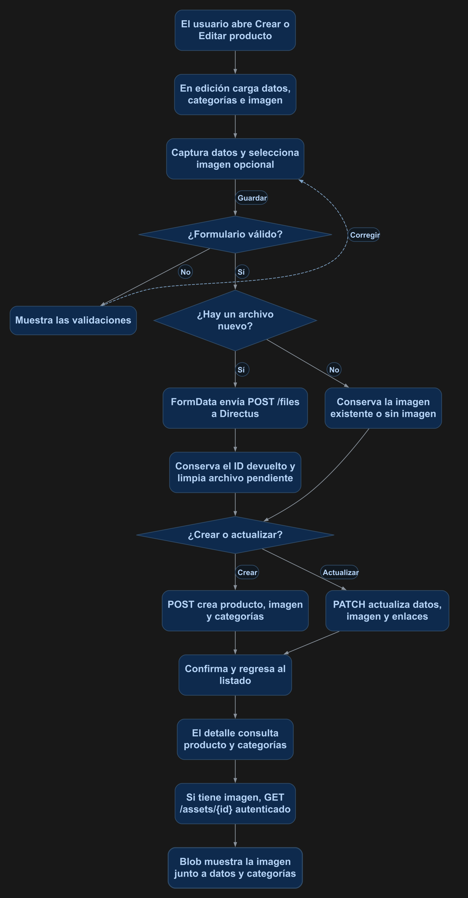

# Imagen en el formulario de creación, actualización y detalle

Seleccionarás una imagen en el mismo formulario donde capturas los datos del producto. Guardar y Actualizar enviarán el archivo y asociarán su ID. El detalle mostrará la imagen y las categorías guardadas.

## 1. Antes de comenzar

Completa el [manual 14](14_muchos_muchos.md) de categorías y el [manual 15](15_subir_archivos.md) de carga básica. Esta práctica utiliza el formulario mediante página de creación y edición. Conserva sus rutas, NgModules y la sesión de AuthService. Las rutas src/... corresponden a mobile/src/...; al generar componentes configura manualmente `standalone: false`.

En la política de la cuenta, conserva Create/Read sobre directus_files y Create/Read/Update sobre productos, además de los permisos de categorías del manual 14. El campo productos.imagen debe relacionarse con directus_files y permitir nulo. Los archivos son compartidos entre cuentas con permiso de lectura.

## 2. Conceptos y métodos que utilizarás

| Elemento | Uso | Resultado |
| --- | --- | --- |
| File y FormData | Seleccionar y enviar un archivo. | POST /files devuelve su ID. |
| ImagenesService | subir() y obtener(). | Reutiliza la sesión para cargar y consultar archivos. |
| imagenId | Conservar el ID existente o recién subido. | Se envía junto con los datos del producto. |
| Blob y createObjectURL() | Preparar una vista previa autenticada. | Mostrar la imagen en el formulario y el detalle. |
| revokeObjectURL() | Liberar la URL anterior. | Limpiar recursos al reemplazar o destruir la vista. |
| ionViewWillEnter() | Consultar al entrar al detalle. | Recuperar los datos y la imagen guardados. |

## 3. Implementación paso a paso

### Paso 1. Crear el servicio de imágenes

Crea mobile/src/app/services/imagenes.ts con el punto 4. subir() agrega el File a FormData y envía POST /files. obtener() consulta GET /assets/{id} con responseType blob. Ambos utilizan auth.cliente, que agrega el encabezado de la sesión.

### Paso 2. Extender los tipos del producto

En las interfaces Producto y ProductoGuardar de services/productos.ts, agrega imagen opcional de tipo string o null. Conserva la consulta expandida y el envío de categorías del manual 14. Las respuestas y los cuerpos de creación y actualización incluyen el ID del archivo.

### Paso 3. Seleccionar la imagen desde el formulario

Inyecta ImagenesService. Agrega el selector, la vista previa y los estilos del punto 4 al mismo formulario. onImagenSeleccionada() conserva el archivo y prepara su vista previa. La selección es opcional. En edición, cargarProducto() consulta la imagen existente y guarda su ID; sin elegir un archivo nuevo se conserva esa imagen.

### Paso 4. Enviar archivo y producto al guardar

Valida el formulario antes de subir. Si hay un archivo nuevo, espera subir(), conserva su ID y limpia archivoImagen para reutilizar ese ID si el guardado del producto falla y se reintenta. Incluye imagen en el objeto del producto y ejecuta crear() o actualizar(). El botón queda deshabilitado durante el guardado.

### Paso 5. Mostrar la imagen en el detalle

Inyecta ImagenesService en ProductosViewPage. Después de consultar el producto, si existe imagen solicita su Blob y crea la URL para img. Un error de imagen muestra su mensaje sin ocultar los demás datos del producto. Conserva la lista de categorías y la consulta en ionViewWillEnter().

## 4. Código completo de referencia

Estos archivos conservan las categorías del manual 14. Agrega el servicio de imágenes y sustituye los archivos indicados. No necesitas una nueva página para seleccionar el archivo.

### `mobile/src/app/services/imagenes.ts`

```typescript
import { Injectable } from '@angular/core';
import { AuthService } from './auth';

@Injectable({ providedIn: 'root' })
export class ImagenesService {
  constructor(private auth: AuthService) {}

  async subir(archivo: File): Promise<string> {
    const datos = new FormData();
    datos.append('file', archivo);
    const response = await this.auth.cliente.post<{ data: { id: string } }>('/files', datos);
    return response.data.data.id;
  }

  async obtener(id: string): Promise<Blob> {
    const response = await this.auth.cliente.get<Blob>('/assets/' + id, { responseType: 'blob' });
    return response.data;
  }
}
```

### `mobile/src/app/services/productos.ts`

```typescript
import { Injectable } from '@angular/core';
import { defer, map, Observable } from 'rxjs';
import { AuthService } from './auth';
import { environment } from '../../environments/environment';

export interface Producto {
  categorias?: { id: number; categorias_id: { id: number; nombre: string } }[];
  imagen?: string | null;
  id: number;
  nombre: string;
  descripcion: string;
  precio: string;
  stock: number;
  fecha_registro: string;
}
export interface ProductoGuardar {
  imagen?: string | null;
  categorias?: { categorias_id: number }[] | { create: { categorias_id: number }[]; delete: number[] };
  nombre: string;
  descripcion: string;
  precio: number;
  stock: number;
}

@Injectable({ providedIn: 'root' })
export class ProductosService {
  constructor(private auth: AuthService) {}
  private url = environment.apiUrl + '/items/productos';

  private filtro(busqueda: string): Record<string, string> {
    const texto = busqueda.trim();
    return texto ? { filter: JSON.stringify({ _or: [
      { nombre: { _icontains: texto } },
      { descripcion: { _icontains: texto } }
    ] }) } : {};
  }

  listado(pagina = 1, porPagina = 3, busqueda = ''): Observable<Producto[]> {
    return defer(() => this.auth.cliente.get<{ data: Producto[] }>(this.url, {
      params: { page: pagina, limit: porPagina, sort: 'id', ...this.filtro(busqueda) }
    })).pipe(map(response => response.data.data));
  }

  detalle(id: number): Observable<Producto> {
    return defer(() => this.auth.cliente.get<{ data: Producto }>(this.url + '/' + id, { params: { fields: '*,categorias.id,categorias.categorias_id.id,categorias.categorias_id.nombre' } }))
      .pipe(map(response => response.data.data));
  }

  crear(producto: ProductoGuardar): Observable<Producto> {
    return defer(() => this.auth.cliente.post<{ data: Producto }>(this.url, producto))
      .pipe(map(response => response.data.data));
  }

  actualizar(id: number, producto: ProductoGuardar): Observable<Producto> {
    return defer(() => this.auth.cliente.patch<{ data: Producto }>(this.url + '/' + id, producto))
      .pipe(map(response => response.data.data));
  }

  eliminar(id: number): Observable<void> {
    return defer(() => this.auth.cliente.delete(this.url + '/' + id)).pipe(map(() => undefined));
  }

  total(busqueda = ''): Observable<number> {
    return defer(() => this.auth.cliente.get<{ data: { count: string | number }[] }>(this.url, {
      params: { 'aggregate[count]': '*', ...this.filtro(busqueda) }
    })).pipe(map(response => Number(response.data.data[0]?.count ?? 0)));
  }
}
```

### `mobile/src/app/productos-form/productos-form.page.ts`

```typescript
import { ImagenesService } from '../services/imagenes';
import { Categoria, CategoriasService } from '../services/categorias';
import { Component, OnDestroy, OnInit } from '@angular/core';
import { FormArray, FormBuilder, FormControl, FormGroup, Validators } from '@angular/forms';
import { ActivatedRoute, Router } from '@angular/router';
import { AlertController } from '@ionic/angular';
import { firstValueFrom } from 'rxjs';
import { ProductoGuardar, ProductosService } from '../services/productos';


@Component({
  selector: 'app-productos-form',
  templateUrl: './productos-form.page.html',
  styleUrls: ['./productos-form.page.scss'],
  standalone: false,
})
export class ProductosFormPage implements OnInit, OnDestroy {
  archivoImagen: File | null = null;
  imagenId: string | null = null;
  imagenUrl = '';
  mensajeImagen = '';

  categorias: Categoria[] = [];
  enlacesCategorias: { id: number; categoriaId: number }[] = [];
  mensajeCategorias = '';
  productoForm!: FormGroup;
  idProducto?: number;
  cargando: boolean = false;
  guardando: boolean = false;

  mensajesValidacion: Record<string, Record<string, string>> = {
    nombre: {
      required: 'El nombre es obligatorio.',
      maxlength: 'El nombre no debe superar 150 caracteres.'
    },
    precio: {
      required: 'El precio es obligatorio.',
      min: 'El precio debe ser igual o mayor que cero.'
    },
    stock: {
      required: 'El stock es obligatorio.',
      min: 'El stock debe ser igual o mayor que cero.',
      pattern: 'El stock debe contener únicamente números enteros.'
    }
  };

  constructor(
    private formBuilder: FormBuilder,
    private alertController: AlertController,
    private activatedRoute: ActivatedRoute,
    private productosService: ProductosService,
    private categoriasService: CategoriasService,
    private imagenesService: ImagenesService,
    private router: Router
  ) {}

  get esEdicion(): boolean {
    return this.idProducto !== undefined;
  }

  async ngOnInit(): Promise<void> {
    this.crearFormulario();
    await this.cargarCategorias();

    const id = this.activatedRoute.snapshot.paramMap.get('id');

    if (id !== null) {
      const idConvertido = Number(id);

      if (!Number.isNaN(idConvertido)) {
        this.idProducto = idConvertido;
        await this.cargarProducto();
      }
    }
  }

  private crearFormulario(): void {
    this.productoForm = this.formBuilder.group({
      nombre: ['', [
        Validators.required,
        Validators.maxLength(150)
      ]],
      descripcion: [''],
      precio: ['', [
        Validators.required,
        Validators.min(0)
      ]],
      stock: ['', [
        Validators.required,
        Validators.min(0),
        Validators.pattern('^[0-9]+$')
      ]]
    });
    this.productoForm.addControl('categorias', this.formBuilder.array([]));
  }

  getError(controlName: string): string {
    const control = this.productoForm.get(controlName);

    if (
      !control ||
      !control.errors ||
      !(control.touched || control.dirty)
    ) {
      return '';
    }

    const tipoError = Object.keys(control.errors)[0];

    return this.mensajesValidacion[controlName]?.[tipoError]
      ?? 'El valor ingresado no es válido.';
  }

  private async cargarProducto(): Promise<void> {
    if (this.idProducto === undefined) {
      return;
    }

    this.cargando = true;

    try {
      const producto = await firstValueFrom(this.productosService.detalle(this.idProducto));

      this.enlacesCategorias = (producto.categorias ?? []).map(enlace => ({ id: enlace.id, categoriaId: enlace.categorias_id.id }));
      this.categoriasFA.clear();
      for (const enlace of this.enlacesCategorias) {
        this.categoriasFA.push(new FormControl(enlace.categoriaId, Validators.required));
      }
      this.imagenId = producto.imagen ?? null;
      if (this.imagenId) {
        try { this.mostrarImagen(await this.imagenesService.obtener(this.imagenId)); }
        catch { this.mensajeImagen = 'No fue posible cargar la imagen actual.'; }
      }
      this.productoForm.patchValue({
        nombre: producto.nombre,
        descripcion: producto.descripcion,
        precio: producto.precio,
        stock: producto.stock
      });
    } catch (error) {
      console.error('Error al cargar el producto:', error);

      const alerta = await this.alertController.create({
        header: 'Error',
        message: 'No fue posible cargar los datos del producto. Revisa la conexión, el identificador y los permisos de lectura en Directus.',
        buttons: ['Aceptar']
      });

      await alerta.present();
    } finally {
      this.cargando = false;
    }
  }

  async guardarProducto(): Promise<void> {
    if (this.guardando) return;
    if (this.productoForm.invalid) {
      this.productoForm.markAllAsTouched();
      return;
    }

    this.guardando = true;

    const valores = this.productoForm.value;

    const producto: ProductoGuardar = {
      nombre: valores.nombre.trim(),
      descripcion: valores.descripcion?.trim() ?? '',
      precio: Number(valores.precio),
      stock: Number(valores.stock)
    };

    const ids = [...new Set(this.categoriasFA.value.map(Number))] as number[];
    if (this.esEdicion) {
      const anteriores = new Set(this.enlacesCategorias.map(enlace => enlace.categoriaId));
      producto.categorias = {
        create: ids.filter(id => !anteriores.has(id)).map(id => ({ categorias_id: id })),
        delete: this.enlacesCategorias.filter(enlace => !ids.includes(enlace.categoriaId)).map(enlace => enlace.id)
      };
    } else {
      producto.categorias = ids.map(id => ({ categorias_id: id }));
    }

    try {
      if (this.archivoImagen) {
        this.imagenId = await this.imagenesService.subir(this.archivoImagen);
        this.archivoImagen = null;
      }
      if (this.imagenId) producto.imagen = this.imagenId;
      if (this.esEdicion && this.idProducto !== undefined) {
        await firstValueFrom(this.productosService.actualizar(this.idProducto, producto));
      } else {
        await firstValueFrom(this.productosService.crear(producto));
      }

      const alerta = await this.alertController.create({
        header: this.esEdicion ? 'Producto actualizado' : 'Producto guardado',
        message: this.esEdicion
          ? 'El producto fue actualizado correctamente.'
          : 'El producto fue registrado correctamente.',
        buttons: ['Aceptar']
      });

      await alerta.present();
      await alerta.onDidDismiss();

      await this.router.navigate(['/productos-list']);
    } catch (error) {
      console.error(
        this.esEdicion
          ? 'Error al actualizar el producto:'
          : 'Error al guardar el producto:',
        error
      );

      const alerta = await this.alertController.create({
        header: 'Error',
        message: this.esEdicion
          ? 'No fue posible actualizar el producto. Revisa los datos, la conexión y los permisos de actualización en Directus.'
          : 'No fue posible guardar el producto. Revisa los datos, la conexión y los permisos de creación en Directus.',
        buttons: ['Aceptar']
      });

      await alerta.present();
    } finally {
      this.guardando = false;
    }
  }
  onImagenSeleccionada(event: Event): void {
    this.archivoImagen = (event.target as HTMLInputElement).files?.[0] ?? null;
    if (this.archivoImagen) {
      this.mensajeImagen = '';
      this.mostrarImagen(this.archivoImagen);
    }
  }
  private mostrarImagen(archivo: Blob): void {
    if (this.imagenUrl) URL.revokeObjectURL(this.imagenUrl);
    this.imagenUrl = URL.createObjectURL(archivo);
  }
  ngOnDestroy(): void {
    if (this.imagenUrl) URL.revokeObjectURL(this.imagenUrl);
  }
  get categoriasFA(): FormArray { return this.productoForm.get('categorias') as FormArray; }
  agregarCategoria(): void { this.categoriasFA.push(new FormControl(null, Validators.required)); }
  eliminarCategoria(indice: number): void { this.categoriasFA.removeAt(indice); }
  private async cargarCategorias(): Promise<void> {
    try { this.categorias = await firstValueFrom(this.categoriasService.listado()); }
    catch { this.mensajeCategorias = 'No fue posible consultar las categorías. Revisa su configuración y permisos.'; }
  }
}
```

### `mobile/src/app/productos-form/productos-form.page.html`

```html
<ion-header>
  <ion-toolbar>
    <ion-buttons slot="start">
      <ion-back-button defaultHref="/productos-list"></ion-back-button>
    </ion-buttons>

    <ion-title>
      {{ esEdicion ? 'Editar producto' : 'Nuevo producto' }}
    </ion-title>
  </ion-toolbar>
</ion-header>

<ion-content class="ion-padding">
  <div *ngIf="cargando" class="ion-text-center ion-padding">
    <ion-spinner></ion-spinner>
    <p>Cargando producto...</p>
  </div>

  <form *ngIf="productoForm && !cargando" [formGroup]="productoForm" (ngSubmit)="guardarProducto()">
    <ion-list>
      <ion-item>
        <ion-input label="Nombre" labelPlacement="stacked" type="text" formControlName="nombre" maxlength="150"></ion-input>
      </ion-item>
      <ion-note color="danger" *ngIf="getError('nombre') as error">
        {{ error }}
      </ion-note>

      <ion-item>
        <ion-textarea label="Descripción" labelPlacement="stacked" formControlName="descripcion" autoGrow="true"></ion-textarea>
      </ion-item>

      <ion-item>
        <ion-input label="Precio" labelPlacement="stacked" type="number" formControlName="precio" min="0"></ion-input>
      </ion-item>
      <ion-note color="danger" *ngIf="getError('precio') as error">
        {{ error }}
      </ion-note>

      <ion-item>
        <ion-input label="Stock" labelPlacement="stacked" type="number" formControlName="stock" min="0"></ion-input>
      </ion-item>
      <ion-note color="danger" *ngIf="getError('stock') as error">
        {{ error }}
      </ion-note>
    </ion-list>

    <section>
      <h2>Categorías</h2>
      <p *ngIf="mensajeCategorias" role="status">{{ mensajeCategorias }}</p>
      <ion-button fill="solid" type="button" (click)="agregarCategoria()" aria-label="Agregar categoría"><ion-icon slot="icon-only" name="add"></ion-icon></ion-button>
      <div formArrayName="categorias">
        <ion-item *ngFor="let control of categoriasFA.controls; let i = index">
          <ion-select label="Categoría" labelPlacement="stacked" [formControlName]="i" interface="popover">
            <ion-select-option *ngFor="let categoria of categorias" [value]="categoria.id">{{ categoria.nombre }}</ion-select-option>
          </ion-select>
          <ion-button fill="solid" type="button" color="danger" (click)="eliminarCategoria(i)" aria-label="Quitar categoría"><ion-icon slot="icon-only" name="trash"></ion-icon></ion-button>
        </ion-item>
      </div>
    </section>

    <section class="ion-margin-top">
      <h2>Imagen del producto</h2>
      <label for="imagen-producto">Selecciona una imagen</label>
      <input id="imagen-producto" type="file" accept="image/*" (change)="onImagenSeleccionada($event)" [disabled]="guardando">
      <p *ngIf="esEdicion">Si no seleccionas otra imagen, se conserva la actual.</p>
      <p *ngIf="mensajeImagen" role="status">{{ mensajeImagen }}</p>
      
    </section>

    <ion-button fill="solid" expand="block" type="submit" class="ion-margin-top" [disabled]="guardando || cargando">
      {{ guardando ? 'Guardando...' : (esEdicion ? 'Actualizar' : 'Guardar') }}
    </ion-button>
  </form>
</ion-content>
```

### `mobile/src/app/productos-form/productos-form.page.scss`

```scss
.imagen-producto { display: block; max-width: 100%; width: 280px; max-height: 240px; object-fit: contain; margin: 16px auto; }
input[type="file"] { max-width: 100%; }
```

### `mobile/src/app/productos-view/productos-view.page.ts`

```typescript
import { Component, OnDestroy } from '@angular/core';
import { ActivatedRoute } from '@angular/router';
import { LoadingController } from '@ionic/angular';
import { firstValueFrom } from 'rxjs';
import { Producto, ProductosService } from '../services/productos';
import { ImagenesService } from '../services/imagenes';
import { environment } from '../../environments/environment';

@Component({
  selector: 'app-productos-view',
  templateUrl: './productos-view.page.html',
  styleUrls: ['./productos-view.page.scss'],
  standalone: false
})
export class ProductosViewPage implements OnDestroy {
  imagenUrl = '';
  mensajeImagen = '';

  producto: Producto | null = null;
  mensajeError: string = '';

  constructor(
    private route: ActivatedRoute,
    private productosService: ProductosService,
    private imagenesService: ImagenesService,
    private loading: LoadingController
  ) { }

  ionViewWillEnter() {
    this.cargarProducto();
  }

  async cargarProducto(): Promise<void> {
    const id = this.route.snapshot.paramMap.get('id');

    if (this.imagenUrl) URL.revokeObjectURL(this.imagenUrl);
    this.imagenUrl = '';
    this.mensajeImagen = '';
    this.producto = null;
    this.mensajeError = '';

    if (!id) {
      this.mensajeError = 'No se recibió el ID del producto.';
      return;
    }

    const loading = await this.loading.create({
      message: 'Cargando producto...',
      spinner: 'bubbles',
    });

    await loading.present();

    try {
      this.producto = await firstValueFrom(this.productosService.detalle(Number(id)));
      if (this.producto.imagen) {
        try { this.imagenUrl = URL.createObjectURL(await this.imagenesService.obtener(this.producto.imagen)); }
        catch { this.mensajeImagen = 'No fue posible cargar la imagen del producto.'; }
      }
    } catch (error) {
      console.error('Error al cargar el producto:', error);
      this.mensajeError = 'No se pudo cargar el producto. Revisa el ID, la conexión y los permisos de lectura.';
    } finally {
      await loading.dismiss();
    }
  }

  ngOnDestroy(): void {
    if (this.imagenUrl) URL.revokeObjectURL(this.imagenUrl);
  }

  abrirPagina(): void {
    if (!this.producto) {
      return;
    }

    const url = `${environment.apiUrl}/items/productos/${this.producto.id}`;
    window.open(url, '_blank', 'noopener,noreferrer');
  }

}
```

### `mobile/src/app/productos-view/productos-view.page.html`

```html
<ion-header>
  <ion-toolbar>
    <ion-buttons slot="start">
      <ion-back-button defaultHref="/productos-list"></ion-back-button>
    </ion-buttons>
    <ion-title>Detalle del producto</ion-title>
  </ion-toolbar>
</ion-header>

<ion-content>
  <ion-text color="danger" *ngIf="mensajeError">
    <p class="ion-padding">{{ mensajeError }}</p>
  </ion-text>

  <ion-card *ngIf="producto as detalle">
    <ion-card-header>
      <ion-card-title>{{ detalle.nombre }}</ion-card-title>
      <ion-card-subtitle>Producto #{{ detalle.id }}</ion-card-subtitle>
    </ion-card-header>

    <ion-card-content>
      
      <p *ngIf="mensajeImagen" role="status">{{ mensajeImagen }}</p>
      <h2>Categorías</h2>
      <ul *ngIf="detalle.categorias?.length; else sinCategorias">
        <li *ngFor="let enlace of detalle.categorias">{{ enlace.categorias_id.nombre }}</li>
      </ul>
      <ng-template #sinCategorias><p>Sin categorías asignadas.</p></ng-template>
      <ion-list>
        <ion-item>
          <ion-label class="ion-text-wrap">
            <p>Descripción</p>
            <h2>{{ detalle.descripcion }}</h2>
          </ion-label>
        </ion-item>
        <ion-item>
          <ion-label>
            <p>Precio</p>
            <h2>${{ detalle.precio }}</h2>
          </ion-label>
        </ion-item>
        <ion-item>
          <ion-label>
            <p>Stock</p>
            <h2>{{ detalle.stock }}</h2>
          </ion-label>
        </ion-item>
        <ion-item>
          <ion-label>
            <p>Fecha de registro</p>
            <h2 *ngIf="detalle.fecha_registro; else sinFecha">
              {{ detalle.fecha_registro | date:'yyyy-MM-dd' }}
            </h2>
            <ng-template #sinFecha>
              <h2>Sin fecha de registro</h2>
            </ng-template>
          </ion-label>
        </ion-item>
      </ion-list>
    </ion-card-content>
  </ion-card>
</ion-content>

<ion-footer *ngIf="producto">
  <ion-toolbar>
    <ion-button fill="solid" expand="block" (click)="abrirPagina()">
      Ver respuesta de la API
    </ion-button>
  </ion-toolbar>
</ion-footer>
```

### `mobile/src/app/productos-view/productos-view.page.scss`

```scss
.imagen-producto { display: block; max-width: 100%; width: 280px; max-height: 240px; object-fit: contain; margin: 16px auto; }
```

## 5. Comprobar el resultado

1. En el formulario de creación captura Mouse con imagen manual 17, precio 450 y stock 10. Selecciona [producto-ejemplo.svg](recursos/producto-ejemplo.svg). La figura 1 muestra la vista previa antes de guardar.

<p align="center">
  <br>
  <em>Figura 1. Datos e imagen preparados en el mismo formulario.</em>
</p>

2. Guarda y acepta la confirmación. Abre el detalle: deben aparecer los datos y la imagen. Si elegiste categorías, deben verse sus nombres.
3. Abre la edición del producto, cambia únicamente el stock y actualiza sin elegir archivo. Comprueba que se conserve la imagen.
4. Vuelve a editar y selecciona [producto-ejemplo-azul.svg](recursos/producto-ejemplo-azul.svg). La figura 2 muestra la nueva vista previa. Actualiza y vuelve al detalle.

<p align="center">
  <br>
  <em>Figura 2. Reemplazo de imagen desde el formulario de actualización.</em>
</p>

5. El detalle debe mostrar la imagen azul como en la figura 3. Sal y vuelve a entrar: debe recuperarse la misma imagen. Revisa también que las categorías permanezcan correctas.

<p align="center">
  <br>
  <em>Figura 3. Imagen guardada y categorías en la vista de detalle.</em>
</p>

6. Crea un producto sin imagen: debe guardarse sin mostrar una imagen vacía. Un formulario inválido debe impedir la subida y mostrar las validaciones existentes.

## 6. Explicación detallada del flujo

La figura 4 muestra cómo el formulario decide entre conservar la imagen existente o subir una nueva, y entre crear o actualizar el producto.

<p align="center">
  <br>
  <em>Figura 4. Selección, guardado y recuperación de la imagen del producto.</em>
</p>

La vista previa local no implica que el archivo esté guardado. Primero se valida el formulario; después POST /files guarda el archivo y devuelve el ID. Ese ID viaja en imagen junto con los datos y las asociaciones de categorías del producto. En edición, no elegir otro archivo conserva el ID cargado.

La carga de archivo y el guardado del producto son peticiones separadas. Si la primera funciona y la segunda falla, el archivo ya existe: el formulario conserva su ID para reintentar mientras sigas en esa vista. No borra archivos anteriores al reemplazar una imagen, porque pueden seguir utilizándose en otros productos.

El detalle consulta el producto al entrar, recupera el archivo con la sesión y muestra el Blob mediante una URL local. Las URLs se liberan al reemplazarlas y al destruir el componente.
