# Integrar colecciones de productos y navegación con tabs

La aplicación tendrá tres tabs: **Productos, Pedidos y Resumen**. El menú lateral dará acceso directo a los catálogos. Agregarás marcas, proveedores, clientes y pedidos a la base del curso, y usarás las páginas de listado, detalle y formulario para administrarlos. Productos conservará imagen y categorías, e incorporará marca y proveedor.

## 1. Antes de comenzar

Completa los [manuales 12](12_login_registro.md), [13](13_guard.md), [14](14_muchos_muchos.md), [16](16_imagen_formulario_detalle.md) y [17](17_campos_formularios.md). Conserva AuthService, la guardia, los componentes de barra y paginación, y los servicios de productos e imágenes. Las páginas se declaran en NgModules con `standalone: false`.

Esta práctica parte de productos, categorias, productos_categorias, ejemplos_campos y origenes_ejemplo. Agrega exactamente cuatro colecciones: marcas, proveedores, clientes y pedidos. Cada pedido del ejemplo corresponde a **un producto y un cliente**; registra cantidad, observaciones y estado. El guardado del pedido no modifica el stock.

## 2. Conceptos y métodos que utilizarás

| Elemento | Responsabilidad |
| --- | --- |
| tabs.page.html | Mostrar la barra inferior y sus tres accesos. |
| tabs-routing.module.ts | Conectar cada tab con sus rutas hijas. |
| productos-list/view/form | Pantallas específicas del producto con imagen y categorías. |
| app.component.html | Mostrar los accesos a los catálogos en el menú lateral. |
| resumen.page / ResumenService | Consultar totales y mostrar indicadores de inventario y pedidos. |
| colecciones-list/view/form | Pantallas compartidas por colecciones con el mismo comportamiento. |
| colecciones.config.ts | Definir nombres, campos, validaciones, opciones y relaciones de cada colección. |
| ColeccionesService | Consultar, buscar, contar, crear, actualizar y eliminar mediante AuthService. |
| ionViewWillEnter() | Recargar listados al volver y actualizar los catálogos de los selectores. |
| canActivate / canActivateChild | Validar la sesión al entrar y navegar por las rutas protegidas. |

**¿Dónde escribir el código?** El contenedor `tabs` reúne navegación. El formulario del producto está en `productos-form`; el listado está en `productos-list`. Los catálogos comparten las páginas `colecciones-list`, `colecciones-view` y `colecciones-form`, que reciben su configuración desde la ruta. Los nombres describen su función. Las carpetas de plantilla tab1, tab2 y tab3 se retiran al conectar las páginas reales.

## 3. Implementación paso a paso

### Paso 1. Crear las cuatro colecciones

En Directus, abre **Configuración → Modelo de datos**. Crea cada colección con clave primaria `id`, Integer autoincremental. Agrega los siguientes campos:

| Colección | Campos |
| --- | --- |
| marcas | nombre String(100), obligatorio; descripcion Text, opcional. |
| proveedores | nombre String(100), obligatorio; correo String(100) y telefono String(20), opcionales; activo Boolean, obligatorio y predeterminado true. |
| clientes | nombre String(100), obligatorio; correo String(100) y telefono String(20), opcionales. |
| pedidos | cliente M2O obligatorio hacia clientes; producto M2O obligatorio hacia productos; cantidad Integer, obligatoria y predeterminado 1; estado String(30), obligatorio y predeterminado pendiente; observaciones Text, opcional; fecha_creacion Timestamp automático date-created. |

En productos agrega dos campos **Muchos a uno** opcionales: `marca` hacia marcas y `proveedor` hacia proveedores. Los productos existentes podrán conservar ambos vacíos. Configura las cuatro relaciones con eliminación **RESTRICT** y actualización **CASCADE**. La plantilla de visualización de marcas, proveedores y clientes es `{{nombre}}`.

En pedidos.estado configura un desplegable con pendiente, entregado y cancelado. En la base conectada a Directus ejecuta el [SQL de restricciones](recursos/18_tabs/restricciones.sql):

```sql
ALTER TABLE pedidos
  MODIFY estado ENUM('pendiente','entregado','cancelado') NOT NULL DEFAULT 'pendiente',
  ADD CONSTRAINT pedidos_cantidad_positiva CHECK (cantidad > 0);
```

El ENUM es nativo de MariaDB; su reconocimiento como unknown en el modelo de Directus 12.3.1 y su uso por REST se comprobaron en el manual 17. Para fecha_creacion elige el campo automático de creación: la aplicación no envía esa fecha.

El recurso [colecciones.json](recursos/18_tabs/colecciones.json) contiene las cuatro definiciones, los dos campos adicionales de productos, las cuatro relaciones y los registros de ejemplo. Sirve como referencia exacta de configuración; el objeto completo no se importa desde la lista de registros. Sus elementos collections corresponden a cuerpos de creación de colecciones y relations a cuerpos de creación de relaciones.

La figura 1 muestra las nueve tablas de la práctica y sus relaciones. productos_categorias sigue siendo la tabla de enlace administrada desde el producto.

<p align="center">
  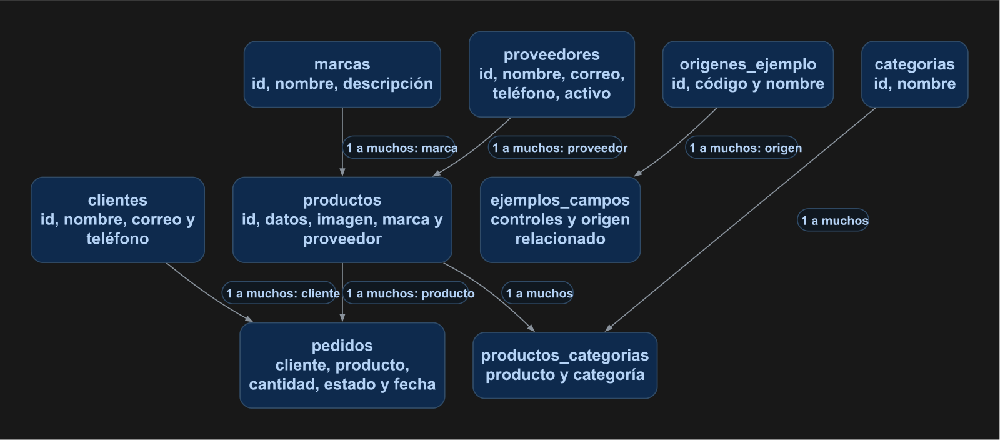<br>
  <em>Figura 1. Colecciones de la práctica y sus llaves foráneas.</em>
</p>

### Paso 2. Preparar permisos y registros de ejemplo

En la política de la cuenta de práctica habilita **Create, Read, Update y Delete** para productos, categorias, marcas, proveedores, clientes, pedidos, origenes_ejemplo y ejemplos_campos. Conserva Read/Create/Delete de productos_categorias y Create/Read de directus_files de las prácticas anteriores. La cuenta no necesita acceso administrativo.

Agrega desde Contenido los registros de seeds en colecciones.json: cinco marcas, un proveedor y un cliente. Conserva el origen con codigo app_ionic del manual 17. Los IDs se generan en cada instalación: los formularios consultan los catálogos y envían el ID seleccionado.

Al terminar los cambios del esquema, reinicia el servicio existente:

```powershell
docker compose restart api
```

### Paso 3. Conectar los tabs y las rutas

Copia las rutas y páginas del punto 4. `app-routing.module.ts` envía el inicio a `/tabs/productos` y protege el módulo de tabs. `tabs-routing.module.ts` conecta sus páginas hijas. `tab` y `href` de cada botón corresponden al primer segmento de su ruta.

| Tab o acceso | Ruta | Pantallas |
| --- | --- | --- |
| Productos | /tabs/productos | Listado; detalle/:id; formulario; formulario/:id; imagen/:id. |
| Pedidos | /tabs/pedidos | Listado; detalle/:id; formulario; formulario/:id. |
| Resumen | /tabs/resumen | Indicadores de inventario y estados de pedidos. |
| Cada catálogo | /catalogos/marcas, proveedores, clientes, categorias, origenes-ejemplo o ejemplos-campos | Listado; detalle/:id; formulario; formulario/:id. |

La figura 2 muestra los tabs ya conectados al listado de productos. Las páginas de detalle y formulario pertenecen a la misma rama, por lo que la barra inferior sigue visible. Cada tab conserva su propia pila de navegación. El menú lateral abre los catálogos con `/catalogos/...`, fuera del contenedor de tabs. Al volver a Productos, Pedidos o Resumen desde el menú se abre esa sección.

<p align="center">
  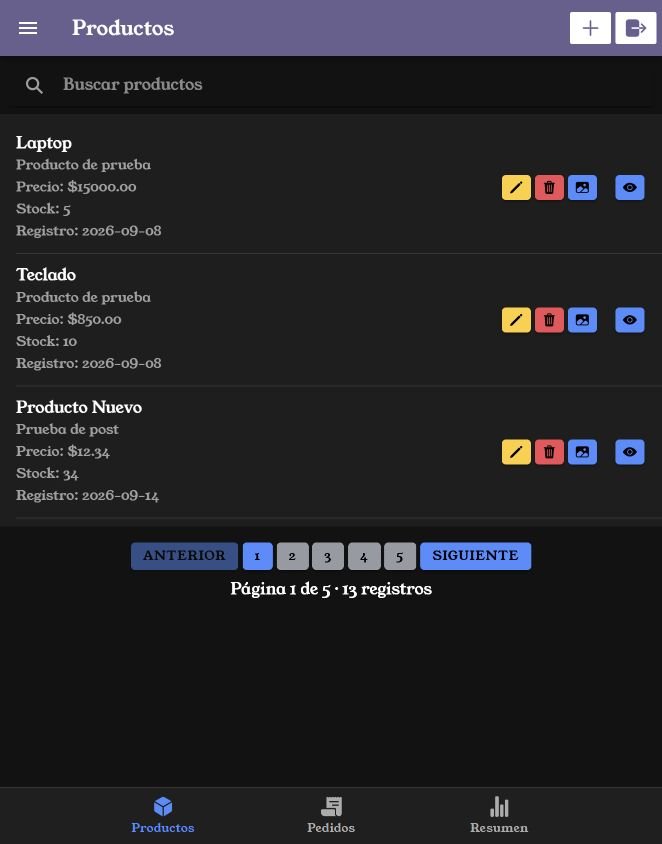<br>
  <em>Figura 2. Productos, Pedidos y Resumen en la barra inferior.</em>
</p>

Sustituye los enlaces del menú por las rutas del punto 4. Después de comprobar las rutas, retira las carpetas tab1, tab2, tab3 y explore-container. Las direcciones antiguas de los manuales conservan redirecciones para abrir la pantalla correspondiente.

### Paso 4. Administrar los catálogos

La figura 3 muestra los accesos a todas las colecciones auxiliares dentro del menú lateral. Abre el menú y elige directamente Categorías, Marcas, Proveedores, Clientes, Orígenes o Ejemplos de campos. Estas pantallas usan rutas propias fuera del contenedor de tabs. La configuración indica sus campos; las páginas compartidas usan esa información para crear los controles y el objeto de guardado. Los datos se envían al nombre real de la colección en Directus.

<p align="center">
  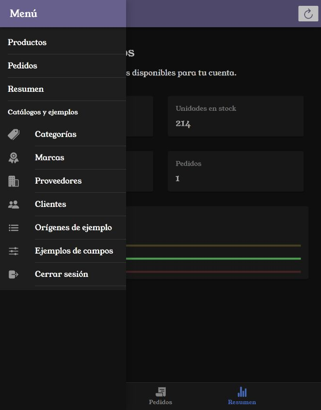<br>
  <em>Figura 3. Colecciones disponibles directamente en el menú lateral.</em>
</p>

En el menú, abre Marcas y pulsa +. La figura 4 muestra el formulario con los datos de AulaTech cargados para editar. Guardar valida y crea el registro; después abre su detalle. El lápiz carga el mismo formulario con los valores existentes para actualizarlo. La figura 5 muestra la consulta de AulaTech.

<p align="center">
  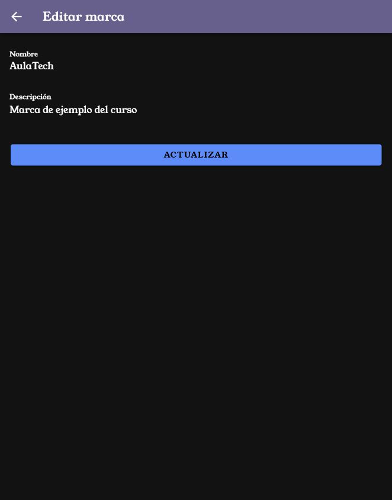<br>
  <em>Figura 4. Formulario de marca desde Ionic.</em>
</p>

<p align="center">
  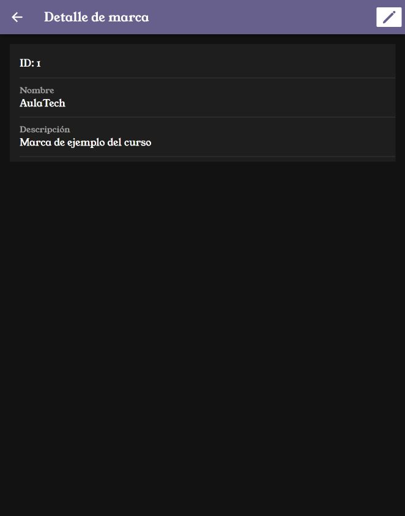<br>
  <em>Figura 5. Consulta de una marca desde el menú.</em>
</p>

El listado consulta tres registros por página. La búsqueda reinicia la página y aplica el mismo filtro al conteo y a los registros. La figura 6 muestra la búsqueda por nombre.

<p align="center">
  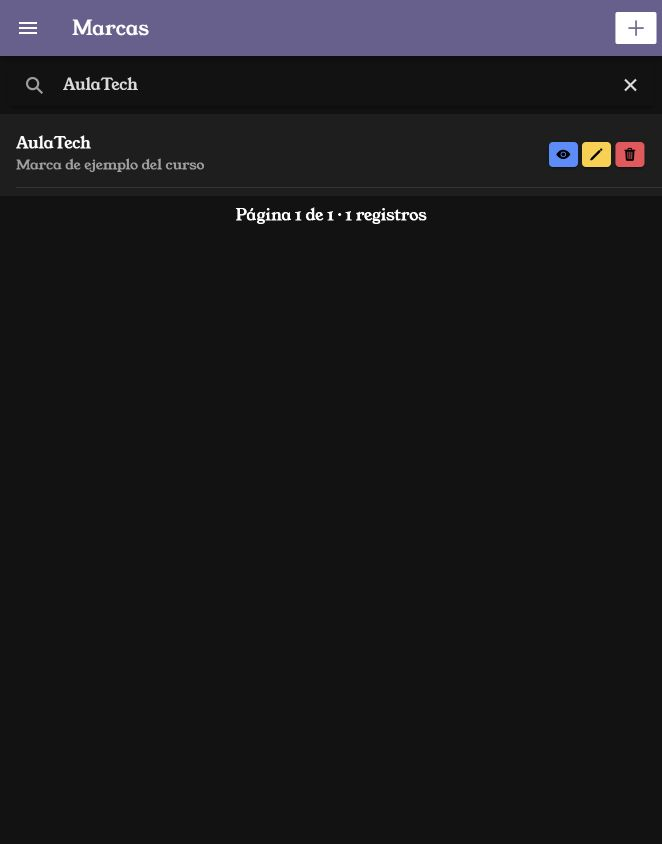<br>
  <em>Figura 6. Resultado filtrado con su conteo.</em>
</p>

En Proveedores, captura nombre y los contactos opcionales. El interruptor Activo envía un booleano. Las figuras 7 y 8 muestran el formulario y el resultado con false conservado.

<p align="center">
  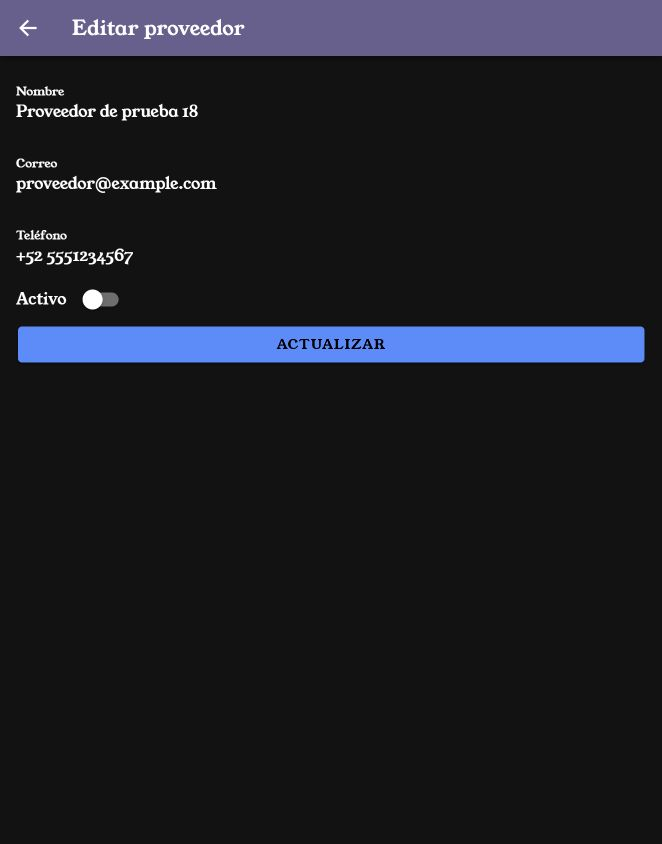<br>
  <em>Figura 7. Formulario del proveedor con datos de contacto.</em>
</p>

<p align="center">
  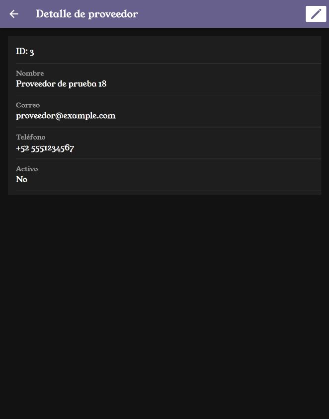<br>
  <em>Figura 8. El valor false se conserva al consultar.</em>
</p>

En Clientes, crea el registro que usarás en el pedido. La figura 9 muestra el ejemplo. Categorías y Orígenes usan el mismo recorrido; los ejemplos de campos conservan sus controles de selección, radio, casillas, interruptor, rango, fecha y hora.

<p align="center">
  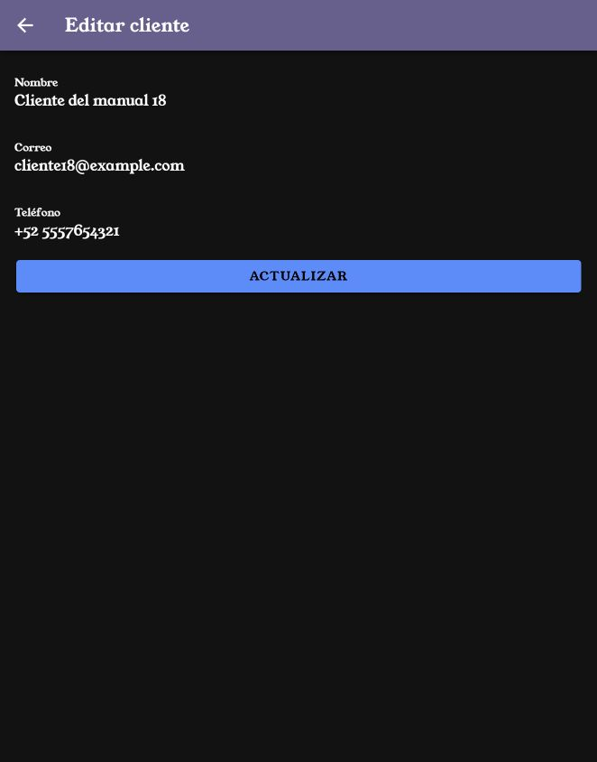<br>
  <em>Figura 9. Formulario del cliente relacionado con el pedido.</em>
</p>

### Paso 5. Integrar los catálogos en productos

Agrega marca y proveedor a Producto y ProductoGuardar. En el detalle expande sus campos id y nombre. El formulario consulta ambos catálogos, carga los IDs al editar y los incluye en el cuerpo de creación o actualización. Un valor vacío se envía como null.

Conserva los controles de categorías, la subida de imagen y la recuperación del archivo existente. La figura 10 muestra el formulario integrado y la figura 11 el detalle del producto de prueba con todas sus relaciones.

<p align="center">
  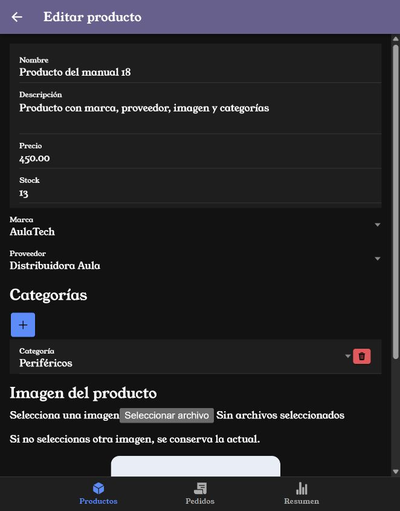<br>
  <em>Figura 10. Guardado integrado de producto y sus relaciones.</em>
</p>

<p align="center">
  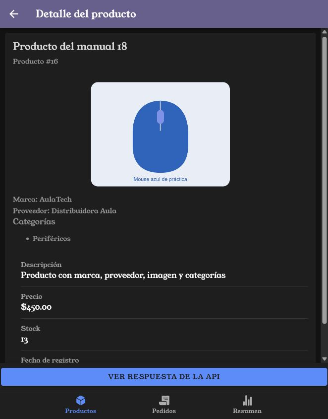<br>
  <em>Figura 11. Detalle del producto 16 creado en Ionic.</em>
</p>

### Paso 6. Registrar y actualizar pedidos

Abre el tab Pedidos y pulsa +. Selecciona cliente y producto, captura una cantidad entera mayor que cero y agrega observaciones si las necesitas. La figura 12 muestra el rechazo de cantidad cero en Ionic. La figura 13 muestra un pedido listo para guardar.

<p align="center">
  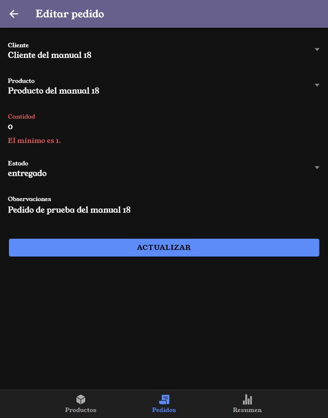<br>
  <em>Figura 12. Ionic impide enviar una cantidad inferior a uno.</em>
</p>

<p align="center">
  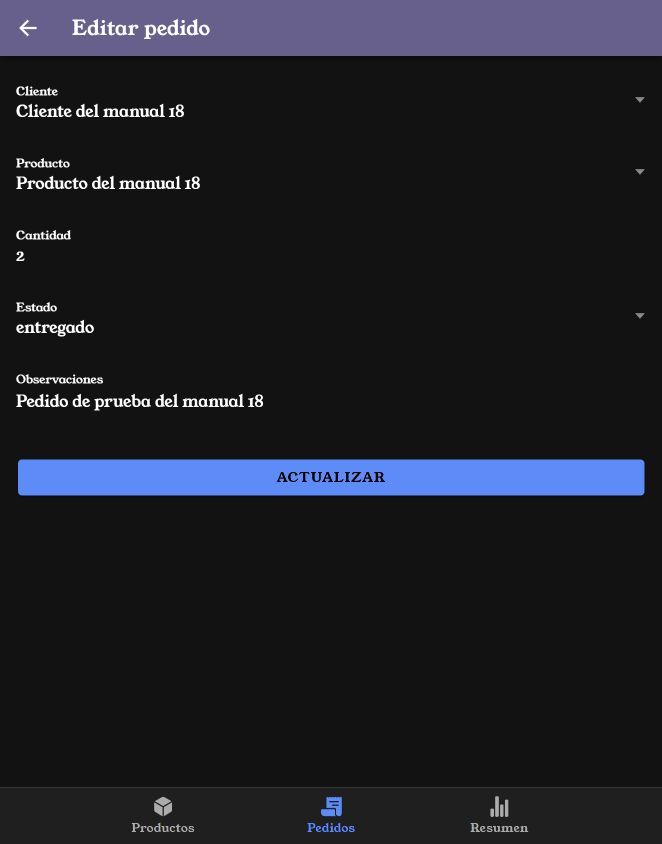<br>
  <em>Figura 13. Formulario del pedido con dos llaves foráneas.</em>
</p>

El POST envía los IDs; el GET solicita los nombres relacionados. La fecha de creación la genera Directus. Edita el pedido, cambia su estado a entregado y actualiza. La figura 14 muestra el resultado.

<p align="center">
  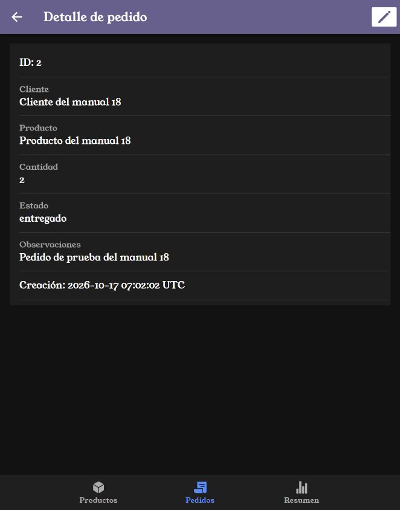<br>
  <em>Figura 14. Detalle del pedido 2 después de actualizarlo.</em>
</p>

### Paso 7. Confirmar eliminaciones y proteger relaciones

El botón de basura abre la confirmación de la figura 15. Cancelar conserva el registro. Al confirmar, el servicio comprueba si el catálogo está en uso; si tiene relaciones muestra el aviso de la figura 16. La llave foránea de la base también protege la relación.

<p align="center">
  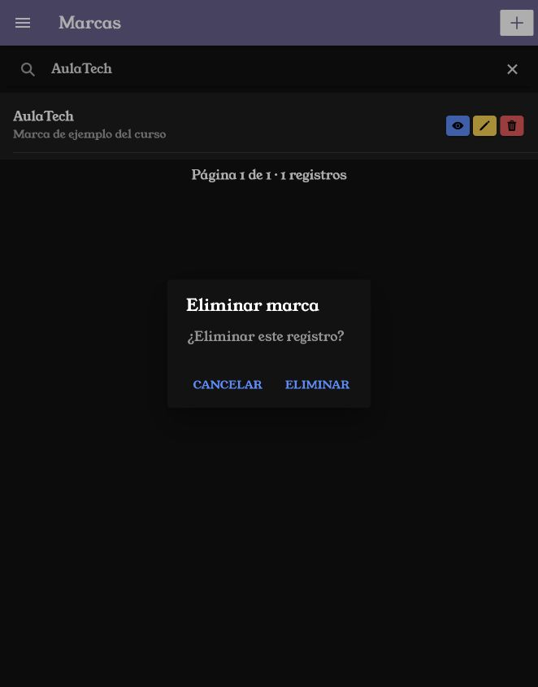<br>
  <em>Figura 15. La eliminación requiere una acción explícita.</em>
</p>

<p align="center">
  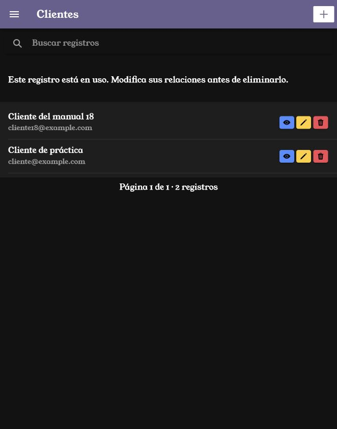<br>
  <em>Figura 16. El cliente se conserva mientras el pedido lo referencia.</em>
</p>

### Paso 8. Elegir la ubicación del botón de creación

En colecciones-list.page.ts elige `usarBotonFlotante = false` para el + sólido en la barra, o true para la variante de la figura 17. El HTML incluye ambas opciones con condiciones para mostrar solo una. Los botones de detalle usan ojo y los de creación +, con etiquetas accesibles y sin texto visible.

<p align="center">
  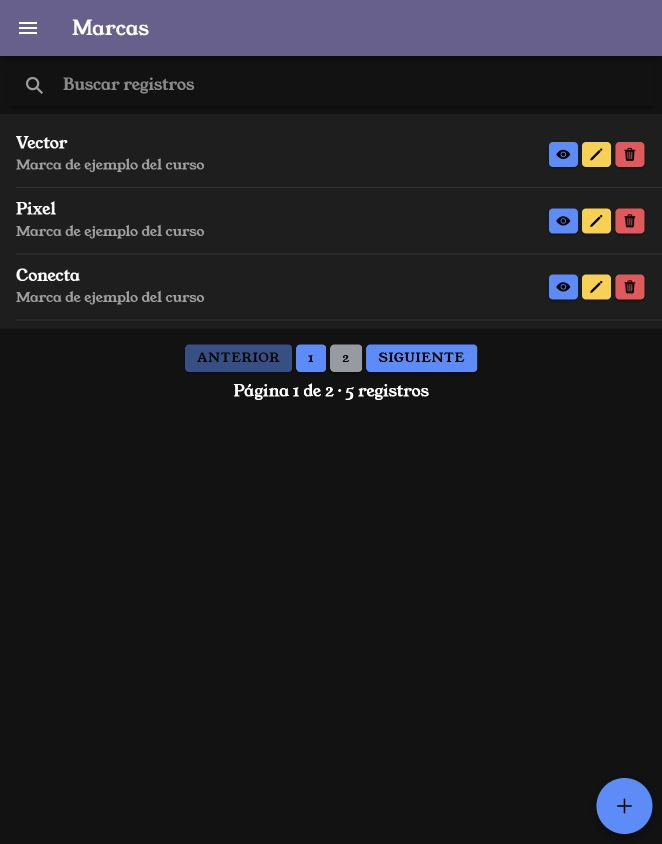<br>
  <em>Figura 17. Variante flotante dentro del catálogo abierto desde el menú.</em>
</p>

### Paso 9. Mostrar indicadores en el tercer tab

Crea `resumen.page` y `ResumenService` con el código del punto 4. El tab **Resumen** muestra tarjetas de productos, unidades en stock, productos sin stock y pedidos. Las barras muestran cuántos pedidos están pendientes, entregados o cancelados. La figura 18 presenta los datos consultados en Directus.

El servicio usa `aggregate[count]` y `aggregate[sum]` sobre productos y agrupa los pedidos por estado con `groupBy[]`. No descarga todos los registros para contarlos. Los totales respetan los permisos de la cuenta; se consultan al entrar al tab y al pulsar el icono de actualizar. Si no hay pedidos, las proporciones valen cero. Si falla la consulta, se muestra el mensaje para reintentar y se retiran los valores anteriores.

<p align="center">
  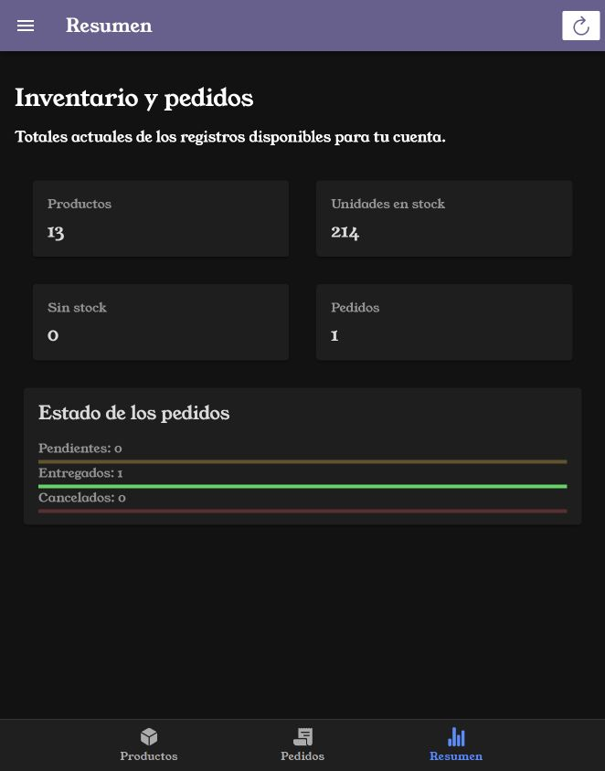<br>
  <em>Figura 18. Tercer tab con indicadores actuales de inventario y pedidos.</em>
</p>

## 4. Código completo de referencia

Los archivos siguientes corresponden a la aplicación probada. Conserva los módulos, servicios y componentes de las prácticas previas. También puedes consultar el [código de la aplicación](../../mobile/src/app).

### `mobile/src/app/app-routing.module.ts`

```typescript
import { NgModule } from '@angular/core';
import { PreloadAllModules, RouterModule, Routes } from '@angular/router';
import { authGuard } from './guard/auth.guard';
import { COLECCIONES } from './catalogos/colecciones.config';
import { rutasColeccion } from './catalogos/rutas-coleccion';
const routes: Routes = [
  { path: 'login', loadChildren: () => import('./login/login.module').then(m => m.LoginPageModule) },
  { path: 'registro', loadChildren: () => import('./registro/registro.module').then(m => m.RegistroPageModule) },
  { path: 'tabs', canActivate: [authGuard], loadChildren: () => import('./tabs/tabs.module').then(m => m.TabsPageModule) },
  { path: 'catalogos', canActivate: [authGuard], canActivateChild: [authGuard], children: [
    ...COLECCIONES.filter(c => c.tabla !== 'pedidos').reduce<Routes>((rutas, c) => [...rutas, ...rutasColeccion(c.ruta, c.ruta)], []),
    { path: '', redirectTo: '/tabs/resumen', pathMatch: 'full' }
  ] },
  { path: 'productos-list', redirectTo: 'tabs/productos', pathMatch: 'full' },
  { path: 'productos-view/:id', redirectTo: 'tabs/productos/detalle/:id', pathMatch: 'full' },
  { path: 'productos-form/:id', redirectTo: 'tabs/productos/formulario/:id', pathMatch: 'full' },
  { path: 'productos-form', redirectTo: 'tabs/productos/formulario', pathMatch: 'full' },
  { path: 'producto-imagen/:id', redirectTo: 'tabs/productos/imagen/:id', pathMatch: 'full' },
  { path: 'ejemplos-campos', canActivate: [authGuard], loadChildren: () => import('./ejemplos-campos/ejemplos-campos.module').then(m => m.EjemplosCamposPageModule) },
  { path: '', redirectTo: 'tabs/productos', pathMatch: 'full' },
  { path: '**', redirectTo: 'tabs/productos' }
];
@NgModule({ imports: [RouterModule.forRoot(routes, { preloadingStrategy: PreloadAllModules })], exports: [RouterModule] })
export class AppRoutingModule {}
```

### `mobile/src/app/tabs/tabs-routing.module.ts`

```typescript
import { NgModule } from '@angular/core';
import { RouterModule, Routes } from '@angular/router';
import { TabsPage } from './tabs.page';
import { COLECCIONES } from '../catalogos/colecciones.config';
import { authGuard } from '../guard/auth.guard';
import { rutasColeccion } from '../catalogos/rutas-coleccion';
const routes: Routes = [{ path: '', component: TabsPage, canActivateChild: [authGuard], children: [
  { path: 'productos/formulario', loadChildren: () => import('../productos-form/productos-form.module').then(m => m.ProductosFormPageModule) },
  { path: 'productos/detalle/:id', loadChildren: () => import('../productos-view/productos-view.module').then(m => m.ProductosViewPageModule) },
  { path: 'productos/imagen/:id', loadChildren: () => import('../producto-imagen/producto-imagen.module').then(m => m.ProductoImagenPageModule) },
  { path: 'productos', loadChildren: () => import('../productos-list/productos-list.module').then(m => m.ProductosListPageModule) },
  ...rutasColeccion('pedidos', 'pedidos'),
  { path: 'resumen', loadChildren: () => import('../resumen/resumen.module').then(m => m.ResumenPageModule) },
  ...COLECCIONES.filter(c => c.tabla !== 'pedidos').reduce<Routes>((rutas, c) => [...rutas,
    { path: 'catalogos/' + c.ruta + '/formulario/:id', redirectTo: '/catalogos/' + c.ruta + '/formulario/:id', pathMatch: 'full' },
    { path: 'catalogos/' + c.ruta + '/formulario', redirectTo: '/catalogos/' + c.ruta + '/formulario', pathMatch: 'full' },
    { path: 'catalogos/' + c.ruta + '/detalle/:id', redirectTo: '/catalogos/' + c.ruta + '/detalle/:id', pathMatch: 'full' },
    { path: 'catalogos/' + c.ruta, redirectTo: '/catalogos/' + c.ruta, pathMatch: 'full' }
  ], []),
  { path: 'catalogos', redirectTo: 'resumen', pathMatch: 'full' },
  { path: 'tab1', redirectTo: 'productos', pathMatch: 'full' },
  { path: 'tab2', redirectTo: 'pedidos', pathMatch: 'full' },
  { path: 'tab3', redirectTo: 'resumen', pathMatch: 'full' },
  { path: '', redirectTo: 'productos', pathMatch: 'full' }
]}];
@NgModule({ imports: [RouterModule.forChild(routes)], exports: [RouterModule] })
export class TabsPageRoutingModule {}
```

### `mobile/src/app/tabs/tabs.page.html`

```html
<ion-tabs>
  <ion-tab-bar slot="bottom">
    <ion-tab-button tab="productos" href="/tabs/productos"><ion-icon name="cube" aria-hidden="true"></ion-icon><ion-label>Productos</ion-label></ion-tab-button>
    <ion-tab-button tab="pedidos" href="/tabs/pedidos"><ion-icon name="receipt" aria-hidden="true"></ion-icon><ion-label>Pedidos</ion-label></ion-tab-button>
    <ion-tab-button tab="resumen" href="/tabs/resumen"><ion-icon name="stats-chart" aria-hidden="true"></ion-icon><ion-label>Resumen</ion-label></ion-tab-button>
  </ion-tab-bar>
</ion-tabs>
```

### `mobile/src/app/app.component.ts`

```typescript
import { Component } from '@angular/core';
import { Router } from '@angular/router';
import { AuthService } from './services/auth';
import { COLECCIONES } from './catalogos/colecciones.config';
@Component({ selector: 'app-root', templateUrl: 'app.component.html', styleUrls: ['app.component.scss'], standalone: false })
export class AppComponent {
  enlaces = [
    { ruta: '/tabs/productos', texto: 'Productos' },
    { ruta: '/tabs/pedidos', texto: 'Pedidos' },
    { ruta: '/tabs/resumen', texto: 'Resumen' }
  ];
  catalogos = COLECCIONES.filter(c => c.tabla !== 'pedidos');
  constructor(private auth: AuthService, private router: Router) {}
  async salir(): Promise<void> { try { await this.auth.cerrarSesion(); } finally { await this.router.navigateByUrl('/login', { replaceUrl: true }); } }
}
```

### `mobile/src/app/app.component.html`

```html
<ion-app>
  <ion-menu contentId="main" menuId="principal">
    <ion-header>
      <ion-toolbar color="personalizado"><ion-title>Menú</ion-title></ion-toolbar>
    </ion-header>
    <ion-content>
      <ion-list>
        <ion-menu-toggle *ngFor="let enlace of enlaces" autoHide="false">
          <ion-item [routerLink]="enlace.ruta" routerDirection="root" button detail="false">
            <ion-label>{{ enlace.texto }}</ion-label>
          </ion-item>
        </ion-menu-toggle>
        <ion-list-header><ion-label>Catálogos y ejemplos</ion-label></ion-list-header>
        <ion-menu-toggle *ngFor="let catalogo of catalogos" autoHide="false">
          <ion-item [routerLink]="['/catalogos', catalogo.ruta]" routerDirection="root" button detail="false">
            <ion-icon slot="start" [name]="catalogo.icono" aria-hidden="true"></ion-icon><ion-label>{{ catalogo.titulo }}</ion-label>
          </ion-item>
        </ion-menu-toggle>
        <ion-menu-toggle><ion-item button (click)="salir()"><ion-icon slot="start" name="log-out"></ion-icon><ion-label>Cerrar sesión</ion-label></ion-item></ion-menu-toggle>
      </ion-list>
    </ion-content>
  </ion-menu>
  <ion-router-outlet id="main"></ion-router-outlet>
</ion-app>
```

### `mobile/src/app/catalogos/colecciones.config.ts`

```typescript
export interface Opcion { texto: string; valor: string; }
export interface Campo {
  clave: string; etiqueta: string;
  tipo: 'text' | 'email' | 'tel' | 'url' | 'textarea' | 'number' | 'boolean' | 'aceptacion' | 'select' | 'multiple' | 'radio' | 'casillas' | 'range' | 'date' | 'time';
  obligatorio?: boolean; longitud?: number; min?: number; max?: number; entero?: boolean;
  inicial?: any; opciones?: Opcion[]; relacion?: string;
}
export interface Coleccion {
  ruta: string; tabla: string; titulo: string; singular: string; icono: string;
  buscar: string[]; campos: Campo[];
}
const opciones = (...valores: string[]): Opcion[] => valores.map(valor => ({ texto: valor.replace(/_/g, ' '), valor }));
const nombre = (): Campo => ({ clave: 'nombre', etiqueta: 'Nombre', tipo: 'text', obligatorio: true, longitud: 100 });
const contacto = (): Campo[] => [
  { clave: 'correo', etiqueta: 'Correo', tipo: 'email', longitud: 100 },
  { clave: 'telefono', etiqueta: 'Teléfono', tipo: 'tel', longitud: 20 }
];
export const COLECCIONES: Coleccion[] = [
  { ruta: 'categorias', tabla: 'categorias', titulo: 'Categorías', singular: 'categoría', icono: 'pricetags', buscar: ['nombre'], campos: [nombre()] },
  { ruta: 'marcas', tabla: 'marcas', titulo: 'Marcas', singular: 'marca', icono: 'ribbon', buscar: ['nombre'], campos: [nombre(), { clave: 'descripcion', etiqueta: 'Descripción', tipo: 'textarea' }] },
  { ruta: 'proveedores', tabla: 'proveedores', titulo: 'Proveedores', singular: 'proveedor', icono: 'business', buscar: ['nombre', 'correo'], campos: [nombre(), ...contacto(), { clave: 'activo', etiqueta: 'Activo', tipo: 'boolean', inicial: true }] },
  { ruta: 'clientes', tabla: 'clientes', titulo: 'Clientes', singular: 'cliente', icono: 'people', buscar: ['nombre', 'correo'], campos: [nombre(), ...contacto()] },
  { ruta: 'origenes-ejemplo', tabla: 'origenes_ejemplo', titulo: 'Orígenes de ejemplo', singular: 'origen', icono: 'list', buscar: ['nombre', 'codigo'], campos: [nombre(), { clave: 'codigo', etiqueta: 'Código', tipo: 'text', obligatorio: true, longitud: 30 }] },
  { ruta: 'pedidos', tabla: 'pedidos', titulo: 'Pedidos', singular: 'pedido', icono: 'receipt', buscar: ['observaciones'], campos: [
    { clave: 'cliente', etiqueta: 'Cliente', tipo: 'select', obligatorio: true, relacion: 'clientes' },
    { clave: 'producto', etiqueta: 'Producto', tipo: 'select', obligatorio: true, relacion: 'productos' },
    { clave: 'cantidad', etiqueta: 'Cantidad', tipo: 'number', obligatorio: true, entero: true, min: 1, inicial: 1 },
    { clave: 'estado', etiqueta: 'Estado', tipo: 'select', obligatorio: true, inicial: 'pendiente', opciones: opciones('pendiente', 'entregado', 'cancelado') },
    { clave: 'observaciones', etiqueta: 'Observaciones', tipo: 'textarea' }
  ] },
  { ruta: 'ejemplos-campos', tabla: 'ejemplos_campos', titulo: 'Ejemplos de campos', singular: 'ejemplo', icono: 'options', buscar: ['nombre', 'correo'], campos: [
    nombre(), { clave: 'correo', etiqueta: 'Correo', tipo: 'email', obligatorio: true, longitud: 100 },
    { clave: 'telefono', etiqueta: 'Teléfono', tipo: 'tel', longitud: 20 },
    { clave: 'sitio_web', etiqueta: 'Sitio web', tipo: 'url', longitud: 100 },
    { clave: 'descripcion', etiqueta: 'Descripción', tipo: 'textarea' },
    { clave: 'edad', etiqueta: 'Edad', tipo: 'number', min: 18, max: 100, entero: true },
    { clave: 'monto', etiqueta: 'Monto', tipo: 'number', obligatorio: true, min: 0, max: 99999999.99 },
    { clave: 'tipo', etiqueta: 'Tipo', tipo: 'select', obligatorio: true, opciones: opciones('curso', 'taller') },
    { clave: 'modalidad', etiqueta: 'Modalidad', tipo: 'radio', obligatorio: true, inicial: 'presencial', opciones: opciones('presencial', 'en_linea') },
    { clave: 'tecnologias', etiqueta: 'Tecnologías', tipo: 'multiple', inicial: [], opciones: opciones('ionic', 'angular', 'directus') },
    { clave: 'canales', etiqueta: 'Canales', tipo: 'casillas', inicial: [], opciones: opciones('correo', 'whatsapp') },
    { clave: 'acepta_terminos', etiqueta: 'Acepto los términos del ejemplo', tipo: 'aceptacion', inicial: false },
    { clave: 'recibir_avisos', etiqueta: 'Recibir avisos', tipo: 'boolean', inicial: false },
    { clave: 'prioridad', etiqueta: 'Prioridad', tipo: 'range', inicial: 3, min: 0, max: 10, entero: true },
    { clave: 'fecha_evento', etiqueta: 'Fecha del evento', tipo: 'date' },
    { clave: 'hora_evento', etiqueta: 'Hora del evento', tipo: 'time' }
  ] }
];
export function buscarColeccion(ruta: string): Coleccion {
  const config = COLECCIONES.find(c => c.ruta === ruta);
  if (!config) throw new Error('Colección no configurada.');
  return config;
}
export function rutaColeccion(config: Coleccion): string {
  return config.tabla === 'pedidos' ? '/tabs/pedidos' : '/catalogos/' + config.ruta;
}
```

### `mobile/src/app/services/colecciones.ts`

```typescript
import { Injectable } from '@angular/core';
import { AuthService } from './auth';
import { Coleccion } from '../catalogos/colecciones.config';
export type Registro = Record<string, any>;
@Injectable({ providedIn: 'root' })
export class ColeccionesService {
  constructor(private auth: AuthService) {}
  private campos(config: Coleccion): string {
    const relacionados = config.campos.filter(c => c.relacion).map(c => c.clave + '.nombre');
    if (config.tabla === 'ejemplos_campos') relacionados.push('origen.nombre', 'origen.codigo');
    return ['*', ...relacionados, ...config.campos.filter(c => c.relacion).map(c => c.clave + '.id')].join(',');
  }
  async listado(config: Coleccion, pagina: number, porPagina: number, texto = ''): Promise<{ registros: Registro[]; total: number }> {
    const filtro = texto.trim() ? { filter: JSON.stringify({ _or: config.buscar.map(c => ({ [c]: { _icontains: texto.trim() } })) }) } : {};
    const url = '/items/' + config.tabla;
    const [lista, conteo] = await Promise.all([
      this.auth.cliente.get<{ data: Registro[] }>(url, { params: { fields: this.campos(config), sort: '-id', page: pagina, limit: porPagina, ...filtro } }),
      this.auth.cliente.get<{ data: { count: string | number }[] }>(url, { params: { 'aggregate[count]': '*', ...filtro } })
    ]);
    return { registros: lista.data.data, total: Number(conteo.data.data[0]?.count ?? 0) };
  }
  async detalle(config: Coleccion, id: number): Promise<Registro> {
    const r = await this.auth.cliente.get<{ data: Registro }>('/items/' + config.tabla + '/' + id, { params: { fields: this.campos(config) } });
    return r.data.data;
  }
  async opciones(tabla: string): Promise<Registro[]> {
    const r = await this.auth.cliente.get<{ data: Registro[] }>('/items/' + tabla, { params: { fields: 'id,nombre', sort: 'nombre', limit: -1 } });
    return r.data.data;
  }
  async guardar(config: Coleccion, datos: Registro, id?: number): Promise<Registro> {
    if (config.tabla === 'ejemplos_campos' && id === undefined) {
      const origen = await this.auth.cliente.get<{ data: Registro[] }>('/items/origenes_ejemplo', { params: { 'filter[codigo][_eq]': 'app_ionic', limit: 1 } });
      if (!origen.data.data.length) throw new Error('Falta el origen app_ionic en el catálogo.');
      datos = { ...datos, origen: origen.data.data[0]['id'], estado: 'pendiente', fecha_envio: new Date().toISOString() };
    }
    const url = '/items/' + config.tabla;
    const r = id === undefined ? await this.auth.cliente.post<{ data: Registro }>(url, datos) : await this.auth.cliente.patch<{ data: Registro }>(url + '/' + id, datos);
    return r.data.data;
  }
  async eliminar(config: Coleccion, id: number): Promise<void> {
    const referencias: Record<string, [string, string]> = {
      marcas: ['productos', 'marca'], proveedores: ['productos', 'proveedor'],
      clientes: ['pedidos', 'cliente'], categorias: ['productos_categorias', 'categorias_id'],
      origenes_ejemplo: ['ejemplos_campos', 'origen']
    };
    const referencia = referencias[config.tabla];
    if (referencia) {
      const [tabla, campo] = referencia;
      const r = await this.auth.cliente.get<{ data: Registro[] }>('/items/' + tabla, {
        params: { fields: 'id', limit: 1, ['filter[' + campo + '][_eq]']: id }
      });
      if (r.data.data.length) throw new Error('Este registro está en uso. Modifica sus relaciones antes de eliminarlo.');
    }
    await this.auth.cliente.delete('/items/' + config.tabla + '/' + id);
  }
  mensaje(error: any): string {
    const codigo = error?.response?.data?.errors?.[0]?.extensions?.code;
    if (codigo === 'RECORD_NOT_UNIQUE') return 'Ese valor ya está registrado.';
    if (codigo === 'RECORD_REFERENCED' || codigo === 'INVALID_FOREIGN_KEY') return 'Hay registros relacionados. Revisa las relaciones antes de continuar.';
    if (codigo === 'FORBIDDEN') return 'La cuenta no tiene permiso para esta operación.';
    return error?.response ? 'No se pudo completar la operación. Revisa los datos y las relaciones.' : (error?.message || 'No se pudo conectar con Directus.');
  }
}
```

### `mobile/src/app/catalogos/rutas-coleccion.ts`

```typescript
import { Routes } from '@angular/router';
export function rutasColeccion(ruta: string, coleccion: string): Routes {
  const data = { coleccion };
  return [
    { path: ruta + '/formulario/:id', data, loadChildren: () => import('../colecciones-form/colecciones-form.module').then(m => m.ColeccionesFormPageModule) },
    { path: ruta + '/formulario', data, loadChildren: () => import('../colecciones-form/colecciones-form.module').then(m => m.ColeccionesFormPageModule) },
    { path: ruta + '/detalle/:id', data, loadChildren: () => import('../colecciones-view/colecciones-view.module').then(m => m.ColeccionesViewPageModule) },
    { path: ruta, data, loadChildren: () => import('../colecciones-list/colecciones-list.module').then(m => m.ColeccionesListPageModule) }
  ];
}
```

### `mobile/src/app/services/resumen.ts`

```typescript
import { Injectable } from '@angular/core';
import { AuthService } from './auth';
export interface Resumen {
  productos: number; unidades: number; sinStock: number;
  pendientes: number; entregados: number; cancelados: number; pedidos: number;
}
@Injectable({ providedIn: 'root' })
export class ResumenService {
  constructor(private auth: AuthService) {}
  async consultar(): Promise<Resumen> {
    const [productos, agotados, pedidos] = await Promise.all([
      this.auth.cliente.get<{ data: { count: number | string; sum: { stock: number | string | null } }[] }>('/items/productos', { params: { 'aggregate[count]': '*', 'aggregate[sum]': 'stock' } }),
      this.auth.cliente.get<{ data: { count: number | string }[] }>('/items/productos', { params: { 'aggregate[count]': '*', 'filter[stock][_eq]': 0 } }),
      this.auth.cliente.get<{ data: { estado: string; count: number | string }[] }>('/items/pedidos', { params: { 'aggregate[count]': '*', 'groupBy[]': 'estado' } })
    ]);
    const total = (estado: string) => Number(pedidos.data.data.find(p => p.estado === estado)?.count ?? 0);
    return {
      productos: Number(productos.data.data[0]?.count ?? 0), unidades: Number(productos.data.data[0]?.sum?.stock ?? 0),
      sinStock: Number(agotados.data.data[0]?.count ?? 0), pendientes: total('pendiente'), entregados: total('entregado'),
      cancelados: total('cancelado'), pedidos: pedidos.data.data.reduce((suma, p) => suma + Number(p.count), 0)
    };
  }
}
```

### `mobile/src/app/resumen/resumen.page.ts`

```typescript
import { Component } from '@angular/core';
import { Resumen, ResumenService } from '../services/resumen';
@Component({ selector: 'app-resumen', templateUrl: './resumen.page.html', standalone: false })
export class ResumenPage {
  datos: Resumen | null = null; cargando = false; mensaje = '';
  constructor(private servicio: ResumenService) {}
  ionViewWillEnter(): void { void this.cargar(); }
  async cargar(): Promise<void> {
    if (this.cargando) return;
    this.cargando = true; this.mensaje = ''; this.datos = null;
    try { this.datos = await this.servicio.consultar(); }
    catch { this.mensaje = 'No se pudo cargar el resumen. Intenta actualizarlo.'; }
    finally { this.cargando = false; }
  }
}
```

### `mobile/src/app/resumen/resumen.page.html`

```html
<ion-header><ion-toolbar color="personalizado">
  <ion-buttons slot="start"><ion-menu-button></ion-menu-button></ion-buttons><ion-title>Resumen</ion-title>
  <ion-buttons slot="end"><ion-button fill="solid" aria-label="Actualizar resumen" (click)="cargar()" [disabled]="cargando"><ion-icon slot="icon-only" name="refresh"></ion-icon></ion-button></ion-buttons>
</ion-toolbar></ion-header>
<ion-content class="ion-padding">
  <h1>Inventario y pedidos</h1><p>Totales actuales de los registros disponibles para tu cuenta.</p>
  <p *ngIf="cargando" role="status">Cargando resumen...</p><p *ngIf="mensaje" role="status">{{ mensaje }}</p>
  <ng-container *ngIf="datos as resumen">
    <ion-grid><ion-row>
      <ion-col size="6"><ion-card><ion-card-header><ion-card-subtitle>Productos</ion-card-subtitle><ion-card-title>{{ resumen.productos }}</ion-card-title></ion-card-header></ion-card></ion-col>
      <ion-col size="6"><ion-card><ion-card-header><ion-card-subtitle>Unidades en stock</ion-card-subtitle><ion-card-title>{{ resumen.unidades }}</ion-card-title></ion-card-header></ion-card></ion-col>
      <ion-col size="6"><ion-card><ion-card-header><ion-card-subtitle>Sin stock</ion-card-subtitle><ion-card-title>{{ resumen.sinStock }}</ion-card-title></ion-card-header></ion-card></ion-col>
      <ion-col size="6"><ion-card><ion-card-header><ion-card-subtitle>Pedidos</ion-card-subtitle><ion-card-title>{{ resumen.pedidos }}</ion-card-title></ion-card-header></ion-card></ion-col>
    </ion-row></ion-grid>
    <ion-card><ion-card-header><ion-card-title>Estado de los pedidos</ion-card-title></ion-card-header><ion-card-content>
      <p *ngIf="!resumen.pedidos">Todavía no hay pedidos.</p>
      <p>Pendientes: {{ resumen.pendientes }}</p><ion-progress-bar color="warning" aria-label="Proporción de pedidos pendientes" [value]="resumen.pedidos ? resumen.pendientes / resumen.pedidos : 0"></ion-progress-bar>
      <p>Entregados: {{ resumen.entregados }}</p><ion-progress-bar color="success" aria-label="Proporción de pedidos entregados" [value]="resumen.pedidos ? resumen.entregados / resumen.pedidos : 0"></ion-progress-bar>
      <p>Cancelados: {{ resumen.cancelados }}</p><ion-progress-bar color="danger" aria-label="Proporción de pedidos cancelados" [value]="resumen.pedidos ? resumen.cancelados / resumen.pedidos : 0"></ion-progress-bar>
    </ion-card-content></ion-card>
  </ng-container>
</ion-content>
```

### `mobile/src/app/resumen/resumen.module.ts`

```typescript
import { NgModule } from '@angular/core';
import { CommonModule } from '@angular/common';
import { IonicModule } from '@ionic/angular';
import { RouterModule } from '@angular/router';
import { ResumenPage } from './resumen.page';
@NgModule({ declarations: [ResumenPage], imports: [CommonModule, IonicModule, RouterModule.forChild([{ path: '', component: ResumenPage }])] })
export class ResumenPageModule {}
```

### `mobile/src/app/colecciones-list/colecciones-list.page.ts`

```typescript
import { Component } from '@angular/core';
import { ActivatedRoute } from '@angular/router';
import { AlertController } from '@ionic/angular';
import { buscarColeccion, rutaColeccion } from '../catalogos/colecciones.config';
import { ColeccionesService, Registro } from '../services/colecciones';
@Component({ selector: 'app-colecciones-list', templateUrl: './colecciones-list.page.html', standalone: false })
export class ColeccionesListPage {
  config = buscarColeccion(this.route.snapshot.data['coleccion']);
  base = rutaColeccion(this.config);
  registros: Registro[] = []; total = 0; pagina = 1; porPagina = 3; texto = ''; mensaje = ''; cargando = false;
  // Elige una ubicación: false = barra; true = botón flotante.
  readonly usarBotonFlotante = false;
  private solicitud = 0;
  constructor(private route: ActivatedRoute, private servicio: ColeccionesService, private alertas: AlertController) {}
  ionViewWillEnter(): void { void this.cargar(); }
  async cargar(): Promise<void> {
    const solicitud = ++this.solicitud; this.cargando = true; this.mensaje = '';
    try {
      const r = await this.servicio.listado(this.config, this.pagina, this.porPagina, this.texto);
      if (solicitud !== this.solicitud) return;
      this.registros = r.registros; this.total = r.total;
      if (this.pagina > 1 && !r.registros.length) { this.pagina--; await this.cargar(); }
    } catch (e) { if (solicitud === this.solicitud) { this.registros = []; this.total = 0; this.mensaje = this.servicio.mensaje(e); } }
    finally { if (solicitud === this.solicitud) this.cargando = false; }
  }
  buscar(event: CustomEvent): void { this.texto = event.detail.value ?? ''; this.pagina = 1; void this.cargar(); }
  cambiarPagina(pagina: number): void { this.pagina = pagina; void this.cargar(); }
  titulo(registro: Registro): string {
    return this.config.tabla === 'pedidos' ? 'Pedido #' + registro['id'] : registro['nombre'];
  }
  resumen(registro: Registro): string {
    if (this.config.tabla === 'pedidos') return registro['cliente']?.nombre + ' · ' + registro['producto']?.nombre + ' · ' + registro['cantidad'] + ' · ' + registro['estado'];
    return registro['correo'] || registro['codigo'] || registro['descripcion'] || '';
  }
  async eliminar(registro: Registro): Promise<void> {
    const alerta = await this.alertas.create({ header: 'Eliminar ' + this.config.singular, message: '¿Eliminar este registro?', buttons: [{ text: 'Cancelar', role: 'cancel' }, { text: 'Eliminar', role: 'destructive' }] });
    await alerta.present();
    if ((await alerta.onDidDismiss()).role !== 'destructive') return;
    try { await this.servicio.eliminar(this.config, registro['id']); await this.cargar(); }
    catch (e) { this.mensaje = this.servicio.mensaje(e); }
  }
}
```

### `mobile/src/app/colecciones-list/colecciones-list.page.html`

```html
<ion-header><ion-toolbar color="personalizado">
  <ion-buttons slot="start"><ion-menu-button></ion-menu-button></ion-buttons>
  <ion-title>{{ config.titulo }}</ion-title>
  <ion-buttons slot="end" *ngIf="!usarBotonFlotante"><ion-button fill="solid" [routerLink]="[base, 'formulario']" [attr.aria-label]="'Crear ' + config.singular"><ion-icon slot="icon-only" name="add"></ion-icon></ion-button></ion-buttons>
</ion-toolbar></ion-header>
<ion-content>
  <ion-searchbar [value]="texto" [debounce]="300" (ionInput)="buscar($event)" [placeholder]="config.tabla === 'pedidos' ? 'Buscar observaciones' : 'Buscar registros'" aria-label="Buscar registros"></ion-searchbar>
  <p *ngIf="mensaje" class="ion-padding" role="status">{{ mensaje }}</p>
  <p *ngIf="!cargando && !mensaje && !total" class="ion-padding">No se encontraron registros.</p>
  <ion-list>
    <ion-item *ngFor="let registro of registros">
      <ion-label class="ion-text-wrap"><h2>{{ titulo(registro) }}</h2><p>{{ resumen(registro) }}</p></ion-label>
      <ion-button fill="solid" [routerLink]="[base, 'detalle', registro['id']]" aria-label="Ver detalle"><ion-icon slot="icon-only" name="eye"></ion-icon></ion-button>
      <ion-button fill="solid" color="warning" [routerLink]="[base, 'formulario', registro['id']]" aria-label="Editar registro"><ion-icon slot="icon-only" name="pencil"></ion-icon></ion-button>
      <ion-button fill="solid" color="danger" (click)="eliminar(registro)" aria-label="Eliminar registro"><ion-icon slot="icon-only" name="trash"></ion-icon></ion-button>
    </ion-item>
  </ion-list>
  <app-paginacion [total]="total" [porPagina]="porPagina" [paginaActual]="pagina" (paginaCambio)="cambiarPagina($event)"></app-paginacion>
  <ion-fab *ngIf="usarBotonFlotante" vertical="bottom" horizontal="end" slot="fixed"><ion-fab-button [routerLink]="[base, 'formulario']" [attr.aria-label]="'Crear ' + config.singular"><ion-icon name="add"></ion-icon></ion-fab-button></ion-fab>
</ion-content>
```

### `mobile/src/app/colecciones-list/colecciones-list.module.ts`

```typescript
import { NgModule } from '@angular/core';
import { CommonModule } from '@angular/common';
import { IonicModule } from '@ionic/angular';
import { RouterModule } from '@angular/router';
import { PaginacionModule } from '../components/paginacion/paginacion.module';
import { ColeccionesListPage } from './colecciones-list.page';
@NgModule({ declarations: [ColeccionesListPage], imports: [CommonModule, IonicModule, PaginacionModule, RouterModule.forChild([{ path: '', component: ColeccionesListPage }])] })
export class ColeccionesListPageModule {}
```

### `mobile/src/app/colecciones-view/colecciones-view.page.ts`

```typescript
import { Component } from '@angular/core';
import { ActivatedRoute } from '@angular/router';
import { buscarColeccion, rutaColeccion } from '../catalogos/colecciones.config';
import { ColeccionesService, Registro } from '../services/colecciones';
@Component({ selector: 'app-colecciones-view', templateUrl: './colecciones-view.page.html', standalone: false })
export class ColeccionesViewPage {
  config = buscarColeccion(this.route.snapshot.data['coleccion']); base = rutaColeccion(this.config);
  registro: Registro | null = null; mensaje = '';
  constructor(private route: ActivatedRoute, private servicio: ColeccionesService) {}
  async ionViewWillEnter(): Promise<void> {
    this.mensaje = ''; this.registro = null;
    try { this.registro = await this.servicio.detalle(this.config, Number(this.route.snapshot.paramMap.get('id'))); }
    catch (e) { this.mensaje = this.servicio.mensaje(e); }
  }
  mostrar(valor: any): string {
    if (valor === null || valor === undefined || valor === '') return 'Sin dato';
    if (typeof valor === 'boolean') return valor ? 'Sí' : 'No';
    if (Array.isArray(valor)) return valor.join(', ') || 'Sin selección';
    if (typeof valor === 'object') return valor.nombre || valor.codigo || 'Sin dato';
    return String(valor);
  }
}
```

### `mobile/src/app/colecciones-view/colecciones-view.page.html`

```html
<ion-header><ion-toolbar color="personalizado"><ion-buttons slot="start"><ion-back-button [defaultHref]="base"></ion-back-button></ion-buttons><ion-title>Detalle de {{ config.singular }}</ion-title><ion-buttons slot="end"><ion-button *ngIf="registro" fill="solid" [routerLink]="[base, 'formulario', registro['id']]" aria-label="Editar registro"><ion-icon slot="icon-only" name="pencil"></ion-icon></ion-button></ion-buttons></ion-toolbar></ion-header>
<ion-content class="ion-padding">
  <p *ngIf="mensaje" role="status">{{ mensaje }}</p>
  <ion-list *ngIf="registro as dato">
    <ion-item><ion-label>ID: {{ dato['id'] }}</ion-label></ion-item>
    <ion-item *ngFor="let campo of config.campos"><ion-label class="ion-text-wrap"><p>{{ campo.etiqueta }}</p><h2>{{ mostrar(dato[campo.clave]) }}</h2></ion-label></ion-item>
    <ion-item *ngIf="dato['fecha_creacion']"><ion-label>Creación: {{ dato['fecha_creacion'] | date:'yyyy-MM-dd HH:mm:ss':'UTC' }} UTC</ion-label></ion-item>
    <ion-item *ngIf="dato['origen']"><ion-label>Origen: {{ mostrar(dato['origen']) }}</ion-label></ion-item>
    <ion-item *ngIf="config.tabla === 'ejemplos_campos'"><ion-label>Estado: {{ dato['estado'] }}</ion-label></ion-item>
    <ion-item *ngIf="dato['fecha_envio']"><ion-label>Envío: {{ dato['fecha_envio'] | date:'yyyy-MM-dd HH:mm:ss':'UTC' }} UTC</ion-label></ion-item>
  </ion-list>
</ion-content>
```

### `mobile/src/app/colecciones-view/colecciones-view.module.ts`

```typescript
import { NgModule } from '@angular/core';
import { CommonModule } from '@angular/common';
import { IonicModule } from '@ionic/angular';
import { RouterModule } from '@angular/router';
import { ColeccionesViewPage } from './colecciones-view.page';
@NgModule({ declarations: [ColeccionesViewPage], imports: [CommonModule, IonicModule, RouterModule.forChild([{ path: '', component: ColeccionesViewPage }])] })
export class ColeccionesViewPageModule {}
```

### `mobile/src/app/colecciones-form/colecciones-form.page.ts`

```typescript
import { Component, OnInit } from '@angular/core';
import { ActivatedRoute, Router } from '@angular/router';
import { FormControl, FormGroup, ValidatorFn, Validators } from '@angular/forms';
import { Campo, buscarColeccion, rutaColeccion } from '../catalogos/colecciones.config';
import { ColeccionesService, Registro } from '../services/colecciones';
@Component({ selector: 'app-colecciones-form', templateUrl: './colecciones-form.page.html', standalone: false })
export class ColeccionesFormPage implements OnInit {
  config = buscarColeccion(this.route.snapshot.data['coleccion']); base = rutaColeccion(this.config);
  form = new FormGroup<Record<string, FormControl>>({}); opciones: Record<string, Registro[]> = {};
  id?: number; cargando = true; guardando = false; mensaje = ''; listo = false;
  constructor(private route: ActivatedRoute, private router: Router, private servicio: ColeccionesService) {}
  async ionViewWillEnter(): Promise<void> {
    if (!this.listo) return;
    try {
      await Promise.all(this.config.campos.filter(c => c.relacion).map(async campo => { this.opciones[campo.clave] = await this.servicio.opciones(campo.relacion!); }));
    } catch (e) { this.mensaje = this.servicio.mensaje(e); }
  }
  async ngOnInit(): Promise<void> {
    try {
      const id = this.route.snapshot.paramMap.get('id'); this.id = id === null ? undefined : Number(id);
      for (const campo of this.config.campos) {
        const reglas: ValidatorFn[] = [];
        if (campo.obligatorio) reglas.push(Validators.required);
        if (campo.obligatorio && ['text', 'textarea'].includes(campo.tipo)) reglas.push(Validators.pattern(/\S/));
        if (campo.longitud) reglas.push(Validators.maxLength(campo.longitud));
        if (campo.tipo === 'email') reglas.push(Validators.email);
        if (campo.tipo === 'url') reglas.push(Validators.pattern(/^https?:\/\/[^\s]+$/));
        if (campo.tipo === 'tel') reglas.push(Validators.pattern(/^[0-9+ ()-]{7,20}$/));
        if (campo.tipo === 'aceptacion') reglas.push(Validators.requiredTrue);
        if (campo.min !== undefined) reglas.push(Validators.min(campo.min));
        if (campo.max !== undefined) reglas.push(Validators.max(campo.max));
        if (campo.entero) reglas.push(Validators.pattern(/^\d+$/));
        if (campo.clave === 'monto') reglas.push(Validators.pattern(/^\d+(\.\d{1,2})?$/));
        this.form.addControl(campo.clave, new FormControl(campo.inicial ?? (campo.tipo === 'boolean' ? false : ''), reglas));
      }
      await Promise.all(this.config.campos.filter(c => c.relacion).map(async campo => { this.opciones[campo.clave] = await this.servicio.opciones(campo.relacion!); }));
      if (this.id !== undefined) {
        const registro = await this.servicio.detalle(this.config, this.id);
        for (const campo of this.config.campos) {
          const valor = registro[campo.clave];
          this.form.controls[campo.clave].setValue(campo.relacion ? valor?.id ?? null : valor ?? campo.inicial ?? '');
        }
      }
      this.listo = true;
    } catch (e) { this.mensaje = this.servicio.mensaje(e); }
    finally { this.cargando = false; }
  }
  error(campo: Campo): string {
    const control = this.form.controls[campo.clave];
    if (!control.touched || !control.invalid) return '';
    if (control.hasError('required')) return 'Este campo es obligatorio.';
    if (control.hasError('email')) return 'Escribe un correo válido.';
    if (control.hasError('maxlength')) return 'Máximo ' + campo.longitud + ' caracteres.';
    if (control.hasError('min')) return 'El mínimo es ' + campo.min + '.';
    if (control.hasError('max')) return 'El máximo es ' + campo.max + '.';
    return 'Revisa el formato de este campo.';
  }
  marcar(campo: Campo, valor: string, checked: boolean): void {
    const control = this.form.controls[campo.clave]; const valores: string[] = control.value ?? [];
    control.setValue(checked ? [...new Set([...valores, valor])] : valores.filter(v => v !== valor));
  }
  async guardar(): Promise<void> {
    if (this.guardando || !this.listo) return;
    if (this.form.invalid) { this.form.markAllAsTouched(); this.mensaje = 'Revisa los campos marcados.'; return; }
    this.guardando = true; this.mensaje = '';
    try {
      const datos: Registro = {};
      for (const campo of this.config.campos) {
        const valor = this.form.controls[campo.clave].value;
        datos[campo.clave] = valor === '' || valor === null || valor === undefined ? null
          : campo.tipo === 'number' || campo.tipo === 'range' || campo.relacion ? Number(valor)
          : campo.tipo === 'time' ? String(valor).slice(0, 5) + ':00'
          : typeof valor === 'string' ? valor.trim() : valor;
      }
      const registro = await this.servicio.guardar(this.config, datos, this.id);
      await this.router.navigateByUrl(this.base + '/detalle/' + registro['id'], { replaceUrl: true });
    } catch (e) { this.mensaje = this.servicio.mensaje(e); }
    finally { this.guardando = false; }
  }
}
```

### `mobile/src/app/colecciones-form/colecciones-form.page.html`

```html
<ion-header><ion-toolbar color="personalizado"><ion-buttons slot="start"><ion-back-button [defaultHref]="base"></ion-back-button></ion-buttons><ion-title>{{ id === undefined ? 'Crear' : 'Editar' }} {{ config.singular }}</ion-title></ion-toolbar></ion-header>
<ion-content class="ion-padding">
  <p *ngIf="mensaje" role="status">{{ mensaje }}</p><p *ngIf="cargando">Cargando...</p>
  <form *ngIf="!cargando && listo" [formGroup]="form" (ngSubmit)="guardar()">
    <div *ngFor="let campo of config.campos" class="ion-margin-bottom">
      <ion-textarea *ngIf="campo.tipo === 'textarea'" [label]="campo.etiqueta" labelPlacement="stacked" [autoGrow]="true" [formControlName]="campo.clave"></ion-textarea>
      <ion-toggle *ngIf="campo.tipo === 'boolean'" [formControlName]="campo.clave">{{ campo.etiqueta }}</ion-toggle>
      <ion-checkbox *ngIf="campo.tipo === 'aceptacion'" [formControlName]="campo.clave">{{ campo.etiqueta }}</ion-checkbox>
      <ion-select *ngIf="campo.tipo === 'select' || campo.tipo === 'multiple'" [label]="campo.etiqueta" labelPlacement="stacked" [multiple]="campo.tipo === 'multiple'" [formControlName]="campo.clave" cancelText="Cancelar" okText="Aceptar">
        <ion-select-option *ngFor="let opcion of campo.opciones" [value]="opcion.valor">{{ opcion.texto }}</ion-select-option>
        <ion-select-option *ngFor="let opcion of opciones[campo.clave]" [value]="opcion['id']">{{ opcion['nombre'] }}</ion-select-option>
      </ion-select>
      <p *ngIf="campo.relacion && opciones[campo.clave]?.length === 0">Primero crea un registro en {{ campo.relacion }}.</p>
      <div *ngIf="campo.tipo === 'radio'"><p>{{ campo.etiqueta }}</p><ion-radio-group [formControlName]="campo.clave"><ion-radio *ngFor="let opcion of campo.opciones" [value]="opcion.valor" class="ion-margin-end">{{ opcion.texto }}</ion-radio></ion-radio-group></div>
      <div *ngIf="campo.tipo === 'casillas'"><p>{{ campo.etiqueta }}</p><ion-checkbox *ngFor="let opcion of campo.opciones" [checked]="form.controls[campo.clave].value.includes(opcion.valor)" (ionChange)="marcar(campo, opcion.valor, $event.detail.checked)" class="ion-margin-end">{{ opcion.texto }}</ion-checkbox></div>
      <ion-range *ngIf="campo.tipo === 'range'" [label]="campo.etiqueta" [min]="campo.min ?? 0" [max]="campo.max ?? 10" [snaps]="true" [pin]="true" [formControlName]="campo.clave"></ion-range>
      <ion-input *ngIf="!['textarea','boolean','aceptacion','select','multiple','radio','casillas','range'].includes(campo.tipo)" [label]="campo.etiqueta" labelPlacement="stacked" [type]="campo.tipo" [maxlength]="campo.longitud ?? null" [min]="campo.min" [max]="campo.max" [step]="campo.entero ? '1' : '0.01'" [formControlName]="campo.clave"></ion-input>
      <ion-note color="danger" *ngIf="error(campo) as texto">{{ texto }}</ion-note>
    </div>
    <ion-button fill="solid" expand="block" type="submit" [disabled]="guardando">{{ guardando ? 'Guardando...' : (id === undefined ? 'Guardar' : 'Actualizar') }}</ion-button>
  </form>
</ion-content>
```

### `mobile/src/app/colecciones-form/colecciones-form.module.ts`

```typescript
import { NgModule } from '@angular/core';
import { CommonModule } from '@angular/common';
import { ReactiveFormsModule } from '@angular/forms';
import { IonicModule } from '@ionic/angular';
import { RouterModule } from '@angular/router';
import { ColeccionesFormPage } from './colecciones-form.page';
@NgModule({ declarations: [ColeccionesFormPage], imports: [CommonModule, ReactiveFormsModule, IonicModule, RouterModule.forChild([{ path: '', component: ColeccionesFormPage }])] })
export class ColeccionesFormPageModule {}
```

### `mobile/src/app/services/productos.ts`

```typescript
import { Injectable } from '@angular/core';
import { defer, map, Observable } from 'rxjs';
import { AuthService } from './auth';
import { environment } from '../../environments/environment';

export interface Producto {
  marca?: { id: number; nombre: string } | null;
  proveedor?: { id: number; nombre: string } | null;
  categorias?: { id: number; categorias_id: { id: number; nombre: string } }[];
  imagen?: string | null;
  id: number;
  nombre: string;
  descripcion: string;
  precio: string;
  stock: number;
  fecha_registro: string;
}
export interface ProductoGuardar {
  marca?: number | null;
  proveedor?: number | null;
  imagen?: string | null;
  categorias?: { categorias_id: number }[] | { create: { categorias_id: number }[]; delete: number[] };
  nombre: string;
  descripcion: string;
  precio: number;
  stock: number;
}

@Injectable({ providedIn: 'root' })
export class ProductosService {
  constructor(private auth: AuthService) {}
  private url = environment.apiUrl + '/items/productos';

  private filtro(busqueda: string): Record<string, string> {
    const texto = busqueda.trim();
    return texto ? { filter: JSON.stringify({ _or: [
      { nombre: { _icontains: texto } },
      { descripcion: { _icontains: texto } }
    ] }) } : {};
  }

  listado(pagina = 1, porPagina = 3, busqueda = ''): Observable<Producto[]> {
    return defer(() => this.auth.cliente.get<{ data: Producto[] }>(this.url, {
      params: { page: pagina, limit: porPagina, sort: 'id', ...this.filtro(busqueda) }
    })).pipe(map(response => response.data.data));
  }

  detalle(id: number): Observable<Producto> {
    return defer(() => this.auth.cliente.get<{ data: Producto }>(this.url + '/' + id, { params: { fields: '*,marca.id,marca.nombre,proveedor.id,proveedor.nombre,categorias.id,categorias.categorias_id.id,categorias.categorias_id.nombre' } }))
      .pipe(map(response => response.data.data));
  }

  crear(producto: ProductoGuardar): Observable<Producto> {
    return defer(() => this.auth.cliente.post<{ data: Producto }>(this.url, producto))
      .pipe(map(response => response.data.data));
  }

  actualizar(id: number, producto: ProductoGuardar): Observable<Producto> {
    return defer(() => this.auth.cliente.patch<{ data: Producto }>(this.url + '/' + id, producto))
      .pipe(map(response => response.data.data));
  }

  eliminar(id: number): Observable<void> {
    return defer(() => this.auth.cliente.delete(this.url + '/' + id)).pipe(map(() => undefined));
  }

  total(busqueda = ''): Observable<number> {
    return defer(() => this.auth.cliente.get<{ data: { count: string | number }[] }>(this.url, {
      params: { 'aggregate[count]': '*', ...this.filtro(busqueda) }
    })).pipe(map(response => Number(response.data.data[0]?.count ?? 0)));
  }
}
```

### `mobile/src/app/productos-form/productos-form.page.ts`

```typescript
import { ColeccionesService, Registro } from '../services/colecciones';
import { ImagenesService } from '../services/imagenes';
import { Categoria, CategoriasService } from '../services/categorias';
import { Component, OnDestroy, OnInit } from '@angular/core';
import { FormArray, FormBuilder, FormControl, FormGroup, Validators } from '@angular/forms';
import { ActivatedRoute, Router } from '@angular/router';
import { AlertController } from '@ionic/angular';
import { firstValueFrom } from 'rxjs';
import { ProductoGuardar, ProductosService } from '../services/productos';


@Component({
  selector: 'app-productos-form',
  templateUrl: './productos-form.page.html',
  styleUrls: ['./productos-form.page.scss'],
  standalone: false,
})
export class ProductosFormPage implements OnInit, OnDestroy {
  marcas: Registro[] = [];
  proveedores: Registro[] = [];
  errorCatalogos = '';
  private inicializado = false;
  archivoImagen: File | null = null;
  imagenId: string | null = null;
  imagenUrl = '';
  mensajeImagen = '';

  categorias: Categoria[] = [];
  enlacesCategorias: { id: number; categoriaId: number }[] = [];
  mensajeCategorias = '';
  productoForm!: FormGroup;
  idProducto?: number;
  cargando: boolean = false;
  guardando: boolean = false;

  mensajesValidacion: Record<string, Record<string, string>> = {
    nombre: {
      required: 'El nombre es obligatorio.',
      maxlength: 'El nombre no debe superar 150 caracteres.'
    },
    precio: {
      required: 'El precio es obligatorio.',
      min: 'El precio debe ser igual o mayor que cero.'
    },
    stock: {
      required: 'El stock es obligatorio.',
      min: 'El stock debe ser igual o mayor que cero.',
      pattern: 'El stock debe contener únicamente números enteros.'
    }
  };

  constructor(
    private formBuilder: FormBuilder,
    private alertController: AlertController,
    private activatedRoute: ActivatedRoute,
    private productosService: ProductosService,
    private categoriasService: CategoriasService,
    private imagenesService: ImagenesService,
    private coleccionesService: ColeccionesService,
    private router: Router
  ) {}

  get esEdicion(): boolean {
    return this.idProducto !== undefined;
  }

  async ionViewWillEnter(): Promise<void> {
    if (!this.inicializado) return;
    try {
      await this.cargarCategorias();
      [this.marcas, this.proveedores] = await Promise.all([this.coleccionesService.opciones('marcas'), this.coleccionesService.opciones('proveedores')]);
      this.errorCatalogos = '';
    } catch { this.errorCatalogos = 'No se pudieron cargar marcas y proveedores. Revisa sus permisos.'; }
  }

  async ngOnInit(): Promise<void> {
    this.crearFormulario();
    await this.cargarCategorias();
    try { [this.marcas, this.proveedores] = await Promise.all([this.coleccionesService.opciones('marcas'), this.coleccionesService.opciones('proveedores')]); }
    catch { this.errorCatalogos = 'No se pudieron cargar marcas y proveedores. Revisa sus permisos.'; }

    const id = this.activatedRoute.snapshot.paramMap.get('id');

    if (id !== null) {
      const idConvertido = Number(id);

      if (!Number.isNaN(idConvertido)) {
        this.idProducto = idConvertido;
        await this.cargarProducto();
      }
    }
    this.inicializado = true;
  }

  private crearFormulario(): void {
    this.productoForm = this.formBuilder.group({
      nombre: ['', [
        Validators.required,
        Validators.maxLength(150)
      ]],
      descripcion: [''],
      precio: ['', [
        Validators.required,
        Validators.min(0)
      ]],
      stock: ['', [
        Validators.required,
        Validators.min(0),
        Validators.pattern('^[0-9]+$')
      ]]
    });
    this.productoForm.addControl('marca', new FormControl(null));
    this.productoForm.addControl('proveedor', new FormControl(null));
    this.productoForm.addControl('categorias', this.formBuilder.array([]));
  }

  getError(controlName: string): string {
    const control = this.productoForm.get(controlName);

    if (
      !control ||
      !control.errors ||
      !(control.touched || control.dirty)
    ) {
      return '';
    }

    const tipoError = Object.keys(control.errors)[0];

    return this.mensajesValidacion[controlName]?.[tipoError]
      ?? 'El valor ingresado no es válido.';
  }

  private async cargarProducto(): Promise<void> {
    if (this.idProducto === undefined) {
      return;
    }

    this.cargando = true;

    try {
      const producto = await firstValueFrom(this.productosService.detalle(this.idProducto));

      this.enlacesCategorias = (producto.categorias ?? []).map(enlace => ({ id: enlace.id, categoriaId: enlace.categorias_id.id }));
      this.categoriasFA.clear();
      for (const enlace of this.enlacesCategorias) {
        this.categoriasFA.push(new FormControl(enlace.categoriaId, Validators.required));
      }
      this.imagenId = producto.imagen ?? null;
      if (this.imagenId) {
        try { this.mostrarImagen(await this.imagenesService.obtener(this.imagenId)); }
        catch { this.mensajeImagen = 'No fue posible cargar la imagen actual.'; }
      }
      this.productoForm.patchValue({
        nombre: producto.nombre,
        descripcion: producto.descripcion,
        precio: producto.precio,
        marca: producto.marca?.id ?? null,
        proveedor: producto.proveedor?.id ?? null,
        stock: producto.stock
      });
    } catch (error) {
      console.error('Error al cargar el producto:', error);

      const alerta = await this.alertController.create({
        header: 'Error',
        message: 'No fue posible cargar los datos del producto. Revisa la conexión, el identificador y los permisos de lectura en Directus.',
        buttons: ['Aceptar']
      });

      await alerta.present();
    } finally {
      this.cargando = false;
    }
  }

  async guardarProducto(): Promise<void> {
    if (this.guardando) return;
    if (this.productoForm.invalid) {
      this.productoForm.markAllAsTouched();
      return;
    }

    this.guardando = true;

    const valores = this.productoForm.value;

    const producto: ProductoGuardar = {
      nombre: valores.nombre.trim(),
      descripcion: valores.descripcion?.trim() ?? '',
      precio: Number(valores.precio),
      marca: valores.marca === null ? null : Number(valores.marca),
      proveedor: valores.proveedor === null ? null : Number(valores.proveedor),
      stock: Number(valores.stock)
    };

    const ids = [...new Set(this.categoriasFA.value.map(Number))] as number[];
    if (this.esEdicion) {
      const anteriores = new Set(this.enlacesCategorias.map(enlace => enlace.categoriaId));
      producto.categorias = {
        create: ids.filter(id => !anteriores.has(id)).map(id => ({ categorias_id: id })),
        delete: this.enlacesCategorias.filter(enlace => !ids.includes(enlace.categoriaId)).map(enlace => enlace.id)
      };
    } else {
      producto.categorias = ids.map(id => ({ categorias_id: id }));
    }

    try {
      if (this.archivoImagen) {
        this.imagenId = await this.imagenesService.subir(this.archivoImagen);
        this.archivoImagen = null;
      }
      if (this.imagenId) producto.imagen = this.imagenId;
      if (this.esEdicion && this.idProducto !== undefined) {
        await firstValueFrom(this.productosService.actualizar(this.idProducto, producto));
      } else {
        await firstValueFrom(this.productosService.crear(producto));
      }

      const alerta = await this.alertController.create({
        header: this.esEdicion ? 'Producto actualizado' : 'Producto guardado',
        message: this.esEdicion
          ? 'El producto fue actualizado correctamente.'
          : 'El producto fue registrado correctamente.',
        buttons: ['Aceptar']
      });

      await alerta.present();
      await alerta.onDidDismiss();

      await this.router.navigate(['/tabs/productos']);
    } catch (error) {
      console.error(
        this.esEdicion
          ? 'Error al actualizar el producto:'
          : 'Error al guardar el producto:',
        error
      );

      const alerta = await this.alertController.create({
        header: 'Error',
        message: this.esEdicion
          ? 'No fue posible actualizar el producto. Revisa los datos, la conexión y los permisos de actualización en Directus.'
          : 'No fue posible guardar el producto. Revisa los datos, la conexión y los permisos de creación en Directus.',
        buttons: ['Aceptar']
      });

      await alerta.present();
    } finally {
      this.guardando = false;
    }
  }
  onImagenSeleccionada(event: Event): void {
    this.archivoImagen = (event.target as HTMLInputElement).files?.[0] ?? null;
    if (this.archivoImagen) {
      this.mensajeImagen = '';
      this.mostrarImagen(this.archivoImagen);
    }
  }
  private mostrarImagen(archivo: Blob): void {
    if (this.imagenUrl) URL.revokeObjectURL(this.imagenUrl);
    this.imagenUrl = URL.createObjectURL(archivo);
  }
  ngOnDestroy(): void {
    if (this.imagenUrl) URL.revokeObjectURL(this.imagenUrl);
  }
  get categoriasFA(): FormArray { return this.productoForm.get('categorias') as FormArray; }
  agregarCategoria(): void { this.categoriasFA.push(new FormControl(null, Validators.required)); }
  eliminarCategoria(indice: number): void { this.categoriasFA.removeAt(indice); }
  private async cargarCategorias(): Promise<void> {
    try { this.categorias = await firstValueFrom(this.categoriasService.listado()); }
    catch { this.mensajeCategorias = 'No fue posible consultar las categorías. Revisa su configuración y permisos.'; }
  }
}
```

### `mobile/src/app/productos-form/productos-form.page.html`

```html
<ion-header>
  <ion-toolbar color="personalizado">
    <ion-buttons slot="start">
      <ion-back-button defaultHref="/tabs/productos"></ion-back-button>
    </ion-buttons>

    <ion-title>
      {{ esEdicion ? 'Editar producto' : 'Nuevo producto' }}
    </ion-title>
  </ion-toolbar>
</ion-header>

<ion-content class="ion-padding">
  <div *ngIf="cargando" class="ion-text-center ion-padding">
    <ion-spinner></ion-spinner>
    <p>Cargando producto...</p>
  </div>

  <form *ngIf="productoForm && !cargando" [formGroup]="productoForm" (ngSubmit)="guardarProducto()">
    <ion-list>
      <ion-item>
        <ion-input label="Nombre" labelPlacement="stacked" type="text" formControlName="nombre" maxlength="150"></ion-input>
      </ion-item>
      <ion-note color="danger" *ngIf="getError('nombre') as error">
        {{ error }}
      </ion-note>

      <ion-item>
        <ion-textarea label="Descripción" labelPlacement="stacked" formControlName="descripcion" autoGrow="true"></ion-textarea>
      </ion-item>

      <ion-item>
        <ion-input label="Precio" labelPlacement="stacked" type="number" formControlName="precio" min="0"></ion-input>
      </ion-item>
      <ion-note color="danger" *ngIf="getError('precio') as error">
        {{ error }}
      </ion-note>

      <ion-item>
        <ion-input label="Stock" labelPlacement="stacked" type="number" formControlName="stock" min="0"></ion-input>
      </ion-item>
      <ion-note color="danger" *ngIf="getError('stock') as error">
        {{ error }}
      </ion-note>
    </ion-list>

    <p *ngIf="errorCatalogos" role="status">{{ errorCatalogos }}</p>
    <ion-select label="Marca" labelPlacement="stacked" formControlName="marca" interface="popover"><ion-select-option [value]="null">Sin marca</ion-select-option><ion-select-option *ngFor="let marca of marcas" [value]="marca['id']">{{ marca['nombre'] }}</ion-select-option></ion-select>
    <ion-select label="Proveedor" labelPlacement="stacked" formControlName="proveedor" interface="popover"><ion-select-option [value]="null">Sin proveedor</ion-select-option><ion-select-option *ngFor="let proveedor of proveedores" [value]="proveedor['id']">{{ proveedor['nombre'] }}</ion-select-option></ion-select>
    <section>
      <h2>Categorías</h2>
      <p *ngIf="mensajeCategorias" role="status">{{ mensajeCategorias }}</p>
      <ion-button fill="solid" type="button" (click)="agregarCategoria()" aria-label="Agregar categoría"><ion-icon slot="icon-only" name="add"></ion-icon></ion-button>
      <div formArrayName="categorias">
        <ion-item *ngFor="let control of categoriasFA.controls; let i = index">
          <ion-select label="Categoría" labelPlacement="stacked" [formControlName]="i" interface="popover">
            <ion-select-option *ngFor="let categoria of categorias" [value]="categoria.id">{{ categoria.nombre }}</ion-select-option>
          </ion-select>
          <ion-button fill="solid" type="button" color="danger" (click)="eliminarCategoria(i)" aria-label="Quitar categoría"><ion-icon slot="icon-only" name="trash"></ion-icon></ion-button>
        </ion-item>
      </div>
    </section>

    <section class="ion-margin-top">
      <h2>Imagen del producto</h2>
      <label for="imagen-producto">Selecciona una imagen</label>
      <input id="imagen-producto" type="file" accept="image/*" (change)="onImagenSeleccionada($event)" [disabled]="guardando">
      <p *ngIf="esEdicion">Si no seleccionas otra imagen, se conserva la actual.</p>
      <p *ngIf="mensajeImagen" role="status">{{ mensajeImagen }}</p>
      
    </section>

    <ion-button fill="solid" expand="block" type="submit" class="ion-margin-top" [disabled]="guardando || cargando || !!errorCatalogos">
      {{ guardando ? 'Guardando...' : (esEdicion ? 'Actualizar' : 'Guardar') }}
    </ion-button>
  </form>
</ion-content>
```

### `mobile/src/app/productos-view/productos-view.page.html`

```html
<ion-header>
  <ion-toolbar color="personalizado">
    <ion-buttons slot="start">
      <ion-back-button defaultHref="/tabs/productos"></ion-back-button>
    </ion-buttons>
    <ion-title>Detalle del producto</ion-title>
  </ion-toolbar>
</ion-header>

<ion-content>
  <ion-text color="danger" *ngIf="mensajeError">
    <p class="ion-padding">{{ mensajeError }}</p>
  </ion-text>

  <ion-card *ngIf="producto as detalle">
    <ion-card-header>
      <ion-card-title>{{ detalle.nombre }}</ion-card-title>
      <ion-card-subtitle>Producto #{{ detalle.id }}</ion-card-subtitle>
    </ion-card-header>

    <ion-card-content>
      
      <p *ngIf="mensajeImagen" role="status">{{ mensajeImagen }}</p>
      <p>Marca: {{ detalle.marca?.nombre || 'Sin marca' }}</p>
      <p>Proveedor: {{ detalle.proveedor?.nombre || 'Sin proveedor' }}</p>
      <h2>Categorías</h2>
      <ul *ngIf="detalle.categorias?.length; else sinCategorias">
        <li *ngFor="let enlace of detalle.categorias">{{ enlace.categorias_id.nombre }}</li>
      </ul>
      <ng-template #sinCategorias><p>Sin categorías asignadas.</p></ng-template>
      <ion-list>
        <ion-item>
          <ion-label class="ion-text-wrap">
            <p>Descripción</p>
            <h2>{{ detalle.descripcion }}</h2>
          </ion-label>
        </ion-item>
        <ion-item>
          <ion-label>
            <p>Precio</p>
            <h2>${{ detalle.precio }}</h2>
          </ion-label>
        </ion-item>
        <ion-item>
          <ion-label>
            <p>Stock</p>
            <h2>{{ detalle.stock }}</h2>
          </ion-label>
        </ion-item>
        <ion-item>
          <ion-label>
            <p>Fecha de registro</p>
            <h2 *ngIf="detalle.fecha_registro; else sinFecha">
              {{ detalle.fecha_registro | date:'yyyy-MM-dd' }}
            </h2>
            <ng-template #sinFecha>
              <h2>Sin fecha de registro</h2>
            </ng-template>
          </ion-label>
        </ion-item>
      </ion-list>
    </ion-card-content>
  </ion-card>
</ion-content>

<ion-footer *ngIf="producto">
  <ion-toolbar>
    <ion-button fill="solid" expand="block" (click)="abrirPagina()">
      Ver respuesta de la API
    </ion-button>
  </ion-toolbar>
</ion-footer>
```

## 5. Comprobar el resultado

Ejecuta la aplicación existente del proyecto y compila el código:

```powershell
docker compose exec mobile npx ng build --configuration development
```

1. Inicia sesión. Debe abrir Productos con los tabs Productos, Pedidos y Resumen. Abre Resumen, comprueba sus totales y pulsa actualizar. Desde su menú abre cada catálogo y verifica que el listado queda fuera de los tabs.
2. En Marcas, guarda vacío y comprueba el mensaje. Crea una marca temporal, abre su detalle, edita el nombre y confirma la actualización.
3. Busca AulaTech y comprueba el conteo. Limpia la búsqueda, pasa a la segunda página y vuelve a la primera.
4. Crea un proveedor con Activo desactivado; el detalle debe mostrar No. Crea un cliente de práctica.
5. Crea un producto con marca, proveedor, categoría e imagen. Abre el detalle y comprueba los cuatro elementos. Edita stock sin elegir otra imagen y conserva las selecciones.
6. En Pedidos, intenta guardar sin relaciones y con cantidad cero; deben aparecer los mensajes. Selecciona cliente y producto, guarda cantidad 2 y revisa los nombres y la fecha. Edita a entregado y comprueba el resultado.
7. Cambia de tab desde un detalle y vuelve: cada tab debe conservar su pantalla. Al regresar a un listado después de guardar o eliminar, sus datos deben recargarse.
8. Cancela la eliminación de la marca temporal y comprueba que sigue allí. Después confirma su eliminación. Prueba el aviso de un cliente utilizado por un pedido: debe conservarlo.
9. Abre ejemplos de campos, edita un registro y comprueba que se cargan selección múltiple, radio, casillas y booleanos. Guardar sin cambiar esos valores debe conservarlos, junto con origen y fechas automáticas.
10. Prueba por separado las ubicaciones del + en barra y flotante. Conserva solo una configuración.

### Pruebas ejecutadas

Las capturas corresponden a la aplicación Ionic real del proyecto. El [registro de pruebas](recursos/18_tabs/pruebas.json) separa las operaciones comprobadas por API de las comprobadas en la interfaz.

| Prueba | Evidencia |
| --- | --- |
| CRUD de las ocho colecciones | API autenticada: crear, consultar, actualizar y eliminar registros temporales de cada una. |
| Marcas en Ionic | Validación de vacío, creación, edición, detalle, búsqueda, dos páginas, cancelar y confirmar eliminación. |
| Proveedor y cliente en Ionic | Proveedor 3 con activo=false y cliente 3 creados y consultados. |
| Producto integrado en Ionic | Producto 16 con imagen, marca AulaTech, proveedor Distribuidora Aula y categoría Periféricos. Edición posterior de stock sin seleccionar otro archivo. |
| Pedido en Ionic | Pedido 2 con cliente 3 y producto 16; cantidad mínima, creación, consulta y cambio a entregado. |
| Tabs | Productos y Pedidos conservaron sus detalles al cambiar de tab; los catálogos se abren desde el menú fuera de los tabs. |
| Resumen | 13 productos, 214 unidades, 0 sin stock y 1 pedido entregado; valores contrastados con MariaDB y actualización desde Ionic. |
| Ejemplos | Registro 8 cargado en el formulario compartido y actualizado sin perder arreglos, booleanos, origen y fechas automáticas. |
| Relaciones protegidas | Aviso comprobado en Ionic al intentar eliminar el cliente 3 utilizado por el pedido. |
| Botón de creación | Las dos variantes abrieron el formulario; captura independiente del botón flotante. |

MariaDB rechazó por API la eliminación de padres relacionados y el pedido de cantidad cero. En Directus 12.3.1 esas restricciones devolvieron HTTP 500 genérico. El formulario impide la cantidad inválida y el servicio comprueba referencias antes de eliminar catálogos; la base conserva la restricción ante otras peticiones o cambios simultáneos. Estas validaciones de interfaz no sustituyen las llaves foráneas ni el CHECK.

La comprobación se realizó en el navegador con Ionic, no mediante una instalación Android. La compilación de desarrollo es independiente del despliegue del servidor.

## 6. Explicación detallada del flujo

La figura 19 muestra el recorrido desde los tabs y el menú hasta Directus y MariaDB, con las ramas de consulta, guardado, validación y eliminación. El PNG permite verlo también en lectores Markdown que no ejecutan Mermaid.

<p align="center">
  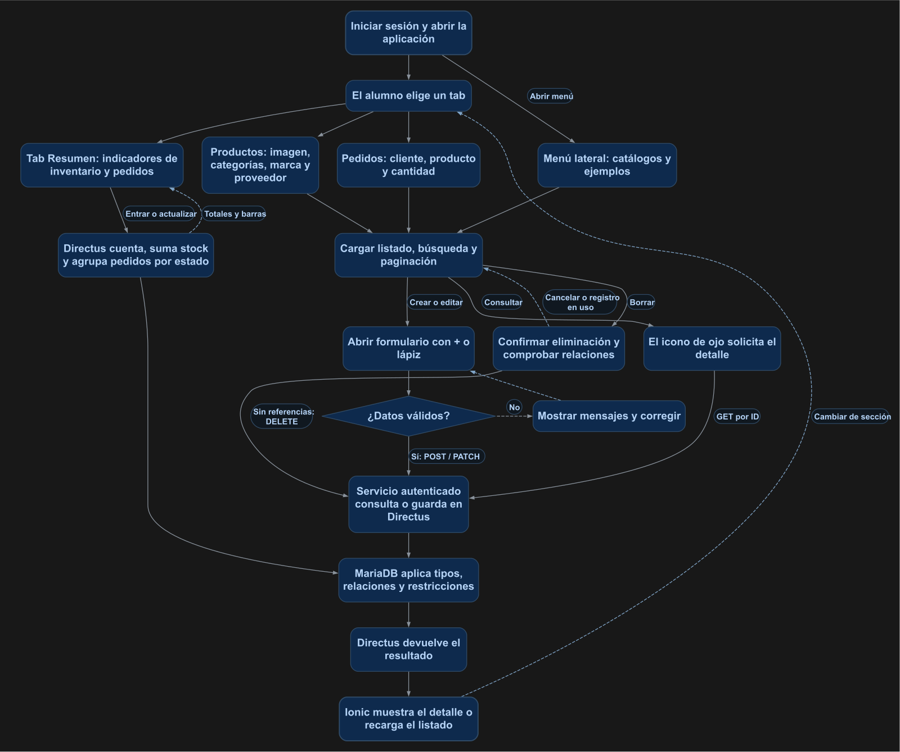<br>
  <em>Figura 19. Navegación y operaciones de las colecciones.</em>
</p>

### El contenedor y sus pantallas

El router principal carga TabsPage después de validar la sesión. ion-tabs utiliza el router de Ionic para mostrar las rutas hijas; ion-tab-bar contiene los tres botones. Dentro de Productos, las rutas de detalle y formulario comparten el prefijo /tabs/productos. Pedidos y Resumen tienen sus propias ramas y conservan su historial al cambiar de tab. Los catálogos se cargan mediante rutas protegidas de app-routing.module.ts, fuera de TabsPage. El menú lateral contiene sus accesos directos. Resumen consulta indicadores agregados y los representa mediante tarjetas y barras.

app.component mantiene el menú lateral y el punto de entrada principal. tabs.page.html muestra navegación; las consultas, formularios y acciones permanecen en sus páginas y servicios correspondientes.

### Configuración y reutilización

Cada entrada de COLECCIONES define una ruta pública, la tabla de Directus y los campos de la interfaz. El router asigna esa clave mediante data. buscarColeccion() obtiene una configuración conocida; el nombre de tabla que se consulta proviene de esa configuración.

ColeccionesFormPage crea los controles y validadores de cada campo. En edición consulta el registro y, para las relaciones, conserva el ID del objeto expandido. El formulario envía un objeto con los campos configurados; los campos automáticos no se incluyen. Los booleanos false, los ceros y los arreglos se conservan sin convertirlos en valores vacíos.

Productos utiliza sus páginas específicas para conservar carga de archivos y relaciones de categorías. Sus dos nuevas relaciones se consultan y guardan como IDs; el detalle muestra los nombres expandidos. Los formularios actualizan las opciones de sus catálogos al volver sin reiniciar los datos que el alumno está escribiendo.

### Consulta y guardado

ColeccionesService reutiliza auth.cliente. El listado y el conteo comparten filtro; la página controla búsqueda y paginación. Una respuesta anterior no reemplaza la búsqueda más reciente. Al volver al listado, ionViewWillEnter() consulta los datos otra vez.

El formulario valida antes de llamar al servicio. Con id ejecuta PATCH; sin id ejecuta POST y abre el detalle del registro devuelto. En pedidos envía cliente y producto como números. Al consultar, solicita cliente.nombre y producto.nombre, además de sus IDs. Directus añade fecha_creacion.

En ejemplos_campos, la creación busca el origen app_ionic y agrega estado pendiente y fecha_envio, como en el manual 17. La edición conserva esos campos al omitirlos del PATCH. El detalle muestra el estado, origen y ambas fechas.

### Eliminación y relaciones

La confirmación debe devolver el rol destructive para continuar. El servicio consulta si existen referencias al catálogo; cuando está en uso muestra el mensaje y conserva el registro. Si no tiene referencias envía DELETE y recarga la lista. Las llaves foráneas aplican RESTRICT para mantener la integridad de los registros.

La tabla productos_categorias representa los enlaces de muchos a muchos. Sus altas y bajas continúan dentro del formulario del producto. El catálogo categorías administra los nombres de las opciones, mientras el producto administra cuáles tiene asignadas.

Fuentes editables: [flujo de navegación DOT](recursos/flujos/18-tabs.dot), [Mermaid](recursos/flujos/18-tabs.mmd), [relaciones DOT](recursos/flujos/18-relaciones.dot), [Mermaid](recursos/flujos/18-relaciones.mmd) y [JSON de los diagramas](recursos/flujos/flujos.json).

Referencias: [navegación Angular de Ionic](https://ionicframework.com/docs/angular/navigation), [ion-tabs](https://ionicframework.com/docs/api/tabs) y [relaciones en Directus](https://directus.com/docs/guides/data-model/relationships).
