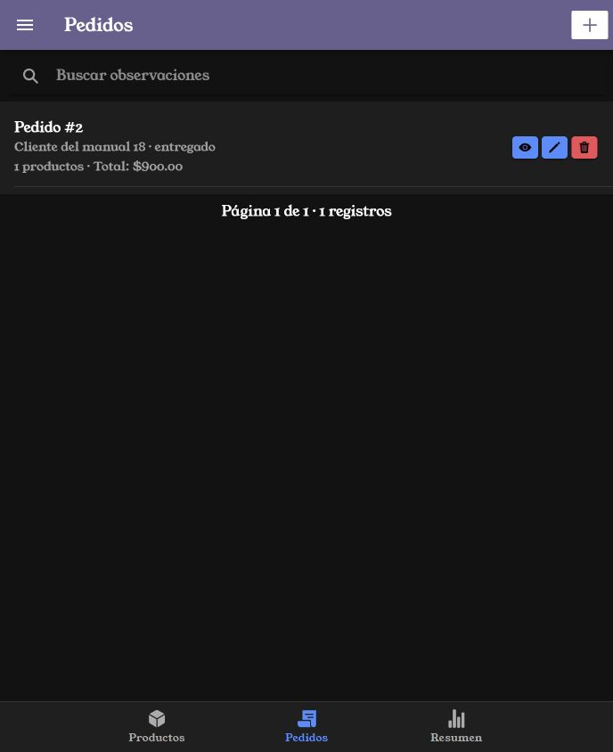
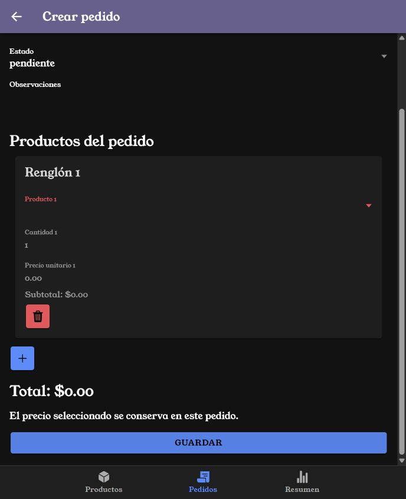
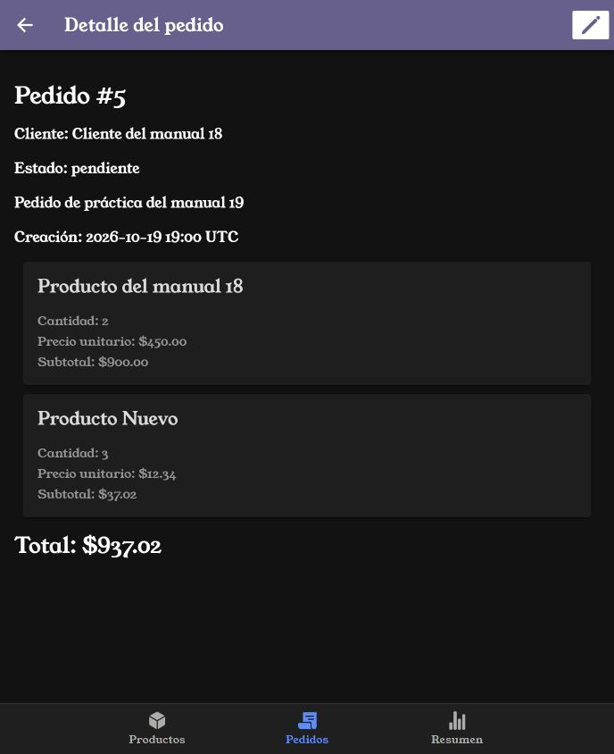
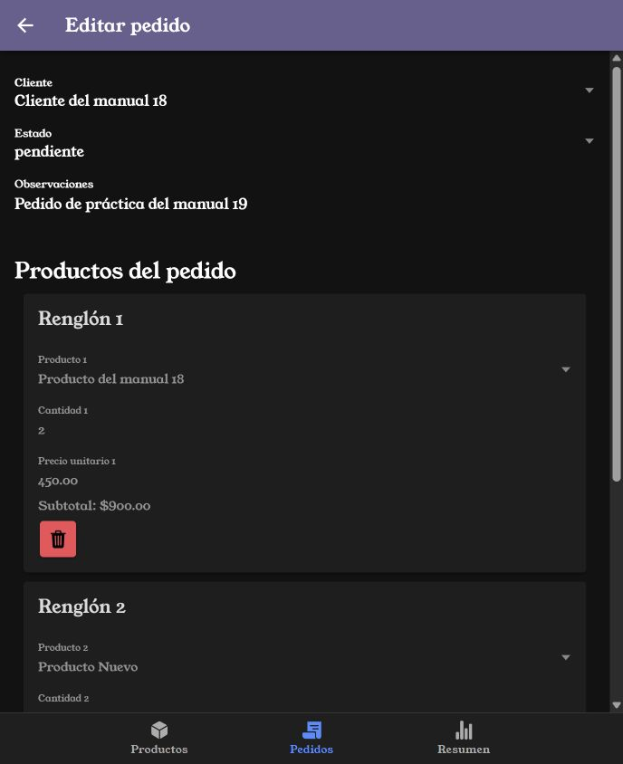
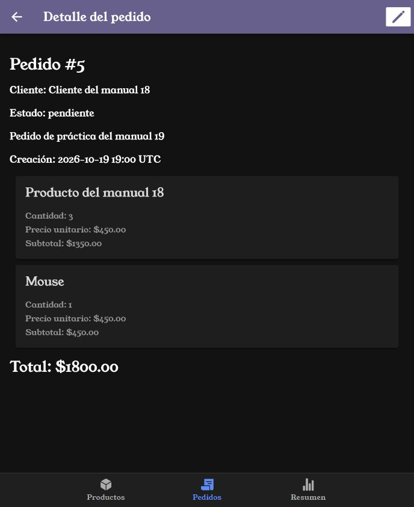
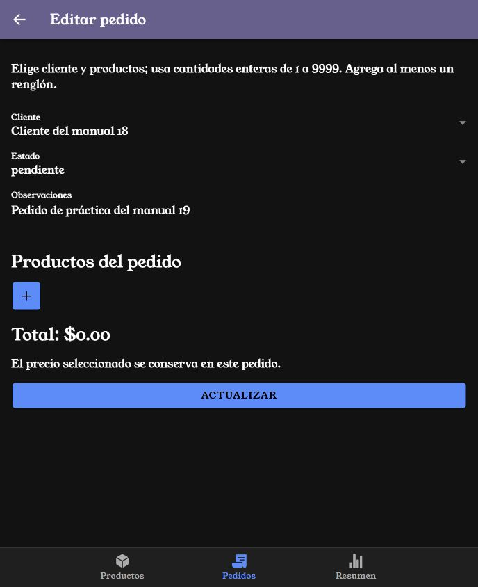
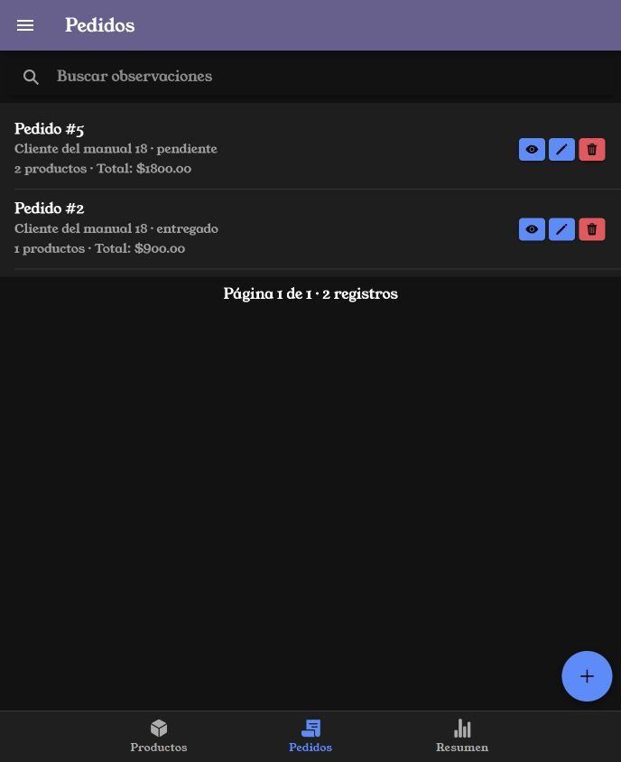
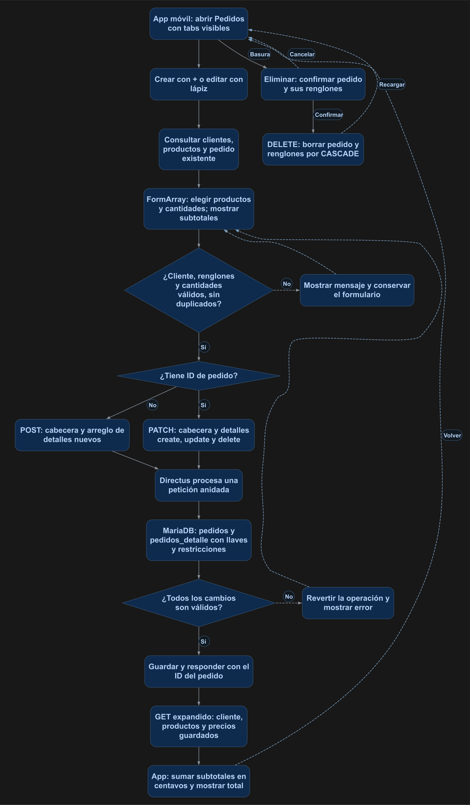

# Pedidos con varios productos, subtotales y total

Un pedido tendrá un cliente y varios renglones. Cada renglón guardará producto, cantidad y precio unitario. La app mostrará los subtotales y el total, y permitirá crear, consultar y actualizar todo desde un formulario.

## 1. Antes de comenzar

Completa el [manual 18](18_tabs_colecciones.md). Conserva AuthService, la guardia, los tabs, los productos, los clientes y el componente de paginación. Utiliza la aplicación Ionic y los servicios existentes del proyecto.

Esta práctica registra pedidos; guardar o eliminar un pedido no modifica el stock. Las capturas usan los registros de práctica de este entorno. Sus IDs pueden ser distintos en tu instalación: selecciona por nombre y envía el ID consultado.

## 2. Conceptos y métodos que utilizarás

| Elemento | Aplicación |
| --- | --- |
| pedidos | Encabezado: cliente, estado, observaciones y fecha de creación. |
| pedidos_detalle | Renglones: pedido, producto, cantidad y precio unitario. |
| detalles, alias O2M | Permite consultar y guardar los renglones desde pedidos. |
| FormArray | Contiene un FormGroup por producto del formulario. |
| push() / removeAt() | Agregan y retiran renglones del borrador. |
| patchValue() | Carga encabezado y valores de edición. |
| getRawValue() | Recupera los valores para preparar el objeto de guardado. |
| centavos() / importe() / dinero() | Convierten el precio a centavos enteros, suman subtotales y muestran dos decimales. |
| POST anidado | Crea el encabezado con todos sus renglones en una petición. |
| PATCH con create, update y delete | Agrega, modifica y elimina renglones al editar el pedido. |
| fields | Solicita cliente y productos relacionados junto con los precios guardados. |

**El precio del renglón es una copia del precio seleccionado.** Al cargar un pedido existente se recupera esa copia. Cambiar el precio del catálogo no cambia los pedidos guardados. Elegir otro producto en un renglón toma el precio actual de ese producto.

El subtotal es cantidad por precio unitario. El total es la suma de los subtotales. Se calculan a partir de los renglones; no se guardan como columnas adicionales.

## 3. Implementación paso a paso

### Paso 1. Crear la relación de encabezado y detalle

En Directus, crea la colección **pedidos_detalle** con estos campos:

| Campo | Configuración |
| --- | --- |
| id | Integer, clave primaria autoincremental. |
| pedido | Muchos a uno hacia pedidos.id, obligatorio. |
| producto | Muchos a uno hacia productos.id, obligatorio. |
| cantidad | Integer obligatorio, predeterminado 1; de 1 a 9999. |
| precio_unitario | Decimal(10,2), obligatorio y mayor o igual que cero. |

En la relación pedido configura **CASCADE** al eliminar y actualizar. En pedidos crea el alias **detalles**, Uno a muchos hacia pedidos_detalle.pedido, y configura la retirada del renglón como **delete**. En la relación producto usa **RESTRICT** al eliminar y **CASCADE** al actualizar. La definición exacta de colección, alias y relaciones está en [esquema.json](recursos/19_pedidos/esquema.json); sirve como referencia de configuración, no como importación de registros.

El esquema queda así:

| Origen | Relación | Destino |
| --- | --- | --- |
| clientes.id | Un cliente tiene varios pedidos | pedidos.cliente |
| pedidos.id | Un pedido tiene varios renglones | pedidos_detalle.pedido |
| productos.id | Un producto aparece en varios pedidos | pedidos_detalle.producto |

### Paso 2. Preparar restricciones, datos y permisos

Después de crear la colección y sus relaciones, ejecuta una vez el [SQL de migración](recursos/19_pedidos/migracion.sql) en la base conectada a Directus. Incluye restricciones de cantidad positiva, precio no negativo y producto único dentro de cada pedido.

El SQL conserva los encabezados existentes y crea un renglón por su producto. Para estos registros toma el **precio del catálogo en el momento de la migración**, porque el encabezado no guardaba una copia del precio. Después deja pedidos.producto y pedidos.cantidad vacíos y opcionales. Estas dos columnas se conservan para la transición; las nuevas pantallas utilizan pedidos_detalle. El pedido 2 del entorno se conservó como dos unidades a $450.00.

La copia de los datos se ejecuta dentro de START TRANSACTION y COMMIT. Las instrucciones ALTER TABLE anteriores modifican el esquema y no forman parte de esa transacción. Antes de aplicarlo a tus datos, conserva un respaldo y revisa que las cantidades existentes estén entre 1 y 9999.

En la política de la cuenta de práctica conserva Create/Read/Update/Delete sobre pedidos y agrega esos cuatro permisos sobre pedidos_detalle. Conserva Read sobre clientes y productos. No se necesita acceso administrativo en Ionic. Recarga el esquema del servicio existente:

```powershell
docker compose restart api
```

### Paso 3. Crear las pantallas y conectar las rutas

Genera pedidos-list, pedidos-form y pedidos-view. Agrega manualmente `standalone: false` en sus decoradores y decláralas en sus módulos. Copia los archivos completos del punto 4.

En tabs-routing.module.ts sustituye las rutas genéricas de pedidos por las cuatro rutas específicas: listado, formulario nuevo, formulario/:id y detalle/:id. Conserva los otros tabs y las rutas de catálogos. La barra inferior permanece visible en las tres pantallas del pedido.

La figura 1 muestra el listado antes del alta del ejemplo y el botón de creación en la barra. El ojo abre el detalle; el lápiz abre la edición.

<p align="center">
  <br>
  <em>Figura 1. Acceso al formulario desde el botón de barra.</em>
</p>

### Paso 4. Construir los renglones del formulario

pedidos-form.page.ts crea el FormArray detalles. Cada FormGroup contiene id, producto, cantidad y precio_unitario. agregar() introduce un renglón; quitar() lo retira del borrador. El botón de basura del renglón no envía DELETE por separado: la baja se incluye al guardar el pedido.

El formulario consulta los clientes y productos disponibles. Al elegir un producto copia su precio; el precio se muestra de solo lectura. Los selectores usan IDs numéricos. Al editar, los productos expandidos se convierten a sus IDs para recuperar las selecciones.

Valida cliente, producto, cantidades enteras de 1 a 9999 y al menos un renglón. El servicio rechaza productos repetidos. La figura 2 muestra el rechazo de un formulario incompleto.

<p align="center">
  <br>
  <em>Figura 2. Completa cliente, productos y cantidades antes de guardar.</em>
</p>

### Paso 5. Crear y consultar el pedido completo

Captura el encabezado y agrega dos productos. El ejemplo utiliza dos unidades de Producto del manual 18 a $450.00 y tres de Producto Nuevo a $12.34: $900.00 + $37.02 = **$937.02**.

El cuerpo de creación tiene esta estructura; usa los IDs consultados en tu instalación:

```json
{
  "cliente": 3,
  "estado": "pendiente",
  "observaciones": "Pedido de práctica del manual 19",
  "detalles": [
    { "producto": 16, "cantidad": 2, "precio_unitario": "450.00" },
    { "producto": 3, "cantidad": 3, "precio_unitario": "12.34" }
  ]
}
```

PedidosService envía un solo POST a /items/pedidos. Directus crea el encabezado y sus hijos; añade fecha_creacion sin recibirla del formulario. La app abre el ID devuelto y hace GET con fields para mostrar nombres, cantidades y precios. La figura 3 muestra el pedido 5 creado desde Ionic.

<p align="center">
  <br>
  <em>Figura 3. Detalle del pedido creado y total calculado desde sus renglones.</em>
</p>

### Paso 6. Actualizar cantidades y productos

El lápiz recupera el encabezado y cada detalle con su ID y precio guardado. La figura 4 muestra el formulario de edición antes de modificarlo.

<p align="center">
  <br>
  <em>Figura 4. Renglones cargados para editar el pedido.</em>
</p>

Al guardar, el servicio prepara detalles.create con los renglones nuevos, detalles.update con los que tienen ID y detalles.delete con los IDs retirados. Envía un solo PATCH a /items/pedidos/:id. El detalle que se mantiene conserva su ID.

En la prueba se cambió la cantidad del primer producto de 2 a 3, se quitó Producto Nuevo y se agregó Mouse, una unidad a $450.00. El resultado fue **$1,800.00**, como muestra la figura 5. La [respuesta real de la API](recursos/19_pedidos/pedido-5.json) conserva las relaciones y precios consultados después de actualizar.

<p align="center">
  <br>
  <em>Figura 5. Cambio de cantidad, baja de un renglón y alta de otro.</em>
</p>

Quitar todos los renglones y pulsar Actualizar debe mostrar la validación de la figura 6. Volver sin guardar conserva el pedido persistido.

<p align="center">
  <br>
  <em>Figura 6. El formulario exige al menos un producto.</em>
</p>

### Paso 7. Elegir botón de barra o botón flotante

En pedidos-list.page.ts elige **usarBotonFlotante = false** para la variante de la figura 1 o **true** para la figura 7. El HTML incluye ambas con condiciones para mostrar solo una. El icono + abre el mismo formulario; los botones de ojo y lápiz mantienen fill="solid" explícito. ion-fab-button tiene relleno sólido.

<p align="center">
  <br>
  <em>Figura 7. Variante flotante de creación; elige una ubicación.</em>
</p>

### Paso 8. Eliminar el pedido y sus renglones

La basura del listado abre una confirmación. Cancelar conserva el pedido. Confirmar envía DELETE al encabezado; la relación con CASCADE elimina sus renglones. Los productos y el cliente se conservan. La baja completa se comprobó por API con un pedido temporal; en Ionic se comprobó la cancelación sobre el ejemplo conservado.

## 4. Código completo de referencia

### `mobile/src/app/services/pedidos.ts`

```typescript
import { Injectable } from '@angular/core';
import { AuthService } from './auth';
export interface LineaPedido { id: number; producto: { id: number; nombre: string }; cantidad: number; precio_unitario: string; }
export interface Pedido { id: number; cliente: { id: number; nombre: string }; estado: string; observaciones: string | null; fecha_creacion: string; detalles: LineaPedido[]; }
export interface LineaGuardar { id?: number; producto: number; cantidad: number; precio_unitario: string; }
export interface PedidoGuardar { cliente: number; estado: string; observaciones: string | null; detalles: LineaGuardar[]; }
// Los cálculos se hacen con centavos enteros; el precio se guarda como decimal.
export function centavos(precio: string | number): number {
  const texto = String(precio);
  if (!/^\d{1,8}(\.\d{1,2})?$/.test(texto)) throw new Error('Precio inválido.');
  const [entero, decimal = ''] = texto.split('.');
  return Number(entero) * 100 + Number(decimal.padEnd(2, '0'));
}
export function importe(lineas: { cantidad: number; precio_unitario: string }[]): number {
  return lineas.reduce((total, linea) => total + Number(linea.cantidad) * centavos(linea.precio_unitario), 0);
}
export function dinero(valor: number): string { return (valor / 100).toFixed(2); }
@Injectable({ providedIn: 'root' })
export class PedidosService {
  constructor(private auth: AuthService) {}
  private fields = 'id,cliente.id,cliente.nombre,estado,observaciones,fecha_creacion,detalles.id,detalles.producto.id,detalles.producto.nombre,detalles.cantidad,detalles.precio_unitario';
  async catalogos(): Promise<{ clientes: { id: number; nombre: string }[]; productos: { id: number; nombre: string; precio: string }[] }> {
    const [clientes, productos] = await Promise.all([
      this.auth.cliente.get('/items/clientes', { params: { fields: 'id,nombre', sort: 'nombre', limit: -1 } }),
      this.auth.cliente.get('/items/productos', { params: { fields: 'id,nombre,precio', sort: 'nombre', limit: -1 } })
    ]);
    return { clientes: clientes.data.data, productos: productos.data.data };
  }
  async listado(pagina: number, texto: string): Promise<{ registros: Pedido[]; total: number }> {
    const filtro = texto.trim() ? { 'filter[observaciones][_icontains]': texto.trim() } : {};
    const [lista, total] = await Promise.all([
      this.auth.cliente.get<{ data: Pedido[] }>('/items/pedidos', { params: { fields: this.fields, page: pagina, limit: 3, sort: '-id', ...filtro } }),
      this.auth.cliente.get('/items/pedidos', { params: { 'aggregate[count]': '*', ...filtro } })
    ]);
    return { registros: lista.data.data, total: Number(total.data.data[0]?.count ?? 0) };
  }
  async detalle(id: number): Promise<Pedido> {
    return (await this.auth.cliente.get<{ data: Pedido }>('/items/pedidos/' + id, { params: { fields: this.fields } })).data.data;
  }
  async guardar(datos: PedidoGuardar, id?: number, anteriores: number[] = []): Promise<number> {
    if (!datos.detalles.length) throw new Error('Agrega al menos un producto.');
    if (new Set(datos.detalles.map(l => l.producto)).size !== datos.detalles.length) throw new Error('Cada producto debe aparecer una sola vez.');
    for (const l of datos.detalles) {
      if (!Number.isInteger(l.cantidad) || l.cantidad < 1 || l.cantidad > 9999) throw new Error('Cantidad inválida.');
      centavos(l.precio_unitario);
    }
    const { detalles, ...cabecera } = datos;
    // Una sola petición anidada: Directus guarda cabecera e hijos conjuntamente.
    const cuerpo = id === undefined ? { ...cabecera, detalles: detalles.map(({ id: ignorado, ...l }) => l) }
      : { ...cabecera, detalles: {
        create: detalles.filter(l => !l.id).map(({ id: ignorado, ...l }) => l),
        update: detalles.filter(l => !!l.id),
        delete: anteriores.filter(anterior => !detalles.some(l => l.id === anterior))
      } };
    const r = id === undefined ? await this.auth.cliente.post('/items/pedidos', cuerpo) : await this.auth.cliente.patch('/items/pedidos/' + id, cuerpo);
    return r.data.data.id;
  }
  async eliminar(id: number): Promise<void> { await this.auth.cliente.delete('/items/pedidos/' + id); }
}
```

### `mobile/src/app/pedidos-list/pedidos-list.page.ts`

```typescript
import { Component } from '@angular/core';
import { AlertController } from '@ionic/angular';
import { dinero, importe, Pedido, PedidosService } from '../services/pedidos';
@Component({ selector: 'app-pedidos-list', templateUrl: './pedidos-list.page.html', standalone: false })
export class PedidosListPage {
  registros: Pedido[] = []; total = 0; pagina = 1; texto = ''; mensaje = ''; dinero = dinero; importe = importe;
  readonly usarBotonFlotante = false; private solicitud = 0;
  constructor(private servicio: PedidosService, private alertas: AlertController) {}
  ionViewWillEnter(): void { void this.cargar(); }
  async cargar(): Promise<void> { const n = ++this.solicitud; this.mensaje = ''; try { const r = await this.servicio.listado(this.pagina, this.texto); if(n !== this.solicitud) return; this.registros = r.registros; this.total = r.total; if(this.pagina > 1 && !r.registros.length) {this.pagina--; await this.cargar();} } catch { if(n === this.solicitud) {this.registros = []; this.total = 0; this.mensaje = 'No se pudieron consultar los pedidos.';} } }
  buscar(e: CustomEvent): void { this.texto = e.detail.value ?? ''; this.pagina = 1; void this.cargar(); }
  async eliminar(p: Pedido): Promise<void> {
    const alerta = await this.alertas.create({ header: 'Eliminar pedido', message: 'Se eliminarán el pedido y sus renglones.', buttons: [{ text: 'Cancelar', role: 'cancel' }, { text: 'Eliminar', role: 'destructive' }] });
    await alerta.present(); if((await alerta.onDidDismiss()).role !== 'destructive') return;
    try { await this.servicio.eliminar(p.id); await this.cargar(); } catch { this.mensaje = 'No se pudo eliminar el pedido.'; }
  }
}
```

### `mobile/src/app/pedidos-list/pedidos-list.page.html`

```html
<ion-header><ion-toolbar color="personalizado"><ion-buttons slot="start"><ion-menu-button></ion-menu-button></ion-buttons><ion-title>Pedidos</ion-title><ion-buttons slot="end" *ngIf="!usarBotonFlotante"><ion-button fill="solid" routerLink="/tabs/pedidos/formulario" aria-label="Crear pedido"><ion-icon slot="icon-only" name="add"></ion-icon></ion-button></ion-buttons></ion-toolbar></ion-header>
<ion-content><ion-searchbar aria-label="Buscar pedidos" placeholder="Buscar observaciones" [value]="texto" [debounce]="300" (ionInput)="buscar($event)"></ion-searchbar><p *ngIf="mensaje" class="ion-padding" role="status">{{ mensaje }}</p>
  <ion-list><ion-item *ngFor="let p of registros"><ion-label class="ion-text-wrap"><h2>Pedido #{{ p.id }}</h2><p>{{ p.cliente.nombre }} · {{ p.estado }}</p><p>{{ p.detalles.length }} productos · Total: ${{ dinero(importe(p.detalles)) }}</p></ion-label><ion-button fill="solid" [routerLink]="['/tabs/pedidos/detalle', p.id]" aria-label="Ver detalle"><ion-icon slot="icon-only" name="eye"></ion-icon></ion-button><ion-button fill="solid" [routerLink]="['/tabs/pedidos/formulario', p.id]" aria-label="Editar pedido"><ion-icon slot="icon-only" name="pencil"></ion-icon></ion-button><ion-button fill="solid" color="danger" (click)="eliminar(p)" aria-label="Eliminar pedido"><ion-icon slot="icon-only" name="trash"></ion-icon></ion-button></ion-item></ion-list>
  <app-paginacion [total]="total" [porPagina]="3" [paginaActual]="pagina" (paginaCambio)="pagina = $event; cargar()"></app-paginacion>
  <ion-fab *ngIf="usarBotonFlotante" slot="fixed" vertical="bottom" horizontal="end"><ion-fab-button routerLink="/tabs/pedidos/formulario" aria-label="Crear pedido"><ion-icon name="add"></ion-icon></ion-fab-button></ion-fab>
</ion-content>
```

### `mobile/src/app/pedidos-list/pedidos-list.module.ts`

```typescript
import { NgModule } from '@angular/core';
import { CommonModule } from '@angular/common';
import { IonicModule } from '@ionic/angular';
import { RouterModule } from '@angular/router';
import { PaginacionModule } from '../components/paginacion/paginacion.module';
import { PedidosListPage } from './pedidos-list.page';
@NgModule({ declarations: [PedidosListPage], imports: [CommonModule, IonicModule, PaginacionModule, RouterModule.forChild([{ path: '', component: PedidosListPage }])] })
export class PedidosListPageModule {}
```

### `mobile/src/app/pedidos-form/pedidos-form.page.ts`

```typescript
import { Component } from '@angular/core';
import { ActivatedRoute, Router } from '@angular/router';
import { FormArray, FormBuilder, FormControl, FormGroup, Validators } from '@angular/forms';
import { centavos, dinero, importe, LineaGuardar, PedidosService } from '../services/pedidos';
type Fila = FormGroup<{ id: FormControl<number | null>; producto: FormControl<number | null>; cantidad: FormControl<number | null>; precio_unitario: FormControl<string | null> }>;
@Component({ selector: 'app-pedidos-form', templateUrl: './pedidos-form.page.html', standalone: false })
export class PedidosFormPage {
  id?: number; anteriores: number[] = []; cargando = true; guardando = false; mensaje = '';
  clientes: { id: number; nombre: string }[] = []; productos: { id: number; nombre: string; precio: string }[] = [];
  estados = ['pendiente', 'entregado', 'cancelado'];
  form = this.fb.group({ cliente: [0, Validators.min(1)], estado: ['pendiente', Validators.required], observaciones: [''], detalles: this.fb.array<Fila>([]) });
  get filas(): FormArray<Fila> { return this.form.controls.detalles; }
  private seleccion = new Map<Fila, number>();
  constructor(private fb: FormBuilder, private servicio: PedidosService, private route: ActivatedRoute, private router: Router) {}
  async ngOnInit(): Promise<void> {
    try {
      const id = this.route.snapshot.paramMap.get('id'); this.id = id === null ? undefined : Number(id);
      const catalogos = await this.servicio.catalogos(); this.clientes = catalogos.clientes; this.productos = catalogos.productos;
      if (this.id === undefined) this.agregar();
      else {
        const p = await this.servicio.detalle(this.id);
        this.form.patchValue({ cliente: p.cliente.id, estado: p.estado, observaciones: p.observaciones ?? '' });
        this.anteriores = p.detalles.map(l => l.id);
        for (const l of p.detalles) this.agregar({ id: l.id, producto: l.producto.id, cantidad: l.cantidad, precio_unitario: l.precio_unitario });
      }
    } catch { this.mensaje = 'No se pudieron cargar el pedido y sus catálogos.'; }
    finally { this.cargando = false; }
  }
  agregar(linea?: LineaGuardar): void {
    const fila = this.fb.group({ id: [linea?.id ?? 0], producto: [linea?.producto ?? 0, Validators.min(1)], cantidad: [linea?.cantidad ?? 1, [Validators.required, Validators.min(1), Validators.max(9999), Validators.pattern(/^\d+$/)]], precio_unitario: [linea?.precio_unitario ?? '0.00', [Validators.required, Validators.pattern(/^\d{1,8}(\.\d{1,2})?$/)]] });
    this.filas.push(fila); this.seleccion.set(fila, linea?.producto ?? 0);
  }
  quitar(i: number): void { this.seleccion.delete(this.filas.at(i)); this.filas.removeAt(i); }
  seleccionar(i: number, id: number): void {
    const fila = this.filas.at(i);
    if (this.seleccion.get(fila) === Number(id)) return;
    const producto = this.productos.find(p => p.id === Number(id));
    fila.patchValue({ precio_unitario: producto?.precio ?? '0.00' }); this.seleccion.set(fila, Number(id));
  }
  subtotal(i: number): string {
    try { const l = this.filas.at(i).getRawValue(); return dinero(Number(l.cantidad) * centavos(l.precio_unitario ?? '0.00')); } catch { return '—'; }
  }
  get total(): string { try { return dinero(importe(this.filas.getRawValue().map(l => ({ cantidad: Number(l.cantidad), precio_unitario: l.precio_unitario ?? '0.00' })))); } catch { return '—'; } }
  async guardar(): Promise<void> {
    if (this.guardando || this.cargando) return;
    this.mensaje = '';
    if (this.form.invalid || !this.filas.length) { this.form.markAllAsTouched(); this.mensaje = 'Elige cliente y productos; usa cantidades enteras de 1 a 9999. Agrega al menos un renglón.'; return; }
    this.guardando = true;
    try {
      const v = this.form.getRawValue();
      const id = await this.servicio.guardar({ cliente: Number(v.cliente), estado: v.estado!, observaciones: v.observaciones?.trim() || null,
        detalles: v.detalles.map(l => ({ ...(l.id ? { id: Number(l.id) } : {}), producto: Number(l.producto), cantidad: Number(l.cantidad), precio_unitario: String(l.precio_unitario) })) }, this.id, this.anteriores);
      await this.router.navigateByUrl('/tabs/pedidos/detalle/' + id, { replaceUrl: true });
    } catch (e: any) { this.mensaje = e.response ? 'No se pudo guardar. Revisa productos repetidos, datos y conexión.' : e.message; }
    finally { this.guardando = false; }
  }
}
```

### `mobile/src/app/pedidos-form/pedidos-form.page.html`

```html
<ion-header><ion-toolbar color="personalizado"><ion-buttons slot="start"><ion-back-button defaultHref="/tabs/pedidos"></ion-back-button></ion-buttons><ion-title>{{ id === undefined ? 'Crear pedido' : 'Editar pedido' }}</ion-title></ion-toolbar></ion-header>
<ion-content class="ion-padding">
  <p *ngIf="cargando">Cargando...</p><p *ngIf="mensaje" role="status">{{ mensaje }}</p>
  <form *ngIf="!cargando" [formGroup]="form" (ngSubmit)="guardar()">
    <ion-select label="Cliente" labelPlacement="stacked" formControlName="cliente" interface="alert"><ion-select-option *ngFor="let c of clientes" [value]="c.id">{{ c.nombre }}</ion-select-option></ion-select>
    <ion-select label="Estado" labelPlacement="stacked" formControlName="estado" interface="popover"><ion-select-option *ngFor="let e of estados" [value]="e">{{ e }}</ion-select-option></ion-select>
    <ion-textarea label="Observaciones" labelPlacement="stacked" formControlName="observaciones"></ion-textarea>
    <h2>Productos del pedido</h2>
    <div formArrayName="detalles"><ion-card *ngFor="let fila of filas.controls; let i = index" [formGroupName]="i">
      <ion-card-header><ion-card-title>Renglón {{ i + 1 }}</ion-card-title></ion-card-header><ion-card-content>
        <ion-select [label]="'Producto ' + (i + 1)" labelPlacement="stacked" formControlName="producto" interface="alert" (ionChange)="seleccionar(i, $event.detail.value)"><ion-select-option *ngFor="let p of productos" [value]="p.id">{{ p.nombre }}</ion-select-option></ion-select>
        <ion-input [label]="'Cantidad ' + (i + 1)" labelPlacement="stacked" type="number" min="1" max="9999" step="1" formControlName="cantidad"></ion-input>
        <ion-input [label]="'Precio unitario ' + (i + 1)" labelPlacement="stacked" formControlName="precio_unitario" readonly></ion-input>
        <p>Subtotal: ${{ subtotal(i) }}</p>
        <ion-button fill="solid" color="danger" type="button" [attr.aria-label]="'Quitar renglón ' + (i + 1)" (click)="quitar(i)"><ion-icon slot="icon-only" name="trash"></ion-icon></ion-button>
      </ion-card-content></ion-card></div>
    <ion-button fill="solid" type="button" aria-label="Agregar producto" (click)="agregar()"><ion-icon slot="icon-only" name="add"></ion-icon></ion-button>
    <h2>Total: ${{ total }}</h2><p>El precio seleccionado se conserva en este pedido.</p>
    <ion-button fill="solid" expand="block" type="submit" [disabled]="guardando">{{ guardando ? 'Guardando...' : id === undefined ? 'Guardar' : 'Actualizar' }}</ion-button>
  </form>
</ion-content>
```

### `mobile/src/app/pedidos-form/pedidos-form.module.ts`

```typescript
import { NgModule } from '@angular/core';
import { CommonModule } from '@angular/common';
import { IonicModule } from '@ionic/angular';
import { ReactiveFormsModule } from '@angular/forms';
import { RouterModule } from '@angular/router';
import { PedidosFormPage } from './pedidos-form.page';
@NgModule({ declarations: [PedidosFormPage], imports: [CommonModule, IonicModule, ReactiveFormsModule, RouterModule.forChild([{ path: '', component: PedidosFormPage }])] })
export class PedidosFormPageModule {}
```

### `mobile/src/app/pedidos-view/pedidos-view.page.ts`

```typescript
import { Component } from '@angular/core';
import { ActivatedRoute } from '@angular/router';
import { dinero, importe, Pedido, PedidosService } from '../services/pedidos';
@Component({ selector: 'app-pedidos-view', templateUrl: './pedidos-view.page.html', standalone: false })
export class PedidosViewPage {
  pedido: Pedido | null = null; mensaje = ''; dinero = dinero; importe = importe;
  constructor(private servicio: PedidosService, private route: ActivatedRoute) {}
  async ionViewWillEnter(): Promise<void> { this.pedido = null; this.mensaje = ''; try { this.pedido = await this.servicio.detalle(Number(this.route.snapshot.paramMap.get('id'))); } catch { this.mensaje = 'No se pudo cargar el pedido.'; } }
}
```

### `mobile/src/app/pedidos-view/pedidos-view.page.html`

```html
<ion-header><ion-toolbar color="personalizado"><ion-buttons slot="start"><ion-back-button defaultHref="/tabs/pedidos"></ion-back-button></ion-buttons><ion-title>Detalle del pedido</ion-title><ion-buttons slot="end"><ion-button *ngIf="pedido" fill="solid" [routerLink]="['/tabs/pedidos/formulario', pedido.id]" aria-label="Editar pedido"><ion-icon slot="icon-only" name="pencil"></ion-icon></ion-button></ion-buttons></ion-toolbar></ion-header>
<ion-content class="ion-padding"><p *ngIf="mensaje" role="status">{{ mensaje }}</p><ng-container *ngIf="pedido as p">
  <h1>Pedido #{{ p.id }}</h1><p>Cliente: {{ p.cliente.nombre }}</p><p>Estado: {{ p.estado }}</p><p>{{ p.observaciones }}</p><p>Creación: {{ p.fecha_creacion | date:'yyyy-MM-dd HH:mm':'UTC' }} UTC</p>
  <ion-card *ngFor="let l of p.detalles"><ion-card-header><ion-card-title>{{ l.producto.nombre }}</ion-card-title></ion-card-header><ion-card-content><p>Cantidad: {{ l.cantidad }}</p><p>Precio unitario: ${{ l.precio_unitario }}</p><p>Subtotal: ${{ dinero(importe([l])) }}</p></ion-card-content></ion-card>
  <h2>Total: ${{ dinero(importe(p.detalles)) }}</h2>
</ng-container></ion-content>
```

### `mobile/src/app/pedidos-view/pedidos-view.module.ts`

```typescript
import { NgModule } from '@angular/core';
import { CommonModule } from '@angular/common';
import { IonicModule } from '@ionic/angular';
import { RouterModule } from '@angular/router';
import { PedidosViewPage } from './pedidos-view.page';
@NgModule({ declarations: [PedidosViewPage], imports: [CommonModule, IonicModule, RouterModule.forChild([{ path: '', component: PedidosViewPage }])] })
export class PedidosViewPageModule {}
```

### `mobile/src/app/tabs/tabs-routing.module.ts`

```typescript
import { NgModule } from '@angular/core';
import { RouterModule, Routes } from '@angular/router';
import { TabsPage } from './tabs.page';
import { COLECCIONES } from '../catalogos/colecciones.config';
import { authGuard } from '../guard/auth.guard';
import { rutasColeccion } from '../catalogos/rutas-coleccion';
const routes: Routes = [{ path: '', component: TabsPage, canActivateChild: [authGuard], children: [
  { path: 'productos/formulario', loadChildren: () => import('../productos-form/productos-form.module').then(m => m.ProductosFormPageModule) },
  { path: 'productos/detalle/:id', loadChildren: () => import('../productos-view/productos-view.module').then(m => m.ProductosViewPageModule) },
  { path: 'productos/imagen/:id', loadChildren: () => import('../producto-imagen/producto-imagen.module').then(m => m.ProductoImagenPageModule) },
  { path: 'productos', loadChildren: () => import('../productos-list/productos-list.module').then(m => m.ProductosListPageModule) },
  { path: 'pedidos/formulario/:id', loadChildren: () => import('../pedidos-form/pedidos-form.module').then(m => m.PedidosFormPageModule) },
  { path: 'pedidos/formulario', loadChildren: () => import('../pedidos-form/pedidos-form.module').then(m => m.PedidosFormPageModule) },
  { path: 'pedidos/detalle/:id', loadChildren: () => import('../pedidos-view/pedidos-view.module').then(m => m.PedidosViewPageModule) },
  { path: 'pedidos', loadChildren: () => import('../pedidos-list/pedidos-list.module').then(m => m.PedidosListPageModule) },
  { path: 'resumen', loadChildren: () => import('../resumen/resumen.module').then(m => m.ResumenPageModule) },
  ...COLECCIONES.filter(c => c.tabla !== 'pedidos').reduce<Routes>((rutas, c) => [...rutas, ...rutasColeccion('catalogos/' + c.ruta, c.ruta)], []),
  { path: 'catalogos', redirectTo: 'resumen', pathMatch: 'full' },
  { path: 'tab1', redirectTo: 'productos', pathMatch: 'full' },
  { path: 'tab2', redirectTo: 'pedidos', pathMatch: 'full' },
  { path: 'tab3', redirectTo: 'resumen', pathMatch: 'full' },
  { path: '', redirectTo: 'productos', pathMatch: 'full' }
]}];
@NgModule({ imports: [RouterModule.forChild(routes)], exports: [RouterModule] })
export class TabsPageRoutingModule {}
```


## 5. Comprobar el resultado

Compila la aplicación existente:

```powershell
docker compose exec mobile npx ng build --configuration development
```

1. Comprueba que el pedido migrado conserva cliente, estado, producto y cantidad.
2. Abre Crear pedido. Guardar vacío debe mostrar la validación. Cantidad cero y ningún renglón también deben rechazarse.
3. Crea dos productos en el mismo pedido y comprueba subtotales y total con centavos. Vuelve a consultar el detalle.
4. Edita cantidad, quita un producto y agrega otro. Comprueba nombres, precios, total y persistencia.
5. Intenta repetir un producto en otro renglón: el servicio debe rechazarlo antes de enviar el pedido.
6. Comprueba por separado + en barra y + flotante. Conserva solo una variante.
7. Cancela una eliminación y comprueba que sigue el pedido. Para probar la confirmación utiliza un pedido temporal de práctica y comprueba que sus productos permanecen.
8. Entra a Resumen y cambia entre los tabs; la navegación debe seguir disponible.

**Pruebas ejecutadas:** compilación de desarrollo correcta; pedido 2 migrado; pedido 5 creado desde Ionic por $937.02 y actualizado por $1,800.00; carga de precios y renglones; validaciones de vacío, cero, duplicados y ausencia de renglones. El [registro de pruebas](recursos/19_pedidos/pruebas.json) separa las comprobaciones de interfaz y API.

En la API se probaron creación anidada, actualización con create/update/delete, precio histórico después de cambiar el catálogo, eliminación en cascada y rechazo de precio negativo y producto duplicado. Un POST y un PATCH con cantidad cero revirtieron el encabezado y los detalles. En esta versión de Directus algunas restricciones de MariaDB devuelven HTTP 500 genérico; la app valida antes de enviar y conserva el formulario si falla el guardado.

Los precios enviados se guardan como Decimal(10,2); la copia inicial se obtiene del catálogo desde la app. El total se calcula en centavos enteros. La validación de al menos un producto se realiza en la app. Las pruebas corresponden a Ionic en navegador, no a una instalación Android.

## 6. Explicación detallada del flujo

La figura 8 muestra el recorrido de creación, edición, consulta y eliminación, con ramas de validación y retorno al formulario. El PNG permite ver el diagrama en lectores Markdown móviles.

<p align="center">
  <br>
  <em>Figura 8. Del formulario con renglones al guardado y consulta del pedido.</em>
</p>

**Formulario y precios.** La pantalla carga clientes y productos. En edición también consulta el pedido y expande sus detalles. El FormArray representa los renglones visibles. La selección de un producto copia su precio; la carga inicial de edición conserva la copia guardada. El seguimiento de la selección evita reemplazarla al recibir el mismo producto.

**Validación y cálculo.** Cada grupo valida su producto, cantidad y formato del precio. El formulario exige cliente y al menos un renglón; el servicio comprueba que no se repitan productos. centavos() convierte, por ejemplo, 12.34 en 1234; importe() suma cantidad por centavos y dinero() presenta dos decimales.

**Creación y actualización.** Sin ID se envía POST con un arreglo de detalles. Con ID se envía PATCH con create, update y delete. La operación anidada evita guardar primero un encabezado y después enviar una petición por cada renglón. Las pruebas inválidas mostraron que Directus revirtió todos los cambios de esa operación.

**Consulta.** Después de guardar se consulta el ID retornado. fields obtiene cliente.nombre, detalles.producto.nombre y los precios unitarios persistidos. La app calcula los subtotales y el total con esos valores; no vuelve a tomar los precios del catálogo para un pedido existente.

**Eliminación y navegación.** La confirmación precede al DELETE. CASCADE retira los renglones del pedido; RESTRICT protege los productos referenciados. Las pantallas permanecen dentro de TabsPage, con Productos, Pedidos y Resumen visibles. Al regresar al listado, ionViewWillEnter() recarga sus datos.

Fuentes editables: [DOT](recursos/flujos/19-pedidos.dot), [Mermaid](recursos/flujos/19-pedidos.mmd) y [JSON de los flujos](recursos/flujos/flujos.json).
